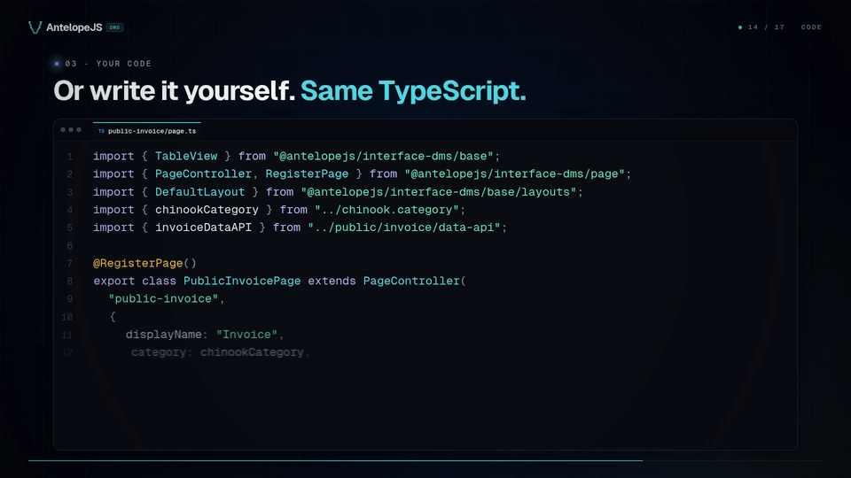
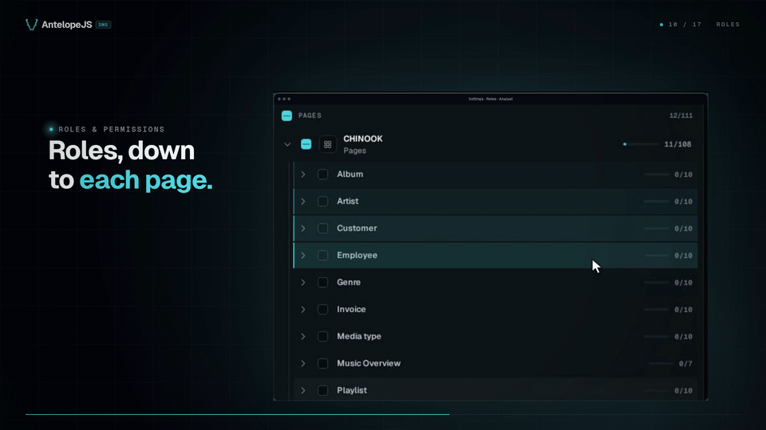
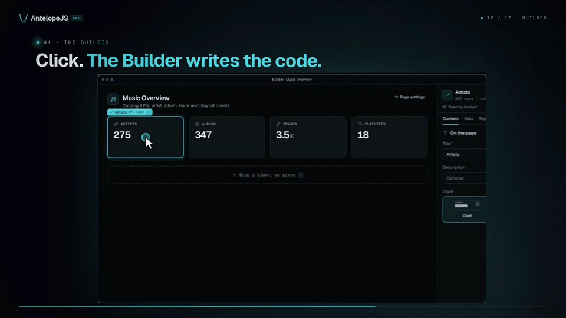

<div align="center">

<picture>
  <source media="(prefers-color-scheme: dark)" srcset="./packages/dms/frontend-vue/layers/dms-layout/public/images/antelope-logo/dark.svg">
  
</picture>

# AntelopeJS DMS

<a href="https://www.npmjs.com/package/@antelopejs/dms"></a>
<a href="./LICENSE"></a>
<a href="https://discord.gg/g4pFt6eXqu"></a>
<a href="https://dms.antelopejs.com/docs"></a>

**Plug in your PostgreSQL, MongoDB or RethinkDB database. Your coding agent writes the back office and an analytics dashboard as typed TypeScript in your repository.**

Open source under Apache-2.0. Self-hosted today.

[Docs](https://dms.antelopejs.com/docs) · [Quick start](https://dms.antelopejs.com/docs/getting-started/quickstart) · [Discord](https://discord.gg/g4pFt6eXqu)

</div>


[Watch the full Meet AntelopeJS DMS video (72 seconds)](./docs/media/meet.mp4)

## Try it in one command

### Try it on a sample database

You need Docker with Compose v2 and git.

```bash
git clone https://github.com/AntelopeJS/template-dms-connect-demo.git
cd template-dms-connect-demo
docker compose up
```

[`template-dms-connect-demo`](https://github.com/AntelopeJS/template-dms-connect-demo) is a demo for trying the Connect flow. The stack starts the DMS, a MongoDB for the DMS's own data, and a PostgreSQL database filled with the Chinook sample (a music store with 11 tables). The command chooses the sample database. To get the same data in MongoDB or RethinkDB, run `docker compose --profile mongodb up` or `docker compose --profile rethinkdb up` instead. On one Linux machine the dashboard was ready after about 2 minutes from a cold start and after about 1 minute with the images and packages cached.

The demo uses placeholder secrets, so keep its ports on your own machine.

Open [http://localhost:3001](http://localhost:3001), create the administrator account, open the Builder, choose the **Database** tab, and connect the sample database. The [demo README](https://github.com/AntelopeJS/template-dms-connect-demo#connect-a-sample-database) lists each step with the connection string for each database.

### Start your project

Start from [`template-dms`](https://github.com/AntelopeJS/template-dms). It runs the same DMS, Builder, and assistant with no sample data.

```bash
git clone https://github.com/AntelopeJS/template-dms.git my-project
cd my-project
docker compose up
```

In the Builder's **Database** tab, enter the connection URL of your own database and press **Connect**. The Builder reads the schema, proposes a page for each table, and writes the pages you keep as TypeScript into your clone.

- Inside the `dms` container, `localhost` is the container itself. A database on your machine needs an address the container can reach.
- To add the DMS to an existing AntelopeJS project instead, follow [Add the DMS to an existing project](#add-the-dms-to-an-existing-project).

## What you get

### Your back office is TypeScript in your repository

Each table you keep gets a typed table definition and a page, written into your repository next to your code. You read it, change it, and review it like any other change to your product.



### Read-only by default, roles for the rest

A generated page lists, shows, and exports rows. It gets no create, edit, or delete route until you switch on **Rows can be edited** for that table. Roles and permissions then decide who sees and edits what, down to each block.



### The Builder turns clicks into code

Edit pages, tables, and charts from the dashboard. Each edit becomes TypeScript, and the Builder writes files only when the whole project still compiles.



### And more

- **An analytics dashboard from your coding agent.** The DMS asks Claude Code or Codex, the agent you already use, to build the back office and a stats dashboard for your data. The DMS ships no AI model of its own.
- **Realtime updates on the data the DMS manages.** When someone saves a record, other people viewing the page see it without reloading.
- **Pages as TypeScript classes.** Forms, tables, charts, and layouts are blocks that the shared Vue renderer draws. Standard screens need no Vue.
- **Sign-in, members, and multi-tenancy.** A SaaS mode is included.
- **An AI dev assistant.** It changes your project for you in Safe mode or Code mode. To run it, you need Claude Code or Codex.
- **Agent skills in the packages.** They teach coding agents how to build DMS pages the way the DMS expects.
- **Embedding.** Run the DMS inside an AdonisJS 6 backend.
- **Installable modules.** Page builder, database and API consoles, automations, SaaS billing, translations, mailing, marketing analytics, and a media library.

---

## Add the DMS to an existing project

For a new application, start from the demo application below. To add the DMS to an existing AntelopeJS project, add the module and the dashboard's frontend loader:

```bash
ajs project modules add @antelopejs/dms
pnpm add -D @antelopejs/dms-frontend
```

The DMS also needs an API module, a module implementing the database interface, and an authentication module: see [Installation](https://dms.antelopejs.com/docs/getting-started/installation).

## Run the demo application

Clone [template-dms-demo](https://github.com/AntelopeJS/template-dms-demo), which loads the DMS, its companions and a seeded demo application. It needs Node.js 22, pnpm and a MongoDB on `localhost:27017`.

```bash
git clone https://github.com/AntelopeJS/template-dms-demo.git my-app
cd my-app
pnpm install
pnpm --dir frontend-vue install
cat > .env <<EOF
DMS_API_BASE_URL=http://localhost:5010
DMS_SESSION_SECRET=$(openssl rand -hex 32)
EOF
pnpm exec ajs project modules install
pnpm dev            # backend on http://localhost:5010
pnpm frontend:dev   # dashboard on http://localhost:3001, in a second terminal
```

Open `http://localhost:3001` and create the first administrator. A page is a class whose static fields are blocks:

```ts
import { PageController, RegisterPage, pagesCategory } from "@antelopejs/interface-dms/page";
import { KpiCard } from "@antelopejs/interface-dms/base/kpi-card";

@RegisterPage()
export class SalesPage extends PageController("sales", {
  displayName: "Sales",
  icon: "i-ph-chart-line",
  category: pagesCategory,
}) {
  static revenue = KpiCard({ title: "Revenue", fetchUrl: "/api/sales/revenue" });
}
```

## Compatibility

| `@antelopejs/dms` | `@antelopejs/interface-dms` | `@antelopejs/dms-frontend` (renderer) |
| --- | --- | --- |
| 0.9 | 0.7 | `>=0.6.1 <0.7.0` |
| 0.8 | 0.6 | `>=0.5.2 <0.6.0` |

**Embedded / AdonisJS 6**: tested with `@antelopejs/core` 1.15.2, `@antelopejs/dms` 0.9.2 and `@antelopejs/dms-frontend` 0.6.1 in an AdonisJS 6 application (see [Run the DMS inside AdonisJS](https://dms.antelopejs.com/docs/getting-started/adonisjs)).

`@antelopejs/dms` 0.9.2 needs `@antelopejs/core` `>=1.15.2 <2` (its peer dependency). Every renderer release is listed in the frontend's [compatibility table](https://dms.antelopejs.com/docs/frontend/introduction#compatibility).

## Packages

| Package | Directory | Role |
| --- | --- | --- |
| [`@antelopejs/dms`](https://www.npmjs.com/package/@antelopejs/dms) | [`packages/dms`](./packages/dms) | The runtime module: pages, components, auth and tenancy, files, notifications, realtime. |
| [`@antelopejs/interface-dms`](https://www.npmjs.com/package/@antelopejs/interface-dms) | [`packages/interface-dms`](./packages/interface-dms) | The public contracts a module imports to extend the dashboard. |

The dashboard's frontend loader and Vue renderer live in [AntelopeJS/dms-frontend](https://github.com/AntelopeJS/dms-frontend).

## Documentation

- [Getting started](https://dms.antelopejs.com/docs/getting-started/introduction): installation, quickstart, tutorial, architecture
- [Building](https://dms.antelopejs.com/docs/building/overview): configuration, pages and components, navigation, localization, deployment
- [Auth and tenancy](https://dms.antelopejs.com/docs/auth-and-tenancy/overview)
- [Components](https://dms.antelopejs.com/docs/components/overview): every block, with a live preview
- [Interfaces](https://dms.antelopejs.com/docs/interfaces): the `@antelopejs/interface-dms` reference
- [AI and Claude Code](https://dms.antelopejs.com/docs/ai-and-claude-code/overview): the skill suite and the AI assistant
- [Modules](https://dms.antelopejs.com/docs/modules) and [Frontend](https://dms.antelopejs.com/docs/frontend)

The runtime guides live in [`packages/dms/docs`](./packages/dms/docs). The canonical consumer contract reference lives in [`packages/interface-dms/docs`](./packages/interface-dms/docs/index.md), published at the existing `/docs/interfaces` URLs.

## Contributing

Read [CONTRIBUTING.md](./CONTRIBUTING.md) before opening a pull request, and [AGENTS.md](./AGENTS.md) for the repository layout and conventions.

One root install includes the runtime, interface, shipped Vue layer and playground, using a shared lockfile so the runtime and interface resolve the same dependencies. Use the root scripts below rather than recursive scripts, because the runtime already delegates checks to the interface and Vue layer.

```bash
pnpm install --frozen-lockfile
pnpm dev            # playground backend
pnpm frontend:dev   # dashboard, in a second terminal
pnpm build
pnpm lint
pnpm typecheck
pnpm test
```

### Recover an outdated playground installation

Use Node 24 (see `.nvmrc`) and run these commands from the repository root. The
playground requires AntelopeJS core 1.16.0 or later and `interface-core` 0.2.4;
the lockfile installs compatible versions together. Use `pnpm exec ajs` for
CLI commands rather than a separately installed global `ajs`.

If startup reports `Incompatible interface package resolution` with a shared
`interface-core` 0.1.1, stop the backend and frontend, then reinstall the local
dependencies from the current lockfile:

```bash
pnpm install --frozen-lockfile --force
pnpm exec ajs --version                    # 1.16.0 with the current lockfile
pnpm --dir packages/dms/playground exec ajs project modules install
pnpm dev
# In a second terminal, from the repository root:
pnpm frontend:dev
```

Do not downgrade the modules' interface requirements to 0.1.1 or delete the
lockfile. The older CLI can supply its own outdated interface singleton even
when the cached modules already have 0.2.4. Reinstalling dependencies preserves
the MongoDB database and playground file storage.

Two scripts keep the documentation data in step with the code (the [block preview page](https://dms.antelopejs.com/docs/ai-and-claude-code/block-preview-page) must be enabled for the screenshots):

```bash
pnpm --dir packages/dms docs:catalog       # docs-data/blocks.json from ListBlockTypes(); CI runs docs:catalog:check
pnpm --dir packages/dms docs:screenshots   # docs/images/blocks/<example>.<theme>.png from docs-data/examples.json
```

### Capture documentation screenshots

`docs:screenshots` renders each hand-authored example in `packages/dms/docs-data/examples.json`
through a running DMS's `/dms-preview` page. It captures light and dark themes, cropped
to the blocks, into `packages/dms/docs/images/blocks/<id>.<theme>.png`. The docs use
these images when no live preview answers.

Enable the preview with `docsPreview: true` or `DMS_DOCS_PREVIEW=1`, as the playground does.
The default frontend URL is `http://localhost:3001`; `DMS_PREVIEW_URL` overrides it.

```bash
pnpm --dir packages/dms docs:screenshots [--base-url <url>] [--only <id,...>] [--theme <light|dark>]
```

| Flag | Meaning | Default |
| --- | --- | --- |
| `--base-url` | DMS frontend URL | `DMS_PREVIEW_URL`, then `http://localhost:3001` |
| `--only` | Comma-separated example IDs | All examples |
| `--theme` | Capture only `light` or `dark` | Both themes |

### Check realtime connections across tabs

`realtime:tabs-check` signs in and opens several tabs in one browser profile. It counts
the long-lived streams to the dashboard's origin, then times a request from each tab.
HTTP/1.1 browsers allow at most six connections per host; streams that hold all of
them leave ordinary requests waiting.

```bash
pnpm --dir packages/dms realtime:tabs-check --email <email> --password <password> [--base-url <url>] [--tabs <n>] [--path </page>] [--channel <chrome|msedge>] [--max-streams <n>] [--timeout <ms>] [--legacy-streams <n>]
```

| Flag | Meaning | Default |
| --- | --- | --- |
| `--email` | Sign-in email | `DMS_CHECK_EMAIL`; required if unset |
| `--password` | Sign-in password | `DMS_CHECK_PASSWORD`; required if unset |
| `--base-url` | DMS frontend URL | `http://localhost:3001` |
| `--tabs` | Tabs in the shared profile | `8` |
| `--path` | Page to open in each tab | `/` |
| `--channel` | Browser channel | `chrome` |
| `--max-streams` | Maximum shared long-lived streams | `2`: realtime and the development reload stream |
| `--timeout` | Per-tab request deadline in milliseconds | `5000` |
| `--legacy-streams` | Extra connection streams per tab to demonstrate the check failing | `0` |

## License

[Apache-2.0](./LICENSE). The runtime package ships the DB-IP IP to Country Lite database under [CC BY 4.0](https://creativecommons.org/licenses/by/4.0/): see [`packages/dms`](./packages/dms#third-party-data).
