<div align="center">

# AntelopeJS DMS

**The open-source back office for your product.**<br>
Paste your PostgreSQL, MySQL, MariaDB, MongoDB or RethinkDB connection string.<br>
One run of your coding agent later, you have the admin pages and dashboards, as TypeScript in your repo.

[Live demo](https://dms-demo.antelopejs.com) · [Quick start](#quick-start) · [Docs](https://dms.antelopejs.com/docs) · [Agent skills](https://github.com/AntelopeJS/agent-skills) · [Discord](https://discord.gg/g4pFt6eXqu)

 <a href="https://www.npmjs.com/package/@antelopejs/dms"></a> <a href="./LICENSE"></a> <a href="https://discord.gg/g4pFt6eXqu"></a> <a href="https://dms.antelopejs.com/docs"></a>

</div>

## One connection string, one agent run

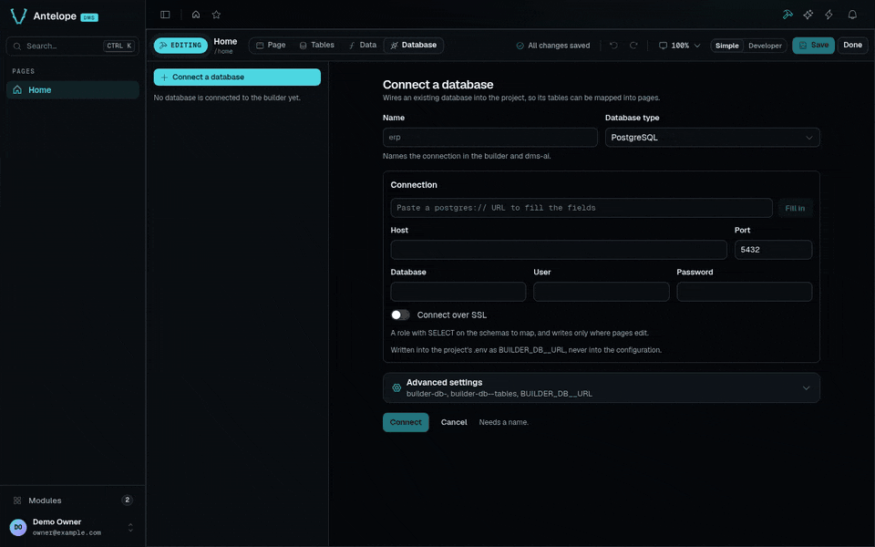

We ran it on the connect demo, a sample coffee shop on PostgreSQL.

1. Paste the connection string into the Builder and press **Connect**.
2. Press **Let the assistant finish**. It runs Claude Code or Codex on your own account.
3. Approve its plan. We approved it as written and changed nothing after that.

| What     | Result                                                     |
| -------- | ---------------------------------------------------------- |
| Database | 12 tables, about 3,000 orders                              |
| Pages    | 2 dashboards and 10 table pages                            |
| Code     | About 3,000 lines of TypeScript in 50 files, in one module |
| Result   | The project typechecks                                     |

**What it got wrong.** Saved views that filter on a list of statuses, such as "Awaiting shipment", came back empty. Charts that need a second relation, such as revenue by product, were skipped, and the assistant said so in its report. That was one run with no follow-up prompt. [Run it yourself](#quick-start).

### A finished back office

<a href="https://dms-demo.antelopejs.com">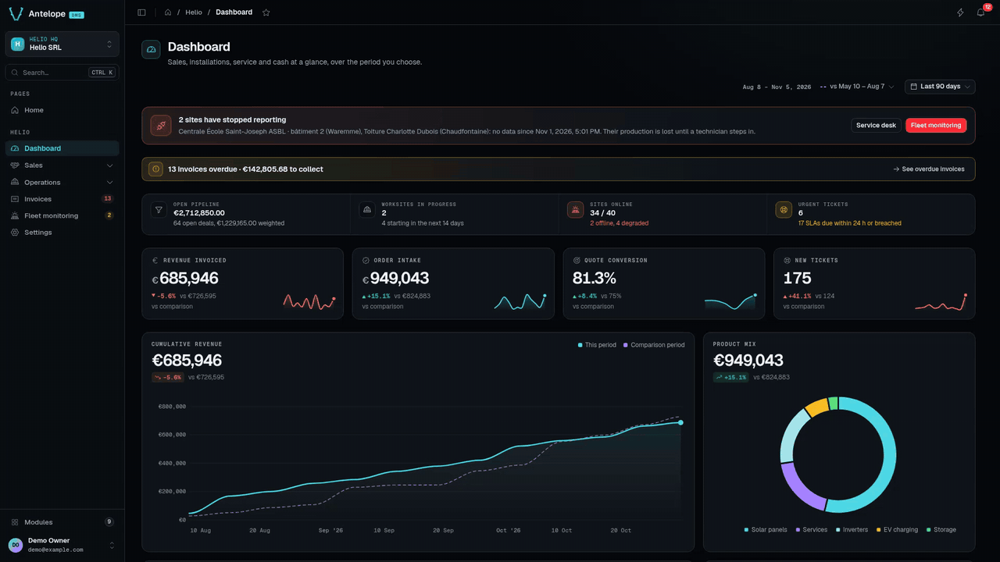</a>

**Everything in this tour is built with AntelopeJS DMS.** Helio is a back office for a solar installer. [Click through it live](https://dms-demo.antelopejs.com), no install needed.

## Why


We run a service company. Almost every client project came with a back office, no two alike, so we rebuilt it each time and carried every permission fix by hand. Admin generators gave us a list screen fast, then got stuck the day a client asked for something they hadn't planned.

AntelopeJS DMS is the base we built instead, and we start every client project from it. It covers the standard screens with no frontend code, and you replace any piece without forking it.

- **Existing product?** Connect its database. You get a page for every table you keep, plus dashboards.
- **New product?** Start from the template and build the tables and pages from nothing.

### Why not ask a coding agent for the whole thing?

On an empty repo, an agent has to invent sign-in, server-side roles, paginated lists, validated forms, charts and the layout in one go. The result looks finished. The gaps sit where a demo doesn't look:

- a route that skips the permission check,
- a list that loads every row,
- a form validated only in the browser.

With AntelopeJS DMS those pieces exist, and the agent picks blocks and fills in their options:

- The agent skills ship inside the npm packages and teach it the API of the version you run.
- Every block option has a type, so a wrong option fails the build.
- Through the Builder, nothing is written unless the whole project still compiles.

## What you get

- **A page for every table.** Search, filters, saved views, totals and export, shown as a grid, cards, a kanban board or a grouped list.
- **14 API routes per table.** List, get, create, edit, delete, archive, counts and export, each checked against one of the table's permissions.
- **41 building blocks.** Tables, forms, KPI cards and 13 chart types. Standard screens need no frontend code.
- **TypeScript in your repo.** Every page is a class you read, review and change like the rest of your code.
- **Read-only by default.** A table gets create, edit and delete only when you switch it on.
- **Roles down to each action.** Hidden on the page and refused by the server.
- **Accounts from the first start.** Sign-in, members, invitations, roles, two-factor authentication, signed-in devices and multi-tenancy, with a SaaS mode.
- **Your coding agent, not ours.** Claude Code or Codex on your own account. AntelopeJS DMS ships no AI model.
- **Installable modules.** See [Modules](#modules).

The roles editor already lists a permission for every page, block and action, so a Support role takes a few clicks.

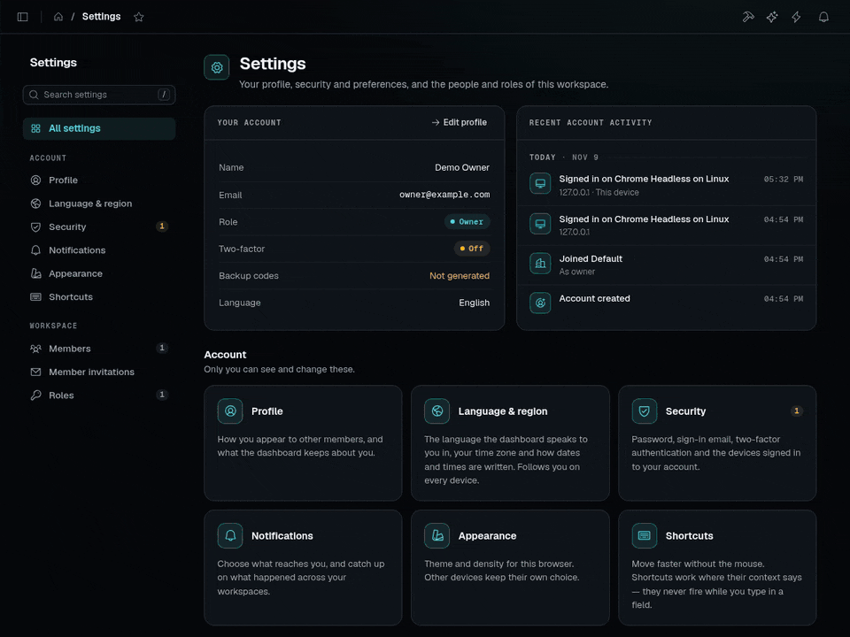

## Quick start


You need Node.js, Git and Docker with Compose v2.

**Try it on sample data.** A coffee shop's orders in PostgreSQL, ready to connect.

```bash
npx @antelopejs/core project init demo --template dms-connect-demo
cd demo && docker compose up
```

**Start your own project.** Same DMS, no sample data. Connect your database from the Builder, or build the tables from nothing.

```bash
npx @antelopejs/core project init my-app --template dms-starter
cd my-app && docker compose up
```

Open the onboarding link the `dms` service prints, create the admin account, then open the Builder's **Database** tab and press **Connect**.

<details>
<summary><b>Step by step, other databases, and existing AntelopeJS projects</b></summary>

- The sample stack starts the DMS, a MongoDB for the DMS's own data, and a PostgreSQL with 12 tables. For the same data in MongoDB or RethinkDB, run `docker compose --profile mongodb up` or `docker compose --profile rethinkdb up`.
- The `dms` service prints a line that starts with `[DMS] No owner exists yet`. Open the address in that line to create the administrator.
- Inside the `dms` container, `localhost` is the container itself. A database on your machine needs an address the container can reach.
- The demo uses placeholder secrets, so keep its ports on your own machine.
- The [demo README](https://github.com/AntelopeJS/template-dms-connect-demo#connect-a-sample-database) lists every step with the connection string for each database.

To add the DMS to an existing AntelopeJS project:

```bash
ajs project modules add @antelopejs/dms
pnpm add -D @antelopejs/dms-frontend
```

It also needs an API module, a database module and an authentication module. The database module is `@antelopejs/mongodb`, or `@antelopejs/mysql` for MySQL and MariaDB. See [Installation](https://dms.antelopejs.com/docs/getting-started/installation). The DMS also runs [inside an AdonisJS 6 backend](https://dms.antelopejs.com/docs/getting-started/adonisjs).

</details>

## Three ways to build

Mix them on the same project. The assistant is a development tool and does not run in production.

### Click in the Builder

Press <kbd>Ctrl</kbd>+<kbd>B</kbd> on any page. Add a table, its fields and its routes, or a block on a page. The Builder writes the TypeScript and saves only if the whole project still compiles.


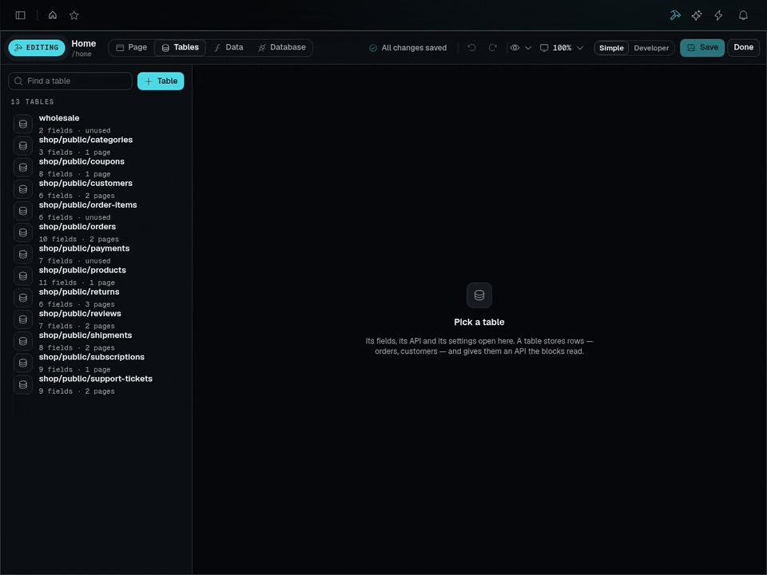

### Ask the assistant

Press <kbd>Ctrl</kbd>+<kbd>Shift</kbd>+<kbd>K</kbd> in the dashboard and describe what you want. With the Builder installed, chats start in Safe mode, which changes pages, tables and queries through the Builder only. Code mode can also edit any file and run commands.

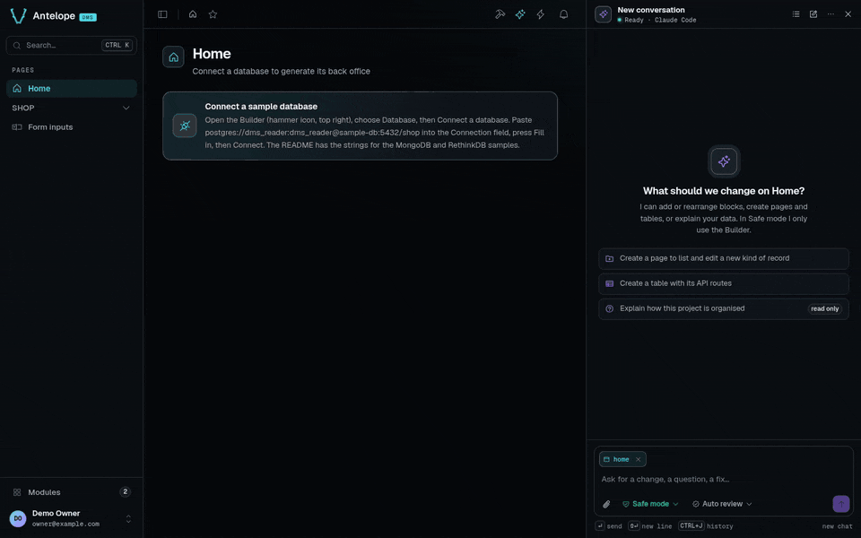

The sample rows took a second request in Code mode, because Safe mode has no tool that writes seed data.

### Use your own coding agent

Run Claude Code or Codex in the project folder. Install the `antelopejs` plugin once to link the skills your packages ship, at the version you run.

```bash
# Claude Code
claude plugin marketplace add AntelopeJS/agent-skills
claude plugin install antelopejs@antelopejs

# Codex
codex plugin marketplace add AntelopeJS/agent-skills
codex plugin add antelopejs@antelopejs
```

Then run `ajs project dev` once. It adds a `dms-ai` server to the project's `.mcp.json`, so Claude Code gets the Builder tools, the database tools and the typecheck the chat uses.

## See it in action

**One field, one full screen.** From the [docs tutorial](https://dms.antelopejs.com/docs/getting-started/tutorial).

```ts fragment
@RegisterPage()
export class SuppliersPage extends PageController("suppliers", {
  displayName: "Suppliers",
  icon: "i-ph-factory",
  category: purchasing,
}) {
  static table = TableView(supplierDataAPI, {
    caption: "Suppliers",
    labelKey: "name",
    formContainer: { type: "drawer" },
    rowActions: { add: true, edit: true, delete: true, hasSelection: true },
  });
}
```

The columns come from the data controller. The field also brings 14 API routes with their permissions, updates when someone saves a row through the table, and a row lock while someone edits it.


**Several ways to look at the same rows.** A grid, cards, a kanban board where dragging a card writes the value back, and a grouped list.

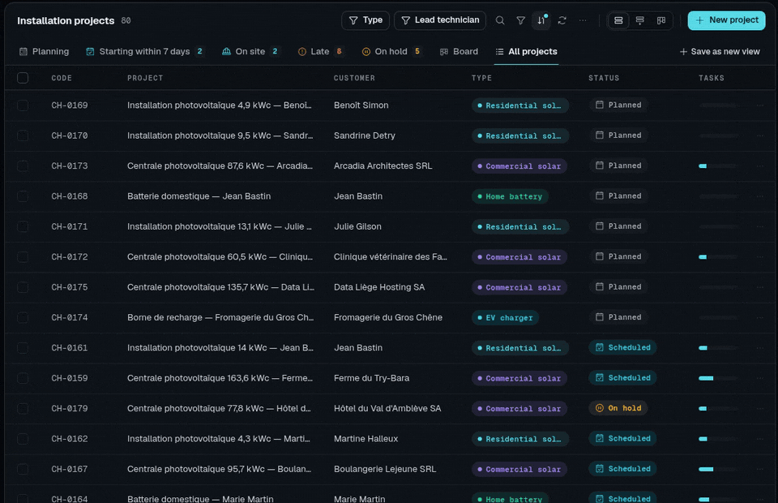


**Roles down to each block and action.** Preview the app as any role.


## 41 blocks, ready to use


Tables, forms, KPI cards, activity feeds and 13 chart types. Each one is a line of TypeScript.

<a href="https://dms.antelopejs.com/docs/components/overview">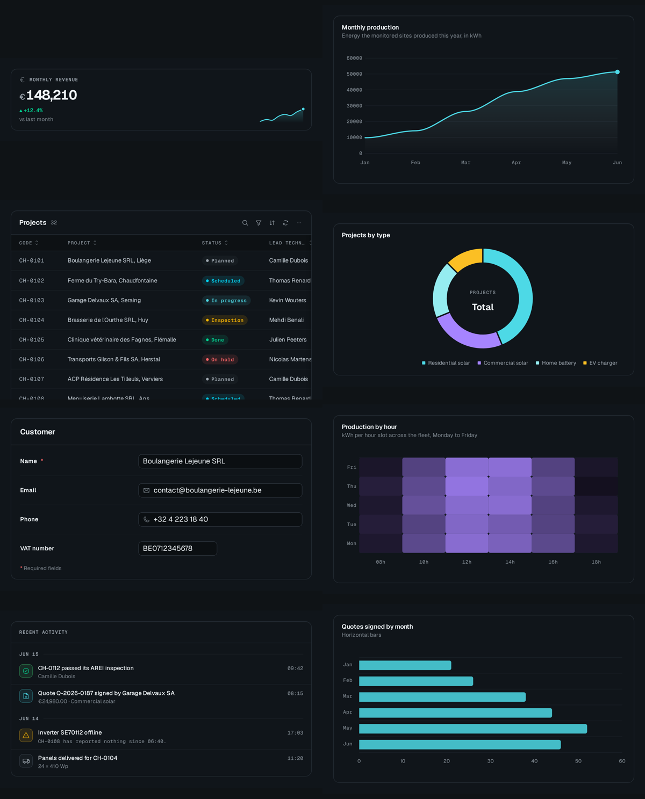</a>

[Browse every block with a live preview](https://dms.antelopejs.com/docs/components/overview)

## When the blocks aren't enough

This is the part we cared most about, because it's where the tools we used before let us down.

**Write your own block.** On the backend it's a field like any other, and on the frontend a Vue component registered under that name. It gets its own permission in the roles editor.

```ts fragment
static graph = CustomComponent("ApiRouteGraph")
  .options({ fetchUrl: "/api/routes/graph", periodScope: "api" })
  .meta({ name: "$api.routes.graph.name", icon: "i-ph-graph" });
```

**Replace a built-in component.** Register yours under the same name from a higher-priority module, and the DMS renders it everywhere.

```ts fragment
sdk.registerComponent("DmsFoo", MyFoo, { prefix: false });
```

**In between**, add a column type, a table display, content in a form slot, routes on a page class, whole pages written by hand, or lifecycle hooks. Services such as file storage sit behind AntelopeJS contracts, so changing provider means installing another module.

## Modules

The core keeps to pages, data, sign-in and roles. The rest installs into the same dashboard, behind the same login.

<!-- antelopejs-dms-modules:start -->

| Module                                                           | What it adds                                                                             |
| ---------------------------------------------------------------- | ---------------------------------------------------------------------------------------- |
| [`dms-builder`](https://github.com/AntelopeJS/dms-builder)       | Edit pages, tables and data sources by clicking, as TypeScript that compiles             |
| [`dms-ai`](https://github.com/AntelopeJS/dms-ai)                 | An assistant chat in the dashboard, on your own Claude Code or Codex                     |
| [`dms-database`](https://github.com/AntelopeJS/dms-database)     | Schemas, relation diagrams, a data browser and a query console                           |
| [`dms-api`](https://github.com/AntelopeJS/dms-api)               | API health, request logs, per-route statistics and a request tester                      |
| [`dms-automation`](https://github.com/AntelopeJS/dms-automation) | Node-graph automations on schedules, webhooks and DMS events, with a trace for every run |
| [`dms-mailing`](https://github.com/AntelopeJS/dms-mailing)       | E-mail templates in a block editor, versions, a send log and delivery metrics            |
| [`dms-lang`](https://github.com/AntelopeJS/dms-lang)             | Translation coverage, a translation matrix and a translation queue                       |
| [`dms-media`](https://github.com/AntelopeJS/dms-media)           | A media library with folders, per-folder permissions, image sizes and light editing      |
| [`dms-saas`](https://github.com/AntelopeJS/dms-saas)             | Self-service sign-up, plans that gate features, and Stripe billing                       |
| [`dms-marketing`](https://github.com/AntelopeJS/dms-marketing)   | Traffic, conversion funnels with A/B splits and click heatmaps, without cookies          |
| [`dms-frontend`](https://github.com/AntelopeJS/dms-frontend)     | The `ajs dms` CLI, the Vue renderer and the SDK every frontend module builds on          |

<!-- antelopejs-dms-modules:end -->

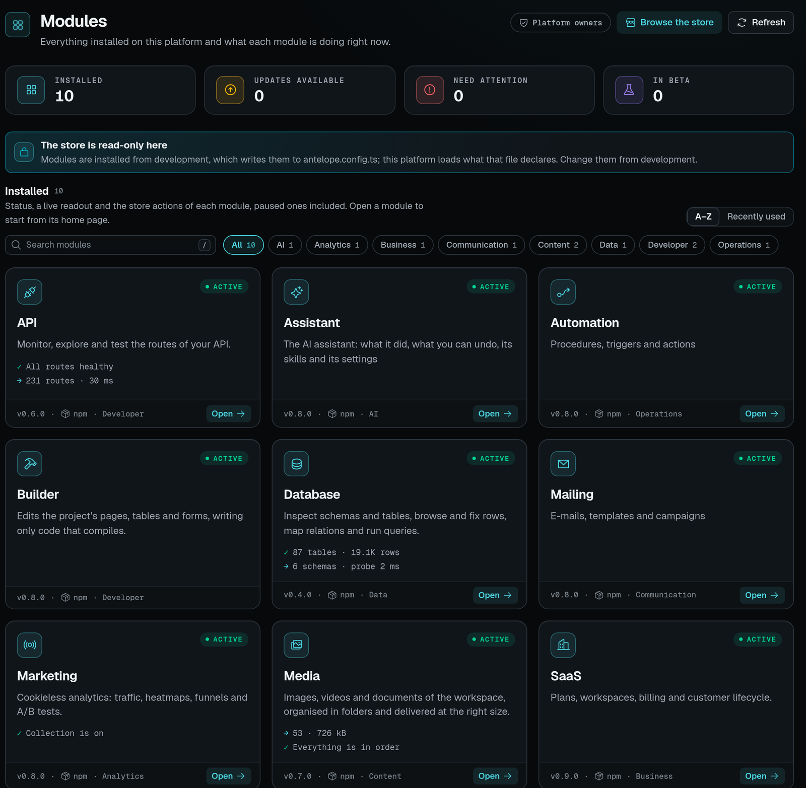

## Built for

- **Developers and CTOs** with a product on PostgreSQL, MySQL, MariaDB, MongoDB or RethinkDB who need a back office and dashboards without building them by hand.
- **Founders and ops people** who'd rather click than code. Once a developer has installed it, the Builder and the assistant do the rest.

[How it compares to other admin tools](https://dms.antelopejs.com/compare)

## FAQ

<details>
<summary><b>Is it really free?</b></summary>

Yes. Apache-2.0, no per-seat price, nothing gated. Self-host it for as many users as you like. AntelopeJS Cloud, a hosted version, is on a waitlist.

</details>

<details>
<summary><b>Does my data go to an AI model?</b></summary>

Table pages need no AI. The assistant runs your own Claude Code or Codex. Its database tools read the schema and aggregates of a connected database, never individual rows.

</details>

<details>
<summary><b>Does the assistant run in production?</b></summary>

No. With `NODE_ENV=production` the assistant starts no agent, and the route your own coding agent would use serves nothing.

</details>

<details>
<summary><b>Can it change my data?</b></summary>

Generated pages are read-only until you switch on **Rows can be edited** for a table. The connection can still do whatever its database account allows, so a SELECT-only account is a good start.

</details>

<details>
<summary><b>Which databases?</b></summary>

**Connect** reads PostgreSQL, MySQL, MariaDB, MongoDB and RethinkDB today. The DMS keeps its own accounts, roles and settings in the database module you load: MongoDB in the templates, or MySQL 8.4 and 9.7 and MariaDB 11.8 and 12.3 with [`@antelopejs/mysql`](https://github.com/AntelopeJS/mysql). Need another database? Tell us on [Discord](https://discord.gg/g4pFt6eXqu).

</details>

<details>
<summary><b>Do I need to know Vue?</b></summary>

No. Standard screens are blocks drawn by the shared renderer. You write Vue only for a fully custom component.

</details>

## Star history


<a href="https://star-history.com/#AntelopeJS/dms&Date"></a>

If the DMS saves you a back office, a ⭐ helps other developers find it.

## Contributing

Read [CONTRIBUTING.md](./CONTRIBUTING.md) before opening a pull request, and [AGENTS.md](./AGENTS.md) for the layout and conventions. Questions and ideas go to [#support on Discord](https://discord.gg/g4pFt6eXqu).

<details>
<summary><b>Development</b>: commands, the demo application, compatibility and maintenance scripts</summary>

One root install includes the runtime, interface, shipped Vue layer and playground, using a shared lockfile so the runtime and interface resolve the same dependencies. Use the root scripts below rather than recursive scripts, because the runtime already delegates checks to the interface and Vue layer.

```bash
pnpm install --frozen-lockfile
pnpm dev            # playground backend
pnpm frontend:dev   # dashboard, in a second terminal
pnpm build
pnpm lint
pnpm typecheck
pnpm test
```

### Recover an outdated playground installation

Use the Node.js release in `.nvmrc` and run these commands from the repository root. The playground's dependency ranges are in `packages/dms/playground/package.json`, and the lockfile installs compatible releases together. Run the CLI with `pnpm exec ajs`, not with a separately installed global `ajs`: an older global CLI can bring its own copy of `interface-core`.

If startup reports `Incompatible interface package resolution`, stop the backend and the frontend, then reinstall the local dependencies from the current lockfile:

```bash
pnpm install --frozen-lockfile --force
pnpm --dir packages/dms/playground exec ajs project modules install
pnpm dev
# In a second terminal, from the repository root:
pnpm frontend:dev
```

Do not lower the modules' interface requirements or delete the lockfile. The reinstall keeps the MongoDB database and the playground's file storage.

Two scripts keep the documentation data in step with the code (the [block preview page](https://dms.antelopejs.com/docs/ai-and-claude-code/block-preview-page) must be enabled for the screenshots):

```bash
pnpm --dir packages/dms docs:catalog       # docs-data/blocks.json from ListBlockTypes(); CI runs docs:catalog:check, which also fails unless each block type has exactly one page holding its `::block-playground` and `::block-options`
pnpm --dir packages/dms docs:screenshots   # docs/images/blocks/<example>.dark.png from docs-data/examples.json
```

### Capture documentation screenshots

`docs:screenshots` renders each hand-authored example in `packages/dms/docs-data/examples.json`
through a running DMS's `/dms-preview` page. It captures the dark theme only, cropped
to the blocks, into `packages/dms/docs/images/blocks/<id>.dark.png`. The docs use
these images when no live preview answers.

Enable the preview with `docsPreview: true` or `DMS_DOCS_PREVIEW=1`, as the playground does.
The default frontend URL is `http://localhost:3001`; `DMS_PREVIEW_URL` overrides it.

```bash
pnpm --dir packages/dms docs:screenshots [--base-url <url>] [--only <id,...>] [--concurrency <n>]
```

| Flag | Meaning | Default |
| --- | --- | --- |
| `--base-url` | DMS frontend URL | `DMS_PREVIEW_URL`, then `http://localhost:3001` |
| `--only` | Comma-separated example IDs | All examples |
| `--concurrency` | Captures in flight on the one browser, each in its own context | `DMS_SCREENSHOT_CONCURRENCY`, then 4 |

### Check realtime connections across tabs

`realtime:tabs-check` signs in and opens several tabs in one browser profile. It counts
the long-lived streams to the dashboard's origin, then times a request from each tab.
HTTP/1.1 browsers allow at most six connections per host; streams that hold all of
them leave ordinary requests waiting.

```bash
pnpm --dir packages/dms realtime:tabs-check --email <email> --password <password> [--base-url <url>] [--tabs <n>] [--path </page>] [--channel <chrome|msedge>] [--max-streams <n>] [--timeout <ms>] [--legacy-streams <n>]
```

| Flag | Meaning | Default |
| --- | --- | --- |
| `--email` | Sign-in email | `DMS_CHECK_EMAIL`; required if unset |
| `--password` | Sign-in password | `DMS_CHECK_PASSWORD`; required if unset |
| `--base-url` | DMS frontend URL | `http://localhost:3001` |
| `--tabs` | Tabs in the shared profile | `8` |
| `--path` | Page to open in each tab | `/` |
| `--channel` | Browser channel | `chrome` |
| `--max-streams` | Maximum shared long-lived streams | `2`: realtime and the development reload stream |
| `--timeout` | Per-tab request deadline in milliseconds | `5000` |
| `--legacy-streams` | Extra connection streams per tab to demonstrate the check failing | `0` |

### Run the demo application

To click through Helio without installing anything, open the [live demo](https://dms-demo.antelopejs.com).

To run it yourself, create a project from the `template-dms-demo` template, which loads the DMS, its companion modules and Helio, a demo back office for a solar installer. It needs the Node.js and pnpm releases the template pins, and a MongoDB on `localhost:27017`.

```bash
npx @antelopejs/core project init dms-demo --template dms-demo
cd dms-demo
pnpm dev            # backend on http://localhost:5010
```

When the backend answers, start the dashboard in a second terminal, from the same folder:

```bash
pnpm frontend:dev   # dashboard on http://localhost:3001
```

Open the address that the backend logs after `No owner exists yet`, and create the first administrator. [Quickstart](https://dms.antelopejs.com/docs/getting-started/quickstart#create-your-administrator) walks through the onboarding.

### Compatibility

The `@antelopejs/*` ranges `@antelopejs/dms` supports are in the compatibility block of the [`dms` README](packages/dms/README.md#compatibility). Each DMS release declares the renderer releases it runs on in `engines["@antelopejs/dms-frontend"]` of its frontend module, and the frontend's [compatibility table](https://dms.antelopejs.com/docs/frontend/introduction#compatibility) lists the renderer release line of each DMS release it covers. The DMS also runs embedded in an AdonisJS application: see [Run the DMS inside AdonisJS](https://dms.antelopejs.com/docs/getting-started/adonisjs).

</details>

<details>
<summary><b>Packages</b></summary>

- [`@antelopejs/dms`](https://www.npmjs.com/package/@antelopejs/dms) in [`packages/dms`](./packages/dms) is the runtime module: pages, components, auth and tenancy, files, notifications and realtime.
- [`@antelopejs/interface-dms`](https://www.npmjs.com/package/@antelopejs/interface-dms) in [`packages/interface-dms`](./packages/interface-dms) holds the public contracts a module imports to extend the dashboard.
- The frontend loader and Vue renderer live in [`AntelopeJS/dms-frontend`](https://github.com/AntelopeJS/dms-frontend).
- Supported `@antelopejs/*` ranges are in the [`dms` README](packages/dms/README.md#compatibility).

</details>

## License

[Apache-2.0](./LICENSE)
