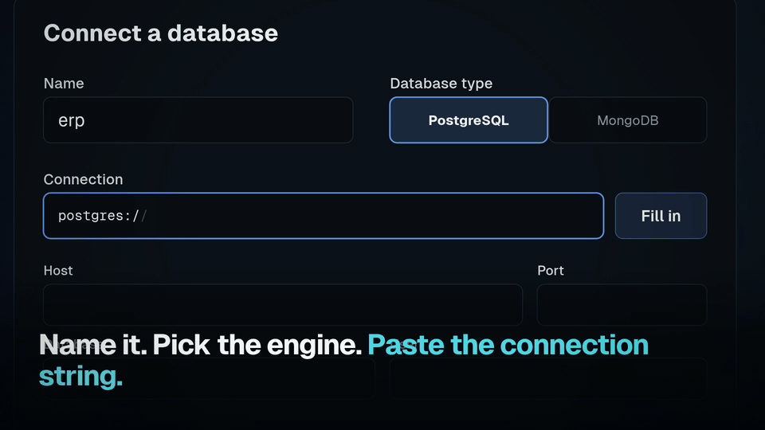

<div align="center">

# AntelopeJS DMS

**The open-source back office for your product.**<br>
Connect your PostgreSQL, MongoDB or RethinkDB database.<br>
Your coding agent builds the admin pages and a dashboard, as TypeScript in your repo.

[Live demo](https://dms-demo.antelopejs.com) · [Quick start](#quick-start) · [Docs](https://dms.antelopejs.com/docs) · [Discord](https://discord.gg/g4pFt6eXqu)

<a href="https://github.com/AntelopeJS/dms/stargazers"></a> <a href="https://www.npmjs.com/package/@antelopejs/dms"></a> <a href="./LICENSE"></a> <a href="https://discord.gg/g4pFt6eXqu"></a> <a href="https://dms.antelopejs.com/docs"></a>

</div>

<a href="https://dms-demo.antelopejs.com"></a>

**Everything in this tour is built with AntelopeJS DMS.** Helio is a back office for a solar installer: dashboards, a sales pipeline, quotes, invoices and fleet monitoring. [Click through it live](https://dms-demo.antelopejs.com), no install needed.

## Why


Every product ends up needing a back office. Support needs to find a customer. Ops needs to fix an order. The founder wants the numbers.

Building it by hand eats weeks you'd rather spend on the product. Hosted admin tools charge per seat and keep your screens outside your code.

AntelopeJS DMS gives you the back office from the database you already have. It lives in your repo, you own every line, and it's free.

- **Existing product?** Connect its database. You get a page for every table you keep, plus a dashboard.
- **New product?** Start from the template and build the whole app on AntelopeJS.

## Connect your database



Paste a connection string and press **Connect**. The Builder reads the schema, proposes a page for each table, and writes the pages you keep as TypeScript in your repo. Connect your ERP, your CRM and your shop, and every database lands in the same back office. Your coding agent then builds the dashboard on top of your data.

## What you get

- **A page for every table.** Search, filters, sort, export and forms, generated from your schema.
- **41 building blocks.** Tables, forms, KPI cards and 13 chart types. Standard screens need no frontend code.
- **TypeScript in your repo.** Every page is a class you read, review and change like the rest of your code.
- **Read-only by default.** A table gets create, edit and delete only when you switch it on.
- **Roles down to each action.** Hidden on the page and refused by the server.
- **A dashboard from your coding agent.** Claude Code or Codex builds it on your own account. The DMS ships no AI model.
- **Sign-in, members and multi-tenancy** built in, with a SaaS mode.
- **Installable modules.** Automations, mailing, translations, media library, SaaS billing and more.

## Quick start


You need Node.js, Git and Docker with Compose v2.

**Try it on sample data.** A coffee shop's orders in PostgreSQL, ready to connect.

```bash
npx @antelopejs/core project init demo --template dms-connect-demo
cd demo && docker compose up
```

**Start your own project.** Same DMS, no sample data. Connect your database from the Builder.

```bash
npx @antelopejs/core project init my-app --template dms-starter
cd my-app && docker compose up
```

Open the onboarding link the `dms` service prints, create the admin account, then open the Builder's **Database** tab and press **Connect**.

<details>
<summary><b>Step by step, other databases, and existing AntelopeJS projects</b></summary>

- The sample stack starts the DMS, a MongoDB for the DMS's own data, and a PostgreSQL with 12 tables. For the same data in MongoDB or RethinkDB, run `docker compose --profile mongodb up` or `docker compose --profile rethinkdb up`.
- The `dms` service prints a line that starts with `[DMS] No owner exists yet`. Open the address in that line to create the administrator.
- Inside the `dms` container, `localhost` is the container itself. A database on your machine needs an address the container can reach.
- The demo uses placeholder secrets, so keep its ports on your own machine.
- The [demo README](https://github.com/AntelopeJS/template-dms-connect-demo#connect-a-sample-database) lists every step with the connection string for each database.

To add the DMS to an existing AntelopeJS project:

```bash
ajs project modules add @antelopejs/dms
pnpm add -D @antelopejs/dms-frontend
```

It also needs an API module, a database module and an authentication module. See [Installation](https://dms.antelopejs.com/docs/getting-started/installation). The DMS also runs [inside an AdonisJS 6 backend](https://dms.antelopejs.com/docs/getting-started/adonisjs).

</details>

## See it in action

**One line of TypeScript, a full CRUD screen.**


**Click on the page, get code.** The Builder writes TypeScript and saves only when the whole project still compiles.


**Roles down to each block and action.** Preview the app as any role.


<details>
<summary><b>Watch the films</b>: Meet AntelopeJS DMS, and a tour of the whole DMS</summary>

**Meet AntelopeJS DMS.** A company connects its ERP, its CRM and its shop, and gets one back office and one dashboard.

https://github.com/user-attachments/assets/1c0b9396-d468-48b4-b504-3e5b9e50eeb4

**A tour of the whole DMS.** Pages and blocks, people and roles, modules, and the three ways to build.

https://github.com/user-attachments/assets/ba552792-f0d4-4fcf-8b0e-81029a5a2582

</details>

## 41 blocks, ready to use


Tables, forms, KPI cards, activity feeds and 13 chart types. Each one is a line of TypeScript.

<a href="https://dms.antelopejs.com/docs/components/overview"></a>

```ts
import { PageController, RegisterPage, pagesCategory } from "@antelopejs/interface-dms/page";
import { KpiCard } from "@antelopejs/interface-dms/base/kpi-card";

@RegisterPage()
export class SalesPage extends PageController("sales", {
  displayName: "Sales",
  icon: "i-ph-chart-line",
  category: pagesCategory,
}) {
  static revenue = KpiCard({ title: "Revenue", fetchUrl: "/api/sales/revenue" });
}
```

[Browse every block with a live preview](https://dms.antelopejs.com/docs/components/overview)

## Built for

- **Developers and CTOs** with a product on PostgreSQL, MongoDB or RethinkDB who need a back office and dashboards without building them by hand.
- **Founders and ops people** who'd rather click than code. Once a developer has installed it, the Builder and the assistant do the rest.

We built the DMS for our own client work, where every client needed a different back office. It's the base we now use for all of them.

[How it compares to other admin tools](https://dms.antelopejs.com/compare)

## FAQ

<details>
<summary><b>Is it really free?</b></summary>

Yes. Apache-2.0, no per-seat price, nothing gated. Self-host it for as many users as you like. AntelopeJS Cloud, a hosted version, is on a waitlist.

</details>

<details>
<summary><b>Does my data go to an AI model?</b></summary>

Table pages need no AI at all. Dashboards are built by your own Claude Code or Codex, on your own account. The agent works from your schema.

</details>

<details>
<summary><b>Can it change my data?</b></summary>

Generated pages are read-only until you switch on **Rows can be edited** for a table. The connection can still do whatever its database account allows, so a SELECT-only account is a good start.

</details>

<details>
<summary><b>Which databases?</b></summary>

PostgreSQL, MongoDB and RethinkDB today. The DMS keeps its own accounts, roles and settings in MongoDB, which the templates start for you. Need another database? Tell us on [Discord](https://discord.gg/g4pFt6eXqu).

</details>

<details>
<summary><b>Do I need to know Vue?</b></summary>

No. Standard screens are blocks drawn by the shared renderer. You write Vue only for a fully custom component.

</details>

## Star history


<a href="https://star-history.com/#AntelopeJS/dms&Date"></a>

If the DMS saves you a back office, a ⭐ helps other developers find it.

## Contributing

Read [CONTRIBUTING.md](./CONTRIBUTING.md) before opening a pull request, and [AGENTS.md](./AGENTS.md) for the layout and conventions. Questions and ideas go to [#support on Discord](https://discord.gg/g4pFt6eXqu).

<details>
<summary><b>Development</b>: commands, the demo application, compatibility and maintenance scripts</summary>

One root install includes the runtime, interface, shipped Vue layer and playground, using a shared lockfile so the runtime and interface resolve the same dependencies. Use the root scripts below rather than recursive scripts, because the runtime already delegates checks to the interface and Vue layer.

```bash
pnpm install --frozen-lockfile
pnpm dev            # playground backend
pnpm frontend:dev   # dashboard, in a second terminal
pnpm build
pnpm lint
pnpm typecheck
pnpm test
```

### Recover an outdated playground installation

Use the Node.js release in `.nvmrc` and run these commands from the repository root. The playground's dependency ranges are in `packages/dms/playground/package.json`, and the lockfile installs compatible releases together. Run the CLI with `pnpm exec ajs`, not with a separately installed global `ajs`: an older global CLI can bring its own copy of `interface-core`.

If startup reports `Incompatible interface package resolution`, stop the backend and the frontend, then reinstall the local dependencies from the current lockfile:

```bash
pnpm install --frozen-lockfile --force
pnpm --dir packages/dms/playground exec ajs project modules install
pnpm dev
# In a second terminal, from the repository root:
pnpm frontend:dev
```

Do not lower the modules' interface requirements or delete the lockfile. The reinstall keeps the MongoDB database and the playground's file storage.

Two scripts keep the documentation data in step with the code (the [block preview page](https://dms.antelopejs.com/docs/ai-and-claude-code/block-preview-page) must be enabled for the screenshots):

```bash
pnpm --dir packages/dms docs:catalog       # docs-data/blocks.json from ListBlockTypes(); CI runs docs:catalog:check, which also fails unless each block type has exactly one page holding its `::block-playground` and `::block-options`
pnpm --dir packages/dms docs:screenshots   # docs/images/blocks/<example>.dark.png from docs-data/examples.json
```

### Capture documentation screenshots

`docs:screenshots` renders each hand-authored example in `packages/dms/docs-data/examples.json`
through a running DMS's `/dms-preview` page. It captures the dark theme only, cropped
to the blocks, into `packages/dms/docs/images/blocks/<id>.dark.png`. The docs use
these images when no live preview answers.

Enable the preview with `docsPreview: true` or `DMS_DOCS_PREVIEW=1`, as the playground does.
The default frontend URL is `http://localhost:3001`; `DMS_PREVIEW_URL` overrides it.

```bash
pnpm --dir packages/dms docs:screenshots [--base-url <url>] [--only <id,...>] [--concurrency <n>]
```

| Flag | Meaning | Default |
| --- | --- | --- |
| `--base-url` | DMS frontend URL | `DMS_PREVIEW_URL`, then `http://localhost:3001` |
| `--only` | Comma-separated example IDs | All examples |
| `--concurrency` | Captures in flight on the one browser, each in its own context | `DMS_SCREENSHOT_CONCURRENCY`, then 4 |

### Check realtime connections across tabs

`realtime:tabs-check` signs in and opens several tabs in one browser profile. It counts
the long-lived streams to the dashboard's origin, then times a request from each tab.
HTTP/1.1 browsers allow at most six connections per host; streams that hold all of
them leave ordinary requests waiting.

```bash
pnpm --dir packages/dms realtime:tabs-check --email <email> --password <password> [--base-url <url>] [--tabs <n>] [--path </page>] [--channel <chrome|msedge>] [--max-streams <n>] [--timeout <ms>] [--legacy-streams <n>]
```

| Flag | Meaning | Default |
| --- | --- | --- |
| `--email` | Sign-in email | `DMS_CHECK_EMAIL`; required if unset |
| `--password` | Sign-in password | `DMS_CHECK_PASSWORD`; required if unset |
| `--base-url` | DMS frontend URL | `http://localhost:3001` |
| `--tabs` | Tabs in the shared profile | `8` |
| `--path` | Page to open in each tab | `/` |
| `--channel` | Browser channel | `chrome` |
| `--max-streams` | Maximum shared long-lived streams | `2`: realtime and the development reload stream |
| `--timeout` | Per-tab request deadline in milliseconds | `5000` |
| `--legacy-streams` | Extra connection streams per tab to demonstrate the check failing | `0` |

### Run the demo application

To click through Helio without installing anything, open the [live demo](https://dms-demo.antelopejs.com).

To run it yourself, create a project from the `template-dms-demo` template, which loads the DMS, its companion modules and Helio, a demo back office for a solar installer. It needs the Node.js and pnpm releases the template pins, and a MongoDB on `localhost:27017`.

```bash
npx @antelopejs/core project init dms-demo --template dms-demo
cd dms-demo
pnpm dev            # backend on http://localhost:5010
```

When the backend answers, start the dashboard in a second terminal, from the same folder:

```bash
pnpm frontend:dev   # dashboard on http://localhost:3001
```

Open the address that the backend logs after `No owner exists yet`, and create the first administrator. [Quickstart](https://dms.antelopejs.com/docs/getting-started/quickstart#create-your-administrator) walks through the onboarding. A page is a class whose static fields are blocks:

```ts
import { PageController, RegisterPage, pagesCategory } from "@antelopejs/interface-dms/page";
import { KpiCard } from "@antelopejs/interface-dms/base/kpi-card";

@RegisterPage()
export class SalesPage extends PageController("sales", {
  displayName: "Sales",
  icon: "i-ph-chart-line",
  category: pagesCategory,
}) {
  static revenue = KpiCard({ title: "Revenue", fetchUrl: "/api/sales/revenue" });
}
```

### Compatibility

The `@antelopejs/*` ranges `@antelopejs/dms` supports are in the compatibility block of the [`dms` README](packages/dms/README.md#compatibility). Each DMS release declares the renderer releases it runs on in `engines["@antelopejs/dms-frontend"]` of its frontend module, and the frontend's [compatibility table](https://dms.antelopejs.com/docs/frontend/introduction#compatibility) lists the renderer release line of each DMS release it covers. The DMS also runs embedded in an AdonisJS application: see [Run the DMS inside AdonisJS](https://dms.antelopejs.com/docs/getting-started/adonisjs).

</details>

<details>
<summary><b>Packages</b></summary>

- [`@antelopejs/dms`](https://www.npmjs.com/package/@antelopejs/dms) in [`packages/dms`](./packages/dms) is the runtime module: pages, components, auth and tenancy, files, notifications and realtime.
- [`@antelopejs/interface-dms`](https://www.npmjs.com/package/@antelopejs/interface-dms) in [`packages/interface-dms`](./packages/interface-dms) holds the public contracts a module imports to extend the dashboard.
- The frontend loader and Vue renderer live in [`AntelopeJS/dms-frontend`](https://github.com/AntelopeJS/dms-frontend).
- Supported `@antelopejs/*` ranges are in the [`dms` README](packages/dms/README.md#compatibility).

</details>

## License

[Apache-2.0](./LICENSE)
