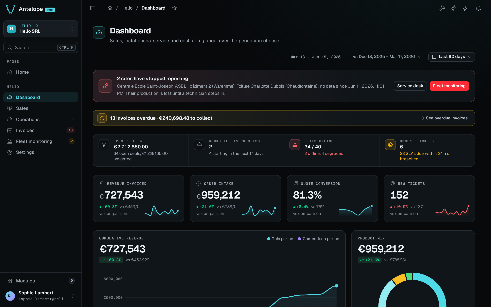

<div align="center">

<picture>
  <source media="(prefers-color-scheme: dark)" srcset="https://raw.githubusercontent.com/AntelopeJS/dms/main/packages/dms/frontend-vue/layers/dms-layout/public/images/antelope-logo/dark.svg">
  
</picture>

# `@antelopejs/dms`

<a href="https://www.npmjs.com/package/@antelopejs/dms"></a>
<a href="./LICENSE"></a>
<a href="https://discord.gg/g4pFt6eXqu"></a>
<a href="https://dms.antelopejs.com/docs"></a>

**Admin dashboards for AntelopeJS, declared in TypeScript on the backend.**

[Documentation](https://dms.antelopejs.com/docs) · [Modules](https://dms.antelopejs.com/docs/modules) · [Frontend](https://dms.antelopejs.com/docs/frontend)

</div>



## What it does

- Declares pages as TypeScript classes: forms, tables, charts and layouts are blocks the shared Vue renderer draws, with no Vue to write for standard screens.
- Handles sign-in, members, roles and permissions down to each block, multi-tenancy and a SaaS mode.
- Manages data through data controllers and table views, with file uploads, notifications and realtime updates.
- Grows with installable modules: an AI assistant, a page builder, database and API consoles, automations, SaaS billing, translations, mailing, marketing analytics and a media library.
- Ships Claude Code skills (`dms`, `dms-best-practices`, `dms-pages`…) so coding agents build pages the way the DMS expects.

Its public contracts live in a separate package, [`@antelopejs/interface-dms`](https://www.npmjs.com/package/@antelopejs/interface-dms): modules import them from there, never from this runtime.

## Install

For a new application, start from the template in the quick start below. To add the DMS to an existing AntelopeJS project, add the module and the dashboard's frontend loader:

```bash
ajs project modules add @antelopejs/dms
pnpm add -D @antelopejs/dms-frontend
```

The DMS also needs an API module, a module implementing the database interface, and an authentication module: see [Installation](https://dms.antelopejs.com/docs/getting-started/installation). Its settings belong in the `config` block of `@antelopejs/dms` in `antelope.config.ts` ([Configuration](https://dms.antelopejs.com/docs/building/configuration)). In production, set `clientBaseUrl` and strong values for `auth.jwtSecret`, `htmlRender.serviceSecret` and `frontend.bootstrapSecret` (the DMS refuses to start without the first three), and use Redis for realtime across several backend instances.

## Quick start

Create a project from the `template-dms-demo` template, which loads the DMS, its companion modules and Helio, a demo back office for a solar installer. It needs the Node.js and pnpm releases the template pins, and a MongoDB on `localhost:27017`.

```bash
npx @antelopejs/core project init dms-demo --template dms-demo
cd dms-demo
pnpm dev            # backend on http://localhost:5010
```

When the backend answers, start the dashboard in a second terminal, from the same folder:

```bash
pnpm frontend:dev   # dashboard on http://localhost:3001
```

Open the address that the backend logs after `No owner exists yet`, and create the first administrator. The [Tutorial](https://dms.antelopejs.com/docs/getting-started/tutorial) builds on this project. To start your own project instead, see [Quickstart](https://dms.antelopejs.com/docs/getting-started/quickstart). A page is a class whose static fields are blocks:

```ts
import { PageController, RegisterPage, pagesCategory } from "@antelopejs/interface-dms/page";
import { KpiCard } from "@antelopejs/interface-dms/base/kpi-card";

@RegisterPage()
export class SalesPage extends PageController("sales", {
  displayName: "Sales",
  icon: "i-ph-chart-line",
  category: pagesCategory,
}) {
  static revenue = KpiCard({ title: "Revenue", fetchUrl: "/api/sales/revenue" });
}
```

## Compatibility

<!-- antelopejs-docs-compat:start -->

| Package                                     | Supported          | Tested with |
| ------------------------------------------- | ------------------ | ----------- |
| `@antelopejs/core`                          | `>=1.21.0 <2`      | `1.21.0`    |
| `@antelopejs/interface-api`                 | `>=0.2.0 <1.0.0`   | `0.2.0`     |
| `@antelopejs/interface-api-util`            | `>=0.3.0 <1.0.0`   | `0.3.0`     |
| `@antelopejs/interface-core`                | `>=0.4.0 <1.0.0`   | `0.4.0`     |
| `@antelopejs/interface-data-api`            | `>=0.6.0 <1.0.0`   | `0.6.0`     |
| `@antelopejs/interface-database`            | `>=0.3.0 <1.0.0`   | `0.3.1`     |
| `@antelopejs/interface-database-decorators` | `>=0.3.1 <1.0.0`   | `0.3.1`     |
| `@antelopejs/interface-dms`                 | `>=0.13.0 <0.14.0` | `workspace` |
| `@antelopejs/interface-dms-automation`      | `>=0.6.0 <1.0.0`   | `0.6.1`     |
| `@antelopejs/interface-email`               | `>=0.0.6 <1.0.0`   | `0.0.6`     |
| `@antelopejs/interface-file-storage`        | `>=0.1.4 <1.0.0`   | `0.1.4`     |
| `@antelopejs/interface-redis`               | `>=0.0.9 <1.0.0`   | `0.0.9`     |

<!-- antelopejs-docs-compat:end -->

Each DMS release declares the renderer releases it runs on in `engines["@antelopejs/dms-frontend"]` of its frontend module, and the frontend's [compatibility table](https://dms.antelopejs.com/docs/frontend/introduction#compatibility) lists the renderer release line of each DMS release it covers. The DMS also runs embedded in an AdonisJS application: see [Run the DMS inside AdonisJS](https://dms.antelopejs.com/docs/getting-started/adonisjs).

## Documentation

- [Getting started](https://dms.antelopejs.com/docs/getting-started/introduction): installation, quickstart, tutorial, architecture
- [Building](https://dms.antelopejs.com/docs/building/overview): configuration, pages and components, navigation, localization, deployment
- [Auth and tenancy](https://dms.antelopejs.com/docs/auth-and-tenancy/overview)
- [Components](https://dms.antelopejs.com/docs/components/overview): every block, with a live preview
- [Interfaces](https://dms.antelopejs.com/docs/interfaces): the `@antelopejs/interface-dms` reference
- [AI and Claude Code](https://dms.antelopejs.com/docs/ai-and-claude-code/overview): the skill suite and the AI assistant
- [Modules](https://dms.antelopejs.com/docs/modules) and [Frontend](https://dms.antelopejs.com/docs/frontend)

The runtime guides live in [`docs/`](./docs). The canonical contract reference belongs to [`@antelopejs/interface-dms`](../interface-dms/docs/index.md), not this runtime package.

The package ships the core Claude Code skills (`dms`, `dms-auth`, `dms-best-practices`, `dms-module`, `dms-pages`, `dms-project`) in [`skills/`](https://github.com/AntelopeJS/dms/tree/main/packages/dms/skills), declared under `antelopeJs.skills`; [Install the plugin](https://dms.antelopejs.com/docs/ai-and-claude-code/install) to use them.

## Contributing

This package lives in the [`AntelopeJS/dms`](https://github.com/AntelopeJS/dms) pnpm workspace, next to `@antelopejs/interface-dms`. Read [CONTRIBUTING.md](https://github.com/AntelopeJS/dms/blob/main/CONTRIBUTING.md) and the [repository README](https://github.com/AntelopeJS/dms#contributing) for the development commands.

## License

[Apache-2.0](./LICENSE)
