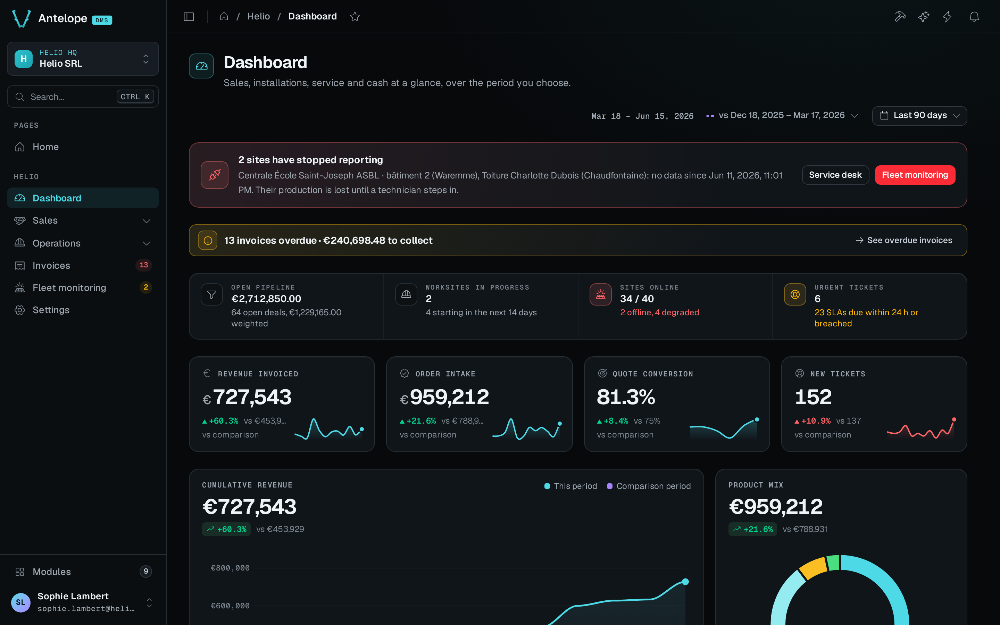

The AntelopeJS DMS (dashboard management system) turns an AntelopeJS backend into an admin dashboard. You declare pages, forms, and tables in TypeScript on the backend, and a shared Vue frontend draws them. Most screens need no Vue at all. You write a Vue component only when a screen needs something the built-in blocks cannot express.

The screenshot is Helio, the back office of a fictional solar installer. It ships with the demo template (`--template dms-demo`) that the [Tutorial](/docs/getting-started/tutorial) builds on, and every one of its pages is made of the same generic blocks you use in your own code.

## What you get before your first page

The DMS module and its frontend loader give you a working product before you declare anything:

- **The dashboard itself.** Onboarding, sign-in and invitations, two-factor authentication, sidebar navigation, search, notifications, and a user menu. See [Built-in dashboard](/docs/getting-started/built-in-dashboard).
- **A catalog of blocks.** Forms, tables, charts, tabs, cards, and layout containers, all declared from the backend. Each one has a live preview in [Components](/docs/components/overview).
- **Data handling.** Typed fields with validation, list, create, edit, and delete routes generated from your models, and file uploads. See [Data types](/docs/components/data-types) and [Data controller](/docs/components/data-controller).
- **Backend services.** Background jobs, exports, HTML and email rendering, and realtime updates. See [Backend services](/docs/building/backend-services).
- **Auth and multi-tenancy.** Sessions, roles and permissions, and tenant scoping. See [Built-in authentication](/docs/auth-and-tenancy/authentication).

Modules add pages and navigation, custom data types add field behavior, and frontend modules add custom UI when you need it. [Extending the dashboard](/docs/extending-the-dashboard/overview) covers each of these.

## Who these docs are for

These docs are for developers who build admin dashboards, back offices, and internal tools on AntelopeJS. They assume you know TypeScript and the AntelopeJS basics: modules, interfaces, and the `ajs` CLI. They do not explain AntelopeJS again. For a question about module wiring or the CLI in general, the AntelopeJS documentation is the reference.

## How the pieces fit

Two processes run side by side. Your AntelopeJS project loads the DMS module next to your own modules and serves page descriptions. The `ajs dms` frontend loader is a generic Inertia and Vue app that every DMS project shares. It fetches those descriptions and renders them. [Architecture](/docs/getting-started/architecture) explains why the backend describes the UI and how a page reaches the screen.

## Where to start

1. [Installation](/docs/getting-started/installation) lists the tools and services a DMS project needs.
2. [Quickstart](/docs/getting-started/quickstart) starts a project from the starter template, connects the AI assistant, and generates pages from your database or from a description. It also lists the demo templates.
3. [Tutorial](/docs/getting-started/tutorial) runs the full demo and adds a purchasing section to it: two related tables, their pages, a dashboard, and a role that cannot delete.

::tip
If you build with an AI agent, [install the skill suite](/docs/ai-and-claude-code/install) first. It teaches the agent the DMS, its blocks, and its [best practices](/docs/ai-and-claude-code/best-practices).
::
