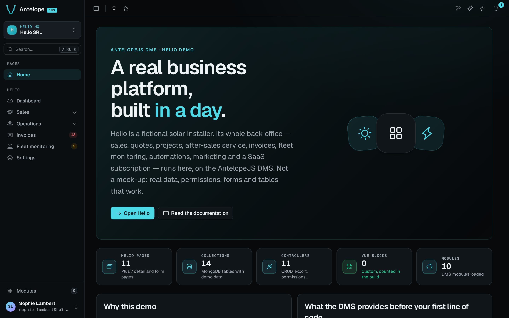
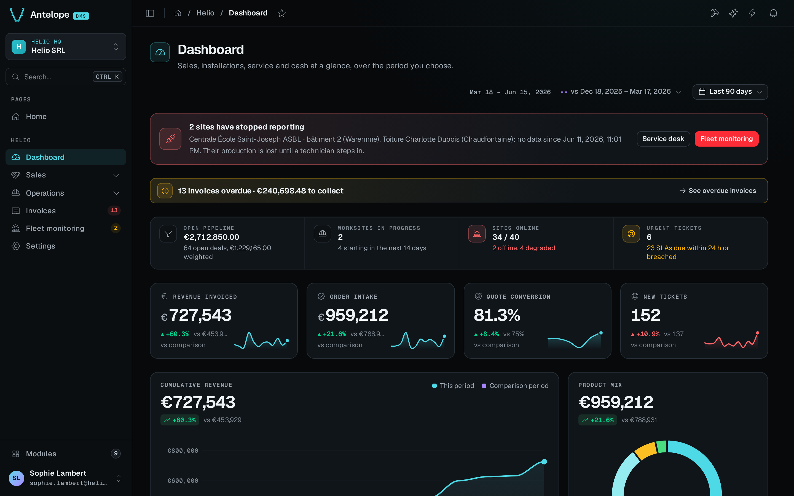

In this quickstart, we run a project from the [`template-dms-demo`](https://github.com/AntelopeJS/template-dms-demo) template on your machine. It holds Helio, the back office of a fictional solar installer, next to every DMS feature module. At the end, you have a running dashboard, your own administrator account, and a map from each Helio screen to the file that declares it.

::tip
To run the DMS inside an AdonisJS application, which then owns the process, use `template-dms-adonis` and follow [Run the DMS inside AdonisJS](/docs/getting-started/adonisjs) instead.
::

## Before you start

You need three things on your machine:

- Node.js, in the release the template pins in its `.nvmrc`.
- pnpm, in the release the template pins in the `packageManager` field of its `package.json`. Run `corepack enable` once and corepack picks that release for you. The `ajs` CLI calls a bare `pnpm` when it installs modules, so another major release of pnpm on your `PATH` breaks the install.
- A running MongoDB on `mongodb://localhost:27017`. [Installation](/docs/getting-started/installation#start-a-database) shows a Docker setup.

The template writes its sample data to the `template_dms_demo` database. Use a database you can throw away.

## Create the project

Install the AntelopeJS CLI, then create a project from the **DMS Demo** template:

```bash [Terminal]
npm install -g @antelopejs/core@latest
ajs project init my-app --template "DMS Demo" --yes
cd my-app
```

The CLI installs the project with pnpm. You need no `.env` file for development. The template README lists the [optional environment variables](https://github.com/AntelopeJS/template-dms-demo#environment).

## Start the backend and the dashboard

First, start the backend:

```bash [Terminal 1]
pnpm dev
```

The first start installs every module that `antelope.config.ts` declares, so it takes a few minutes. The backend then listens on `http://localhost:5010`. If that port is busy, it takes the next free one and writes the address to `.antelope/dev.json`.

Now, in a second terminal in the same folder, start the dashboard:

```bash [Terminal 2]
pnpm frontend:dev
```

`ajs dms dev` finds the running backend through `.antelope/dev.json`, so you pass it no address. It serves the dashboard on `http://localhost:3001`. Start the backend first: the dashboard asks the backend for its modules when it starts.

## Create your administrator

Open `http://localhost:3001`. A fresh database has no account, so the dashboard sends you to `/onboarding`. There are no default credentials.

1. Enter a platform name, then select **Continue to administrator**.
2. Enter your name, your email, and a password. The password needs at least 8 characters, with an uppercase letter, a digit, and one of `@$!%*?&`. Other special characters, such as `#` or `-`, are refused.
3. Select **Create administrator account**, then **Open the dashboard**.

The dashboard opens on the first page in its sidebar, the template's **Home** page:



From now on, the sign-in page is `/auth`.

## Explore the demo back office

Open the **Helio** section of the sidebar. It is a complete back office for a solar installer: a sales pipeline, quotes, customers, a product catalog, installation projects, a live service desk, the team, invoices, live fleet monitoring, settings, and a dashboard.



Every Helio screen is made of generic DMS blocks declared on the backend. The template has no Vue file for any of them. Each domain lives in its own folder:

| File or folder | What it declares |
| --- | --- |
| `src/helio/dashboard/` | The **Dashboard** page and the routes behind its cards and charts. |
| `src/helio/crm/` | The **Pipeline** and **Customers** pages, their tables, and their fixtures. |
| `src/helio/projects/` | The installation projects list and the page of one project. |
| `src/helio/monitoring/` | **Fleet monitoring**, a live page fed by a simulator. |
| `src/helio/category.ts` | The **Helio** sidebar section and its **Sales** and **Operations** groups. |
| `src/home.ts` | The **Home** page. |
| `src/index.ts` | The module lifecycle: the frontend module and the template's database schema. |
| `antelope.config.ts` | The modules the project loads and their configuration. |
| `frontend-vue/i18n/locales/` | The English and French texts that the `$` keys in page declarations point to. |

Helio's sample data is relative to today's date, so the dashboard always shows recent activity. The service desk and fleet monitoring change on their own, because small simulators write to them. To stop the simulators, set `HELIO_SIMULATORS=off` before `pnpm dev`.

## Change a page

Open `src/helio/category.ts` and change the `order` of the `helioCategory` root category from `1.5` to `0.5`. The built-in **Pages** section has order 1, so Helio moves above it. Stop `pnpm dev` with Ctrl+C, start it again, and reload the dashboard. The **Helio** section now sits above **Pages** in the sidebar.

When you change `antelope.config.ts` or a frontend layer, restart the backend first, then the dashboard.

Some integrations need their own credentials, such as Stripe and the AI providers. You do not need them to browse Helio. The template README explains how to turn each one on.

## Next steps

- [Tutorial](/docs/getting-started/tutorial) adds a purchasing section to this project.
- [Pages & components](/docs/building/pages-and-components) explains how a backend declaration becomes a screen.
- [Project setup](/docs/building/project-setup) explains the module configuration and the lifecycle, for when you adapt the template or start from an existing project.
- [Built-in dashboard](/docs/getting-started/built-in-dashboard) shows what the DMS gives you around Helio: settings, members, roles, and the Modules page.
- [Troubleshooting](/docs/building/troubleshooting) covers missing pages, frontend discovery, and the restart order.
