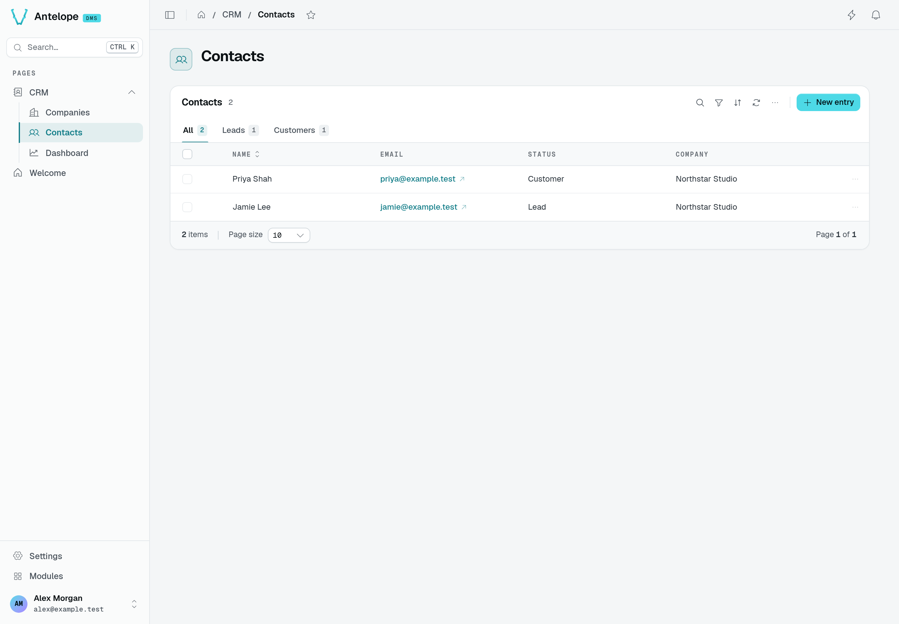
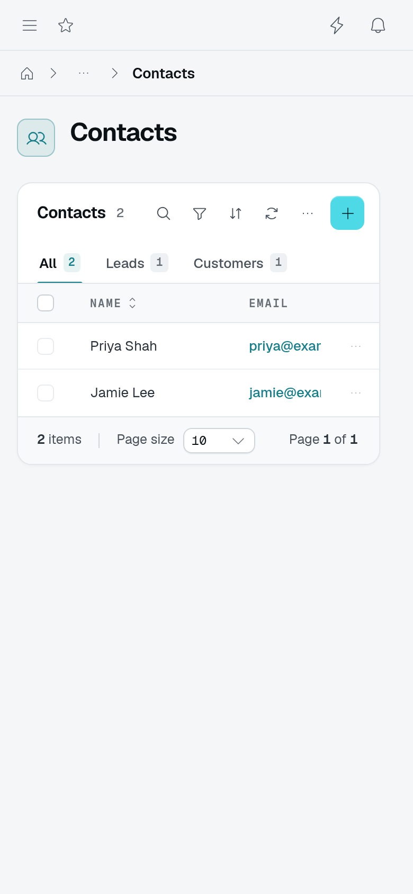
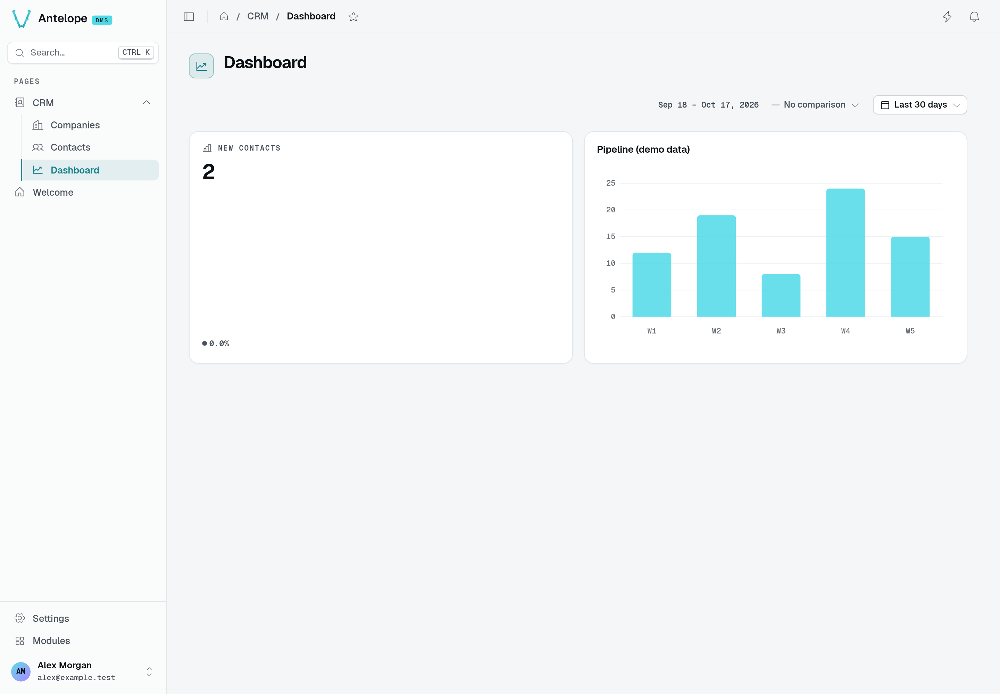
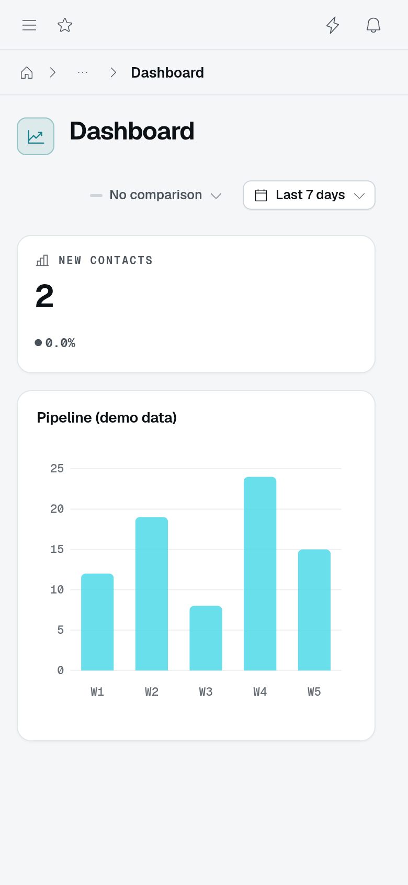

# Tutorial

The [Quickstart](/docs/getting-started/quickstart) runs the demo template. This tutorial adds a small CRM: companies, contacts linked to them, a dashboard, and role-based access. Build the company and contact screens first, then add the dashboard and test a restricted role.

You need a running project from the Quickstart (or [Project setup](/docs/building/project-setup)) with the database up ([Installation](/docs/getting-started/installation)). Redis is optional for this single-instance tutorial. Add the files below alongside the template's existing files, and merge the entry-point imports and schema registration into its lifecycle rather than replacing it. Everything below is backend TypeScript — no Vue.

For a smaller first step, run the [Welcome page example](/docs/building/pages-and-components#declare-a-page) and check its **Your first DMS page** placeholder before adding the CRM below. The screenshots here run these examples together on a fresh database; they do not show the template's unrelated demo application.

## What you'll build

The same contact appears in three places: a database row, a controller's field definitions, and a table with an edit form. The controller connects the stored data to the UI:

```text [From data to screen]
┌─────────────────┐     ┌─────────────────┐     ┌───────────────────┐
│ Company /       │────▶│ DataController  │────▶│ TableView page    │
│ Contact models  │     │ fields + routes │     │ list + edit form  │
└─────────────────┘     └─────────────────┘     └───────────────────┘
```

Keep this file map nearby as you work. The CRM is separate from the template's seeded demo application.

```bash [src/]
src/
  db/crm.ts           # two tables + models: Company, Contact
  data-api/crm.ts     # two DataControllers: the data shape and CRUD rules
  pages/crm.ts        # a CRM category, two table pages, a dashboard page
  routes/crm-stats.ts # the KPI route behind the dashboard
  index.ts            # side-effect imports + schema registration
```

:::steps{level="3"}

### Declare the tables and models

Tables, models, and the `@Field`/`@Relation` decorators are AntelopeJS concepts — the framework's [Database guide](https://antelopejs.com/docs/guides/database) is their reference if anything in this step is unfamiliar. The point to notice here: `Contact.companyId` carries `@Relation({ to: () => Company })`, so the schema itself records the link between the two tables.

```ts [src/db/crm.ts]
import {
  BasicDataModel,
  CreationTime,
  Field,
  Index,
  RegisterTable,
  Relation,
  Table,
  UpdateTime,
} from "@antelopejs/interface-database-decorators";

export const CRM_SCHEMA = "crm";

@RegisterTable("crm_companies", CRM_SCHEMA)
export class Company extends Table {
  @Field("string") declare _id: string;
  @Field("string") declare name: string;
  @Field("string") declare city?: string;
  @CreationTime() @Index() @Field("date") declare createdAt: Date;
  @UpdateTime() @Index() @Field("date") declare updatedAt: Date;
}
export class CompanyModel extends BasicDataModel(Company, "crm_companies") {}

@RegisterTable("crm_contacts", CRM_SCHEMA)
export class Contact extends Table {
  @Field("string") declare _id: string;
  @Field("string") declare name: string;
  @Field("string") declare email: string;
  @Index() @Field("string") declare status: "lead" | "customer";
  @Field("string") @Relation({ to: () => Company }) declare companyId?: string;
  @CreationTime() @Index() @Field("date") declare createdAt: Date;
  @UpdateTime() @Index() @Field("date") declare updatedAt: Date;
}
export class ContactModel extends BasicDataModel(Contact, "crm_contacts") {}
```

`@CreationTime()` / `@UpdateTime()` auto-stamp the dates on insert and update. `CRM_SCHEMA` is your project's **own schema**: the second argument of `@RegisterTable` files each table under it, and the entry file provisions it with `RegisterSchema` (wired below). The tutorial stays single-tenant — a per-tenant CRM uses the tenant schema and scoped models instead ([Multi-tenant data](/docs/auth-and-tenancy/multi-tenant)).

### Describe the data with DataControllers

A `DataController` declares, once, what each field is and which operations exist — the table screens and their forms derive from it ([Data controller](/docs/components/data-controller)). The `DataController` factory and its field decorators are AntelopeJS Data API concepts ([Data API guide](https://antelopejs.com/docs/guides/data-api)); the DMS-specific parts are the `@Column`/`@Searchable` metadata and the `TableViewRoutes` generators used below — the DMS counterpart of data-api's `DefaultRoutes`, with each generated route gated by its own permission.

```ts fragment [src/data-api/crm.ts]
import { Controller } from "@antelopejs/interface-api";
import { DataController, RegisterDataController } from "@antelopejs/interface-data-api";
import {
  Access,
  AccessMode,
  Listable,
  Mandatory,
  ModelReference,
  Optional,
  Sortable,
} from "@antelopejs/interface-data-api/metadata";
import { Model } from "@antelopejs/interface-database-decorators";
import { DefaultDataTypes } from "@antelopejs/interface-dms/base/data-types";
import { Searchable } from "@antelopejs/interface-dms/base/searchable";
import {
  Column,
  Select,
  TableViewRoutes,
} from "@antelopejs/interface-dms/base/table-view";
import { Company, CompanyModel, Contact, ContactModel } from "../db/crm";

@RegisterDataController()
export class companyDataAPI extends DataController(
  Company,
  TableViewRoutes.All,
  Controller("/api/crm/companies"),
) {
  @ModelReference()
  @Model(CompanyModel)
  declare model: CompanyModel;

  @Select()
  @Listable()
  @Access(AccessMode.ReadOnly)
  declare _id: string;

  @Searchable()
  @Select()
  @Listable()
  @Sortable()
  @Column({ name: "Name", type: new DefaultDataTypes.StringType(), filterable: true })
  @Mandatory("new", "edit")
  @Access(AccessMode.ReadWrite)
  declare name: string;

  @Listable()
  @Column({ name: "City", type: new DefaultDataTypes.StringType() })
  @Optional()
  @Access(AccessMode.ReadWrite)
  declare city: string;
}

@RegisterDataController()
export class contactDataAPI extends DataController(
  Contact,
  TableViewRoutes.All,
  Controller("/api/crm/contacts"),
) {
  @ModelReference()
  @Model(ContactModel)
  declare model: ContactModel;

  @Listable()
  @Access(AccessMode.ReadOnly)
  declare _id: string;

  @Searchable()
  @Listable()
  @Sortable()
  @Column({ name: "Name", type: new DefaultDataTypes.StringType(), filterable: true })
  @Mandatory("new", "edit")
  @Access(AccessMode.ReadWrite)
  declare name: string;

  @Searchable()
  @Listable()
  @Column({ name: "Email", type: new DefaultDataTypes.EmailType() })
  @Mandatory("new", "edit")
  @Access(AccessMode.ReadWrite)
  declare email: string;

  @Listable()
  @Column({
    name: "Status",
    type: new DefaultDataTypes.SelectType({
      items: [
        { value: "lead", label: "Lead" },
        { value: "customer", label: "Customer" },
      ],
    }),
    filterable: true,
    defaultValue: "lead",
  })
  @Mandatory("new", "edit")
  @Access(AccessMode.ReadWrite)
  declare status: string;

  @Listable()
  @Column({
    name: "Company",
    type: new DefaultDataTypes.RelationType({
      dataApiController: companyDataAPI,
      keyMapping: { label: "name", value: "_id" },
    }),
  })
  @Optional()
  @Access(AccessMode.ReadWrite)
  declare companyId: string;
}
```

The `RelationType` column is the UI side of the relation the schema declared with `@Relation`: the contact form gets a searchable **company picker** (served by the company controller's `select` route), the list shows the company's `name` instead of a raw id, and — because the company controller has a `new` route — the picker offers an inline "add company" form to users holding that permission.

`@Select()` marks the fields that lightweight `select` route exposes, so only the **target** of a relation needs it — `_id` for the picker's value, `name` for its label. Nothing references contacts, which is why the contact controller declares none.

### Register the pages

Pages anchor the screens in the sidebar. A `Category` groups them under `pagesCategory` — the sidebar's root **Pages** group; each `TableView` points at its controller — columns and forms come from the decorators, not from the page. `PageController`'s first argument is the **page id**: keep it in mind, the permission ids in the last step derive from it.

```ts fragment [src/pages/crm.ts]
import {
  Category,
  PageController,
  RegisterPage,
  pagesCategory,
} from "@antelopejs/interface-dms/page";
import { TableView } from "@antelopejs/interface-dms/base/table-view";
import { companyDataAPI, contactDataAPI } from "../data-api/crm";

export const crm = Category("crm", {
  displayName: "CRM",
  icon: "i-ph-address-book",
  category: pagesCategory,
});

@RegisterPage()
export class CompaniesPage extends PageController("crm-companies", {
  displayName: "Companies",
  icon: "i-ph-buildings",
  category: crm,
  urlSlug: "companies",
}) {
  static table = TableView(companyDataAPI, {
    caption: "Companies",
    labelKey: "name",
    formContainer: { type: "drawer" },
    rowActions: { add: true, edit: true, delete: true, hasSelection: true },
  });
}

@RegisterPage()
export class ContactsPage extends PageController("crm-contacts", {
  displayName: "Contacts",
  icon: "i-ph-users",
  category: crm,
  urlSlug: "contacts",
}) {
  static table = TableView(contactDataAPI, {
    caption: "Contacts",
    labelKey: "name",
    formContainer: { type: "drawer" },
    rowActions: { add: true, edit: true, delete: true, hasSelection: true },
    tabs: [
      {
        id: "leads",
        label: "Leads",
        filter: { accessorKey: "status", value: "lead", mode: "is" },
      },
      {
        id: "customers",
        label: "Customers",
        filter: { accessorKey: "status", value: "customer", mode: "is" },
      },
    ],
  });
}
```

Two options do quiet work here: `labelKey` picks the field that identifies a row in container titles (the drawer's title shows the record's `name` instead of an id), and `hasSelection` enables row selection.

Wire the entry file: the side-effect imports run the decorators, and `start()` registers the schema — `RegisterSchema` reads every table filed under `crm` and provisions them once the database is up.

```ts fragment [src/index.ts]
import "./db/crm";
import "./data-api/crm";
import "./pages/crm";
import "./routes/crm-stats"; // next step

import { RegisterSchema } from "@antelopejs/interface-database-decorators";
import { CRM_SCHEMA } from "./db/crm";

export async function start(): Promise<void> {
  await RegisterSchema(CRM_SCHEMA);
}
```

Restart the backend, then the frontend ([full-restart, always](/docs/building/project-setup#running)). The sidebar now shows a **CRM** group: create a company, then a contact — the company picker, the status tabs, the drawer forms, search, and filters are all there without a line of Vue.

To reproduce the populated screen, create **Northstar Studio** with city **Brussels** in **CRM → Companies**. In **CRM → Contacts**, use **New entry** to add the following contacts, select Northstar Studio in each company picker, and save each form:

| Name | Email | Status | Company |
| --- | --- | --- | --- |
| Jamie Lee | jamie@example.test | Lead | Northstar Studio |
| Priya Shah | priya@example.test | Customer | Northstar Studio |



These are saved tutorial records, not the template's seed data: **All 2**, **Leads 1**, and **Customers 1**. The Company column resolves the stored relation to **Northstar Studio**.



At 390 CSS pixels, the names and tab counts remain visible. Scroll the table horizontally to reach **Status** and **Company**; the screenshot shows its initial scroll position.

### Add a dashboard

A dashboard is a page composing widgets. The `PeriodSelector` publishes a date range; the KPI card names it via `periodScope` and refetches when it changes ([Charts & widgets](/docs/components/charts-and-widgets)).

First the KPI route — it receives the selector's `from`/`to` as query params and answers the `KpiCard` payload. Guard it with the dashboard page's permission: hiding a widget does not protect a standalone API route. `CrmDashboardPage` is declared in the next snippet, so add both snippets before restarting.

```ts fragment [src/routes/crm-stats.ts]
import { Controller, Get, Parameter } from "@antelopejs/interface-api";
import { Model } from "@antelopejs/interface-database-decorators";
import { AuthUserWithPermission } from "@antelopejs/interface-dms/guards";
import type { User } from "@antelopejs/interface-dms/auth/db";
import { Contact, ContactModel } from "../db/crm";
import { CrmDashboardPage } from "../pages/crm";

export class CrmStatsController extends Controller("/api/crm/stats") {
  @Model(ContactModel)
  declare contacts: ContactModel;

  @Get("new-contacts")
  async newContacts(
    @AuthUserWithPermission(CrmDashboardPage) _user: User,
    @Parameter("from", "query") from?: string,
    @Parameter("to", "query") to?: string,
  ) {
    const start = from ? new Date(from) : new Date(0);
    const end = to ? new Date(to) : new Date();
    const span = end.getTime() - start.getTime();
    const previousStart = new Date(start.getTime() - span);

    // Fine for a tutorial-sized table; index-backed queries for real volumes.
    const all = await this.contacts.getAll();
    const inRange = (c: Contact, a: Date, b: Date) => c.createdAt >= a && c.createdAt <= b;
    const value = all.filter((c) => inRange(c, start, end)).length;
    const previousValue = all.filter((c) => inRange(c, previousStart, start)).length;
    const delta = previousValue === 0 ? 0 : ((value - previousValue) / previousValue) * 100;

    return { value, delta };
  }
}
```

Then the page — it composes a selector, a grid row, one live KPI card, and a chart running on fixture data so you can see both feeding modes:

```ts fragment [src/pages/crm.ts — add to the file]
import { ChartColumn } from "@antelopejs/interface-dms/base/chart";
import { Grid, GridRow } from "@antelopejs/interface-dms/base/grid";
import { KpiCard } from "@antelopejs/interface-dms/base/kpi-card";
import { PeriodSelector } from "@antelopejs/interface-dms/base/period-selector";

@RegisterPage()
export class CrmDashboardPage extends PageController("crm-dashboard", {
  displayName: "Dashboard",
  icon: "i-ph-chart-line-up",
  category: crm,
  urlSlug: "dashboard",
  order: 0,
}) {
  static period = PeriodSelector({ id: "crm", defaultPreset: "last-30-days" });

  static widgets = Grid({ gap: "1rem" }).child(
    "row",
    GridRow()
      .child(
        "newContacts",
        KpiCard({
          title: "New contacts",
          fetchUrl: "/api/crm/stats/new-contacts",
          periodScope: "crm",
        }),
      )
      .child(
        "pipeline",
        ChartColumn({
          title: "Pipeline (demo data)",
          height: "260px",
          staticDataset: [
            { name: "Deals", data: [12, 19, 8, 24, 15].map((y, i) => ({ x: `W${i + 1}`, y })) },
          ],
        }),
      ),
  );
}
```

Reload: pick "Last 7 days" in the selector and watch the KPI refetch with the new range while the demo chart stays put. Swapping the chart's `staticDataset` for a `fetchUrl` + `periodScope` is the same pattern as the KPI.



**New contacts** reads **2** from the two records just saved, with **Last 30 days** selected. **Pipeline (demo data)** still uses the snippet's fixed values **12, 19, 8, 24, 15**; it does not summarize those contacts. The dates follow the day you run the tutorial, and the example returns a zero delta when the previous period has no contacts.



After selecting **Last 7 days**, the narrow layout stacks the KPI and chart. **New contacts** remains **2** because both records were created today, and the five demo bars stay unchanged.

### Gate it with roles

Everything you registered already produced a **permission tree**: the CRM pages, each table, and each table action (`list`, `add`, `edit`, `delete`, …) under ids like `pages.crm.crm-contacts.table.delete`. Nothing to declare — see for yourself:

::important
Step 3 sends an email, so an `interface-email` implementation must be loaded — in development, `@antelopejs/nodemailer` with `ethereal: true` routes invites to a disposable test inbox ([Optional dependencies](/docs/getting-started/installation#optional-dependencies)).
::

1. Open **Settings → Roles** and create a role `Sales`.
2. In its permission tree, expand **CRM** and grant the contacts page with `list`/`add`/`edit` but **not** `delete`.
3. Invite a user from **Settings → Members** with the `Sales` role ([Built-in authentication](/docs/auth-and-tenancy/authentication#how-users-enter-the-platform)), then sign in as them.

The Delete entry is gone from the row menu — and the route rejects it server-side too, because the same permission gates both. The full model (id derivation, decorators, standalone permissions) is [Auth & permissions](/docs/auth-and-tenancy/auth-and-permissions).

:::

## Where to go next

You have modelled data, derived CRUD screens from it, linked two tables, composed a dashboard driven by a shared period, and scoped it all by role — the workflow behind every DMS feature. From here:

:::card-group

::card{title="Tables" icon="i-lucide-table" to="/docs/components/tables"}
Everything a TableView can do — archive, kanban, exports, guards.
::

::card{title="Actions & reactivity" icon="i-lucide-zap" to="/docs/building/actions-and-reactivity"}
Make components react to each other, from the backend.
::

::card{title="Multi-tenant data" icon="i-lucide-building-2" to="/docs/auth-and-tenancy/multi-tenant"}
Turn the CRM per-tenant with scoped models.
::

::card{title="Built-in dashboard" icon="i-lucide-panels-top-left" to="/docs/getting-started/built-in-dashboard"}
The screens you just used — members, roles, invites.
::

:::
