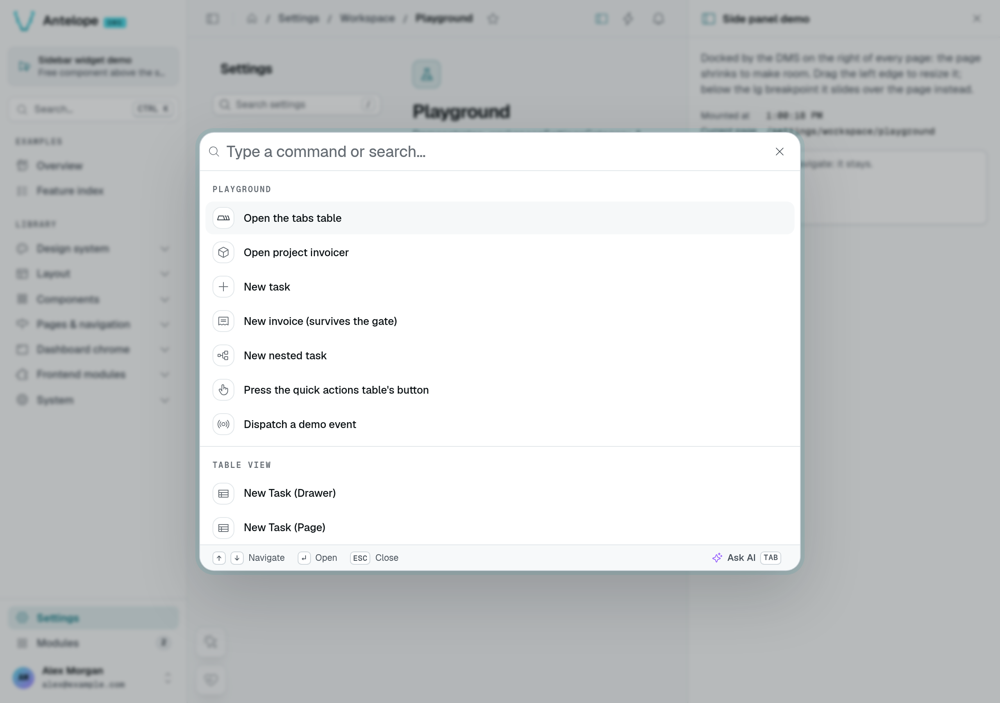
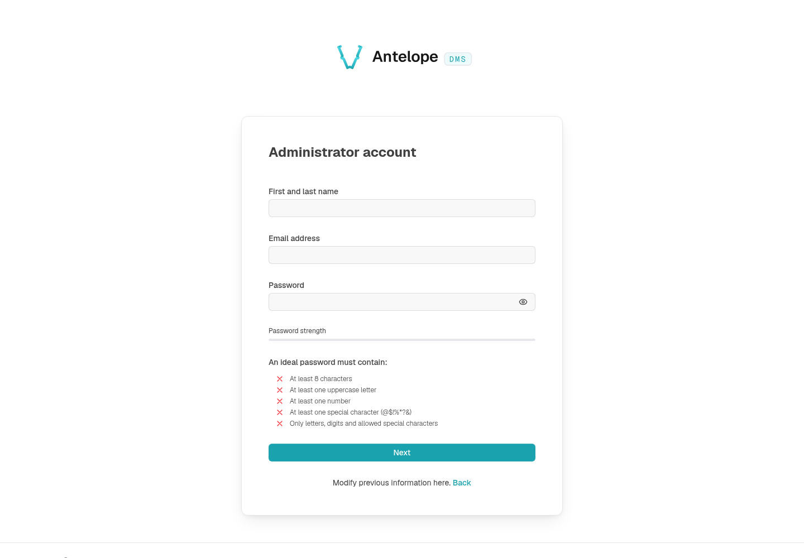
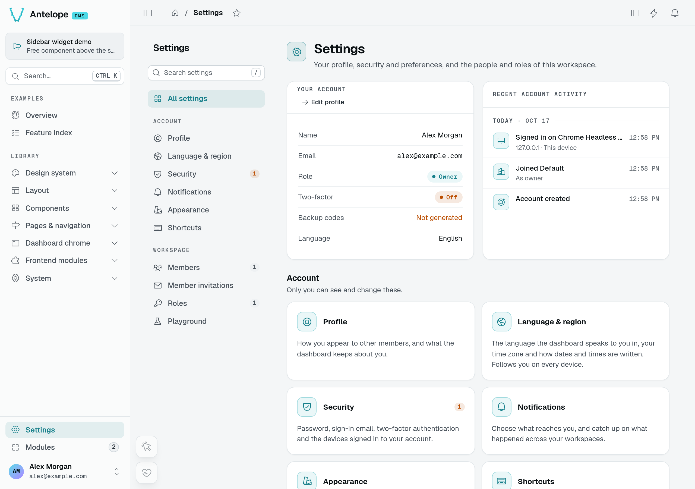
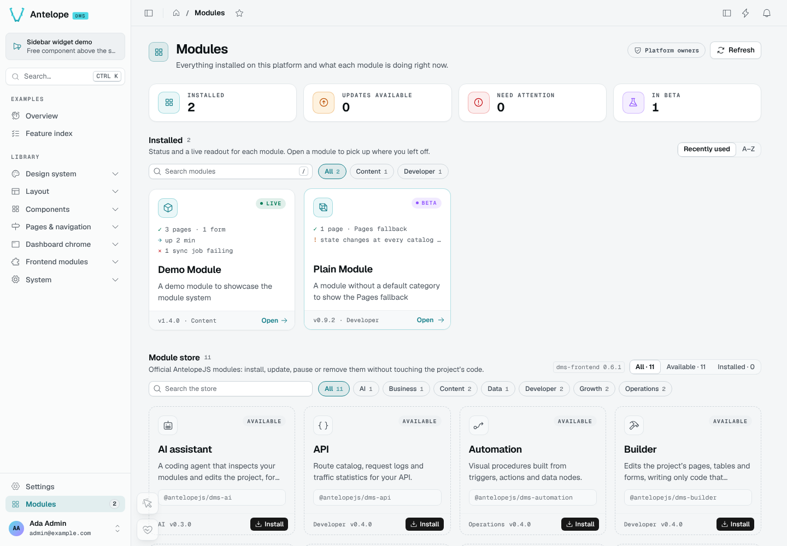

# Built-in dashboard

Before you add a page, the DMS gives you onboarding, sign-in, navigation, search, and account and workspace settings. This tour shows where users find those features. The screenshots use the repository playground, whose demo widgets and navigation entries are not part of a bare installation.

## The shell

Every page renders inside the same chrome:

- **Sidebar** — the search / command palette trigger and the navigation tree built from the three root groups (**Pages**, **Modules**, **Settings**) and whatever categories and modules your code registers ([Navigation](/docs/building/navigation)). Its footer holds Modules (for platform owners) and the user menu, opened from the signed-in user's row: Profile, Settings, Switch account, Theme, Language and Log out. The user menu is the way to the settings: its Settings entry opens every setting the user may open (`/settings`), the sidebar has no Settings entry of its own, and the user's row is drawn active while a settings page is open. The command palette's session group offers the same account entries, and its navigation group leaves their pages out so Settings and Profile are listed once. Choosing an entry of the user menu closes the sidebar drawer on a phone, as a sidebar link does. Users can pin pages as **favorites**, and the sidebar collapses to icons.
- **Header** — the sidebar-collapse toggle, the breadcrumb with its favorite star, quick actions and the notification bell (the light / dark / system choice lives in the user menu of the sidebar footer).
- **Footer** — copyright, locale switcher, and registered links.

A frontend layer extends every part of this shell through registries — header buttons, layout banners, sidebar widgets, footer links, app widgets and overlays ([Dashboard chrome](/docs/extending-the-dashboard/dashboard-chrome)) — and reskins it through app config ([Theming & branding](/docs/extending-the-dashboard/theming-and-branding)).

### The command palette

The search (Ctrl/Cmd+K) opens a command palette aggregating several groups, all permission-gated and fuzzy-searchable:

- **Quick actions** — backend-registered shortcuts that navigate somewhere, open a form, or fire an event, grouped by category. Your modules add their own ([Navigation](/docs/building/navigation#quick-actions-the-command-palette)).
- **Favorites & recents** — the user's pinned pages, and recently visited modules resuming at their last path.
- **Navigation** — every reachable page of the nav tree as a breadcrumbed link, broader than the sidebar.
- **Session** — profile, settings, account switching, a language submenu, copy-current-URL, and logout.

A frontend layer can contribute its own groups through the command-palette source registry ([Dashboard chrome](/docs/extending-the-dashboard/dashboard-chrome#command-palette-sources)). A module can also give the palette an **assistant mode**: Tab then switches the dialog to a prompt the module answers, and every search ends with an "Ask the assistant" item ([Dashboard chrome](/docs/extending-the-dashboard/dashboard-chrome#command-palette-assistant)).

### The notification center

The bell surfaces in-app notifications with a badge of what is unread, live over the user's realtime stream, drawn in the tone of the most important unread notification: red while an error is unread, amber for a warning, the accent for an action available. The Notifications entry of the settings shows the same count in the same colour. Opening the bell changes neither: a notification leaves the count once you open it or mark it read. Your backend code sends notifications through the notification service ([Backend services](/docs/building/backend-services#notifications)); users choose which subjects they receive in their settings.

## First run: the onboarding wizard

A fresh instance has no users. Until one exists, every route funnels to `/onboarding`, a three-step wizard: **Platform** (the platform name, which then titles the browser tab and the sign-in page over the configured `meta.title`, and the administrator's language), **Administrator** (first and last name, e-mail and a password checked live against the five password rules), then **Ready** (next steps, then the dashboard). It registers the **first admin** — created as **platform owner**, attached to the default tenant — and marks the instance onboarded. From then on the wizard locks itself (it answers `412` to anyone who returns) and new users arrive by [invitation](/docs/auth-and-tenancy/authentication#how-users-enter-the-platform) — or by [self-registration](/docs/auth-and-tenancy/saas-mode) when the optional `dms-saas` module is loaded.

## The auth screens

Login, invite signup, two-factor challenge, email validation, password recovery, and the account picker all ship as public pages under `/auth/*`. The flows behind them — token rotation, 2FA methods, the password policy — are their own chapter: [Built-in authentication](/docs/auth-and-tenancy/authentication).

## The settings area

The **Settings** root group opens on an overview — the user's account summary, their recent account activity, and a card per settings page they can open — which every member reaches, with or without a role, and groups its pages in two categories, each with its own navigation group:

- **Account** (`/settings/user/…`) — the user's own pages. Every signed-in member reaches them, with every component and action on them, without a role granting anything (the category is `memberAccess` — [Auth & permissions](/docs/auth-and-tenancy/auth-and-permissions#authenticate-pages)), so the Roles editor does not list them.
- **Workspace** (`/settings/workspace/…`) — the pages that manage the workspace as a whole. They keep requiring their permissions, granted through roles.

| Page              | Category  | What it does                                                                                                                                                                                                 |
| ----------------- | --------- | ------------------------------------------------------------------------------------------------------------------------------------------------------------------------------------------------------------ |
| **Profile**       | Account   | Avatar, name, email, a security summary, and shortcuts to preferences and workspace roles. Also provides personal data export and account deletion; see [Profile data and deletion](#profile-data-and-deletion). |
| **Language & region** | Account | Interface language, time zone (automatic from the browser, or any IANA zone), first day of the week, 12- or 24-hour clock and numeric or written dates, saved as they change. Stored on the account, so every device follows them, and applied by every date the dashboard writes ([Localization](/docs/building/localization#dates-and-times)). |
| **Security**      | Account   | What needs attention, the password (a change signs out every other device), the sign-in email (changed through a code sent to the new address), **two-factor** methods (authenticator app, email codes, backup codes; adding one asks for the password, then a code from the new method), and the **sessions** list with per-device revocation and "Sign out other sessions" ([Authentication](/docs/auth-and-tenancy/authentication)). |
| **Notifications** | Account   | Toggle received notification subjects, saved as they change. Subjects are grouped by source, each group folded until opened (its row keeps the master switch and the "n of m on" count; the browser remembers which groups the viewer opened); the inbox lists past notifications in a table — All / Unread tabs, mark all as read, delete all.                                                 |
| **Appearance**    | Account   | Color mode, interface density (small / normal / large), the sidebar's starting state, and accessibility options: reduce motion, increase contrast, always underline links. All per device.                   |
| **Shortcuts**     | Account   | The keyboard-shortcut reference, aggregated from every loaded layer.                                                                                                                                         |
| **Members**       | Workspace | The tenant's member table — invite by email (roles, language, owner flag, optional name), promote/demote tenant owners, force email validation, remove members. Owner-safety guards prevent removing the last owner. **Member invitations**, listed under it, holds the pending invitations, with edit, resend and cancel. |
| **Roles**         | Workspace | Create roles and grant permissions from the permission tree that your pages, components, and actions register, and preview what a role sees ([Auth & permissions](/docs/auth-and-tenancy/auth-and-permissions)). |

Your project can add its own settings pages — workspace settings under `workspaceSettingsCategory`, personal ones in a `memberAccess` category — see [Settings pages](/docs/building/settings-pages).

### Profile data and deletion

The Profile page's **Preferences & access** block summarizes workspace roles, Language & region, Notifications (unread count and enabled subjects), and Appearance. It shows a row only when the user can open that page; the role summary links to Roles only when the user can open Roles. The security summary links to Security.

**Your data** downloads a JSON file containing the user's profile, preferences, memberships and roles, notifications, sessions, linked sign-in providers, and invitations sent. It never includes a password, two-factor secret, or token.

Deleting an account requires the user's password and typed email. The DMS refuses to delete the last owner of a workspace or the platform. A successful deletion signs out every device and removes memberships, exports started by the user (including files), notifications, provider links, and two-factor data. It keeps invitations the user sent and fires `USER_DELETED` ([Lifecycle hooks](/docs/building/backend-services#lifecycle-hooks)).

## The Modules page and its store

**Modules**, in the sidebar footer, is for platform owners. Its first section lists the modules installed on the platform with their status and live readout; the second, the **module store**, lists the official AntelopeJS modules, installed or not, filtered by All, Available or Installed, searchable and grouped by category.

In development, from a store tile an owner installs a module, updates it when the npm registry has a newer release, pauses and resumes it, or uninstalls it. Uninstalling keeps the module's data — collections, files, settings — for a later install. Every action runs on the live platform, one at a time: the tile shows its steps, a failure leaves the platform as it was and keeps the error on the tile with a retry, and the page reloads by itself once the frontend serves the change. A module the project declares in `antelope.config.ts` is shown as such and has no action. A tile also says when a release needs another dms-frontend, which interfaces it needs that nothing implements yet (the install then asks which module to add for each), and which running modules keep a module from being paused or removed.

The frontend follows on its own under `ajs dms dev`, which rebuilds its workspace when the backend's set of modules changes. A production frontend is rebuilt with `ajs dms build`, which the page says once the backend runs a module the frontend does not serve yet. What the store installs is written to `antelope.config.ts`, without restarting the project, and production loads it from there: in production the store is read-only unless `store.enabled` is set ([Configuration](/docs/building/configuration#store-module-store)).

## Housekeeping the platform runs for you

Two scheduled tasks ship with the module:

- **Invite cleanup** — expires outdated invitations every night.
- **Export sweep** — removes expired completed or failed table exports every hour, leaving pending exports untouched.

Add to that the default-tenant bootstrap on first database initialization, and session `lastActiveAt` tracking on refresh.

## Where to go next

:::card-group

::card{title="Quickstart" icon="i-lucide-rocket" to="/docs/getting-started/quickstart"}
Register your first page next to all of this.
::

::card{title="Authentication" icon="i-lucide-key-round" to="/docs/auth-and-tenancy/authentication"}
The flows behind the auth screens.
::

::card{title="Dashboard chrome" icon="i-lucide-layout-template" to="/docs/extending-the-dashboard/dashboard-chrome"}
Add your own buttons, widgets, and links to the shell.
::

::card{title="Theming & branding" icon="i-lucide-palette" to="/docs/extending-the-dashboard/theming-and-branding"}
Your logo and colors instead of the defaults.
::

:::
