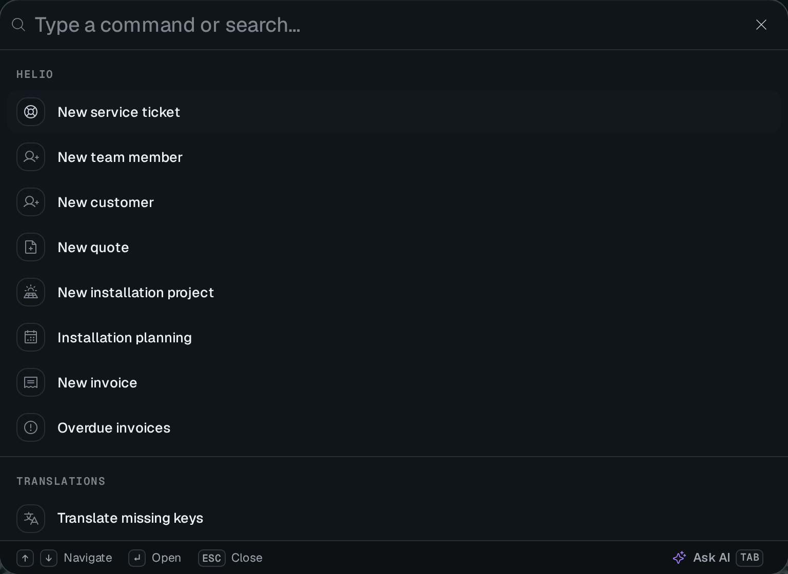
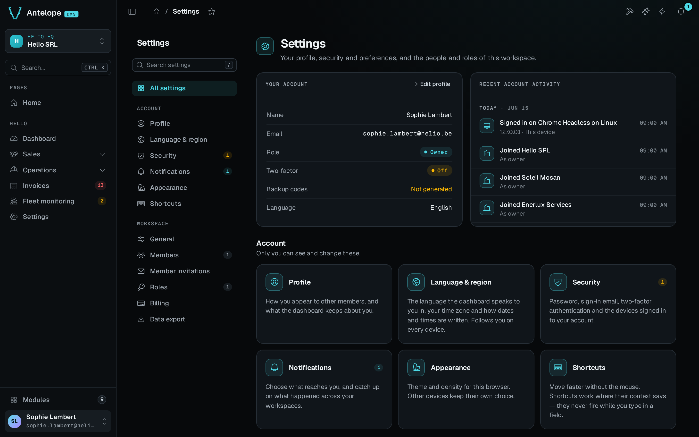
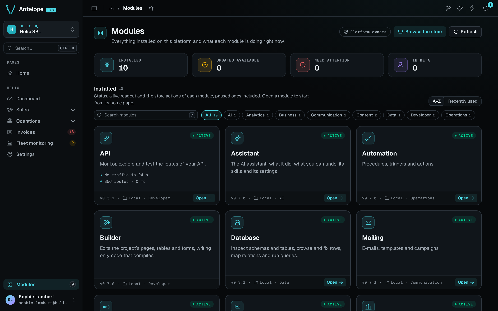

The DMS ships a complete dashboard before you add a page. This page lists what each part does and where users find it. The screenshots come from the demo template, so they also show Helio's pages and quick actions, which a bare installation does not have.

## The shell

Every page of the dashboard renders inside the same frame: a sidebar, a header, and the page.

- **Sidebar.** It holds the search button that opens the command palette, the user's favorite pages, and the navigation tree. The tree shows the **Pages** section and the other categories your code registers ([Navigation](/docs/building/navigation)). Inside a module, it shows that module's own tree with a **Back** entry. The sidebar footer holds **Modules**, for platform owners only, and the user menu. The sidebar collapses to icons.
- **User menu.** It opens from the signed-in user's row and has **Profile**, **Settings**, **Switch account**, **Theme**, **Language**, and **Log out**. **Settings** opens `/settings`, which lists every settings page the user may open. The sidebar has no Settings entry of its own, and the user's row is drawn active while a settings page is open. On a phone, choosing an entry closes the sidebar drawer, as a sidebar link does.
- **Header.** It holds the toggle that collapses the sidebar, the breadcrumb with its favorite star, the quick actions, and the notification bell.

The public pages, such as sign-in and onboarding, use a separate layout without the sidebar or the header. Its footer shows the copyright, a locale switcher, and registered links.

A frontend layer adds header buttons, layout banners, sidebar widgets, footer links, app widgets, and overlays through registries ([Dashboard chrome](/docs/extending-the-dashboard/dashboard-chrome)). App config changes the logo and the colors ([Theming & branding](/docs/extending-the-dashboard/theming-and-branding)).

### The command palette

Ctrl+K, or Cmd+K on macOS, opens the command palette. It searches several groups with fuzzy matching, and each entry checks the user's permissions:

| Group | What it lists |
| --- | --- |
| Quick actions | Shortcuts that the backend registers, grouped by category. Each one opens a page, opens a form, or fires an event. Your modules add their own ([Navigation](/docs/building/navigation)). |
| Favorites and recents | The user's pinned pages and the modules they opened recently. A recent module opens on its landing page. |
| Navigation | Every page the user can reach, each with its breadcrumb. |
| Session | Profile, settings, account switching, a language submenu, copying the current URL, and logout. |

A frontend layer can add its own groups ([Dashboard chrome](/docs/extending-the-dashboard/dashboard-chrome)). A module can also give the palette an assistant. Tab then switches the palette to a prompt that the module answers, and a search with text ends with an **Ask the assistant** entry.

### The notification bell

The bell shows the in-app notifications and a badge with the unread count. It updates live over the user's realtime stream. The badge takes the tone of the most important unread notification, in this order: error (red), warning (amber), the primary color, success, then neutral. A notification without a tone counts as primary. The **Notifications** settings entry shows the same count in the same color. Opening the bell changes neither. A notification leaves the count when the user opens it or marks it read.

Backend code sends notifications through the notification service ([Backend services](/docs/building/backend-services)). Users choose the subjects they receive on the **Notifications** settings page.

## First run: the onboarding wizard

A fresh instance has no user. Until the first one exists, every route sends the browser to `/onboarding`, a wizard in three steps:

1. **Platform.** The platform name and the administrator's language. The platform name then titles the browser tab and the sign-in page, in place of the configured `meta.title`.
2. **Administrator.** First and last name, email, and a password. The form checks the password live against five rules: at least 8 characters, an uppercase letter, a digit, a special character among `@$!%*?&`, and no other character.
3. **Ready.** The next steps, then a button that opens the dashboard.

The wizard creates the first user as **platform owner**, attaches it to the default tenant, and marks the instance as onboarded. After that, a visit to `/onboarding` sends the browser on to the sign-in page or the dashboard, and the registration route refuses a second administrator. New users then join by [invitation](/docs/auth-and-tenancy/authentication), or by [self-registration](/docs/auth-and-tenancy/saas-mode) when the optional `dms-saas` module is loaded.

## The auth screens

Sign-in, invitation signup, the two-factor challenge, email validation, password recovery, and the account picker are public pages under `/auth`. The sign-in page itself is `/auth`. [Built-in authentication](/docs/auth-and-tenancy/authentication) describes the flows behind them: token rotation, the two-factor methods, and the password policy.

## The settings

`/settings` opens on an overview with the user's account summary, their recent account activity, and a card for each settings page they can open. Every member reaches the overview, with or without a role. The settings pages fall in two categories:

- **Account**, under `/settings/user/`, holds the user's own pages. Every signed-in member reaches them with every component and action on them, and no role grants anything there. The category uses `memberAccess` ([Auth & permissions](/docs/auth-and-tenancy/auth-and-permissions)), so the Roles editor does not list these pages.
- **Workspace**, under `/settings/workspace/`, holds the pages that manage the workspace. Each one requires its permission, which a role grants.

| Page | Category | What it does |
| --- | --- | --- |
| **Profile** | Account | Avatar, name, email, a security summary, and links to preferences and workspace roles. It also has the personal data export and account deletion. See [Profile data and deletion](#profile-data-and-deletion). |
| **Language & region** | Account | Interface language, time zone (from the browser, or any IANA zone), first day of the week, 12- or 24-hour clock, and numeric or written dates. Each change saves at once. The values are stored on the account, so every device uses them, and every date the dashboard writes follows them ([Localization](/docs/building/localization)). |
| **Security** | Account | What needs attention, the password, the sign-in email, the two-factor methods, and the sessions. A password change signs out every other device. A new sign-in email is confirmed by a code sent to it. The two-factor methods are an authenticator app, email codes, and backup codes. The sessions list revokes one device or every other session. |
| **Notifications** | Account | The notification subjects the user receives, grouped by source. Each change saves at once. A group stays folded until the user opens it, its row shows a master switch and an "n of m on" count, and the browser remembers which groups are open. Below, the inbox lists past notifications in a table with **All** and **Unread** tabs, mark all as read, and delete all. Deleting one notification asks first. |
| **Appearance** | Account | Color mode, interface density (small, normal, or large), the sidebar's starting state, and three accessibility options: reduce motion, increase contrast, and always underline links. These settings are per device. |
| **Shortcuts** | Account | The keyboard shortcuts that the dashboard's components register. |
| **Members** | Workspace | The tenant's members. An owner invites by email with roles, a language, the owner flag, and an optional name. Owners also promote and demote tenant owners, force email validation, and remove members. The last owner cannot be removed. |
| **Member invitations** | Workspace | The pending invitations, with edit, resend, and cancel. The Members page links to it. |
| **Roles** | Workspace | Roles and their permissions, granted from the permission tree that your pages, components, and actions register. A preview shows what a role sees ([Auth & permissions](/docs/auth-and-tenancy/auth-and-permissions)). |

The screenshot also shows **General**, **Billing**, and **Data export** under Workspace. Modules of the demo template add them, and a bare installation does not have them. Your project can add its own settings pages too: workspace pages under `workspaceSettingsCategory`, and personal pages in a category with `memberAccess` ([Settings pages](/docs/building/settings-pages)).

### Profile data and deletion

The **Preferences & access** block of the Profile page always shows the user's workspace roles, and links to the Roles page only when the user can open it. It also summarizes Language & region, Notifications (unread count and enabled subjects), and Appearance, each only when the user can open that page. The security summary links to the Security page.

**Your data** downloads a JSON file with the user's profile, preferences, memberships and roles, notifications, sessions, linked sign-in providers, and the invitations they sent. It never holds a password, a two-factor secret, or a token.

To delete their account, a user types their email, and their password when the account has one. The DMS refuses to delete the last owner of a workspace or of the platform. A deletion signs out every device and removes the user's memberships, the exports they started with their files, their notifications, their provider links, and their two-factor data. It keeps the invitations the user sent and fires `USER_DELETED` ([Backend services](/docs/building/backend-services)).

## The Modules page and the store

**Modules**, in the sidebar footer, is for platform owners. It is the one place where a module is managed.

The page lists every module installed on the platform, including paused modules and modules that serve no page, because `antelope.config.ts` still declares them. Modules are sorted by their name by default, or by last use, and the browser remembers the choice. Each tile shows:

- A pill with the module's state: **Active**, **Inactive** while it is paused, or what needs a look, such as an error, a change not applied yet, a frontend to restart, or an update.
- A footer with the version, the source of the code, and the category, such as `v0.5.0 · npm · Content`. The source is npm, GitHub, GitLab, another git host, or a local folder, shown by its icon and name.
- A button that opens the module on its landing page, or resumes it while it is paused. The other actions are in its **Manage** menu.

**Browse the store**, in the page header, opens the module store at `/modules/store`. It lists the official AntelopeJS modules in one grid, with a search field and a filter per category. It opens on **Available**, the modules not installed yet. **Installed** and **All** show the rest. When every module is installed, the store says so and offers a button to show them all. A module that is not installed offers **Install**. An installed one is marked **Installed**, links to its tile on the Modules page, and shows **Update available** when the npm registry has a newer release.

In development, an owner installs a module from the store. From its tile, the owner then updates it, pauses it, resumes it, or uninstalls it. Pausing keeps its configuration in `antelope.config.ts`. Uninstalling removes its configuration block from `antelope.config.ts` and keeps its data, such as collections, files, and settings, for a later install.

Each action runs on the live platform, one at a time. The tile shows the steps. A failure leaves the platform as it was and keeps the error on the tile, with a retry. The page reloads by itself once the frontend serves the change. Other rules apply:

- A module that `antelope.config.ts` loads from a local folder or from git shows as a local copy, with no action.
- A store tile says when a release needs another `dms-frontend` release, and which interfaces it needs that no installed module implements. The install then asks which module to add for each.
- An installed tile says which running modules use it.
- A module that other running modules or the project's own code need cannot be paused or removed. Its **Manage** menu says why, and the server refuses the action too.

Under `ajs dms dev`, the frontend rebuilds its workspace when the backend's set of modules changes. A production frontend needs `ajs dms build`, and the page says so when the backend runs a module that the frontend does not serve yet. The store writes what it installs to `antelope.config.ts` without restarting the project, and production loads it from there. In production, the store is read-only ([Configuration](/docs/building/configuration)).

## Scheduled tasks

The module registers three scheduled tasks:

| Task | Schedule | What it does |
| --- | --- | --- |
| Invitation cleanup | Every night at 03:00 | Expires outdated invitations. |
| Session sweep | Every night at 03:30 | Deletes sessions idle for longer than the refresh-token lifetime. |
| Export sweep | Every hour | Removes expired table exports that completed or failed, and leaves pending exports alone. |

The module also creates the default tenant the first time it initializes the database, and it records each session's `lastActiveAt` when the session refreshes.

## Next steps

:::card-group

::card{title="Quickstart" icon="i-lucide-rocket" to="/docs/getting-started/quickstart"}
Run the demo template and see all of this next to Helio.
::

::card{title="Authentication" icon="i-lucide-key-round" to="/docs/auth-and-tenancy/authentication"}
The flows behind the auth screens.
::

::card{title="Dashboard chrome" icon="i-lucide-layout-template" to="/docs/extending-the-dashboard/dashboard-chrome"}
Add your own buttons, widgets, and links to the shell.
::

::card{title="Theming & branding" icon="i-lucide-palette" to="/docs/extending-the-dashboard/theming-and-branding"}
Use your logo and colors instead of the defaults.
::

:::
