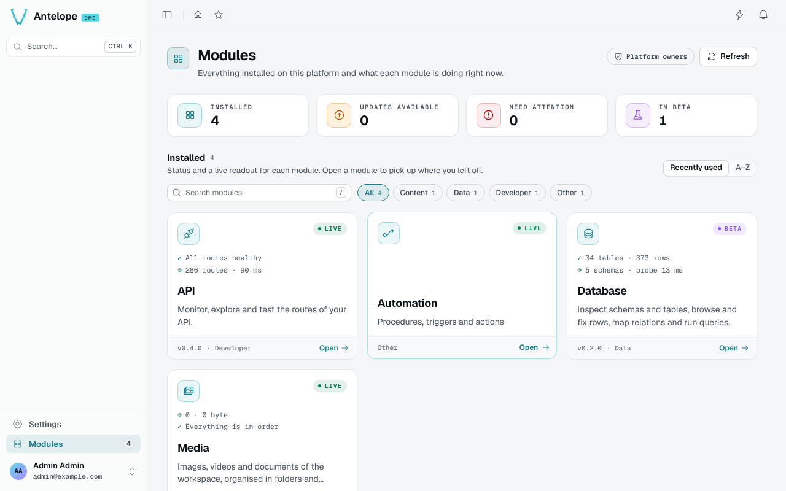

# Run the DMS inside AdonisJS

[template-dms-adonis](https://github.com/AntelopeJS/template-dms-adonis) runs the DMS as a guest of an AdonisJS 6 application. Pick it when you already have, or want, an AdonisJS app that owns the HTTP server, signals, logger and configuration. For a new application without that constraint, start from [template-dms-demo](/docs/getting-started/quickstart): it supports hot reload for the dashboard and every `ajs` command.

## Standalone and embedded modes

In **standalone** mode the `ajs` CLI owns the process and reads the modules from `antelope.config.ts`; this is what template-dms-demo uses. In **embedded** mode your application owns the process and starts the runtime with `createRuntime()` from `@antelopejs/core`, with the modules listed in code. The [Embedded runtime](https://framework.antelopejs.com/docs/concepts/embedded-runtime) concept page compares the two.

In the template, `providers/antelope_provider.ts` creates the runtime in `register()`, starts it in `start()` and stops it in `shutdown()`, so the DMS follows the AdonisJS lifecycle.

## Start the backend and dashboard

You need Node.js 22 or later, pnpm, and a MongoDB server on `mongodb://localhost:27017` (`MONGODB_URL` in `.env`).

```bash [Terminal]
git clone https://github.com/AntelopeJS/template-dms-adonis.git my-app
cd my-app
pnpm install --frozen-lockfile
cp .env.example .env
node ace generate:key
```

Start AdonisJS and the embedded DMS:

```bash [Terminal 1]
pnpm dev
```

AdonisJS listens on `http://localhost:3333` and the DMS API on `http://localhost:5010`. While the backend runs, build and start the dashboard in a second terminal:

```bash [Terminal 2]
pnpm frontend:build
pnpm frontend:start
```

Open `http://localhost:3001`. On a fresh database, the first-run wizard creates your administrator account; after that, the dashboard shows the sign-in page.



The `.env` file holds the secrets the two processes share: `DMS_BOOTSTRAP_SECRET` is the DMS `frontend.bootstrapSecret` the dashboard presents to the backend, and `DMS_SESSION_SECRET` (at least 32 characters) signs the dashboard sessions. `DMS_COOKIE_SECURE=false` lets the session cookie work over plain `http` locally; remove it behind TLS. Replace every development secret before you deploy. [Frontend CLI](/docs/frontend/cli/overview) covers `ajs dms build`, `ajs dms start` and their variables.

## Add a DMS module

In embedded mode the provider's code is the module list, so `ajs project modules add` does not apply. To add a module such as `@antelopejs/dms-lang`:

::steps{level="3"}

### Install the package

```bash [Terminal]
pnpm add @antelopejs/dms-lang
```

The runtime loads modules from the application's `node_modules` (or a local path), not from the `~/.antelopejs` cache.

### List it in the provider

Add an entry to the `modules` map of `providers/antelope_provider.ts`, with its configuration under `config`:

```ts [providers/antelope_provider.ts]
this.runtime = createRuntime({
  projectFolder: this.app.makePath(),
  modules: {
    '@antelopejs/dms': { config: { /* ... */ } },
    '@antelopejs/dms-lang': {},
    // ...
  },
  uses: ['@antelopejs/interface-dms'],
})
```

### Restart and rebuild the dashboard

Restart `pnpm dev`, then run `pnpm frontend:build` and `pnpm frontend:start` again: the build bundles the frontend modules the backend serves, so a module added or removed after the last build does not show until you rebuild.

::

Application code reaches the DMS through `runtime.use()`, never by importing an `@antelopejs/interface-*` package directly; the template's `GET /dms/info` route in `start/routes.ts` shows the pattern.

## Limitations

Embedded mode trades the `ajs` tooling for control over the process. The [Embedded runtime guide](https://framework.antelopejs.com/docs/guides/embedded-runtime) details each point:

- **No `ajs dms dev`.** The embedded runtime forces `dev: false`, so the DMS does not publish the layer source paths the dashboard's hot-reload server needs. Build and start the dashboard instead, and rebuild after a module change.
- **A separate API port.** `@antelopejs/api` listens on its own port (`DMS_API_PORT`, `5010` by default), not inside the AdonisJS HTTP server, and needs `publicBaseUrl` set to the origin browsers reach it at.
- **No module hot reload.** With `dev: false`, DMS modules load once per runtime start: restart `pnpm dev` after changing the module list or a module's configuration.
- **No `ajs project` commands**, `envOverrides` or `environments`: configure modules in the provider, from AdonisJS's `env`.

## Tested versions

| Package | Version |
| --- | --- |
| AdonisJS (`@adonisjs/core`) | 6 |
| `@antelopejs/core` | 1.15.2 |
| `@antelopejs/dms` | 0.9.2 |
| `@antelopejs/dms-frontend` | 0.6.1 |

Only AdonisJS 6 is tested. Other Node.js hosts (Express, Fastify, NestJS) follow the same principle, described in the framework guide.
