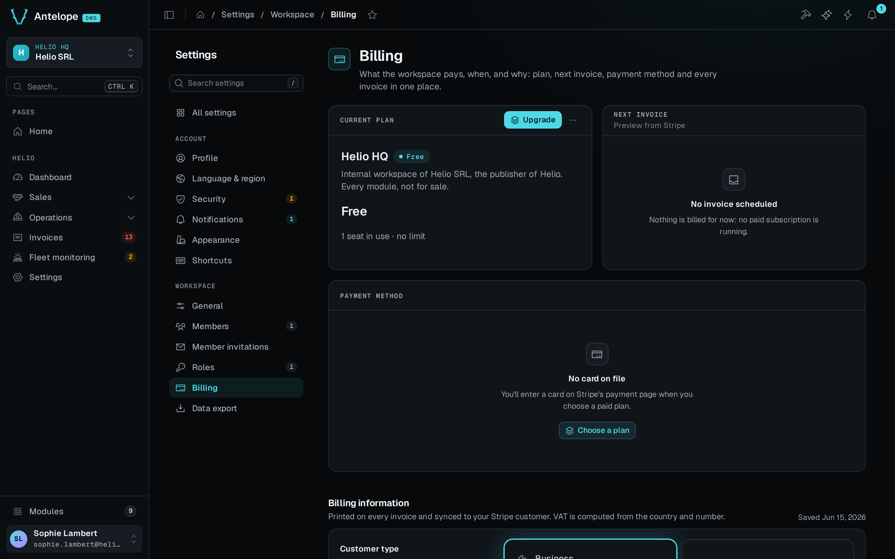

A page is a class. Components attach to it as static fields, and the shared Inertia and Vue frontend renders the resulting description. A standard screen needs no Vue at all.

For a first page, read [Declare a page](#declare-a-page), [Composing the page](#composing-the-page) and [Access & permissions](#access-permissions), and keep the default layout.

## Declare a page

A page extends `PageController(id, options[, layout])` and carries the `@RegisterPage()` decorator. Registration happens at import time. Your module must import the file during startup, directly or through a barrel such as `import "./pages"`, or the decorator never runs and the page never appears.

A page with one visible block:

```ts [src/pages/welcome.ts]
import {
  PageController,
  RegisterPage,
  pagesCategory,
} from "@antelopejs/interface-dms/page";
import { Placeholder } from "@antelopejs/interface-dms/base/placeholder";

@RegisterPage()
export class WelcomePage extends PageController("welcome", {
  displayName: "Welcome",
  icon: "i-ph-house",
  category: pagesCategory, // group under the dashboard's Pages section
  order: 0,
  description: "A welcome page",
}) {
  static greeting = Placeholder({ label: "Your first DMS page" });
}
```

Import `./pages/welcome` from your module entry point, restart the backend and then the frontend, and open **Welcome** in the sidebar. The placeholder shows inside the dashboard frame. Replace it with a [form](/docs/components/forms), a [table](/docs/components/tables) or [dashboard widgets](/docs/components/charts-and-widgets) as your page takes shape.

### Page options (`MenuOptions`)

The second argument is a `MenuOptions` object, exported next to `PageController`. The table lists the fields a page sets. The `MenuOptions` type is the full shape.

| Field                                                                 | Purpose                                                                                                                                  |
| --------------------------------------------------------------------- | ---------------------------------------------------------------------------------------------------------------------------------------- |
| `displayName`                                                         | Sidebar label. Use a `$dms_x.y` i18n key in real modules.                                                                                |
| `icon`                                                                | Iconify name, such as `i-ph-table`.                                                                                                      |
| `category`                                                            | The `Category` the page sits under: the built-in `pagesCategory` or your own. Most project pages set it.                                 |
| `module`                                                              | Places the page in a module registered with `RegisterModule`, by its `id`. The page then lives in that module's own sidebar. Works together with `category`. |
| `urlSlug`                                                             | URL segment. Defaults to the page `id`.                                                                                                  |
| `order`                                                               | Sort order within its group.                                                                                                             |
| `description`                                                         | Help text.                                                                                                                               |
| `hidden`                                                              | Registers the page but keeps it out of the navigation.                                                                                   |
| `publicAccess`, `authOnly`, `memberAccess`, `permission`, `noComponentPermissions` | Access. See [Auth & permissions](/docs/auth-and-tenancy/auth-and-permissions).                                                 |
| `bypassTenantAccessGate`                                              | Keeps the page reachable while a tenant access gate denies the tenant. See [Tenant access gate](/docs/auth-and-tenancy/auth-and-permissions#tenant-access-gate). |
| `validation`, `setupId`                                               | Page validation and a setup function run on mount. See [Page setup and validation](#page-setup-and-validation).                          |
| `type`                                                                | Menu item type: `"link"`, the default, for a page you can open, or `"label"` for a heading entry that opens nothing.                     |
| `query`                                                               | Query parameters carried by the page's menu link, so one page can back several entries. See [Entries that share one page](/docs/building/navigation#entries-that-share-one-page). |
| `variant`, `status`                                                   | The look of the menu entry: `"accent"` for a call to action, and a state dot. See [Entry appearance](/docs/building/navigation#entry-appearance). |
| `badge`                                                               | Short count or label at the end of the entry (`3`, `new`). Wins over `status` and over a counted navigation badge.                       |
| `layout`                                                              | Default layout of the entry and of everything declared under it that names none. See [Layouts](#layouts).                                |
| `live`                                                                | A Direct and Pause state over the page's realtime, `{ maxRate?, slowRateAfter?, rememberKey? }`. See [Live pages](/docs/building/live-pages). |
| `parent`                                                              | The list page this page is a detail of, as a controller. The breadcrumb shows it before this page. See [The breadcrumb of a detail page](/docs/building/navigation#the-breadcrumb-of-a-detail-page). |

### Live pages {#live-pages-direct-and-pause}

A page declared with `live` decides when the realtime events of its blocks turn into requests: at most once every `maxRate` seconds in Direct, none while paused. [Live pages](/docs/building/live-pages) covers the options.

#### What a pause freezes {#what-pause-freezes}

A pause holds every block that reads on realtime events or on a polling interval, and each one reads once on resume if it missed an event. [What a pause freezes](/docs/building/live-pages#what-pause-freezes) lists each block and what still reads.

### Page setup and validation

Two `MenuOptions` fields hook into the page's frontend lifecycle. Both name a function your frontend layer registers under a string id with `useDefinedFunctions().registerFunction(id, fn)` ([Component events](/docs/extending-the-dashboard/component-events)).

- **`validation`** takes `{ requiredQueryParams?, customFunctionId?, redirectTo? }`. Before it shows the page, the renderer checks that the listed query parameters exist, and runs the custom function when one is named. A failure renders the "Page not found" error instead. Use it for a page that means nothing without its context, such as a detail page opened without its `?id`.
  - With `redirectTo`, a failure sends the user to that path instead, such as the list the detail page belongs to. The history entry is replaced and none of the page's blocks are drawn.
  - `redirectTo` is a dashboard path. It may carry the page URL's `{{params.X}}` and `{{query.X}}` tokens (`redirectTo: "/modules/shop/orders?store={{query.store}}"`). A query pair whose token has no value is left out.
  - The renderer ignores a `redirectTo` on the page's own path, since it would fail again.
- **`setupId`** names a page setup function, run when the page mounts. The function receives an event bus view of the page: the `pageInfo`, the user's `permissions`, and `on` and `emit` functions keyed by component and event. It may return a cleanup callback, run on unmount. Use it to coordinate several components without shipping a custom component. [Page context](/docs/frontend-composables/page-context#page-setup-functions-setupid) has the contract and a worked example.

### Layouts

A **page layout** sets the frame around the page. **Containers** such as `Grid` or `VStack` arrange the content inside it. A settings sidebar is a layout concern. Two cards side by side is a container concern.



The optional third argument to `PageController` wraps the page in a layout. A layout is a component description, the same `ComponentInfo` shape your components compile to, so any registered frontend component can be a layout.

A page resolves its layout in this order:

1. The layout argument of its own `PageController(id, options, layout)`.
2. Its own `layout` option (`MenuOptions.layout`).
3. The `layout` option of the nearest category or parent page that declares one.
4. `DefaultLayout()`.

A category declares the frame of a whole branch this way, and its pages need no layout argument ([Default layout of a category](/docs/building/navigation#default-layout-of-a-category)).

The DMS ships four layouts:

- **`DefaultLayout(options?)`** is the standard dashboard frame.
  - `fullWidth` sets whether the content spans the panel, and defaults to `true`.
  - `hideHeader` hides the page header.
  - `fillHeight` makes the page fill the height of the panel, for a tool that scrolls inside itself ([Pages that fill the panel](/docs/interfaces/base/page-layouts#pages-that-fill-the-panel)).
  - `headerActions` puts buttons next to the page title. They are the same `CustomButton`s as a table's toolbar: links, quick actions, drawers, modals and API calls, each optionally behind a permission ([Header actions](/docs/interfaces/base/page-layouts#header-actions)).
  - `record` reads the record the page shows, on the server, with the layout. The header buttons read its fields as `{{record.X}}` and are left out without it, and their `availability` reads it as `context.record` ([Buttons acting on the page's record](/docs/interfaces/base/page-layouts#buttons-acting-on-the-pages-record)).
- **`FormPageLayout(options?)`** is the same frame with `fullWidth: false`, for a page that only holds a form.
- **`SettingsLayout(options?)`** is the dashboard frame with the settings navigation next to the page, in the one column width every settings page shares (component `dms-settings-layout`). `settingsCategory` declares it, so every page under the settings root gets it without naming it ([Settings pages](/docs/building/settings-pages)).
- **`EmptyLayout()`** draws no frame at all. The built-in auth and onboarding pages use it. Use it when a page must fill the viewport on its own.

The `<key>/new`, `<key>/:id/edit` and `<key>/:id/view` pages a `TableView` generates for `formContainer: { type: "page" }` take `FormPageLayout()`, unless their page's category chain declares a layout. The form pages of a settings table therefore stay in the settings frame.

```ts [src/pages/tasks.ts]
import { PageController, pagesCategory } from "@antelopejs/interface-dms/page";
import { DefaultLayout } from "@antelopejs/interface-dms/base/layouts";

// full width, page header shown: no layout argument needed
export class TasksPage extends PageController("tasks", {
  displayName: "Tasks",
  icon: "i-ph-table",
  category: pagesCategory,
}) {
  /* … */
}

// full width, but the component draws its own header
export class BoardPage extends PageController(
  "board",
  { displayName: "Board", icon: "i-ph-kanban", category: pagesCategory },
  DefaultLayout({ hideHeader: true }),
) {
  /* … */
}
```

A form page takes `FormPageLayout()`:

```ts [src/pages/preferences.ts]
import { PageController, pagesCategory } from "@antelopejs/interface-dms/page";
import { FormPageLayout } from "@antelopejs/interface-dms/base/layouts";

export class PreferencesPage extends PageController(
  "preferences",
  { displayName: "Preferences", icon: "i-ph-sliders", category: pagesCategory },
  FormPageLayout(),
) {
  /* … */
}
```

Since a layout is only a component description, a page can render inside a component from your own frontend module. Point the layout at it by `componentName`, the name your layer registers it under:

```ts [src/pages/report.ts]
import { PageController, pagesCategory } from "@antelopejs/interface-dms/page";

export class ReportPage extends PageController(
  "report",
  { displayName: "Report", category: pagesCategory },
  // a custom layout: your frontend module registers a component under this name
  { componentName: "MyLayout", options: { fullWidth: true } },
) {}
```

::tip
See [Frontend layer](/docs/building/frontend-layer) for how a frontend module registers the Vue component a custom layout resolves to.
::

## Where a page lives

**`category`** places the page in the navigation tree on the left, under the built-in `pagesCategory` or under a `Category` of your own.

A page that also sets **`module`** moves into that module's own sidebar, with `category` still grouping it inside ([Distributable module](/docs/building/distributable-module#module-navigation-and-access)). [Navigation](/docs/building/navigation) covers the tree itself: root groups, categories and quick actions.

The category chain also sets the page's URL. A page resolves at its `fullSlug`: the `urlSlug`s of its category chain joined with `/`, ending in the page's own `urlSlug`, which defaults to its id. The Pages root adds no segment, so a page in a `crm` category under `pagesCategory` lives at `/crm/<page>`. The Settings root adds the `/settings` prefix, and module pages add `/modules/<moduleId>`.

## Composing the page

Every static field of the page class whose value is a component becomes a named component of the page. The field key is the component's key and part of its permission id ([Access & permissions](#access-permissions)).

Every component is built on the `ComponentBuilder` class from `@antelopejs/interface-dms/component`, created with `new ComponentBuilder(componentName)`. Its chained methods build the component's description:

- `.options(props)` sets the component's props.
- `.child(id, child, { slot? })` nests a child component, optionally in a named slot.
- `.meta({ name, icon?, description? })` sets the component's metadata, which also titles its permission.
- `.action(id, definition)`, `.watch(…)` and `.watchOn(childId, …)` add permissioned actions and reactivity between components, covered in [Actions & reactivity](/docs/building/actions-and-reactivity).

The `interface-dms/base` builders (`Form`, `TableView`, `Grid`, `KpiCard` and the others) are `ComponentBuilder`s set up for a specific `componentName`. Use them for standard UI. When a screen needs your own Vue, `CustomComponent(name)` returns the bare builder for a component your layer registers.

Assign a builder to a static field and the page has its component. Here it is a `Form`:

```ts [src/pages/contact.ts]
import { PageController, RegisterPage, pagesCategory } from "@antelopejs/interface-dms/page";
import { Form } from "@antelopejs/interface-dms/base/form";
import { DefaultDataTypes } from "@antelopejs/interface-dms/base/data-types";
import { HttpMethod } from "@antelopejs/interface-dms/base/types";

@RegisterPage()
export class ContactPage extends PageController("contact", {
  displayName: "Contact Form",
  category: pagesCategory,
}) {
  static form = Form({
    title: "Contact Us",
    description: "Send us a message and we'll get back to you",
    fields: [
      {
        id: "name",
        label: "Full Name",
        type: new DefaultDataTypes.StringType({ placeholder: "Jane Doe", maxLength: 100 }),
      },
      { id: "email", label: "Email", type: new DefaultDataTypes.EmailType() },
      { id: "subscribe", label: "Subscribe", type: new DefaultDataTypes.BooleanType() },
    ],
    submitUrl: "/api/contact",
    submitUrlMethod: HttpMethod.post,
    kind: "action", // sends something new each time: empties after a submit
  });
}
```

A field's `type` is always a DataType instance. See [Data types](/docs/components/data-types).

Richer screens nest builders with `.child`. A `Grid` holds `GridRow` children, and each row holds its own components, here two KPI cards:

```ts fragment [src/pages/dashboard.ts]
static kpis = Grid({ gap: "1rem" }).child("row",
  GridRow()
    .child("revenue", KpiCard({ title: "Revenue", fetchUrl: "/api/kpi/revenue", valueFormat: "currency" }))
    .child("orders",  KpiCard({ title: "Orders",  fetchUrl: "/api/kpi/orders" })),
);
```

When no `interface-dms/base` builder fits, use `CustomComponent` and render your own Vue. `.meta()` names the component and titles its permission:

```ts fragment [src/pages/dashboard.ts]
static widget = CustomComponent("MyWidget").meta({ name: "My widget" });
```

Each `interface-dms/base` builder has its own options and features, documented in the [Components](/docs/components/overview) section:

| Group                      | Chapter                                                       |
| -------------------------- | ------------------------------------------------------------- |
| Field & column types       | [Data types](/docs/components/data-types)                     |
| File uploads & storage     | [File storage](/docs/components/file-storage)                 |
| Forms                      | [Form](/docs/components/forms)                                |
| Tables & CRUD              | [Tables](/docs/components/tables)                             |
| Charts & dashboard widgets | [Charts & widgets](/docs/components/charts-and-widgets)       |
| Layout & containers        | [Layout & containers](/docs/components/layout-and-containers) |
| Freeform Vue               | [Custom component](/docs/components/custom-component)         |

## Template tokens

An option declared once on the backend often depends on where it is shown: the record a detail page is open on, or the row an action runs on. Such an option names those values with a token, always written ``, with spaces allowed inside the braces. The DMS fills it where the option is used.

| Token | Value | Where |
| --- | --- | --- |
| `{{params.X}}` | Route parameter `X` of the page URL. On a route that repeats a name (`/workspaces/:id/invoiceTable/:id/edit`), the bare name is the last occurrence. `{{params.X:n}}` reaches the n-th, so `{{params.id:1}}` is the page above. | Every option below |
| `{{query.X}}` | Query parameter `X` of the page URL. `X` may contain dots and hyphens (`{{query.sales.period}}`). | Every option below |
| `{{row.X}}` | Field `X` of the row an action runs on, a dotted path reaching into it. In a confirmation's `from`, a source table's `fetchRowUrl` and a row container's component options, `{{row.id}}` is the row's id, read through the table's `rowIdKey`. | Table actions and their confirmations, a source table's `fetchRowUrl`, the options of the component a row's drawer, modal or side panel opens ([Row drawers](/docs/components/tables/row-drawers#blocks-reading-the-row)) |
| `{{job.id}}` | The id of the job an `exportJob` target started. | `statusUrl`, `downloadUrl` |
| `{{response.X}}` | Field `X` of the JSON a form's submit returned, a dotted path reaching into it. | `redirectOnSuccess` |
| `{{user.id}}`, `{{now}}`, `{{now-7d}}` | The signed-in user's id, and the current instant moved by whole days. The server resolves them. | Table view filter values (views, tabs, `defaultFilters`) |

The DMS reads the page tokens from the URL the option is used on, and again when the URL changes. When the page has no value for a token, the result depends on the kind of option:

- **A route the DMS requests**, such as a block's `fetchUrl` or `badgesUrl`, a form's `submitUrl`, or a field's `searchUrl`, `rotateUrl` or `completionsUrl`. The DMS does not request it while a token has no value, since it would not name a route that exists.
- **A link or an action**, such as any `to`, a form's `backTo` and `redirectOnSuccess`, an action target's `url` (`page`, `external`, `download`, `api`, `exportJob`, and an export job's `statusUrl` and `downloadUrl`), a confirmation's `from` and its secondary target, or a page's `validation.redirectTo`. It always leads somewhere. A query pair whose value is such a token is left out, so `?workspace={{query.workspace}}` on a page without `?workspace=` leads to the target's default. Any other such token is left empty.
- **A value written as is**, such as a form's `submitDefaults` or a download's `filename`. The DMS drops it while one of its tokens has no value.

In a URL, the DMS percent-encodes the page and row values, so `GET /api/a?b=c` stays one query value or one path segment. It writes a response value as returned, so a response may hand back a whole path. A URL that is one row token and nothing else, such as `url: "{{row.invoiceUrl}}"` on an `external` target, takes the field as the whole link, unchanged. An action's URL takes the page's values first, then the row's: `url: "/shop/orders/{{row._id}}?store={{query.store}}"`.

A relation column lists the related row (its label, avatar and other selected fields). `{{row.customer}}` therefore stands for that row's id, its `_id` or else its `id`, which is the value the field stores. A multiple relation stands for its ids joined by commas. A dotted path such as `{{row.customer.name}}` still reaches into the related row, and so does one keyed on another field (`{{row.customer.code}}`).

A single-brace `{name}` is not a token. It is a translation parameter, which an action's label or a confirmation's texts receive from the row (`"Remove {name}?"`).

## Access & permissions {#access-permissions}

Permissions gate the page and every declared component position. The page's permission derives from its id. A top-level component appends its field key, and each `.child()` appends its child id. `.meta()` supplies the title, icon and description. All of them register together when the `@RegisterPage` decorator runs, and each level must be granted for the nested branch to render.

::note
For the full model (id derivation, the page access options `publicAccess`, `authOnly` and `noComponentPermissions`, roles and owners), see [Auth & permissions](/docs/auth-and-tenancy/auth-and-permissions).
::

## Extending another module's page

`@RegisterPageExtension(pageId)` lets a module add components to a page that another module owns, such as a billing block on the SaaS billing page or a quota banner on the members page. The decorated class is not a page. It is a plain class whose static component fields become components of the target.

The example below adds blocks to the Members page.

```ts [src/pages/members-quota.ts]
import { RegisterPageExtension } from "@antelopejs/interface-dms/page";
import { CustomComponent } from "@antelopejs/interface-dms/base/custom";

@RegisterPageExtension("settings.workspace.members")
export class MembersQuotaExtension {
  static seatQuota = CustomComponent("SeatQuotaBanner")
    .meta({ name: "Seat quota", icon: "i-ph-users-three" })
    .before("table");
}
```

The target is the page id, a string, not the page class. An extending module therefore depends on `@antelopejs/interface-dms` alone. It never imports the owning module's runtime package or evaluates its page files, so a hot reload of the extension cannot take the target module's pages down.

### Finding a page id

A page id is the dotted path of the categories the page sits under, ending with the page's own id. The DMS members page is `settings.workspace.members`. A playground page under the `internals` section of the playground's `library` root is `library.internals.<page id>`. The page id is also the page's permission id, so the same string appears in the roles screen next to the page, and the components of that page are `<page id>.<field name>` below it. Inside the module that owns the page, `GetPermissionId(ThePageClass)` returns it. `GetRegisteredPageIds()` lists every id currently registered. An extension of an id no module registers stays pending, and the DMS reports it as a warning once the project has started.

### Placement

The component itself declares its placement, anchored on a component key of the target page. The key is the name of the static field the page declared the component under (`"table"`), or the dotted path to a nested position (`"content.tasks"`):

| Call              | Effect                                                                                     |
| ----------------- | ------------------------------------------------------------------------------------------ |
| `.before(anchor)` | Inserts the component just above `anchor`.                                                 |
| `.after(anchor)`  | Inserts the component just below `anchor`.                                                 |
| Neither           | Appends the component after every component the target page declares.                      |
| `.order(n)`       | Breaks the tie when several components land at the same spot. Lower comes first, and the default is `0`. |

When several components land at the same spot, `order` decides. Equal orders fall back to the extension class name, then to the declaration order inside that class. Every criterion belongs to the declaration, so the result never depends on the order the modules started in, and a restart cannot reorder the page. Use `order` when a block must sit at a specific place whoever else inserts there.

### Permissions

An inserted component joins the target page's own permission tree as `<target fullId>.<field name>`. The DMS filters it like a component the page declares itself. Its `.meta()` titles the permission, and the extending module adds no second gate. Reaching the page takes the target page's permission. Showing the block takes the block's own. A field name the target page already uses, or that another extension of it already inserted, is reported at error level when the insertion applies, and the DMS skips that whole extension. The page and the other extensions still apply.

### Lifecycle

The insertion applies as soon as the target page has finished registering. If the extending module starts first, or while the page is registering, the DMS holds the insertion until the page has serialized its own components. The module start order therefore does not matter, and anchors always resolve against the page's complete set of components.

An extension whose target page never registers stays pending, reported as a warning once the project has started, and never fails the boot. An anchor the target page does not declare is reported the same way, with the extension name, the page id and the unknown key, and the DMS skips that extension. Everything a module inserted is removed when that module stops.

A component that throws while registering is dropped on its own. The DMS logs it at error level and leaves it out of the layout, while the rest of its extension and the page still apply. The DMS does not retry it, so a side effect that already ran never runs again.
