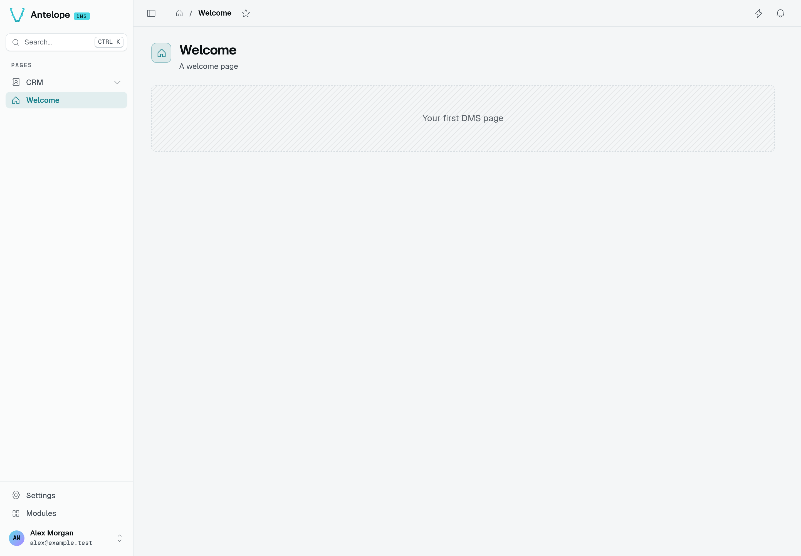
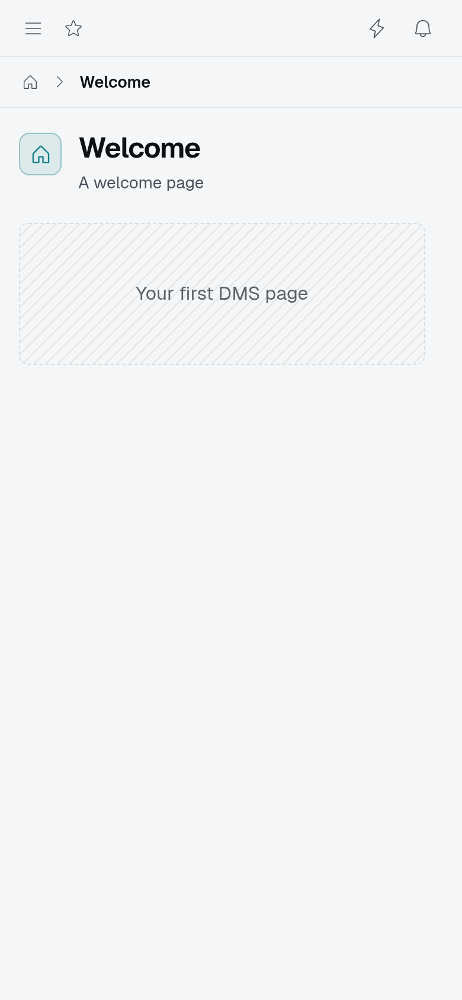
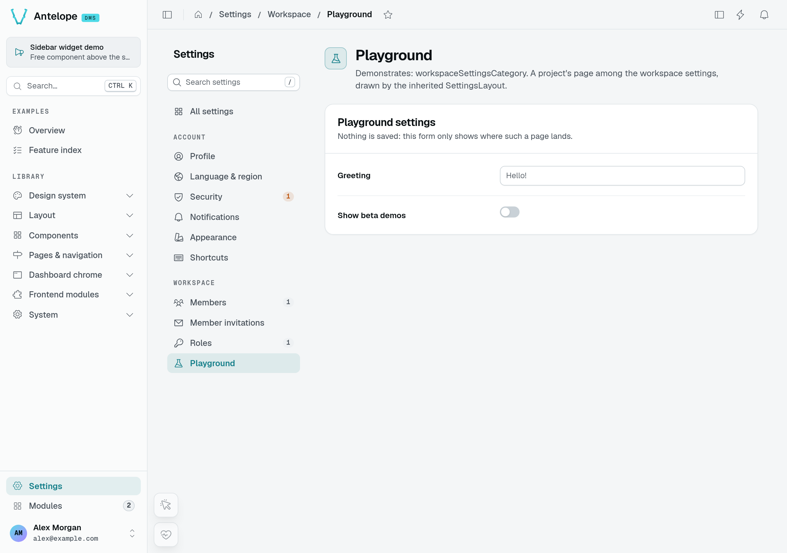
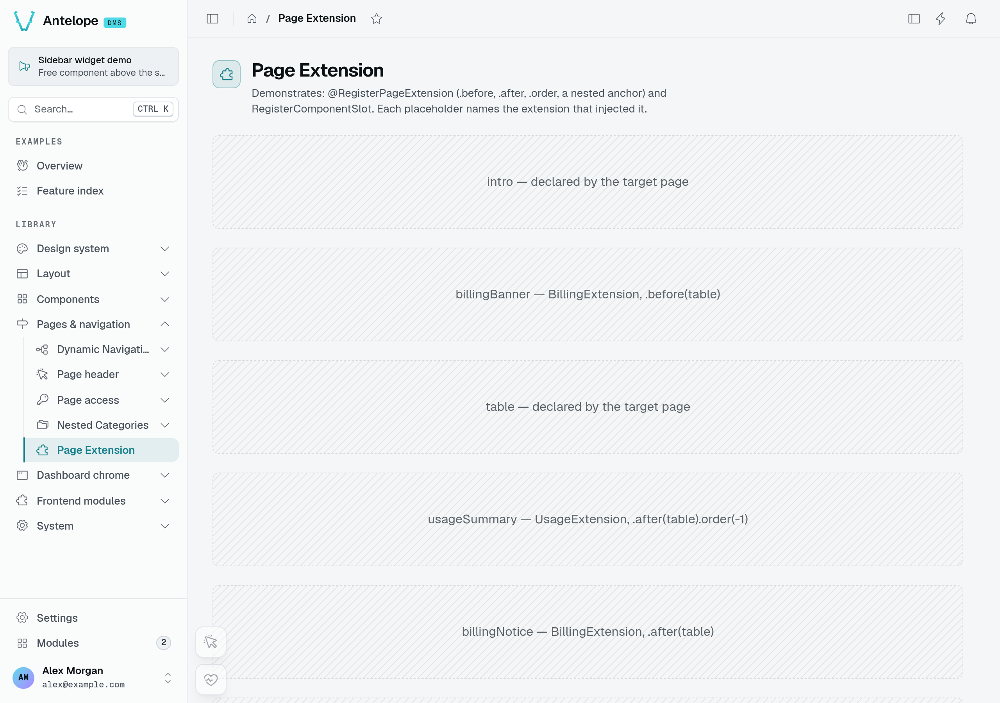

# Pages & components

A page is a class: components attach to it as static fields, and the shared Inertia/Vue frontend renders the resulting description. For standard screens you write no Vue at all.

For a first page, follow **Declare a page → [Composing the page](#composing-the-page) → [Access & permissions](#access-permissions)**. Keep the default layout until you need a different frame. The live-page controls, template tokens, and extension lifecycle below are reference material for later.

## Declare a page

A page extends `PageController(id, options[, layout])` and carries the `@RegisterPage()` decorator. Registration happens at **import time**: your module must import the file during startup — directly or through a barrel like `import "./pages"` — or the decorator never runs and the page never appears.

Start with a page containing one visible block:

```ts [src/pages/welcome.ts]
import {
  PageController,
  RegisterPage,
  pagesCategory,
} from "@antelopejs/interface-dms/page";
import { Placeholder } from "@antelopejs/interface-dms/base/placeholder";

@RegisterPage()
export class WelcomePage extends PageController("welcome", {
  displayName: "Welcome",
  icon: "i-ph-house",
  category: pagesCategory, // group under the dashboard's Pages section
  order: 0,
  description: "A welcome page",
}) {
  static greeting = Placeholder({ label: "Your first DMS page" });
}
```

Import `./pages/welcome` from your module entry point, restart the backend and then the frontend, and open **Welcome** in the sidebar. You should see the placeholder inside the dashboard frame. Replace it with a [form](/docs/components/forms), [table](/docs/components/tables), or [dashboard widgets](/docs/components/charts-and-widgets) as your page takes shape.



The example above, running at `/welcome`: **Welcome**, **A welcome page**, and the **Your first DMS page** placeholder. The CRM navigation belongs to the [tutorial](/docs/getting-started/tutorial), loaded alongside this page for these captures.



At 390 CSS pixels, the same page keeps its placeholder visible and moves the sidebar behind the menu button. This is a narrow Chromium viewport, not a native mobile application.

### Page options (`MenuOptions`)

The second argument is a `MenuOptions` object. The table covers the fields you'll actually set; the `MenuOptions` type — exported next to `PageController` — is the authoritative shape.

| Field                                                                 | Purpose                                                                                                                                  |
| --------------------------------------------------------------------- | ---------------------------------------------------------------------------------------------------------------------------------------- |
| `displayName`                                                         | Sidebar label (use a `$dms_x.y` i18n key in real modules).                                                                               |
| `icon`                                                                | Iconify name, e.g. `i-ph-table`.                                                                                                         |
| `category`                                                            | Group the page under a `Category` (the built-in `pagesCategory`, or your own) — a project's usual anchor.                                |
| `module`                                                              | Place the page in a `RegisterModule`'d module (by its `id`); it then lives in that module's own sidebar. Works together with `category`. |
| `urlSlug`                                                             | URL segment; defaults to the page `id`.                                                                                                  |
| `order`                                                               | Sort order within its group.                                                                                                             |
| `description`                                                         | Help text.                                                                                                                               |
| `hidden`                                                              | Register the page but keep it out of the nav.                                                                                            |
| `publicAccess` / `authOnly` / `memberAccess` / `permission` / `noComponentPermissions` | Auth — see [Auth & permissions](/docs/auth-and-tenancy/auth-and-permissions).                                                            |
| `bypassTenantAccessGate`                                              | Keep the page reachable while a tenant access gate denies the tenant — see [Tenant access gate](/docs/auth-and-tenancy/auth-and-permissions#tenant-access-gate). |
| `validation` / `setupId`                                              | Page-level validation and a mount-time setup function — see [Page setup and validation](#page-setup-and-validation).                     |
| `type`                                                                | Menu-item type: `"link"` (the default — a navigable page) or `"label"` (a non-navigable heading entry).                                  |
| `query`                                                               | Query parameters carried by the page's menu link, so one page can back several entries — see [Entries sharing one page](/docs/building/navigation#entries-that-share-one-page). |
| `variant` / `status`                                                  | Semantic look of the menu entry: `"accent"` for a call to action, and a state dot — see [Entry appearance](/docs/building/navigation#entry-appearance). |
| `badge`                                                               | Short count or label at the end of the entry (`3`, `new`); wins over `status` and over a counted navigation badge. |
| `layout`                                                              | Default layout of the entry and of everything declared under it that names none — see [Layouts](#layouts). |
| `live`                                                                | A Live / Pause state over the page's realtime, `{ maxRate?, slowRateAfter?, rememberKey? }` — see [Live pages](#live-pages-direct-and-pause). |

### Live pages: Direct and Pause

A monitoring page refetches its blocks on every realtime event, which a busy topic turns into a stream of requests, and the user has no way to stop the page to read it. `live` adds a valve on the realtime the blocks already have: blocks keep their `realtimeTopic` and tables their `realtime`, and the page decides when an event turns into a request.

```ts fragment [src/pages/request-logs.ts]
import { HStack, Spacer } from "@antelopejs/interface-dms/base/stack";
import { LiveToggle } from "@antelopejs/interface-dms/base/live-toggle";

@RegisterPage()
export class RequestLogs extends PageController("logs", {
  displayName: "Request logs",
  module: "api",
  live: { maxRate: 5 },
}) {
  static toolbar = HStack().child("spacer", Spacer()).child("live", LiveToggle());
  static chart = ChartLine({ fetchUrl: "/api/logs/chart", realtimeTopic: "api:requests" });
  static table = TableView.fromSource({ /* … */ realtimeTopic: "api:requests", liveHold: true });
}
```

- **Direct** (the default): each block and table refetches on its events, at most once every `maxRate` seconds. The first event of a quiet block reads at once; the ones that follow within the interval collapse into one read when it ends, so the last event is never lost. Without `maxRate`, every event refetches, as before.
- **Pause**: nothing is requested on an event. Each block and table counts the events it receives; resuming refetches once each one that missed something. A rolling period (`last-hour`, `last-24h`) stops sliding, so the blocks reading it do not refetch every minute, and a calendar period (`today`, `last-7-days`...) waits to move past midnight; a period the user picks still applies at once, and resuming catches up what was skipped in one read.

What the user asks for always reads, paused or not: `refreshPageBlocks()` (a page header button, a form saved through `BlockFunctions.REFRESH_PAGE`, a banner button), a table's row actions and its refresh button. Only the realtime events and the refreshes nobody asked for are gated: a module that refreshes the page on a timer or a feed calls `refreshLivePageBlocks()` from `#dms-ui/app/utils/blockRefresh` instead, which is capped by `maxRate` in Direct and counted while paused.

The user switches with the [`LiveToggle()`](/docs/components/charts-and-widgets/live-toggle) block, which the module places where it wants — in a [`pageToolbar()`](/docs/components/layout-and-containers/page-toolbar) to give the page the same context bar as every other — or with the **L** key while one is on the page (once per press, however many toggles the page shows). The choice is kept per page in the browser, or per `rememberKey` (below); it applies once the page is mounted, so the server-rendered and hydrating pages agree. `?live=0` in the URL opens the page paused without remembering it — a shared link to a frozen view — and resuming drops it from the URL. A table declared with [`liveHold`](/docs/components/tables#live-pages) keeps its rows while paused, through the user's own search, sort and pagination, and shows a "N new · Show" strip. A custom component follows the same state with [`usePageLive()`](/docs/frontend-composables/realtime-and-notifications#usepagelive-direct-and-pause) and refreshes its own data through the same gate with [`usePageLiveRefresh()`](/docs/frontend-composables/realtime-and-notifications#usepageliverefresh-refresh-like-a-built-in-block). A page without `live` behaves exactly as before.

The page also pauses by itself, and says why in the toggle:

- **A hidden tab**: while the browser tab is in the background, the page requests nothing and counts what arrives; it resumes on return, unless the user had paused it.
- **A hold**: a component holds the page while the user does something the live data would disturb, with [`usePageLive().hold(reason)`](/docs/frontend-composables/realtime-and-notifications#usepagelive-direct-and-pause) — the toggle reads "Paused · typing in the Tester". The page resumes once nothing holds it. Resuming by hand lifts the holds of the moment until their component releases them.

**What a pause counts.** Paused, the page counts published rows, not messages: an event naming rows in `payload.ids` counts each row once per pause (a table view's own row events do), an event carrying a positive integer `payload.count` counts that many, any other event counts one. A module whose feed would flood the pages can so batch its publishes — one message per second or so with `{ count }` — and the toggle and the table strip still read "40 new":

```ts fragment
void PublishMessage("api:requests", "requests", { payload: { count: batch.length } });
```

**Cadence.** `maxRate` is also the polling interval while the realtime stream is down: the page then reads its blocks every `maxRate` seconds (as `refreshLivePageBlocks()` does) until the stream is back, and the toggle shows a "no realtime, polling" icon beside its "Updated" time, from the first poll on (a stream still connecting, as on every full load, is not reported down). The icon's box is kept while it is hidden, so it never widens the toggle nor wraps the toolbar. A page showing long periods declares a slower cadence for them — once its `PeriodSelector` spans `period` or more, `slowRateAfter.maxRate` replaces `maxRate`, for the gate and the polling alike:

```ts fragment
live: { maxRate: 10, slowRateAfter: { period: "7d", maxRate: 60 }, rememberKey: "api" },
```

| `live` option   | Type                                      | Description |
| --------------- | ----------------------------------------- | ----------- |
| `maxRate`       | `number` (seconds)                        | Shortest interval between two reads of one block in Live, and the polling interval without a stream. Unset: every event reads, and no polling. |
| `slowRateAfter` | `{ period: "30m" \| "24h" \| "7d" …; maxRate }` | The slower cadence once the period shown spans `period` (whole minutes `m`, hours `h` or days `d`) or more. |
| `rememberKey`   | `string`                                  | Shares the remembered Live / Pause choice between the pages declaring the same key, e.g. every page of a module. |

#### Making a block live

A block is live when something tells it its data moved. On a page declared with `live`, every one of those signals goes through the page's gate; nothing else makes a block read by itself.

- **A built-in data block** — `KpiCard`, `ChartCard` and the charts, `TopListCard`, `StatGroup`, `KeyValueList`, `NavCardGrid`, `ActivityFeed`, `Meter`, `Banner`, a `Tab` set's badges, `Guard` — is live once it names a `realtimeTopic`. The builder registers the topic on the page (`RegisterPageTopic`), so the session may subscribe to it, and the backend publishes on it with `PublishMessage`.
- **A table view** follows the row events of its data controller without any option, and the topics of its own `realtimeTopic` (a `TableView.fromSource` table has no row events: give it one).
- **A block without a `realtimeTopic`** (a `CodeBlock` reading a `fetchUrl`, a list block or a card left without one) has no event of its own. It reads again on `refreshLivePageBlocks()`, on the polling while the stream is down, and on `refreshPageBlocks()`. A live page does not poll its blocks while the stream is up: data that moves with time alone needs a module clock calling `refreshLivePageBlocks()`, or `idleRefresh` in a custom component.
- **A custom component** reading through `useApiData` follows the events of the page's topics (every topic registered on the page, by its blocks or by `RegisterPageTopic(pageId, topic)` in the backend). For a topic of its own, it registers the topic on the page in the backend and reads through [`usePageLiveRefresh(refresh, { realtimeTopic })`](/docs/frontend-composables/realtime-and-notifications#usepageliverefresh-refresh-like-a-built-in-block), its read opting out of the page's refresh (`refreshOnPageRefresh: false`). It never throttles on its own: the gate applies `maxRate`.

#### What Pause freezes

Paused — by the user, a hold or a hidden tab — the page requests nothing that nobody asked for, and every block of it is frozen at once:

| Frozen while paused | On resume |
| ------------------- | --------- |
| The events of a block's `realtimeTopic`, a table's row events, the events of the page's topics behind `useApiData` reads | Counted in the toggle's "N new"; each block that missed one reads once |
| `refreshLivePageBlocks()`, a `usePageLiveRefresh` `trigger()` or `idleRefresh`, the polling while the stream is down | Each block that missed one reads once |
| A component's `useApiData` polling (`refreshInterval`) | Reads once if a poll fell due meanwhile, then polls again; not counted |
| A rolling or calendar period moving on with the clock | One read catches up |

What still reads while paused: `refreshPageBlocks()` and every action of the user (a table's row actions, its refresh button, a form saved), and the inputs the user changes — a period picked, a filter, a search, a sort, a page of results. A table with `liveHold` keeps its rows through those too. The shell is not part of the page: notifications, presence and the menu keep updating.

### Page setup and validation

Two `MenuOptions` fields hook into the page's **frontend lifecycle**. Both name a function your frontend layer registers under a string id with `useDefinedFunctions().registerFunction(id, fn)` ([Component events](/docs/extending-the-dashboard/component-events)):

- **`validation`** — `{ requiredQueryParams?, customFunctionId?, redirectTo? }`. Before showing the page, the renderer checks that the listed query params exist and runs the custom function when one is named; a failure renders the "Page not found" error instead. Use it for pages that are meaningless without context — a detail page opened without its `?id`. With `redirectTo`, a failure sends the user there instead, the history entry replaced and none of the page's blocks drawn — the list the detail page belongs to, say. It is a dashboard path and may carry the page URL's `{{params.X}}` / `{{query.X}}` tokens (`redirectTo: "/modules/shop/orders?store={{query.store}}"`), a query pair whose token has no value being left out; a target on the page's own path is ignored, since it would fail again.
- **`setupId`** — names a **page setup function**, run when the page mounts. The function receives an event-bus view of the page — the `pageInfo`, the user's `permissions`, and `on` / `emit` functions keyed by component and event — and may return a cleanup callback, run on unmount. Use it to orchestrate several components at once without shipping a custom component. [Page context](/docs/frontend-composables/page-context#page-setup-functions-setupid) has the contract and a worked example.

### Layouts

Choose a **page layout** for the surrounding frame and **containers** such as `Grid` or `VStack` for the content inside it. A settings sidebar is a layout concern; placing two cards side by side is a container concern.



The optional third argument to `PageController` wraps the page in a **layout**. A layout is just another component description — the same `ComponentInfo` shape your components compile to — so any registered frontend component can play the role. Omit it and the page takes the default layout of its category chain, or `DefaultLayout()` when none declares one.

A page resolves its layout in this order:

1. the layout argument of its own `PageController(id, options, layout)`;
2. its own `layout` option (`MenuOptions.layout`);
3. the `layout` option of the nearest category or parent page that declares one;
4. `DefaultLayout()`.

A category declares the frame of a whole branch this way, and its pages stay free of layout arguments ([Default layout of a category](/docs/building/navigation#default-layout-of-a-category)).

Four built-in layouts ship:

- **`DefaultLayout(options?)`** — the standard dashboard frame. `fullWidth` controls the content max-width and defaults to `true`; `hideHeader` suppresses the page header; `fillHeight` makes the page fill the height of the panel, for a tool that scrolls inside itself ([Pages that fill the panel](/docs/interfaces/base/layout#pages-that-fill-the-panel)). `headerActions` puts buttons next to the page title — the same `CustomButton`s as a table's toolbar: links, quick actions, drawers, modals, API calls, each optionally behind a permission ([Header actions](/docs/interfaces/base/layout#header-actions)); `record` reads the record the page shows on the server, with the layout: those buttons read its fields as `{{record.X}}` and are left out without it, and their `availability` reads it as `context.record` ([Buttons acting on the page's record](/docs/interfaces/base/layout#buttons-acting-on-the-pages-record)).
- **`FormPageLayout(options?)`** — the same frame with `fullWidth: false`, for a page that only holds a form.
- **`SettingsLayout(options?)`** — the dashboard frame with the settings navigation next to the page, in the one column width every settings page shares (component `dms-settings-layout`). `settingsCategory` declares it, so every page under the settings root gets it without naming it ([Settings pages](/docs/building/settings-pages)).
- **`EmptyLayout()`** — no chrome at all; the built-in auth and onboarding pages use it. Reach for it when a page must fill the viewport on its own.

Dashboard pages span the whole panel by default — tables, dashboards and card grids all want the room. Pages that only hold a form keep a constrained column, which stays easier to read: the `<key>/new` / `<key>/:id/edit` / `<key>/:id/view` pages a `TableView` generates for `formContainer: { type: "page" }` take `FormPageLayout()`, unless their page's category chain declares a layout — a settings table's form pages stay in the settings frame.

```ts [src/pages/tasks.ts]
import { PageController, pagesCategory } from "@antelopejs/interface-dms/page";
import { DefaultLayout } from "@antelopejs/interface-dms/base/layouts";

// full-width, page header shown: no layout argument needed
export class TasksPage extends PageController("tasks", {
  displayName: "Tasks",
  icon: "i-ph-table",
  category: pagesCategory,
}) {
  /* … */
}

// full-width, but the component draws its own header
export class BoardPage extends PageController(
  "board",
  { displayName: "Board", icon: "i-ph-kanban", category: pagesCategory },
  DefaultLayout({ hideHeader: true }),
) {
  /* … */
}
```

A page that only holds a form takes `FormPageLayout()` — `DefaultLayout({ fullWidth: false })` with a name:

```ts [src/pages/preferences.ts]
import { PageController, pagesCategory } from "@antelopejs/interface-dms/page";
import { FormPageLayout } from "@antelopejs/interface-dms/base/layouts";

export class PreferencesPage extends PageController(
  "preferences",
  { displayName: "Preferences", icon: "i-ph-sliders", category: pagesCategory },
  FormPageLayout(),
) {
  /* … */
}
```

Because a layout is only a component description, a page can render inside a component from your own frontend module. Point the layout at it by `componentName` — the same name your layer registers it under:

```ts [src/pages/report.ts]
import { PageController, pagesCategory } from "@antelopejs/interface-dms/page";

export class ReportPage extends PageController(
  "report",
  { displayName: "Report", category: pagesCategory },
  // a custom layout — your frontend module registers a component under this name:
  { componentName: "MyLayout", options: { fullWidth: true } },
) {}
```

::tip
See [Frontend layer](/docs/building/frontend-layer) for how a frontend module registers the Vue component a custom layout resolves to.
::

## Where a page lives

**`category`** places the page in the navigation tree on the left: nested under the built-in `pagesCategory`, or under a `Category` of your own.

A page that also sets **`module`** moves into that module's own, separate sidebar, with `category` still grouping it inside ([Distributable module](/docs/building/distributable-module#module-navigation-and-access)). The tree itself — root groups, categories, quick actions — is covered in [Navigation](/docs/building/navigation).

The category chain also fixes the page's **URL**. A page resolves at its `fullSlug`: the `urlSlug`s of its category chain joined with `/`, ending in the page's own `urlSlug` (default: its id). The Pages root contributes no segment — a page in a `crm` category under `pagesCategory` lives at `/crm/<page>` — while the Settings root prefixes `/settings` and module pages prefix `/modules/<moduleId>`.

## Composing the page

Every static field on the page class whose value is a component becomes a named component on the page. The field key is the component's key — and part of its permission id (next section).

Underneath every component sits the **`ComponentBuilder`** class (from `dms/component`), instantiated with `new ComponentBuilder(componentName)`. Its fluent API builds the component's description:

- `.options(props)` sets the component's props.
- `.child(id, child, { slot? })` nests a child component, optionally in a named slot.
- `.meta({ name, icon?, description? })` sets the component's metadata, which titles its permission.
- `.action(id, definition)`, `.watch(…)`, and `.watchOn(childId, …)` add behavior — permissioned actions and cross-component reactivity, covered in [Actions & reactivity](/docs/building/actions-and-reactivity).

The **`interface-dms/base` builders** — `Form`, `TableView`, `Grid`, `KpiCard`, … — are `ComponentBuilder`s preconfigured for a specific `componentName`. Reach for them for standard UI; when a screen needs your own Vue, `CustomComponent(name)` returns the bare builder for a component your layer registers.

Assign a builder to a static field and the page has its component — here a `Form`:

```ts [src/pages/contact.ts]
import { PageController, RegisterPage, pagesCategory } from "@antelopejs/interface-dms/page";
import { Form } from "@antelopejs/interface-dms/base/form";
import { DefaultDataTypes } from "@antelopejs/interface-dms/base/data-types";
import { HttpMethod } from "@antelopejs/interface-dms/base/types";

@RegisterPage()
export class ContactPage extends PageController("contact", {
  displayName: "Contact Form",
  category: pagesCategory,
}) {
  static form = Form({
    title: "Contact Us",
    description: "Send us a message and we'll get back to you",
    fields: [
      {
        id: "name",
        label: "Full Name",
        type: new DefaultDataTypes.StringType({ placeholder: "Jane Doe", maxLength: 100 }),
      },
      { id: "email", label: "Email", type: new DefaultDataTypes.EmailType() },
      { id: "subscribe", label: "Subscribe", type: new DefaultDataTypes.BooleanType() },
    ],
    submitUrl: "/api/contact",
    submitUrlMethod: HttpMethod.post,
    kind: "action", // sends something new each time: empties after a submit
  });
}
```

A field's `type` is always a **DataType instance** — see [Data types](/docs/components/data-types).

Richer screens nest builders with `.child`: a `Grid` holds `GridRow` children, and each row holds its own components — here two KPI cards.

```ts fragment [src/pages/dashboard.ts]
static kpis = Grid({ gap: "1rem" }).child("row",
  GridRow()
    .child("revenue", KpiCard({ title: "Revenue", fetchUrl: "/api/kpi/revenue", valueFormat: "currency" }))
    .child("orders",  KpiCard({ title: "Orders",  fetchUrl: "/api/kpi/orders" })),
);
```

When no `interface-dms/base` builder fits, drop to `CustomComponent` and render your own Vue — `.meta()` names the component and titles its permission:

```ts fragment [src/pages/dashboard.ts]
static widget = CustomComponent("MyWidget").meta({ name: "My widget" });
```

Each `interface-dms/base` builder renders something specific, with its own options and features. Those references live in the **[Components](/docs/components/overview)** section:

| Group                      | Chapter                                                       |
| -------------------------- | ------------------------------------------------------------- |
| Field & column types       | [Data types](/docs/components/data-types)                     |
| File uploads & storage     | [File storage](/docs/components/file-storage)                 |
| Forms                      | [Form](/docs/components/forms)                                |
| Tables & CRUD              | [Tables](/docs/components/tables)                             |
| Charts & dashboard widgets | [Charts & widgets](/docs/components/charts-and-widgets)       |
| Layout & containers        | [Layout & containers](/docs/components/layout-and-containers) |
| Freeform Vue               | [Custom component](/docs/components/custom-component)         |

## Template tokens

Options are declared once on the backend, but a URL, a link or a value often depends on where it is shown: the record a detail page is open on, the scope in its query, the row an action runs on. Such an option names those values with a token, always written `` (spaces inside the braces allowed), and the DMS fills it where the option is used.

| Token | Value | Where |
| --- | --- | --- |
| `{{params.X}}` | Route parameter `X` of the page URL. On a route repeating a name (`/workspaces/:id/invoiceTable/:id/edit`) the bare name is the last occurrence; `{{params.X:n}}` reaches the n-th, `{{params.id:1}}` being the page above. | Every option below |
| `{{query.X}}` | Query parameter `X` of the page URL; `X` may carry dots and dashes (`{{query.sales.period}}`). | Every option below |
| `{{row.X}}` | Field `X` of the row an action runs on, a dotted path reaching into it. In a confirmation's `from`, a source table's `fetchRowUrl` and a row container's component options, `{{row.id}}` is the row's id, read through the table's `rowIdKey`. | Table actions and their confirmations, a source table's `fetchRowUrl`, the options of the component a row's drawer, modal or side panel opens ([Row drawers](/docs/components/tables/row-drawers#blocks-reading-the-row)) |
| `{{job.id}}` | The id of the job an `exportJob` target started. | `statusUrl`, `downloadUrl` |
| `{{response.X}}` | Field `X` of the JSON a form's submit answered, a dotted path reaching into it. | `redirectOnSuccess` |
| `{{user.id}}`, `{{now}}`, `{{now-7d}}` | The signed-in user's id, the current instant moved by whole days. Resolved by the server. | Table view filter values (views, tabs, `defaultFilters`) |

The page tokens are taken from the URL the option is used on, and again when it changes. How a token the page has no value for is treated depends on what the option is:

- **A route the DMS requests** — a block's `fetchUrl`, `badgesUrl`, a form's `submitUrl`, a field's `searchUrl`, `rotateUrl` or `completionsUrl` — is not requested while a token has no value: it does not name a route that exists.
- **A link or an action** — any `to`, a form's `backTo` and `redirectOnSuccess`, an action target's `url` (`page`, `external`, `download`, `api`, `exportJob`, and an export job's `statusUrl` / `downloadUrl`), a confirmation's `from` and its secondary target, a page's `validation.redirectTo` — always leads somewhere: a query pair whose value is such a token is left out (`?workspace={{query.workspace}}` on a page without `?workspace=` leads to the target's default), any other such token is left empty.
- **A value written as is** — a form's `submitDefaults`, a download's `filename` — is dropped while one of its tokens has no value.

In a URL the page and row values are percent-encoded, so `GET /api/a?b=c` stays one query value or one path segment; a response value is written as answered, so a response may hand back a whole path. A URL that is one row token and nothing else, such as `url: "{{row.invoiceUrl}}"` on an `external` target, takes the field as the whole link, written as it is. An action's URL takes the page's values first, then the row's: `url: "/shop/orders/{{row._id}}?store={{query.store}}"`.

A relation column is listed as the related row (its label, avatar and other selected fields), so `{{row.customer}}` stands for that row's id — its `_id`, else its `id` — the value the field stores, and a multiple relation for its ids joined by commas; a dotted path such as `{{row.customer.name}}` still reaches into the related row, and one keyed on another field names it (`{{row.customer.code}}`).

A single-brace `{name}` is not a token: it is a translation parameter, which an action's label or a confirmation's texts receive from the row (`"Remove {name}?"`).

## Access & permissions {#access-permissions}

Permissions gate the page and every declared component position. The page's permission derives from its id; a top-level component appends its field key, and each `.child()` appends its child id. `.meta()` supplies the title, icon, and description. All of them register together when the `@RegisterPage` decorator runs, and each level must be granted for the nested branch to render.

::note
For the full model — id derivation, the page auth options (`publicAccess` / `authOnly` / `noComponentPermissions`), roles, and owners — see [Auth & permissions](/docs/auth-and-tenancy/auth-and-permissions).
::

## Extending another module's page

`@RegisterPageExtension(pageId)` lets a module add components to a page **another module owns** — a billing block on the SaaS billing page, a quota banner on the members page. The decorated class is not a page: it is a plain class whose static component fields become components of the target.



The playground deliberately uses placeholders so you can read the placement: `billingBanner` comes before `table`; `usageSummary` and `billingNotice` come after it. The example below applies the same mechanism to the Members page.

```ts [src/pages/members-quota.ts]
import { RegisterPageExtension } from "@antelopejs/interface-dms/page";
import { CustomComponent } from "@antelopejs/interface-dms/base/custom";

@RegisterPageExtension("settings.workspace.members")
export class MembersQuotaExtension {
  static seatQuota = CustomComponent("SeatQuotaBanner")
    .meta({ name: "Seat quota", icon: "i-ph-users-three" })
    .before("table");
}
```

The target is the **page id**, a string — not the page class. An extending module therefore depends on `@antelopejs/interface-dms` alone: it never imports the owning module's runtime package, never evaluates its page files, and so never owns its registrations (which used to take the target module's pages down on a hot reload of the extension).

#### Finding a page id

A page id is the dotted path of the categories it sits under, ending with the page's own id — the DMS members page is `settings.workspace.members`, a playground page under the `internals` section of the playground's `library` root is `library.internals.<page id>`. It is also the page's **permission id**, so the same string appears in the roles screen next to the page, and the components of that page are `<page id>.<field name>` below it. Inside the module that owns the page, `GetPermissionId(ThePageClass)` returns it; `GetRegisteredPageIds()` lists every id currently registered. An id no module registers keeps the extension pending and is reported as a warning once the project has started.

### Placement

Placement is declared on the component itself, anchored on a **component key** of the target page — the name of the static field it declared the component under (`"table"`), or the dotted path to a nested position (`"content.tasks"`):

| Call              | Effect                                                                                     |
| ----------------- | ------------------------------------------------------------------------------------------ |
| `.before(anchor)` | Inject just above `anchor`.                                                                |
| `.after(anchor)`  | Inject just below `anchor`.                                                                |
| _(neither)_       | Append after every component the target page declares.                                     |
| `.order(n)`       | Break the tie when several components land at the same spot; lower first, defaults to `0`. |

When several components land at the same spot, `order` decides; equal orders fall back to the extension class name, then to the declaration order inside that class. Every criterion is intrinsic to the declaration, so the result **never depends on the order the modules started in** — a restart cannot reshuffle the page. Use `order` when a block must sit at a specific place regardless of who else injects there.

### Permissions

An injected component joins the target page's own permission tree as `<target fullId>.<field name>` and is filtered exactly like a component the page declares itself — its `.meta()` titles the permission, and the extending module adds no second gate. Reaching the page is the target page's permission; showing the block is the block's own. A field name already used by the target page, or already injected by another extension of it, is reported at error level when the injection applies, and that whole extension is skipped — the page and the other extensions are unaffected.

### Lifecycle

The injection applies as soon as the target page has finished registering. If the extending module starts first — or starts while the page is registering — the injection is held until the page has serialized its own components, so module start order does not matter and anchors always resolve against the page's complete component set; if the target page never registers — its module is not installed, or the id is a typo — the extension stays pending and is reported as a warning once the project has started, it never fails the boot. An anchor the target page does not declare is reported the same way, with the extension name, the page id and the offending key, and that extension is skipped. Everything a module injected is removed when that module stops.

A component that throws while registering is dropped on its own: it is logged at error level and left out of the layout, while the rest of its extension — and the page — still apply. It is not retried, so a side effect that already ran is never replayed.
