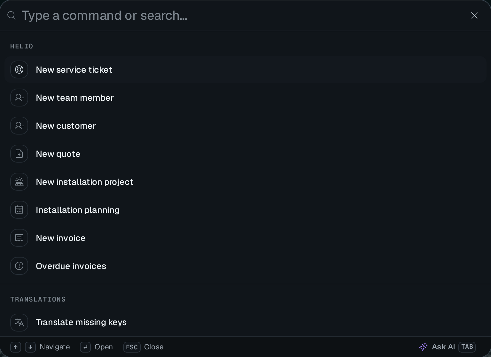

A **category** groups pages in the sidebar. Application screens start under `pagesCategory`, workspace settings under `workspaceSettingsCategory`. A module is for a feature that needs its own sidebar and access reserved to platform owners.

The command palette is a second way to reach those pages, and it runs registered quick actions:



Most projects need only [Categories](#categories) and [Page URLs](#page-urls). [Dynamic entries](#dynamic-entries) build navigation from data that depends on the request, such as the projects a member can access.

## The root groups

The sidebar has three built-in roots: **Pages** (`pagesCategory`), **Modules** (`modulesCategory`) and **Settings** (`settingsCategory`). Everything you register attaches under one of them, directly or nested. `RootCategory(id, options)` adds a top-level group of your own. The ids `pages`, `modules` and `settings` are reserved, and `RootCategory` throws on them.

A project can register pages under `settingsCategory`, or under a category nested in it such as `workspaceSettingsCategory`, to add its own screens next to the built-in settings pages ([Settings pages](/docs/building/settings-pages)). A page that declares a `module` cannot use the Settings category. A module declares its settings inside its own sidebar instead ([Distributable module](/docs/building/distributable-module#module-navigation-and-access)).

## Categories

`Category(id, options)` returns a `CategoryInfo` you pass as a page's `category`. Categories nest, since a category has its own `category`, and they usually start at `pagesCategory`. A project groups its own screens this way:

```ts [src/pages/category.ts]
import { Category, pagesCategory } from "@antelopejs/interface-dms/page";

export const crm = Category("crm", {
  displayName: "CRM",
  icon: "i-ph-users",
  category: pagesCategory,
});
// then on a page:  category: crm
```

A category is a heading: a label that groups pages, with no landing page of its own. It still controls access. A category registers its own permission, keyed to its `fullId`, and its `hidden`, `publicAccess`, `authOnly` and `memberAccess` options apply to the pages under it. The sidebar computes the category's visibility from that permission. A category the user cannot access hides its whole branch. So does a category the user can access that holds no entry they can open, as the role preview shows it.

### Default layout of a category

`layout` on a category is the default layout of its whole branch. Every page and sub-category declared under it that names no layout of its own gets it. The nearest declaring ancestor wins, and a page's own layout (its `layout` option, or the third argument of `PageController`) always overrides it. A page used as a category passes its `layout` option down the same way.

```ts [src/pages/billing/category.ts]
import { SettingsLayout } from "@antelopejs/interface-dms/base/layouts";
import { Category, settingsCategory } from "@antelopejs/interface-dms/page";

export const billing = Category("billing", {
  displayName: "Billing",
  icon: "i-ph-credit-card",
  category: settingsCategory,
  layout: SettingsLayout(),
});
// pages declaring `category: billing` render in the settings frame
```

The built-in `settingsCategory` declares `SettingsLayout()` this way, so a settings page needs no layout argument. The example above only spells it out. The form pages a `TableView` generates also take the layout of their page's category chain. [Layouts](/docs/building/pages-and-components#layouts) gives the full resolution order.

## Entries that share one page

A menu entry normally points at its page's bare URL. Set `query` on the page, or on a dynamic entry, and the entry links to that page with those query parameters, so one page can back any number of entries:

```ts fragment [src/pages/project.ts]
@RegisterPage()
export class ProjectPage extends PageController("project", {
  displayName: "Project",
  category: crm,
  hidden: true, // the entries below are the way in
  validation: { requiredQueryParams: ["project"] },
}) {}
```

Pair it with `validation.requiredQueryParams` ([Page setup and validation](/docs/building/pages-and-components#page-setup-and-validation)), so the page renders its error state when opened without its parameters, or sends the user to its `redirectTo`. The parameters tell the entries of one page apart. Only the entry matching the current URL is highlighted, and the command palette lists each entry on its own.

## Dynamic entries

Static registration covers the screens you know at build time. When the entries depend on the caller's data (one per project, per workspace or per customer), register a **provider** instead. It resolves the entries of a category on every site layout request.

```ts fragment [src/pages/projects-provider.ts]
import { RegisterDynamicMenuProvider } from "@antelopejs/interface-dms/page";
import { crm } from "./category";

RegisterDynamicMenuProvider(crm.fullId, async (user, tenantId, permissions) => {
  const projects = await listProjectsFor(tenantId, permissions);
  return projects.map((project, index) => ({
    id: project.id,
    displayName: project.name,
    fullSlug: "/crm/project", // an already registered page
    query: { project: project.id },
    icon: "i-ph-cube",
    order: index,
    status: project.isLive ? "success" : "neutral",
  }));
});
```

The DMS guarantees the following about dynamic entries:

- **Per request, never global.** The DMS adds the entries to the copy of the tree built for that request, so one tenant's entries never reach another tenant's sidebar.
- **One total sort order.** Dynamic and static children of the category sort together by `order`, so a static "New project" entry with a high `order` lands after the dynamic ones. Entries that share an `order` then sort by display name and by id, so the menu is the same on every host and after every restart.
- **Access checked twice.** The DMS does not call the provider when the caller cannot reach the category. It drops an entry that declares a `permissionId` the caller lacks, or whose target page the caller cannot access. Your resolver still filters the data itself, such as which projects this member may see.
- **Only what the client can act on.** The DMS matches an entry's `permissionId` against the set the browser receives, the way the browser matches it: the `*` wildcard or a literal grant, never a `defaultGranted` fallback the client does not know about. While a [tenant access gate](/docs/auth-and-tenancy/auth-and-permissions#tenant-access-gate) denies the tenant, that set shrinks to the surfaces flagged `bypassTenantAccessGate`. A recovery entry therefore declares its permission under its target page (`<pageFullId>.settle`). An ordinary entry disappears while the gate denies, instead of rendering controls that do nothing.
- **Listing is not authorization.** An entry's `permissionId` decides whether the menu lists it. The target page receives the entry's `query` like any input a caller supplies, and must authorize the value itself. The page must refuse a member who is not on project 42, not only hide the link from them.
- **Failures stay contained.** Providers run concurrently. A provider that throws, does not answer within two seconds, targets an unregistered page or collides with an existing entry id contributes nothing and is reported once. The two-second limit exists because resolvers run on every page load. The rest of the menu still resolves, and the provider's entries return as soon as it recovers.

`RegisterDynamicMenuProvider` returns a function that removes the provider. The DMS also removes a module's providers when the module unloads.

A provider is bound to the module that registers it, not to the category it targets. A provider whose category is not registered, not yet or no longer, stays dormant with a single warning, and resolves again as soon as the category appears. Neither the module start order nor a hot reload needs coordinating.

### Refreshing the menu

The DMS resolves the entries per request, so a change in your data reaches open browsers only when you signal it:

```ts fragment
import { NotifyMenuChanged } from "@antelopejs/interface-dms/page";

await createProject(tenantId, input);
void NotifyMenuChanged(tenantId); // that tenant's sessions fetch their site layout again
```

The signal carries no data. Connected clients fetch their own `/sitelayout` and permission list again, each resolved against their own access. Pass the `tenantId` whose data changed so only its sessions refresh. Omit it to refresh every connected session.

## Entry appearance

Three fields set how an entry renders, on pages (`MenuOptions`) and on dynamic entries alike. They name a meaning, not a class, and the theme picks the colors.

| Field     | Values                                             | Renders as                                                                    |
| --------- | -------------------------------------------------- | ----------------------------------------------------------------------------- |
| `variant` | `"default"` (implicit) or `"accent"`               | An accent entry uses the theme's primary color, for a call to action ("New project"). |
| `status`  | `"success"`, `"warning"`, `"error"`, `"neutral"`   | A colored state dot at the end of the entry, on the icon's corner when the sidebar is collapsed. |
| `badge`   | A short string (`"3"`, `"new"`)                    | A small neutral pill with a monospace label at the end of the entry, for counts and "new" markers. |

A status dot or a badge takes the end of the entry, the slot where an entry with children shows its expand chevron. A status dot shows on leaf entries only. When a leaf has both, the badge wins.

A page without a static `badge` can show a live count, either from a table view tab declared with `navBadge: true` ([Link tabs](/docs/components/tables/filters-and-tabs#link-tabs)) or from any component through `navBadge(...)` ([Components](/docs/interfaces/core/components#navigation-badges)). The server counts it per caller on each page visit, not in the menu a browser keeps for minutes. It shows in the main navigation and in the settings navigation. A count may carry a tone (`navBadge: { tone: "warning" }` on a tab, `{ count, tone }` from a component), and the pill takes that color: red for `error`, amber for `warning`. Without a tone it stays neutral. Counts published for one page add up, in the strongest tone. A count of zero shows no badge.

## Quick actions in the command palette

The sidebar is one way to reach a screen. The **command palette** (the search, Ctrl+K or Cmd+K) is the other. Next to its other groups (navigation, favorites, session commands), the backend contributes **quick actions**, shortcuts that go somewhere or run something, grouped by category. Frontend layers add more groups through the [command palette source registry](/docs/extending-the-dashboard/dashboard-chrome#command-palette-sources). Register a category once, then actions that point at a target:

```ts fragment [src/pages/quick-actions.ts]
import {
  QuickAction,
  QuickActionCategory,
} from "@antelopejs/interface-dms/quick-actions";
import { PageTasks } from "./tasks";

const cat = QuickActionCategory("tasks", { displayName: "Tasks", icon: "i-ph-table" });

QuickAction("tasks-add", {
  category: cat,
  displayName: "New task",
  icon: "i-ph-plus",
  target: { type: "openForm", page: PageTasks, component: PageTasks.table },
});
```

Every target names the page the action belongs to as a controller class, not a URL. The DMS derives the route from the class, so renaming a page cannot leave a stale link.

**Access follows that page.** The palette lists an action only when it lists the action's page: same permission, same tenant access gate, same `bypassTenantAccessGate` exception. An action therefore never offers what its page refuses, and there is no second rule to keep in step. An `openForm` action also requires the `add` permission of the target table, derived from the component itself. A `button` action requires the permission of the toolbar button it presses. The payload leaves out the actions the caller cannot run, and any category they leave empty.

| Target | Behavior |
| ------ | -------- |
| `{ type: "navigate", page, query? }` | Goes to the page, with the query parameters when given. |
| `{ type: "openForm", page, component? }` | Goes to the page and opens the creation form of the table view named by `component`. `component` is optional while the page mounts a single component that can create a row. It is required once there are several, since otherwise each of them would open its form. |
| `{ type: "button", page, button, component? }` | Goes to the page and presses the table's custom toolbar button whose `id` is `button`. It opens the same modal, drawer or page as the button. The action takes the button's `permission`, so the palette lists it for exactly the callers who see the button. `component` follows the same rule as for `openForm`, among the components that declare that button id. |
| `{ type: "event", page, name, payload? }` | Dispatches a window `CustomEvent` on the page the user is on. The page decides who may run it. |

## Page URLs

Every page resolves at its **`fullSlug`**, and each root group adds its own URL prefix. [Pages & components](/docs/building/pages-and-components#where-a-page-lives) defines the rule. Module pages carry the extra `/modules/<moduleId>` prefix, covered with the module rules below.

### The breadcrumb of a detail page

The page header's breadcrumb follows the URL. Each segment that is a category or a page shows its name, and the last segment shows the record the page is about once its form or component names it ([`usePageRecordLabel`](/docs/frontend-composables/page-context)). A hidden detail page usually sits beside its list, not under it: `/operations/project/:id` next to `/operations/projects`. The URL alone then reads "Operations / <record>". Name the list as the page's **`parent`**, and the breadcrumb shows it before the record, as a link back to the list:

```ts fragment
export class ProjectPage extends PageController("project", {
  displayName: "Project",
  category: operationsCategory,
  urlSlug: "project/:id",
  hidden: true,
  parent: ProjectsPage, // Operations / Projects / Solar farm Liège
}) {}
```

`parent` takes the list's controller, resolved when the page registers. Import it, as for `category`. The detail page fills the route parameters of the parent's URL from its own when they share a name. The breadcrumb leaves out a parent the caller cannot open, or one whose parameters stay unfilled, and does not repeat a crumb that already opens the parent.

## Modules

A **module** is a self-contained feature area with its own sidebar. A category is a heading under Pages. A module is closer to a small application inside the dashboard. A page joins one by setting `module: "<id>"`, with `category` still grouping it inside the module's own tree, so a page can set both options. Only platform owners can access modules, and module pages live under the `/modules/<moduleId>` URL prefix.

Building a module belongs to distributable modules. [Distributable module](/docs/building/distributable-module#module-navigation-and-access) covers `RegisterModule`, the attachment rules, module URLs and the access model.
