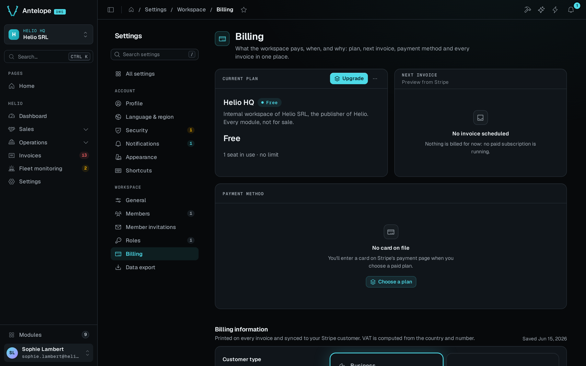

Add a page under `workspaceSettingsCategory` to place it next to Members and Roles. The DMS supplies the settings navigation and layout, and you declare only the page's content. Use a personal `memberAccess` category instead when every member should manage their own preferences.



The playground page above inherits `SettingsLayout()` from the settings root. Your page gets the same frame. For the built-in pages themselves, see [Built-in dashboard](/docs/getting-started/built-in-dashboard#the-settings).

## The two categories

The DMS declares two categories under the settings root:

| Category | Id | URL | Pages | Access |
| -------- | -- | --- | ----- | ------ |
| **Account** | `settings.user` | `/settings/user` | Profile, Language & region, Security, Notifications, Appearance, Shortcuts | `memberAccess`. Every signed-in member, no role needed |
| **Workspace** | `settings.workspace` | `/settings/workspace` | Members, Member invitations, Roles | The page permissions, granted through roles |

`@antelopejs/interface-dms/page` exports `workspaceSettingsCategory`. A project adds its workspace settings there instead of declaring a `settings.workspace` category of its own. The Account category belongs to the DMS and is not exported. Personal pages of your own go in a category of yours flagged `memberAccess` (see [Personal settings](#personal-settings)).

The overview at `/settings` opens from Settings in the user menu of the sidebar footer. The sidebar has no Settings entry of its own. The overview shows the caller's account summary and recent activity, then a card per page of each of the two categories, with its badge (`NavCardGrid({ category })`). Every member opens it, a member without any role included, because the settings root is `memberAccess: "self"`. The overview lists only the pages its caller can open, and leaves out a category they open none of. `"self"` stops at the overview. A page declared under `settingsCategory` still needs its own permission, and the Roles editor lists the Workspace pages at the top level, after every other section.

## Add a workspace settings page

Declare the page under `workspaceSettingsCategory`. Its permission works as on any page. A role must grant it, and the Roles editor lists it.

```ts fragment [src/pages/settings/billing.ts]
import { TableView } from "@antelopejs/interface-dms/base/table-view";
import { PageController, RegisterPage, workspaceSettingsCategory } from "@antelopejs/interface-dms/page";
import { invoiceDataAPI } from "../../data/invoices";

@RegisterPage()
export class BillingSettingsPage extends PageController("billing", {
  displayName: "$my_app.settings.billing",
  description: "$my_app.settings.billing_description",
  icon: "i-ph-credit-card",
  category: workspaceSettingsCategory,
  order: 3,
}) {
  static invoices = TableView(invoiceDataAPI, {
    layout: "compact",
    tabs: [{ id: "all", label: "$my_app.invoices.all", navBadge: true }],
  });
}
```

The page answers at `/settings/workspace/billing`, and its permission id is `settings.workspace.billing`.

A page that declares a `module` cannot sit under the settings root. Registration throws, and a module keeps its settings in its own sidebar ([Distributable module](/docs/building/distributable-module#module-navigation-and-access)). A module that extends the workspace settings registers its page without `module`.

## Personal settings

A page every member keeps for themselves, such as their preferences for your feature or their API tokens, sets `memberAccess: true`. Set it on the page, or on a category whose pages inherit it. `true` passes on to what is declared under the entry, while `"self"` opens the entry alone:

```ts [src/pages/settings/category.ts]
import { Category, settingsCategory } from "@antelopejs/interface-dms/page";

export const myAccount = Category("my-app", {
  displayName: "$my_app.settings.title",
  icon: "i-ph-user-gear",
  category: settingsCategory,
  order: 3,
  memberAccess: true,
});
// pages declaring `category: myAccount` are open to every member
```

Every signed-in member holds a `memberAccess` page, its components and their actions without a role grant. Their permissions are registered as `defaultGranted`, so they never wait on a role, and the Roles editor does not list them. Every check still runs (guards, menus, table views and the tenant access gate), and only the grant is implied. `authOnly` differs here: it skips the permission checks and registers no ids at all. Keep `memberAccess` for pages that show only the caller's own data, because anything on such a page is open to every member of the workspace. [Auth & permissions](/docs/auth-and-tenancy/auth-and-permissions#authenticate-pages) has the full list of access options.

## The settings navigation

The settings navigation lists one group per category declared under `settingsCategory`, in menu order and labelled by the category's `displayName`, then the pages declared on the root itself. Within a group:

- **Order.** Pages follow their `order`, then their name. A page declared with another page as its `category` follows that page. The built-in account pages take the orders 1 to 6, and the workspace ones take 1 (Members), 2 (Member invitations) and 3 (Roles). Give your page an `order` to place it.
- **Visibility.** A page shows only to the callers who can open it.
- **Badge.** An entry shows the page's badge. The badge is a static `badge` option, or the count a table on the page publishes with `navBadge: true` on one of its tabs ([Link tabs](/docs/components/tables/filters-and-tabs#link-tabs)). It is drawn neutral or in the tone the count carries (`navBadge: { tone: "warning" }`, or `{ count, tone }` from a component's own `navBadge(...)`). The server counts it on each page visit, with the caller's own permissions, and the main navigation shows the same badge. Without a badge, the page's `status` shows as a dot for `"success"`, `"warning"` or `"error"`. The settings navigation draws no dot for `"neutral"`.

## The settings frame

Every page under the settings root renders in `SettingsLayout()`, which draws the settings navigation next to the page, in the column width every settings page shares. `settingsCategory` declares it as its default layout ([Default layout of a category](/docs/building/navigation#default-layout-of-a-category)), so pass no layout to a settings page. A page that passes one (`DefaultLayout()`, `FormPageLayout()`) opts out of the frame. Pass `SettingsLayout(options)` when the page needs layout options such as `headerActions`. The form pages a table generates on a settings page stay in the frame.
