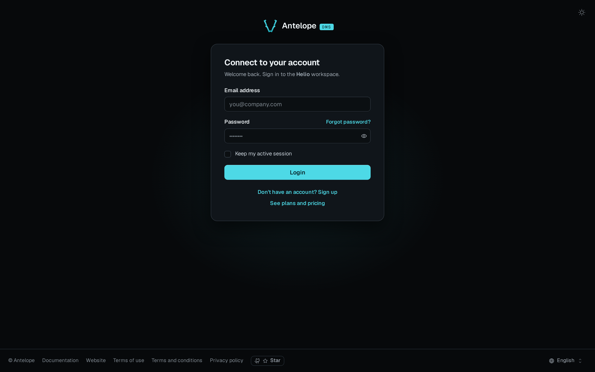
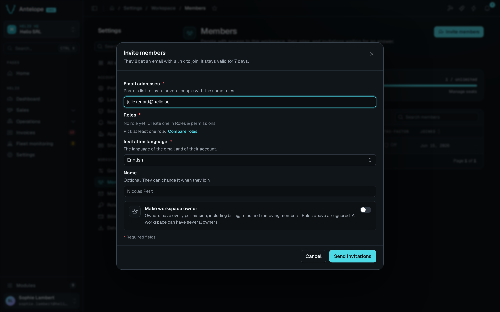
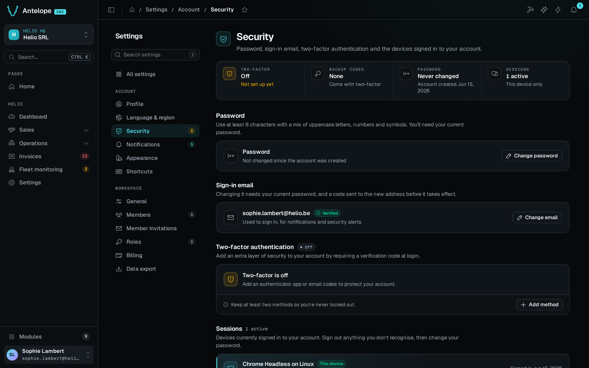
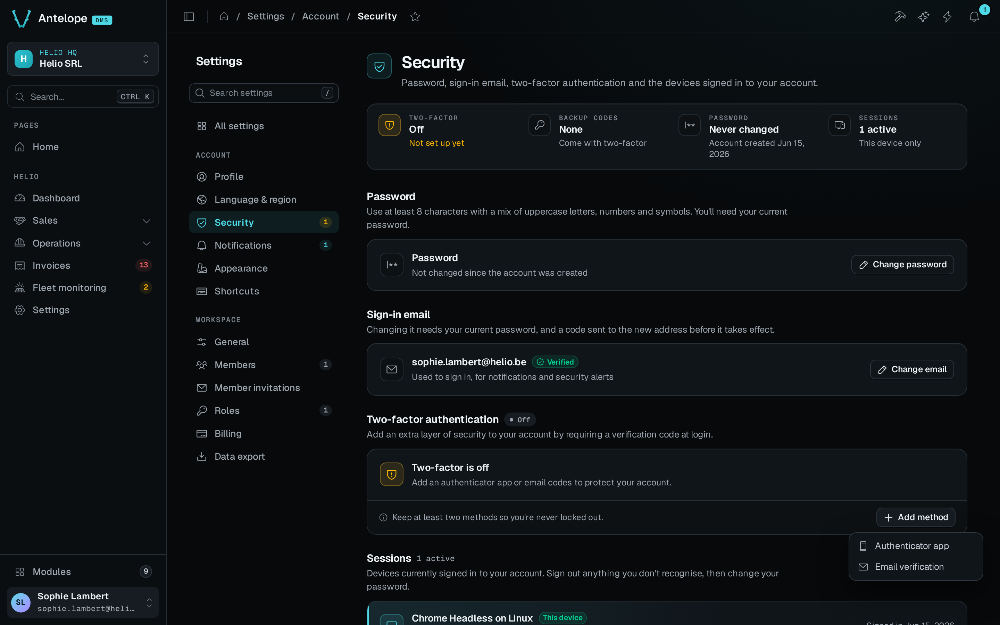
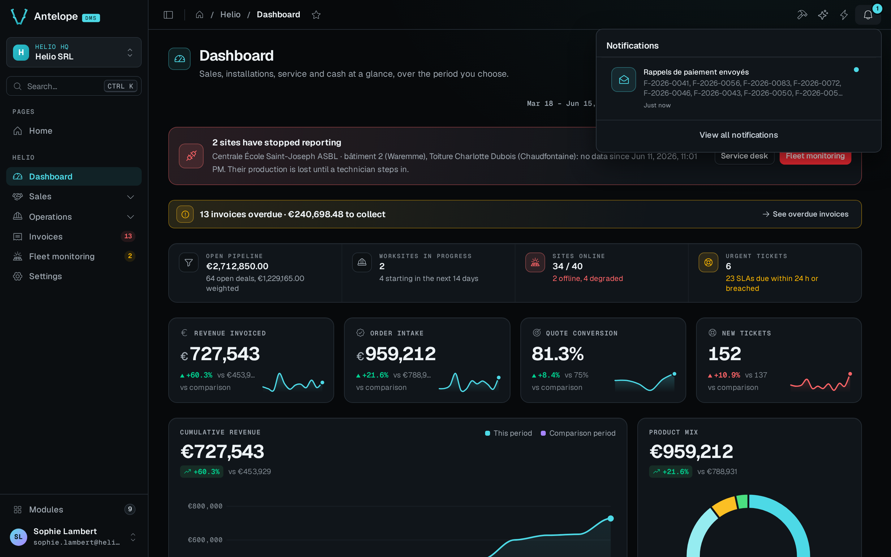
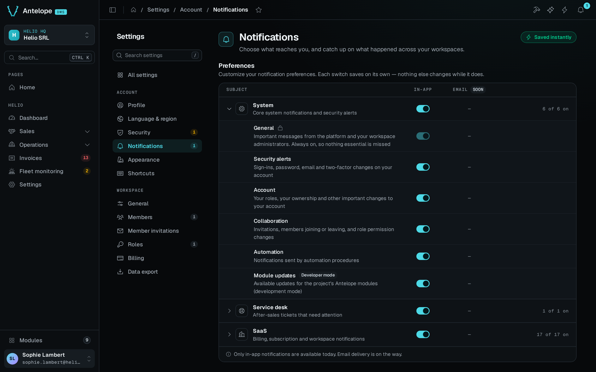

The DMS ships login screens, two-factor authentication, email validation, and password recovery, wired end to end. You configure them ([Configuration](/docs/building/configuration)). You do not rebuild them. This page lists what each flow does and where your code can hook in.

To gate your own routes and pages with this system, see [Auth and permissions](/docs/auth-and-tenancy/auth-and-permissions). Provider sign-in is on [Login providers](/docs/auth-and-tenancy/login-providers), and tokens and sessions are on [Sessions and tokens](/docs/auth-and-tenancy/sessions).



For a first project, create the administrator through onboarding, invite a teammate, and visit **Settings → Security** to set up two-factor authentication. You do not need to issue or store tokens yourself. Read [Sessions and tokens](/docs/auth-and-tenancy/sessions) when integrating a custom authentication flow.

## How users enter the platform

The core DMS has no open self-service signup. An account comes into existence in one of three ways:

1. **Onboarding.** On a fresh instance, the first visit goes to the onboarding wizard. Once the visitor presents the instance's setup token, the wizard registers the first admin as platform owner and marks the instance onboarded ([Built-in dashboard](/docs/getting-started/built-in-dashboard#first-run-the-onboarding-wizard)).
2. **Invites.** An admin invites an email from the Members settings page, or your code calls `inviteUserToTenant` ([Multi-tenant data](/docs/auth-and-tenancy/multi-tenant#invites)). The invite email links to `/auth/signup?token=…`. When the invite carries a first or last name, the link also prefills the name field of the signup form.
3. **`dms-saas`.** The optional SaaS module adds self-registration: owners sign up, pick a plan, and get their tenant ([SaaS mode](/docs/auth-and-tenancy/saas-mode)).

An invite signup consumes the token, creates the account with the invite's roles, attaches it to the tenant, and deletes the invite. The account language is the locale of the signup form, and the invite's language only when the form sends none. Invites expire after 7 days. The Member invitations page (`/settings/workspace/invites`), next to Members, lists the invites not yet accepted. An admin can edit, resend or cancel them there.

A configured login provider ([`auth.oauth`](/docs/building/configuration#login-providers-in-authoauth)) can also create an account, but only when the instance sets `allowAccountCreation` or the sign-in carries an invitation. Otherwise a provider identity signs in an existing account and never creates one ([Login providers](/docs/auth-and-tenancy/login-providers#which-account-a-provider-identity-resolves-to)).

### Invite a teammate

Choose **Invite members** in Members, enter one or more addresses, and pick at least one role, unless you make the invitee a workspace owner. The dialog also sets the language of the invitation and an optional name. The pending invitation keeps its roles until the recipient joins.



The invitation link opens the signup form with the invited address fixed. The recipient chooses a name and a password, and joins with the invitation's roles. [Auth and permissions](/docs/auth-and-tenancy/auth-and-permissions) explains what those roles open.

## Login

A login attempt checks the password, then takes one of three branches:

1. **No tenant membership.** The login answers `requires_tenant_assignment` with an assignment token that lives 15 minutes, and the login screen goes to `/auth/no-workspace`. The core DMS does not ship that screen. The `dms-saas` module provides it as its workspace creation flow ([SaaS mode](/docs/auth-and-tenancy/saas-mode#how-an-owner-signs-up)). The account picker at `/auth/accounts` switches between saved accounts and plays no part in tenant assignment.
2. **Two-factor enabled.** The login answers `requires_2fa` with a two-factor token that lives 5 minutes and the user's enabled methods. The screen goes to `/auth/2fa`.
3. **Otherwise.** The DMS creates a session and issues both tokens for the user's oldest tenant membership.

A login that creates a session sends a "new login" security notification when the account never signed in from that browser, system and device type, or from that country when the country is known ([Country of a sign-in](/docs/building/configuration#country-of-a-sign-in)). When the user agent does not identify the device, the notification uses its "unknown device" variant. It names the country, never the address.

### Sign-in limits

The DMS throttles wrong passwords before it checks any password. Each typed address gets 10 failed sign-ins and each client address gets 50 within 15 minutes ([`auth.clientIpHeader` and `auth.trustedProxies`](/docs/building/configuration#client-address-behind-proxies) decide the client address). After that, `POST /api/auth/login` answers `429` with `error.too_many_sign_in_attempts` until the window ends. An unknown address is throttled like a known one, so the refusal does not tell which accounts exist. A successful sign-in clears its address's count. These counts live in memory on each API instance, so a deployment of several instances multiplies each budget by their number.

Five wrong passwords on an account within 15 minutes also warn its owner, once per burst. The DMS stores sign-in attempts in the database for this warning, so every instance sees the same attempts.

### The current-password limit

A signed-in session asked for the account password again gets the same budget per account: 10 tries within 15 minutes. The forms that ask are the sign-in email change, the password change, adding a second factor and deleting the account, and they share the budget. Once it is spent, every one of them answers `429 error.too_many_current_password_attempts`, the right password included, until the oldest try leaves the window. A refused try is not counted, and the right password clears the count. The DMS keeps these tries in the database, so every instance shares them. A wait that one of those forms imposes, such as one email change request or one emailed code a minute, is checked before the password, so its refusal never tells a right guess from a wrong one.

### Switch tenants

A signed-in user can switch to another tenant without signing in again. The DMS checks the membership, answers `403 error.not_a_member` without one, and issues both tokens again for the target tenant. The core dashboard ships no UI for it. The workspace switcher comes with the optional `dms-saas` module ([SaaS mode](/docs/auth-and-tenancy/saas-mode)). Switching between separate accounts is a frontend feature backed by stored refresh tokens ([`useMultiAccount`](/docs/frontend-composables/authenticated-requests#usemultiaccount-the-account-switcher)).

## Two-factor authentication

Users manage 2FA themselves on the built-in Security page. Three methods can verify a login:



| Method   | How it works |
| -------- | ------------ |
| `totp`   | An authenticator app. Enabling is a two-step enrollment: the server issues a pending secret, and the user confirms a code. Each code works once. A code from the 30-second window last accepted, or from an earlier one, is refused. |
| `email`  | A 6-digit code emailed on demand. It is valid 10 minutes, single-use, and stored hashed. A resend waits 60 seconds after an email that left. A failed send stores no code and starts no wait. Enabling is a two-step enrollment too: a code goes to the account address, and the method turns on once the code comes back. Starting again while that code is still valid sends no other code. |
| `backup` | One of the recovery codes generated at enrollment. Each code is hashed at rest and consumed on use. The Security page can regenerate the set. |

Adding a method asks for the account password first, so a borrowed session cannot enroll a factor of its own. An account without a password, which signs in through a provider only, skips that step. Removing a method asks for a code of that method. Regenerating the backup codes asks for a code of any method. Enabling, disabling, and backup-code regeneration all post security notifications to the account.

For email verification, choose **Add method**, then **Email verification**, confirm your current password, then enter the emailed code. Save the recovery codes privately when enrollment succeeds.



### Two-factor limits

Each password sign-in issues its own two-factor challenge with a random id, so two sign-ins never share one. The limits below apply to every method:

- A challenge takes at most 5 codes, right or wrong. Past them, `/api/auth/verify-2fa` answers `429 error.too_many_2fa_attempts` and sends no new email code for that challenge. The user signs in again with the password to get a new challenge.
- An account takes at most 10 wrong codes within an hour, across all its challenges. Past them, every code is refused with `429 error.too_many_2fa_attempts_account`, the right one included and whatever new challenge a sign-in brings, until the oldest wrong code leaves the window. The owner gets a security notification once per burst, since whoever reached that step knew the password.
- A refused code is not counted. A right code clears the account's count, so only the holder of the second factor can clear it.
- A challenge opens one session. Once a code went through, the challenge answers `401 error.2fa_challenge_used`.
- The DMS keeps the tries and the used challenges in the database, so every instance shares them.

`/api/auth/verify-2fa` and `/api/auth/request-2fa-email` give the same answer, `401 error.invalid_2fa_token`, to every bad two-factor token. That covers a token that is not one, names an unknown user, carries a bad signature, has expired, or was issued for another purpose. The answer tells nothing about which user ids exist. A request without a token answers `400 error.invalid_2fa_token`.

## Email validation

With `auth.mustValidateEmail: true` ([Configuration](/docs/building/configuration#tokens-validation-and-sanitization-in-auth)), `@AuthUser`-guarded routes refuse a user until they validate their email. The user requests a verification email, at most one per 60 seconds. The emailed token is valid 1 day by default, and the `/auth/validate` page confirms it. Admins can force-validate a member from the Members settings page.

An account created through an invitation link always starts validated, whatever `mustValidateEmail` says, and no separate validation round follows. The link reached the invitee through that mailbox, and an admin who copies it by hand vouches for the address.

### Changing the sign-in email

The Security page changes the sign-in email in two steps.

1. The request, `POST /dms/pages/settings/user/security/email` with the current password, sends a 6-digit code to the new address and a notice to the current one. The account keeps its address meanwhile. The DMS accepts at most one request a minute per user and per new address, cancelling included. It checks that limit before the password and answers `429 error.rate_limited`.
2. The confirmation, `POST /dms/pages/settings/user/security/email/confirm` with the code, moves the account to the new address, marks it validated, and posts the "email changed" security notification. The code is valid as long as `auth.emailValidationTokenLifetime`. After 5 wrong tries the code is burnt (`429 error.email_change_too_many_attempts`), and the user requests a new one.

`DELETE /dms/pages/settings/user/security/email/pending` drops the change. The Security overview reports the address waiting as `pendingEmail`.

## Password recovery

The forgot-password request answers the same whether or not the email exists, so it cannot be used to list accounts. When the account exists, the DMS emails a 6-character reset code of capital letters and digits, at most one per 60 seconds. The code is valid 1 day by default and accepted in any case. The `/auth/forgot` and `/auth/recover` pages check the code and set the new password.

- A code takes at most 5 tries. The fifth wrong try withdraws it, and the user requests a new one.
- The DMS counts the tries in the database, so every instance shares them. The refusal reads the same as for an unknown address.
- Setting the new password signs out every session and rotates the user's auth key, so whoever had access to the account loses it at once. Then a "password reset" security notification fires.

Every password follows one policy: at least 8 characters, with at least one uppercase letter, one digit, and one special character from `@$!%*?&`. Letters, digits and those special characters are the only characters accepted. A module that sets passwords through its own flow enforces the same policy with `isPasswordCompliant` from `@antelopejs/interface-dms/auth/password`.

## The auth screens

The dashboard frontend renders these screens as public, hidden pages. You get them without registering anything:

| Route                     | Screen |
| ------------------------- | ------ |
| `/auth`                   | Login |
| `/auth/signup`            | Invite-based signup (`?token=…&email=…`) |
| `/auth/2fa`               | Two-factor challenge |
| `/auth/backup`            | Backup-code entry |
| `/auth/validate`          | Email validation |
| `/auth/forgot`            | Request a password reset |
| `/auth/forgot-validation` | Reset-code validation |
| `/auth/recover`           | Set the new password |
| `/auth/recover-success`   | Confirmation |
| `/auth/accounts`          | Account picker (switch between saved accounts) |
| `/auth/oauth-complete`    | End of a provider sign-in |

A frontend layer can add links under these forms with `registerAuthLink` ([Dashboard chrome](/docs/extending-the-dashboard/dashboard-chrome#auth-links)).

## Emails and security notifications

The flows send transactional email through the [HTML render service](/docs/building/backend-services#email-templates-and-rendering) and your mailer module. They send an admin-invite email, an email-validation email, a password-reset email, and the 2FA code email. Configure `htmlRender.renderEndpoint` and a mailer such as `@antelopejs/nodemailer`, or these sends fail.

The system also posts in-app security notifications under the built-in Security notification subject. Users can turn that subject off in their notification preferences. The notifications cover:

- a new login, with its unknown-device variant;
- a password changed or reset;
- an email changed;
- 2FA enabled or disabled;
- backup codes regenerated;
- too many two-factor codes.

### Read notifications

Open the header bell to read recent messages. An unread message carries a dot, and clicking the message marks it read. **View all notifications** opens the inbox in **Settings → Notifications**. A message reaches every open session of its recipient without a reload, and no other account.



### Notification preferences

Go to **Settings → Notifications** and expand a category to see its subjects. A category switch changes its toggleable subjects together. A subject switch changes that subject alone. The System category keeps General locked on. These preferences control in-app notifications, not the transactional authentication emails described above.



The Email column is marked **Soon**. These switches do not configure an email channel. Turning a subject off stops new notifications of that subject, and the messages already in the inbox stay.

```text
Category → subject → recipient
              │
              ▼
       Preference check
       ├─ off: skipped
       └─ on
           │
           ▼
     Stored notification
           │ realtime update
           ▼
       Inbox / bell
```

Realtime publishing is best-effort. A stored notification does not guarantee that every open session receives the live event.

See [Categories and subjects](/docs/interfaces/notifications/categories-and-subjects) for the toggle rules and [Sending notifications](/docs/interfaces/notifications/sending) for recipient selection and delivery.

## Auth in your own frontend pages

Pages you author in a frontend layer opt into the same guard with route meta:

```vue [frontend-vue/app/custom-pages/report.vue]
<script setup lang="ts">
definePageMeta({ auth: true });
</script>
```

`auth` also accepts `navigateAuthenticatedTo` and `navigateUnauthenticatedTo` options, which redirect instead of blocking. Backend-described pages do not need this. The catch-all renderer enforces each page's own access options (`publicAccess`, `authOnly`, permission) for you.

On the backend, `@antelopejs/interface-dms/auth` exports the token helpers behind these flows. See [Auth and permissions](/docs/auth-and-tenancy/auth-and-permissions).
