# Built-in authentication

The DMS ships a complete authentication system: login screens, session management, two-factor authentication, email validation, and password recovery, all wired end to end. You configure it ([Configuration](/docs/building/configuration)); you don't rebuild it. These flows determine what your users get and where your code can hook in.

For gating **your** routes and pages with this system — the decorators and the permission model — see [Auth & permissions](/docs/auth-and-tenancy/auth-and-permissions).

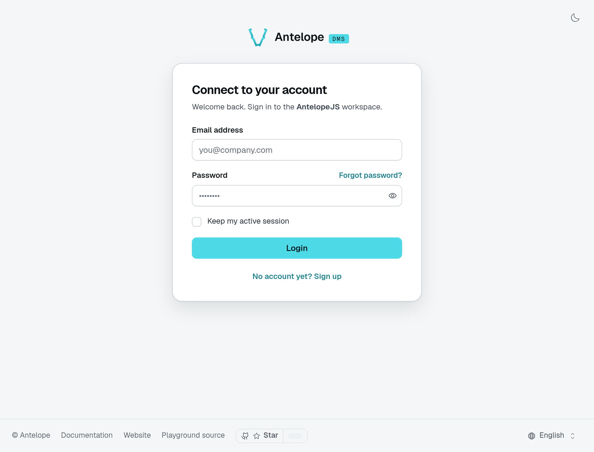

For a first project, create the administrator through onboarding, invite a teammate, and visit **Settings → Security** to set up two-factor authentication. You do not need to issue or store tokens yourself. Read [The session model](#the-session-model) when integrating a custom authentication flow.

## How users enter the platform

There is **no open self-service signup** in the core DMS. An account comes into existence one of three ways:

1. **Onboarding** — on a fresh instance, the first visit funnels to the onboarding wizard, which registers the **first admin** as platform owner and marks the instance onboarded ([Built-in dashboard](/docs/getting-started/built-in-dashboard#first-run-the-onboarding-wizard)).
2. **Invites** — an admin invites an email from the Members settings page (or your code calls `inviteUserToTenant`, see [Multi-tenant data](/docs/auth-and-tenancy/multi-tenant#invites)). The invite email links to `/auth/signup?token=…`; when the invite carries a first/last name, the link also prefills the signup's name field. The signup consumes the token, creates the account with the invite's roles, attaches it to the tenant, and deletes the invite. The account language comes from the signup form's locale, not from the invite. Invites expire after 7 days. Invites not yet accepted are listed on the Member invitations page (`/settings/workspace/invites`), next to Members, where they can be edited, resent or cancelled.
3. **`dms-saas`** — the optional SaaS module adds real self-registration on top (owners sign up, pick a plan, get their tenant — [SaaS mode](/docs/auth-and-tenancy/saas-mode)).

A configured login provider ([`auth.oauth`](/docs/building/configuration#authoauth-login-providers)) can also open the door, but only when the instance sets `allowAccountCreation` — otherwise a provider identity may sign in an existing account and never create one.

### Invite a teammate

Choose **Invite members** in Members, enter the address, and select a role. The pending invitation keeps that role until the recipient joins. The playground also asks for a team through its invite extension; that field is not part of the core invitation form.

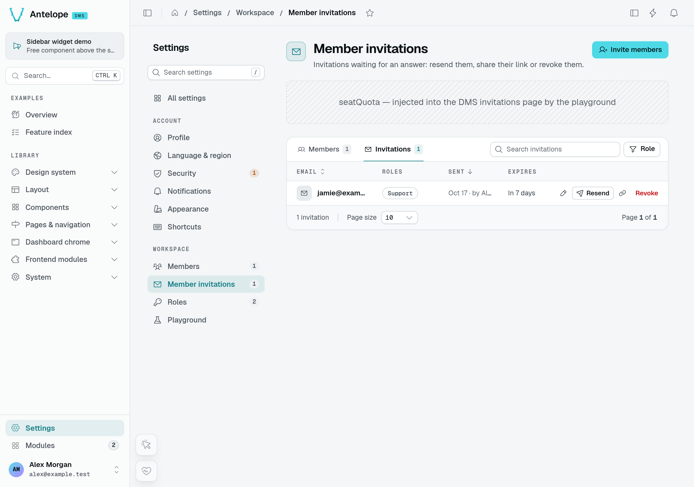

*An invitation for Jamie waits for acceptance. This local demonstration intercepts the email instead of delivering it to an external mailbox.*

Open the invitation link in a fresh browser session. The account form fixes the invited email address and lets the recipient choose their name and password.

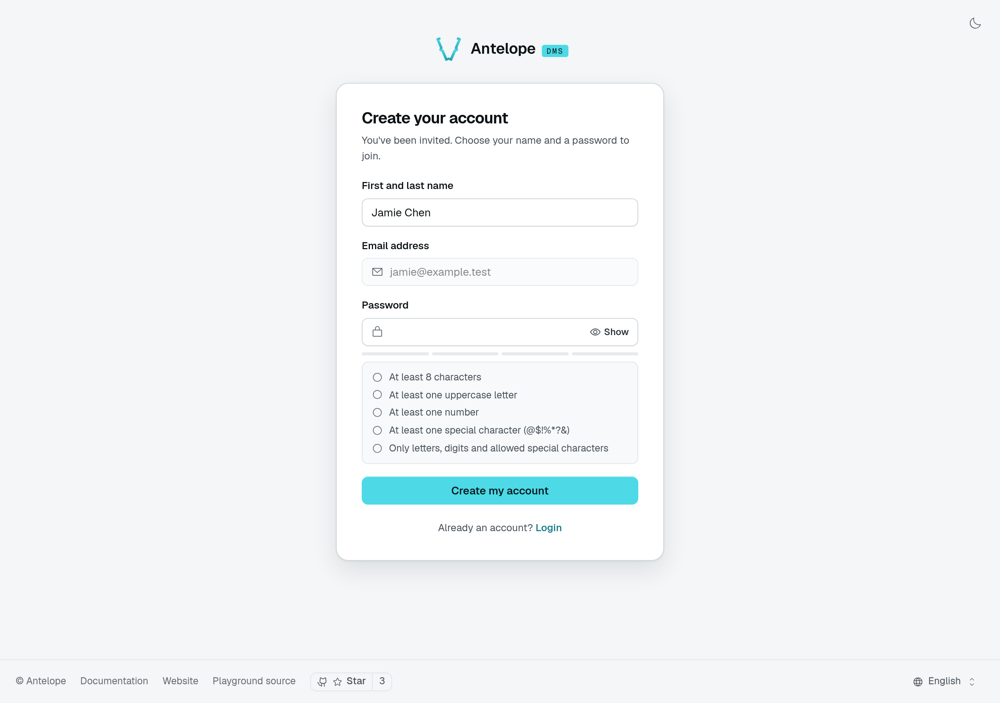

*The invitation opens the real signup form. Its token is not shown in the capture. After signup, Jamie holds the saved Support role; see the [administrator and member comparison](/docs/auth-and-tenancy/auth-and-permissions#compare-real-member-access).*

## Login

A login attempt verifies the password, then branches:

1. **No tenant membership** — the login answers `requires_tenant_assignment` with a short-lived (15 min) assignment token, and the login screen navigates to `/auth/no-workspace`. The core DMS does not ship that screen — the `dms-saas` module provides it as its workspace-creation flow ([SaaS mode](/docs/auth-and-tenancy/saas-mode#how-an-owner-signs-up)). The account picker at `/auth/accounts` is the multi-account switcher and plays no part in tenant assignment.
2. **Two-factor enabled** — the login answers `requires_2fa` with a 5-minute two-factor token and the user's enabled methods; the UI routes to `/auth/2fa`.
3. **Otherwise** — a session is created, both tokens are issued for the user's **oldest tenant membership**, and a "new login" security notification fires when the account never signed in from that browser, system and device type — or from that country, when it is known ([Configuration](/docs/building/configuration#country-of-a-sign-in)) — with an "unknown device" variant when the device cannot be identified from the user agent. The notice names the country, never the address.

Wrong passwords are throttled before any password is checked: 10 failed sign-ins per typed address and 50 per client address (see `auth.clientIpHeader` and `auth.trustedProxies`) within 15 minutes, after which `POST /api/auth/login` answers `429` with `error.too_many_sign_in_attempts` until the window ends. An unknown address is throttled like a known one, so the refusal tells nothing about which accounts exist; a successful sign-in clears its address's count. The counts live in memory, per API instance. Five wrong passwords within 15 minutes also warn the account owner once.

A signed-in session asked for the account password again — to change the sign-in email or the password, add a second factor, or delete the account — gets the same budget per account: 10 tries within 15 minutes, shared by all those forms, after which every one answers `429 error.too_many_current_password_attempts`, the right password included, until the oldest try leaves the window. A refused try is not counted, and the right password clears the count. These tries are kept in the database, so every instance shares them. A wait one of those forms imposes (one email-change request a minute, one emailed code a minute) is checked before the password, so its refusal never tells a right guess from a wrong one.

## Login providers (OAuth)

When [`auth.oauth`](/docs/building/configuration#authoauth-login-providers) enables GitHub or Google, the auth screens gain a "Continue with …" button above the e-mail form. The round-trip is owned by the backend: the browser-facing layer only carries the redirect and the state cookie, while the authorization code is exchanged **inside the instance**, with the client secret never leaving it. The identity that comes back is therefore vouched for by the provider, not asserted by the frontend.

The OAuth API endpoints are **frontend-server-only**: they require a relay secret derived from the instance `jwtSecret`, handed to the layer through server-side options. The browser-binding CSRF check (the state cookie) lives in the layer that set the cookie, and the relay secret is what guarantees no other caller can stand in for that layer. A module composing its own OAuth-entry flow presents the same secret (`runtimeConfig.dms.oauth.relaySecret` in its server routes).

That guarantee rests on the frontend server being the only thing that ever receives the secret. A production frontend reads it from its own environment, `DMS_OAUTH_RELAY_SECRET` ([the server's secrets](/docs/frontend/cli/start#the-servers-secrets)), and provider login fails while it is unset. In development, `ajs dms dev` receives it with the manifest, which [`frontend.bootstrapSecret`](/docs/building/configuration#bootstrap-protection) protects: without one, the backend withholds every private module option.

Once the identity resolves to an account, the flow rejoins the branches above unchanged — `requires_tenant_assignment`, `requires_2fa`, or a session. A provider login on a 2FA-enabled account still runs the challenge.

The account it resolves to follows one rule set, applied in order:

1. a provider account already bound to a user always resolves to that user — provider e-mails change, provider account ids do not;
2. an account holding the same e-mail is adopted only when the provider marks that e-mail verified **and** the local account is validated; anything else is refused rather than linked silently;
3. an **unvalidated** account holding that e-mail is never adopted as it stands — nobody proved they own it. An invitation addressed to that e-mail reclaims it instead, wiping its password, recovery token, auth key, second factor and provider bindings so nothing the previous holder set survives, exactly as a password signup overwrites an unvalidated account;
4. an unknown identity creates an account only when `allowAccountCreation` is on **or** when the flow carries a valid invitation — an invitation is already the permission to join, exactly as it is for a password signup — and only on a provider-verified e-mail. The account is created without a usable password — password recovery is how such a user later sets one.

Bindings live in their own `user_external_identities` table, one row per (provider, provider account). `linkExternalIdentity()` and `getExternalIdentities()` are exported from `@antelopejs/interface-dms/auth` for modules that create accounts themselves and need to bind the identity inside their own transaction. Product integrations that connect the same provider for other purposes (repository access, deployments) must keep their own storage: these rows only mean "this person can sign in as that account".

A module owning its own registration flow — a SaaS transactional signup, for instance — calls `announceRegistration(userModel, user, tenantId)`, also exported from `@antelopejs/interface-dms/auth`, once its provisioning has committed. It runs everything that must happen when an account has really joined a tenant: the welcome and collaborator notifications, then the `USER_REGISTERED` hook ([Backend services](/docs/building/backend-services#lifecycle-hooks)). The DMS password signup and a provider login consuming an invitation go through the same call, so automations never depend on which door the account came through. The call is observational — registration is already complete when it runs, and a failing hook subscriber is logged rather than allowed to fail the request.

A logged-in user can also switch tenants without re-authenticating: membership is verified and both tokens are reissued for the target tenant. The core dashboard ships **no UI for it** — the workspace switcher comes with the optional `dms-saas` module ([SaaS mode](/docs/auth-and-tenancy/saas-mode)). Switching between separate **accounts** is a different thing: a frontend feature backed by stored refresh tokens ([`useMultiAccount`](/docs/frontend-composables/authenticated-requests#usemultiaccount-the-account-switcher)).

## Two-factor authentication

Users manage 2FA themselves on the built-in Security page. Three methods can verify a login:

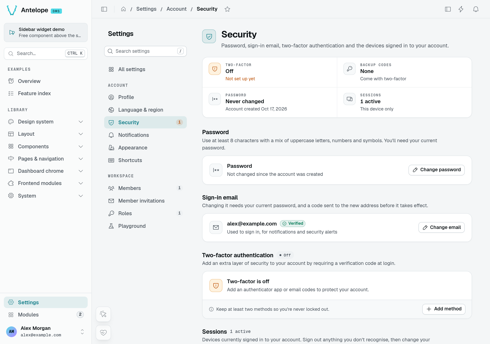

| Method   | How it works                                                                                                                                     |
| -------- | ------------------------------------------------------------------------------------------------------------------------------------------------ |
| `totp`   | An authenticator app. Enabling is a two-step enroll: the server issues a pending secret, the user confirms a code. Each code works once: a code from the 30-second window last accepted, or an earlier one, is refused. |
| `email`  | A 6-digit code emailed on demand, valid 10 minutes, single-use, stored hashed; resend is rate-limited to one per 60 seconds, counted from an email that actually left (a failed send stores no code and starts no wait). Enabling is a two-step enroll too: a code goes to the account address and the method turns on once it comes back; starting again while that code is still valid sends no other. |
| `backup` | One of the recovery codes generated at enrollment. Each code is hashed at rest and **consumed on use**; the profile page can regenerate the set. |

Adding a method asks for the account password first (an account without one, single sign-on only, has nothing to prove), so a borrowed session cannot enrol a factor of its own; removing one asks for a code of that method, and regenerating the backup codes a code of any. Enabling, disabling, and backup-code regeneration all emit security notifications to the account.

For email verification, choose **Add method → Email verification**, confirm your current password, then enter the emailed code. Save the recovery codes privately when enrollment succeeds.

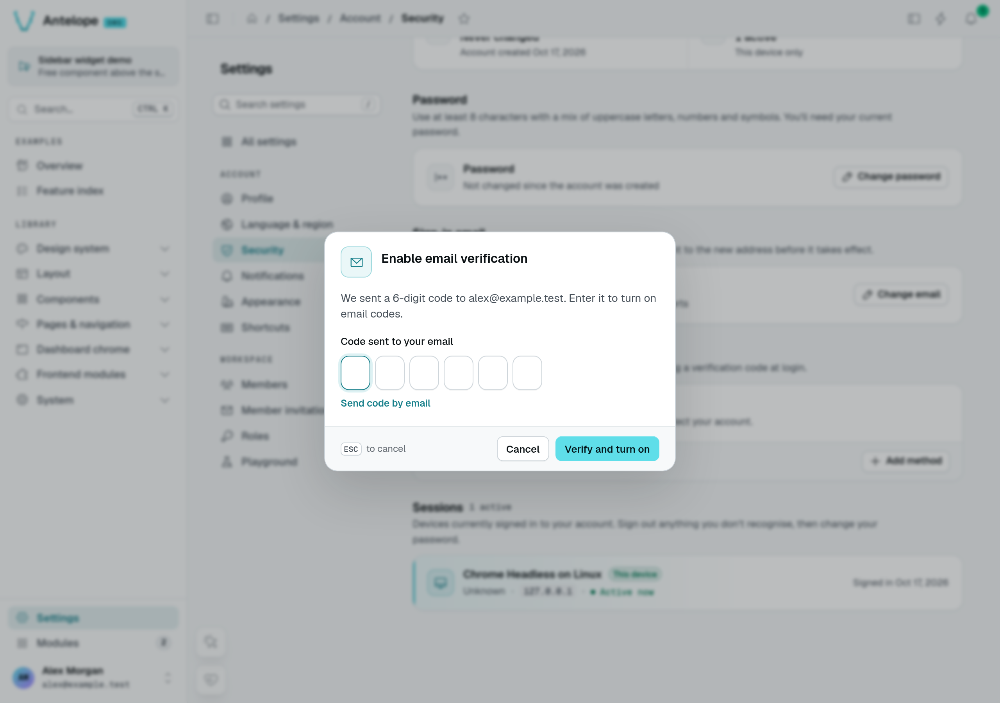

*Email enrollment before code entry. The code is captured only by the local test mailbox, never in the screenshot.*

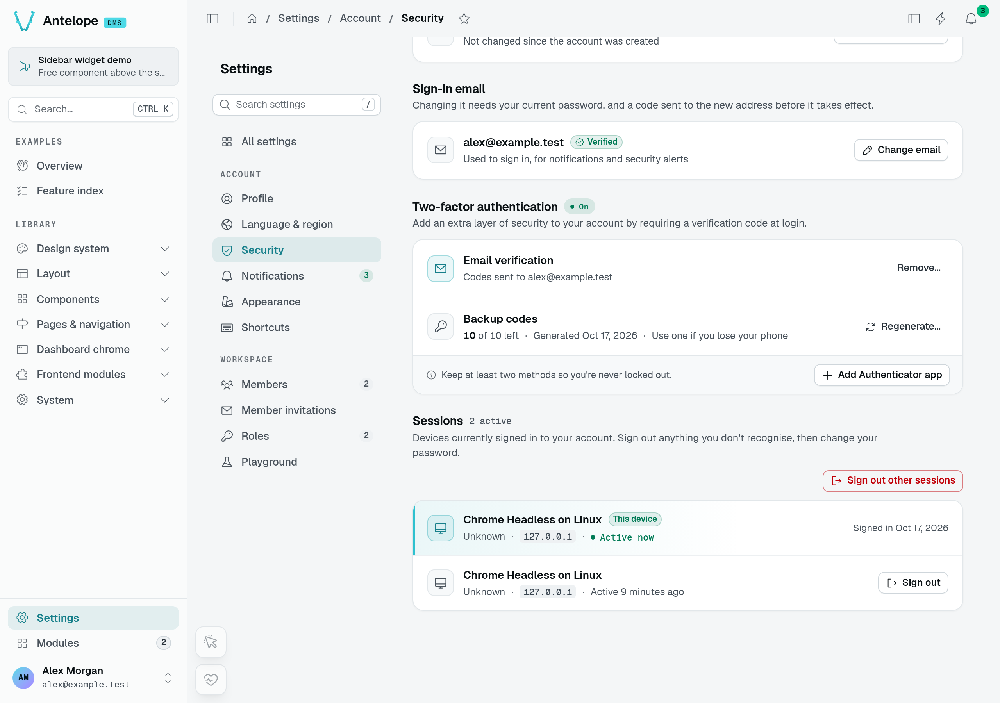

*After confirmation, Email verification is on. Only the recovery-code count is visible; neither the codes nor an authenticator secret is shown.*

Each password sign-in issues its own two-factor challenge, with a random id, so two sign-ins never share one. A challenge takes at most 5 codes, right or wrong, whatever the method: past them `/api/auth/verify-2fa` answers `429 error.too_many_2fa_attempts`, no new email code is sent for it, and the user signs in again with the password for a new challenge. An account also takes at most 10 wrong codes within an hour across all its challenges: past them every code is refused with `429 error.too_many_2fa_attempts_account`, the right one included and whatever new challenge a sign-in brings, until the oldest of them leaves the window; the owner gets a security notification once per burst, since whoever reached that step knew the password. A refused code is not counted, and a right one clears the account's count, as a right password clears the sign-in throttle: only the holder of the second factor can clear it. A challenge opens one session: once a code went through, it answers `401 error.2fa_challenge_used`. The tries and used challenges are kept in the database, so every instance shares them.

A two-factor token that is not one, names an unknown user, carries a bad signature, has expired or was issued for another purpose gets the same `401 error.invalid_2fa_token` from `/api/auth/verify-2fa` and `/api/auth/request-2fa-email`, so the answer tells nothing about which user ids exist; a request without a token answers `400 error.invalid_2fa_token`.

## Email validation

With `auth.mustValidateEmail: true` ([Configuration](/docs/building/configuration#auth-tokens-validation-sanitization)), a user must validate their email before `@AuthUser`-guarded routes accept them. The user requests a verification email (one per 60 seconds; the token is valid 1 day by default) and confirms with the emailed token — the `/auth/validate` page drives the flow. Admins can force-validate a member from the Members settings page.

An account created through an invitation link always starts validated, whatever `mustValidateEmail` says, and no separate validation round follows: the link reached the invitee through that mailbox, and an admin who copies it by hand vouches for the address.

### Changing the sign-in email

The Security page changes the sign-in email in two steps. The request (`POST /dms/pages/settings/user/security/email`, with the current password) sends a 6-digit code to the new address and a notice to the current one, and the account keeps its address meanwhile; at most one request a minute per user and per new address, cancelling included, checked before the password (429 `error.rate_limited`). Entering the code (`POST /dms/pages/settings/user/security/email/confirm`, valid as long as `auth.emailValidationTokenLifetime`) moves the account, marks the new address validated and posts the "email changed" security notification; after 5 wrong tries the code is burnt (429 `error.email_change_too_many_attempts`) and a new one must be requested. `DELETE /dms/pages/settings/user/security/email/pending` drops the change. The Security overview reports the address waiting as `pendingEmail`.

## Password recovery

The forgot-password flow is deliberately **silent** — it answers the same whether or not the email exists, so accounts can't be enumerated. When the account exists it emails a 6-character reset code of capital letters and digits, accepted in any case (one per 60 seconds; valid 1 day by default). The `/auth/forgot` → `/auth/recover` pages validate the code and set the new password. A code takes at most 5 tries: the fifth wrong one withdraws it and a new one must be requested. The tries are counted in the database, so every instance shares them, and the refusal reads the same as for an unknown address. Setting the new password signs out every session and rotates the user's auth key — whoever had access to the account loses it at once — then a "password reset" security notification fires.

Passwords everywhere follow one policy: **minimum 8 characters, with at least one uppercase letter, one digit, and one special character** (`@$!%*?&`). A module setting passwords through its own flow enforces the same policy with `isPasswordCompliant` from `@antelopejs/interface-dms/auth/password`.

## The auth screens

All of these ship as public, hidden pages rendered by the dashboard frontend — you get them without registering anything:

| Route                     | Screen                                   |
| ------------------------- | ---------------------------------------- |
| `/auth`                   | Login                                    |
| `/auth/signup`            | Invite-based signup (`?token=…&email=…`) |
| `/auth/2fa`               | Two-factor challenge                     |
| `/auth/backup`            | Backup-code entry                        |
| `/auth/validate`          | Email validation                         |
| `/auth/forgot`            | Request a password reset                 |
| `/auth/forgot-validation` | Reset-token validation                   |
| `/auth/recover`           | Set the new password                     |
| `/auth/recover-success`   | Confirmation                             |
| `/auth/accounts`          | Account picker (switch between saved accounts) |

A frontend layer can add links under these forms with `registerAuthLink` ([Dashboard chrome](/docs/extending-the-dashboard/dashboard-chrome#auth-links)).

## Emails and security notifications

The flows send transactional email through the [HTML render service](/docs/building/backend-services#html-email-rendering) and your mailer module: an admin-invite email, an email-validation email, a password-reset email, and the 2FA code email. Configure `htmlRender.renderEndpoint` (and a mailer such as `@antelopejs/nodemailer`) or these sends fail.

Alongside email, the system posts **in-app security notifications** — new login (with unknown-device variant), password changed or reset, email changed, 2FA enabled/disabled, backup codes regenerated, too many two-factor codes — under the built-in Security notification subject, which users can toggle in their notification preferences.

### Read notifications

Open the header bell to read recent messages. The playground's **Test Notifications** page can send a custom notification to the signed-in account only; the example below uses that action, not its broadcast or role-wide presets.

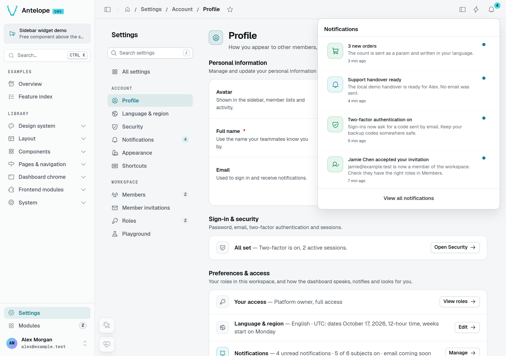

*Before reading: Support handover ready has an unread dot. The other messages include the real invitation-acceptance and two-factor events from this demonstration.*

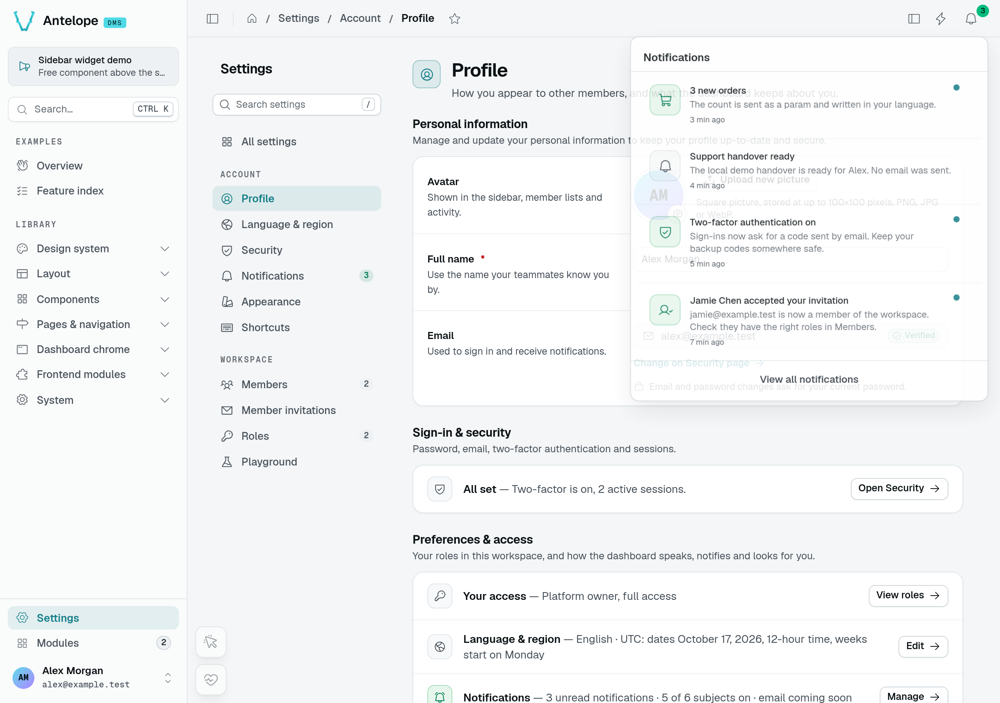

*After clicking the message and reopening the bell, its unread dot is gone. Read state records a user's action; it is not proof of email delivery.*

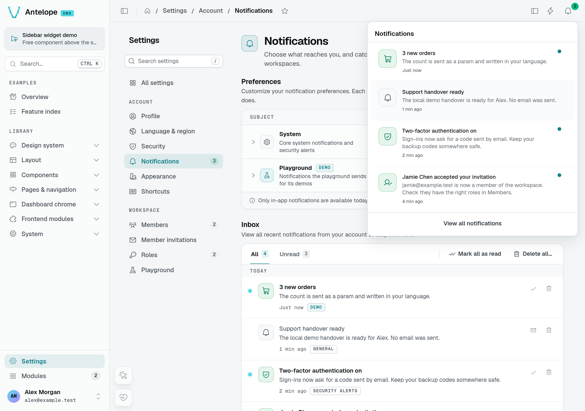

*A second session of Alex's account receives 3 new orders without reloading, after the first session sends the translated-text preset. Jamie's separate account receives neither this message nor the custom handover notification.*

### Notification preferences

Go to **Settings → Notifications** and expand a category to see its subjects. A category switch changes its toggleable subjects together; a subject switch changes that subject alone. The System category keeps General locked on. These preferences control in-app notifications, not the transactional authentication emails described above.

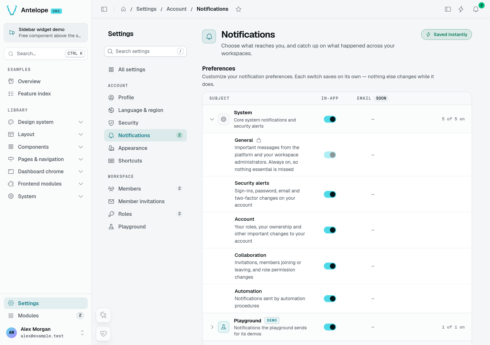

*System groups General, Security alerts, Account, Collaboration, and Automation. The Email column is marked Soon; these switches do not configure an email channel.*

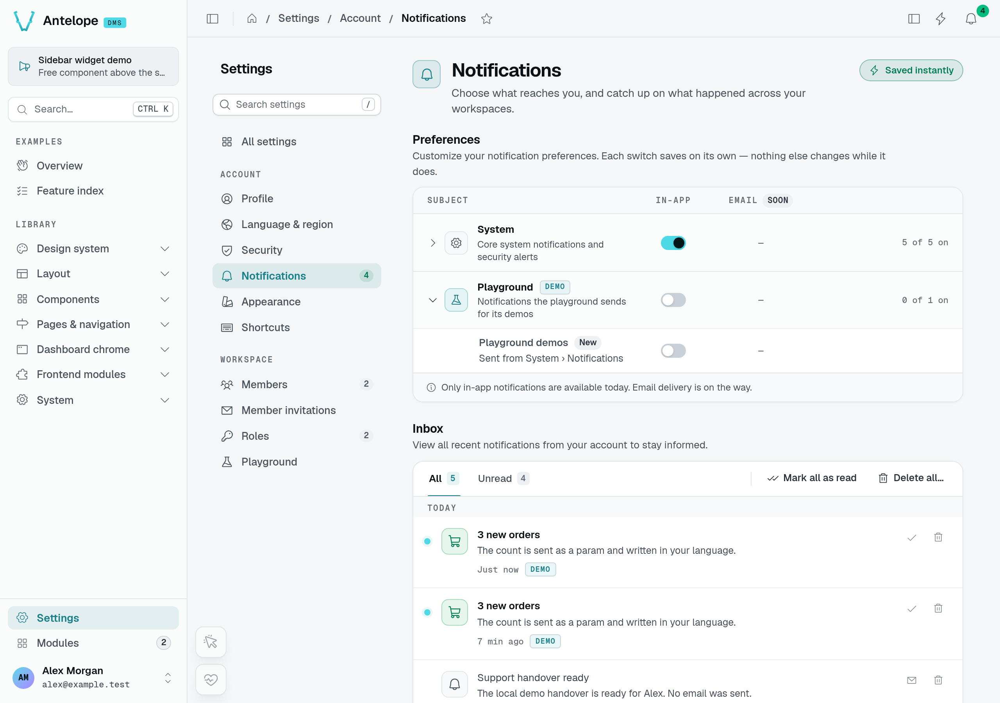

*Playground demos is off and the preference persists across sessions. A subsequent send of that subject stores no new notification; existing inbox entries remain.*

```text
Category → subject → recipient
              │
              ▼
       Preference check
       ├─ off: skipped
       └─ on
           │
           ▼
     Stored notification
           │ realtime update
           ▼
       Inbox / bell
```

Realtime publishing is best-effort: a stored notification does not guarantee that every open session receives the live event.

See [Categories and Subjects](/docs/interfaces/notifications/categories-and-subjects) for the toggle rules and [Sending Notifications](/docs/interfaces/notifications/sending) for recipient selection and delivery semantics.

## Auth in your own frontend pages

Pages you author in a frontend layer opt into the same guard with route meta:

```vue [frontend-vue/app/custom-pages/report.vue]
<script setup lang="ts">
definePageMeta({ auth: true });
</script>
```

`auth` also accepts `navigateAuthenticatedTo` / `navigateUnauthenticatedTo` options to redirect instead of blocking. Backend-described pages don't need this — the catch-all renderer enforces each page's own access options (`publicAccess`, `authOnly`, permission) for you.

On the backend, the token helpers behind these flows are exported by `@antelopejs/interface-dms/auth` — see [Auth & permissions](/docs/auth-and-tenancy/auth-and-permissions).

## The session model

This section explains the token lifecycle for custom integrations. The built-in frontend handles refresh and session handoff for you; use [authenticated requests](/docs/frontend-composables/authenticated-requests) rather than managing tokens in your components.

Authentication is JWT-based, with two tokens per session:

- The **access token** (default lifetime 1 hour) travels as the `Authorization: Bearer` header on authenticated API requests. It carries the user id, the active `tenantId`, and the session id. Logging out or revoking a device deletes its session row, so its access token stops working on the next request, not when it expires.
- The **refresh token** (default 30 days) belongs to a **session row** — one per device/login, recording user agent, browser, OS, IP, and last activity. Refreshing exchanges it for a fresh access token and rotates the refresh token itself once it is older than 15 days.

Tokens are signed with a **per-user secret**, derived from the configured `jwtSecret` and a rotating per-user key. Rotating that key invalidates every outstanding token at once. A password reset does this for every device; `DELETE /dms/pages/settings/user/security/other-sessions` signs out every device but the caller's.

A password change and the Security page's **Sign out other sessions** rotate the key and delete the other sessions. Those devices lose access immediately. The initiating device stays signed in: the response carries a `sessionHandoff`, a 60-second, single-use token in its session's refresh slot. The frontend exchanges it at `/api/auth/session-handoff`, through the frontend server's `/auth/establish`, for a fresh token pair for the same session. The DMS declares that endpoint.

Users can inspect and revoke individual sessions on the Security page. The frontend refreshes expired access tokens transparently; an invalid or revoked session still requires the user to sign in again.

### Revoke another session

The Sessions section identifies **This device** separately from other sign-ins. Use the other device's **Sign out** action to revoke just that session.

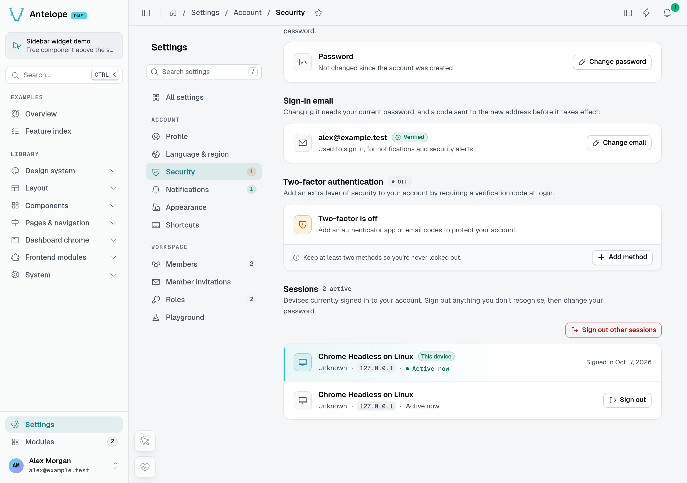

*Two real browser sessions of the same disposable account. The current session has no individual sign-out action in this list.*

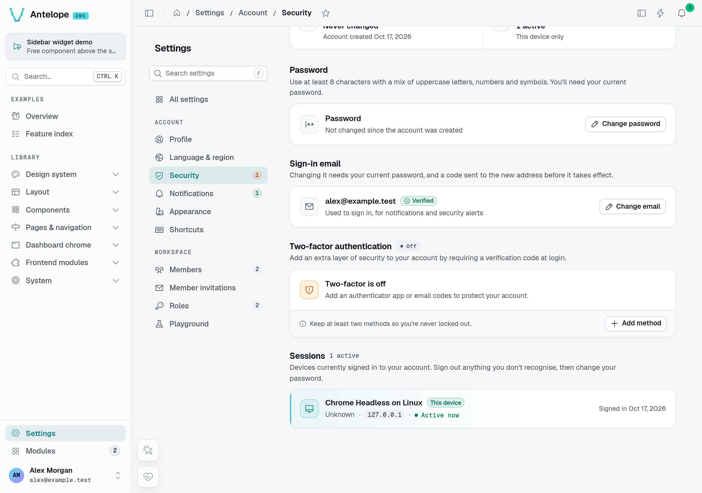

*After revocation, only the current device remains. A separate API request from the revoked session returns 401; the current session still reads its session list successfully.*
