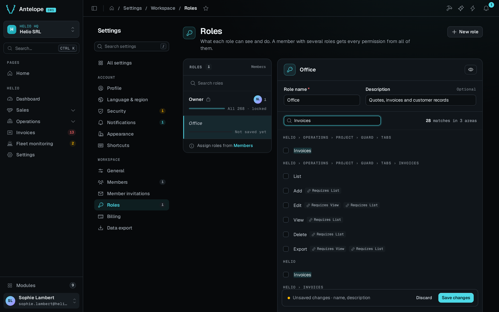

The DMS ships a built-in authentication and role-based access control (RBAC) layer. Authentication answers "who is calling". Permissions answer "may they see or do this". The login, two-factor, and recovery flows are on [Built-in authentication](/docs/auth-and-tenancy/authentication). This page covers gating your routes and pages with them, and the permission model underneath.



The Roles editor turns your page declarations into choices an administrator can grant. The capture shows an unsaved role with no grants, not a recommended policy. Start with the route decorators below. Hiding controls in the UI never replaces backend authorization.

## Compare real member access

A member whose roles leave out a page does not see it in the sidebar, and the settings opened from the user menu list only the pages the member can open. Navigation is not authorization, though. The backend checks the permission on every request: a member without `settings.workspace.roles` who calls `GET /dms/pages/settings/workspace/roles/overview` directly gets **403** with `Forbidden: missing permission settings.workspace.roles`. Always test the protected operation, not only the hidden menu.

## Authenticate routes

Apply auth with parameter decorators on controller route methods. Each one resolves and injects the user, or rejects the request when its requirement is not met:

```ts [src/routes/things.ts]
import { Controller, Get } from "@antelopejs/interface-api";
import { AuthUser, IfAuthUser } from "@antelopejs/interface-dms/auth";
import type { User } from "@antelopejs/interface-dms/auth/db";
import { AuthUserWithPermission } from "@antelopejs/interface-dms/guards";
import { PageController, RegisterPage } from "@antelopejs/interface-dms/page";

@RegisterPage()
export class ThingsPage extends PageController("things", {
  displayName: "Things",
}) {}

export class ThingController extends Controller("/api/things") {
  @Get("")
  list(@AuthUser() user: User) {
    return { requester: user.email };
  }

  @Get("/public")
  maybe(@IfAuthUser() user: User | undefined) {
    return { signedIn: user !== undefined };
  }

  @Get("/admin")
  admin(@AuthUserWithPermission(ThingsPage) user: User) {
    return { admin: user.email };
  }
}
```

Without a signed-in user, `list` answers `401` and `maybe` receives `undefined`. Without the permission of `ThingsPage`, `admin` answers `403`.

The decorators come from two subpaths. The `interface-dms/auth` decorators answer "who is calling". The `interface-dms/guards` decorators add "may they" checks on top:

| Decorator | From | Requires |
| --- | --- | --- |
| `@AuthUser()` | `interface-dms/auth` | A logged-in user, with the account validated. `401` otherwise. |
| `@IfAuthUser()` | `interface-dms/auth` | Nothing. Injects `User \| undefined`, so anonymous callers pass. |
| `@AuthRawUser()` | `interface-dms/auth` | A logged-in user, without the extra validation `@AuthUser` runs. |
| `@AuthOwnerOnly()` | `interface-dms/auth` | A platform owner. A tenant owner is not enough. |
| `@AuthUserWithPermission(target[, options])` | `interface-dms/guards` | A user and the permission tied to `target`, which is a page, a component, or an `Action`. `403` otherwise. |
| `@AuthTenantOwner()`, `@AuthTenantMember()` | `interface-dms/guards` | Tenant ownership or tenant membership. |

The three `interface-dms/guards` decorators also run the [tenant access gate](#tenant-access-gate) before they answer. When a registered gate denies the tenant, the request fails with a `403` carrying the gate's code. All three accept a `{ bypassTenantAccessGate: true }` option for the few recovery routes that must stay reachable while the tenant is denied, such as billing and payment.

## Authenticate pages

A page's auth comes from its `PageController` options (see [Pages and components](/docs/building/pages-and-components)):

| Option | Effect |
| --- | --- |
| `publicAccess: true` | No auth required. |
| `authOnly: true` | Requires login, with no permission check. |
| `memberAccess: true` | Every signed-in member holds the page, its components and their actions without a role grant. See below. |
| None of the above (default) | Requires login and the page's derived permission. |
| `permission: <Partial<Permission> \| Action>` | Attaches a specific permission or action. |
| `noComponentPermissions: true` | Derives no per-component permissions for this page. |
| `bypassTenantAccessGate: true` | Keeps the page reachable while a gate denies the tenant. Permission checks are unchanged (see [Tenant access gate](#tenant-access-gate)). |

`memberAccess` is meant for personal pages. The ids still exist and every check still runs, the tenant access gate included. The DMS registers them as `defaultGranted`, so the Roles editor leaves them out. The built-in account settings (`settings.user.*`) and the settings overview (`settings`) use it. The workspace settings (`settings.workspace.*`) do not. `true` passes on to everything declared under the entry, page or category. `memberAccess: "self"` opens the entry alone. The settings root declares `"self"`, so a page under `settingsCategory` keeps its own permission.

Routes inherit their controller's auth. A route declared under a `Controller(...)` that a page or `DataController` wraps is already gated to logged-in callers, so do not add a second login check. Add finer checks, such as ownership or a specific permission, only when the route needs more than a logged-in caller. For example, the parent controller protects the list, get, edit and export routes of a `DataController` or `TableView` ([Data controller](/docs/components/data-controller)). They are not open endpoints.

## The permission model

Permissions are hierarchical, and most are derived from the tree of pages, components and actions. A component's permission id is the page's permission id followed by the component key. Nested children and actions append their keys in turn.

The page's permission id is its `fullId`, which is its category chain plus the page id. A page can declare its own id with `permission: { id }` instead:

| Declaration | Derived permission id |
| --- | --- |
| A `form` component on the page with `fullId: "pages.form.form-grouped"` | `pages.form.form-grouped.form` |
| A `delete` action on that component | `pages.form.form-grouped.form.delete` |
| The same `form` component on a page with `permission: { id: "mailing.access" }` | `mailing.access.form` |

Users hold roles. A role holds a flat list of granted permission ids. A platform owner holds `*`, which grants everything.

### Parent grants and page visibility

Every synchronously declared `.child(id, component)` position registers its own permission, including layout containers such as grid rows and stack items. Grants are exact. Granting a parent makes the branch reachable but grants no child, so a role needs the full chain of component ids it should render.

When a role is granted a page but none of its blocks:

- The served layout carries `allComponentsHidden: true`, and the page shows a "nothing to show for you here" notice instead of a blank page.
- The menu leaves the page out of the sidebar, the settings navigation, the command palette and the first-page fallback. The role preview locks it, but it stays reachable by its URL.
- Pages nested under it keep their own entries. Opening the parent leads to the first of them the member can open. For a role that holds Members but none of its blocks, that is Member invitations.

A page that declares no block at all, such as a module page that renders its own content, is never left out this way. The Roles form selects descendants when you check a parent, but stored roles remain flat permission lists.

### Required ancestors and dependencies

The reverse is enforced. A granted id counts only with every id it sits under. `pages.sales.orders.table.delete` grants nothing to a role that lacks `pages.sales.orders.table`, `pages.sales.orders`, `pages.sales` or `pages`. The exception is a parent that carries `defaultGranted` or is not a registered permission.

Saving a role, through the roles editor or the `/api/tables/roles` routes, stores each permission with every id above it. It also stores the permissions each one declares as `dependencies`, and the ids above those. A role saved through the API therefore reads the same as one built in the editor. Only registered ids are added. An id that nothing registers, such as one from a module not loaded or a typo, is stored as given, without parents made up from its dotted path.

A check counts `dependencies` like the ids above. A granted permission counts only with every registered dependency it declares. A role stored outside the editor with an edit but no view grants no edit.

A table view's actions depend on the permission that guards what they read, and on its `list` when they are reached only from the table's rows:

| Action | Dependencies | Reason |
| --- | --- | --- |
| `list` | None | It shows the rows. |
| `select` | None | It is `defaultGranted`, because the relation pickers of other pages' forms read through it. |
| `add` | `list`, unless its form opens as a page | Its button sits on the table. A form page is reached by URL. |
| `edit` | `view` (with a view form), and `list` unless its form opens as a page | Its form loads the row through the view, and it opens from a row. |
| `view` | `list`, unless its form opens as a page | It opens from a row. |
| `delete`, `archive`, `viewArchived` | `list` | Pressed from the rows. `delete` reads nothing, so it does not need `view`. |
| `restore` | `viewArchived`, and so `list` too | Pressed from the archived rows. |
| `export` | `view` (with a view form), `list` | It writes the `@Exported` fields, which can go past the columns `list` shows, and it is offered from the table. |

A form that opens as a page (`formContainer` absent or `{ type: "page" }`) keeps no `list` dependency. A member can then be granted the one record a notification links them to, without the table. A form that opens over the table (`drawer`, `modal`, side panel) is reached only from its rows.

A role given a table's edit or export also gets its view and its list. Unticking the view or the list in the roles editor unticks them. The server enforces these like any dependency. A role written through the API with an edit but no list grants no edit.

A custom action declared on a table with `.action()` declares its own `dependencies: ["list"]` when it is pressed from the rows.

Component permissions register with the page when its `@RegisterPage` decorator runs. They do not register when the page sets `noComponentPermissions` or `authOnly`. Under `memberAccess` they register as held by every member.

### Register a standalone permission

When a module needs its own permission, for example to split "view" from "export", register it, usually in `construct`:

```ts [src/index.ts]
import { RegisterPermission } from "@antelopejs/interface-dms/permissions";

RegisterPermission("reports.export", {
  id: "reports.export",
  title: "$my_app.perm.reports_export", // i18n key, add it to every locale file
  icon: "i-ph-download",
  defaultGranted: false,
  dependencies: ["reports.view"], // the roles editor adds them, and a saved role is stored with them
});
```

A `Permission` carries an `id` and a `title`, an optional `icon`, `description` and `dependencies`, and a `defaultGranted` flag. Gate with `@AuthUserWithPermission(...)` on routes, or with the page or component `permission` option. `GetPermission(id)` and `GetPermissions()` read the registry.

### How the effective set is computed

The DMS resolves a user's permissions in two steps:

1. The base set comes from roles. It is the union of the granted ids of the user's roles in the current tenant, or `Set("*")` for a platform owner.
2. That set runs through the registered [permission resolvers](#permission-resolvers), which can add or remove entries. The result is the effective set.

Every permission surface reads the effective set: `@AuthUserWithPermission`, the permission list the frontend reads, page and menu visibility, table-view actions, and search. The dashboard therefore never shows an entry that its routes would refuse.

### Who can grant what

The DMS sets no cap on what a role or member editor can hand out. Whoever holds these permissions can give anyone any permission, including `*` and workspace ownership, even permissions they do not hold themselves:

| Permission | What its holder can grant |
| ---------- | ------------------------- |
| `settings.workspace.roles.table.add`, `settings.workspace.roles.table.edit` | Any permission, `*` included, to a new or existing role, their own roles included. |
| `settings.workspace.roles.table.delete` | Moves every holder of the deleted role to any other role (`reassignTo` in the delete dialog). |
| `settings.workspace.members.table.edit` | Any role to any member, themselves included, and workspace ownership ("Make owner"). |
| `settings.workspace.members.table.add` | Invitations carrying any role, or ownership of the workspace. |
| `settings.workspace.invites.table.edit` | Any role, or ownership, on a pending invitation. |

This is the intended model. Editing roles or members is an administrator's right, and the DMS does not enforce "grant only what you hold". Give these permissions only to people you would make owners, and keep the rest of your roles free of them. The owner-safety guards still apply, so nobody can demote or remove the last owner of a workspace.

The Roles editor warns where it matters. The members table's `edit` and `add`, the invitations table's `edit`, and the roles editor's `add`, `edit` and `delete` carry an amber warning on their row. A closed row above a ticked one shows an "Owner-level access" chip, and a role holding any of them gets a summary above the tree. The role pickers of the invite and "Change roles" forms repeat the warning when such a role is picked.

### Check a permission imperatively

To test a permission outside the decorators, resolve the caller's effective set, then check the id against it:

```ts fragment [src/routes/reports.ts]
import {
  GetEffectiveUserPermissions,
  HasPermission,
} from "@antelopejs/interface-dms/permissions";

// the base set (roles, or the owner wildcard) passed through the permission resolvers
const permissions = await GetEffectiveUserPermissions(user, tenantId, roleIds, roleModel);

// true on the "*" wildcard, a defaultGranted permission, or a direct grant
// whose parent ids and dependencies are held too
if (await HasPermission(permissions, "reports.export")) {
  // …
}
```

The built-in surfaces use `GetEffectiveUserPermissions`, so an imperative check with it always agrees with the decorators. The lower-level `GetUserPermissions(user, roleIds, roleModel)` returns the base set only, before resolvers. Do not authorize against it.

### Permission resolvers

A permissions resolver is the hook a module registers to reshape the effective set. It receives the caller's current permission set for a tenant and returns a new one, with entries added or removed. A module changes what users can do this way without touching their roles. `dms-saas` registers one to intersect each user's permissions with their tenant's plan ([SaaS mode](/docs/auth-and-tenancy/saas-mode#plans-gate-permissions)).

```ts [src/index.ts]
import { RegisterPermissionsResolver } from "@antelopejs/interface-dms/permissions-resolver";

RegisterPermissionsResolver({
  id: "my_app.trial-limits",
  order: 100, // ascending, so later resolvers see this one's result
  resolver: async (userId, tenantId, currentPermissions) => {
    // return a new Set to add or remove effective permissions for this user and tenant
    return currentPermissions;
  },
});
```

Resolvers follow these rules:

- Resolvers run in ascending `order`, each receiving the previous one's result. Resolvers with equal `order` run in registration order.
- A resolver that throws fails the request. It is never skipped.
- The registration is removed when the registering module unloads. There is no unregister call.
- Register in your module's `construct()`, so the resolver is active before the API starts serving requests.
- The roles editor's preview runs the resolvers too, over the previewed role's set, for the user previewing. The resolver's fourth argument, `context`, then has `preview` set. A resolver keyed on the user, such as one that hands an owner every permission of the plan, must skip that standing when `context.preview` is set. The preview then matches what a member holding only the role is served.

::warning
A resolver shapes a permission set. It cannot deny surfaces that never read one, such as `@AuthUser`-only routes and tenant membership guards. It also cannot revoke a permission registered with `defaultGranted`, which `HasPermission` grants after the resolvers run. To cut a tenant off from the product entirely, use a [tenant access gate](#tenant-access-gate) instead of returning an empty set.
::

### Tenant access gate

A tenant access gate is a yes-or-no check at the tenant level. It decides whether a tenant may use the product at all, whatever any permission set says. Every tenant authorization surface enforces it:

- `@AuthUserWithPermission`, `@AuthTenantOwner` and `@AuthTenantMember`;
- table-view data routes;
- page and menu visibility;
- realtime page access.

One registration therefore cuts a tenant off everywhere at once. `dms-saas` registers one to lock workspaces with a blocking subscription status ([SaaS mode](/docs/auth-and-tenancy/saas-mode#suspension-and-the-access-gate)).

```ts fragment [src/index.ts]
import { RegisterTenantAccessGate } from "@antelopejs/interface-dms/tenant-access";

RegisterTenantAccessGate({
  id: "my_app.subscription-status",
  order: 100, // ascending, and the first denial wins
  gate: async (userId, tenantId) => {
    if (await tenantIsBlocked(tenantId)) {
      // the code becomes the 403 body, a machine-readable i18n key the
      // frontend can match on
      return { allowed: false, code: "my_app.errors.tenant_blocked" };
    }
    return { allowed: true };
  },
});
```

Gates follow the lifecycle rules of resolvers. They run in ascending `order` and the first denial wins. A gate that throws fails the request. The registration is removed when the module unloads, and you register it in `construct()`. `userId` is `undefined` for unauthenticated requests.

A denial is enforced in two ways. Route guards answer a `403` whose body is the gate's `code`. The site layout, the permission list, and the realtime surfaces fall back instead. The user keeps an authenticated session, `publicAccess` and `authOnly` pages stay reachable, and everything permission-gated reports no access. A dedicated recovery screen can then still render. Routes that must stay reachable for a denied tenant opt out explicitly:

```ts fragment [src/routes/billing.ts]
@Post("/portal-session")
async createPortalSession(
  @AuthTenantOwner({ bypassTenantAccessGate: true }) user: User,
) {
  // the recovery path a blocked tenant uses to pay
}
```

A page opts out with the same option in its `PageController` options:

```ts fragment [src/pages/billing.ts]
@RegisterPage()
export class BillingPage extends PageController("billing", {
  displayName: "Billing",
  category: workspaceSettings,
  bypassTenantAccessGate: true, // the recovery screen of a blocked tenant
}) {}
```

The flag covers the page's visibility in the site layout and the menu, its layout route, and the permissions the client keeps for that surface. The permission list of a denied tenant is narrowed to the flagged pages and their components instead of being emptied.

- A caller holding the `*` wildcard keeps it whole, because the platform owner is usually the one who has to use the recovery page. The wildcard is still handed out only when at least one surface carries the flag, and every route keeps enforcing the gate.
- Permission checks still apply in full, unlike `authOnly`, which would drop them.
- A flagged category passes the flag to its pages.
- The flag does not cover the data routes that feed the page. A data API is not owned by a single page, so it opts out through its own guard option, as above. Table-view data routes opt out with the `bypassTenantAccessGate` option of `TableViewOptions`, which keeps the table readable (`view`, `list`, `select`) and leaves every write, and `export`, gated ([Tables](/docs/components/tables#tableview-options)).

The DMS notifications API (`/settings/user/notifications/*`) opts out too. A user's notifications are not tenant data, and the header bell requests them on every page, the recovery page included. The API asks for a signed-in user (`@AuthUser`) and no membership, so a member removed from their workspace still reads their notifications, including the one telling them they were removed. A layout-level widget that calls the API on its own, on mount or on a realtime event, handles a failure locally. An unhandled rejection reaches the app error handler, which replaces the whole page with the error screen.

To test the gate imperatively, `CheckTenantAccess(userId, tenantId)` returns the first denial, or `{ allowed: true }`. `AssertTenantAccess(userId, tenantId)` throws the matching `403`.
