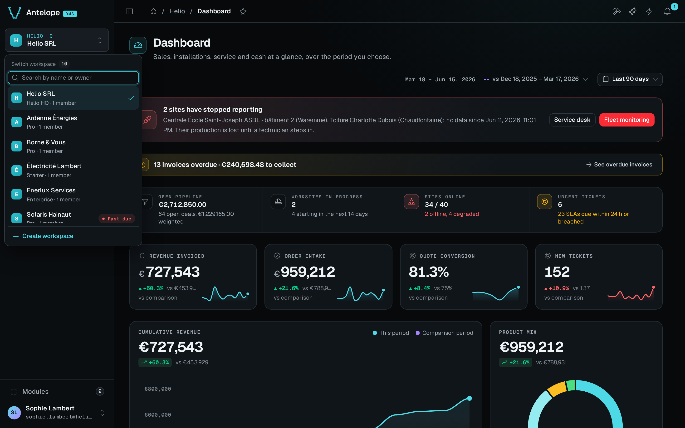
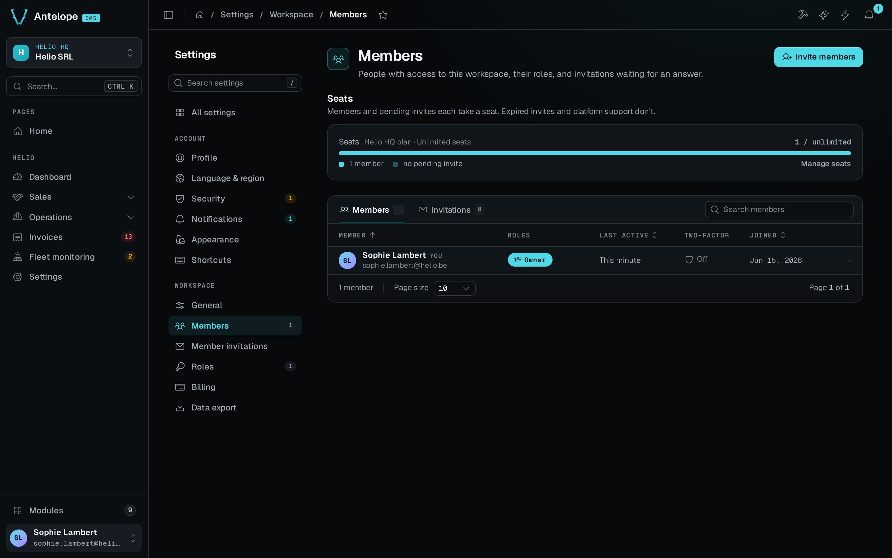

A tenant is a workspace whose records are isolated from other workspaces. The DMS supports several tenants on one backend. A single-workspace project uses the built-in `default` tenant. User accounts are global, while memberships, roles, and tenant-owned tables belong to a tenant.

Isolation needs both an authorized request and a tenant-bound model. Register tenant-owned tables in the tenant schema, then use `TenantScopedModel` to select the request's instance. See the [schema constants](/docs/interfaces/core/tenancy#constants) and [route guards](/docs/auth-and-tenancy/auth-and-permissions#authenticate-routes) for those two prerequisites.

```text [Tenant-scoped request]
┌────────────────────────┐   ┌──────────────────────────┐
│ Authenticated request  │──▶│ Membership / permission  │
│ tenantId = workspace A │   │ check on the route       │
└────────────────────────┘   └────────────┬─────────────┘
                                          │ allowed
                                          ▼
                             ┌──────────────────────────┐
                             │ Model bound to A         │
                             │ reads / writes A's rows  │
                             └──────────────────────────┘
```

The same user can belong to A and B, but a request bound to A does not read B's rows. A plain `@Model(Model)` does not provide this scoping, and a permission grant alone does not either.

## See the tenant boundary

The Helio demo runs `dms-saas` and seeds ten workspaces: Helio SRL, the publisher, and nine installer companies that subscribe to it. The onboarding administrator owns all ten. The switcher at the top of the sidebar changes the active workspace, not the signed-in account.



Open **Settings → Workspace → Members** in a workspace. The route is the same in every workspace, but each one lists its own membership rows and counts its own seats.



The captures show the boundary. They do not prove authorization. The members table answers from `/api/tables/members`, bound to the request's tenant, so it returns only the active workspace's rows. A switch to a workspace the account is not a member of answers `403 error.not_a_member`. When you add your own tenant-scoped tables, test both the rows returned and the refused request.

## How the request's tenant is resolved

`getRequestTenantId(ctx)` returns the tenant of the request's verified credential. The credential is bound by the auth decorators (`@AuthUser`, `@IfAuthUser` with a valid token, `@AuthUserWithPermission`, an auth-gated `PageController`), the tenant guards, or the request authenticator. Without one, it returns the built-in `default` tenant. The DMS creates that tenant at first run, and a single-tenant project keeps its data there. An unverified or forged token never selects a tenant.

```ts [src/data-api/invoices.ts]
import { getRequestTenantId } from "@antelopejs/interface-dms/request-tenant";
```

::warning
Resolving the tenant is not authorization. Enforce membership and permissions for the operation with `@AuthTenantMember`, `@AuthUserWithPermission`, or an auth-gated `PageController`.
::

## Scope a model to the tenant

The `@TenantScopedModel` decorator injects a model already bound to the request's tenant. It works in both places you bind a model. It is a parameter decorator on a route handler, and a property decorator on the model field of a `DataController`.

In a route:

```ts fragment [src/routes/billing.ts]
import { Controller, Get } from "@antelopejs/interface-api";
import { AuthTenantMember } from "@antelopejs/interface-dms/guards";
import { TenantScopedModel } from "@antelopejs/interface-dms/tenant-scoped-model";
import { User } from "@antelopejs/interface-dms/auth/db";

export class BillingController extends Controller("/api/billing") {
  @Get("/status")
  async status(
    @AuthTenantMember() _user: User,
    @TenantScopedModel(SubscriptionModel) subs: SubscriptionModel,
  ) {
    return subs.findOne(); // reads only this tenant's data
  }
}
```

In a `DataController` ([Data controller](/docs/components/data-controller)), decorate the field marked with `@ModelReference`:

```ts fragment [src/data-api/invoices.ts]
@ModelReference()
@TenantScopedModel(InvoiceModel)
declare model: InvoiceModel;
```

`@TenantScopedModel(Model)` verifies the request's bearer token itself when no auth decorator has done so yet (`resolveRequestTenantId`), then binds `GetModel(Model, <tenantId>)`. `@Model(Model, callback)` is the general binding, and it resolves to `GetModel(Model, <tenantId>)` too. Use `@Model` directly when you need an instance other than the request's tenant, such as a static instance id or a callback that resolves it another way. A plain `@Model(Model)`, with no second argument, is not tenant-scoped. Use it only for registry-global tables such as `TenantModel` itself.

## Query across all tenants with `CROSS_INSTANCE`

To read one table across every tenant, for a platform-owner view, pass `CROSS_INSTANCE` instead of a tenant id:

```ts fragment [src/routes/admin.ts]
import { CROSS_INSTANCE } from "@antelopejs/interface-database";
import { GetModel } from "@antelopejs/interface-database-decorators";
import { TenantMemberModel } from "@antelopejs/interface-dms/db";

const members = GetModel(TenantMemberModel, CROSS_INSTANCE);
const rows = await members.listByUserWithTenantIds(user._id);
// each row already carries its tenant: { tenantId, member }
```

::note
Cross-instance queries make sense only on a per-tenant schema, where rows come from many instances. Prefer model methods that already pair each row with its tenant. `listByUserWithTenantIds` returns `{ tenantId, member }`.
::

## List the tenant instances

Each tenant is a named instance of the `dms-tenant` schema (`TENANT_SCHEMA_NAME`). A tool that browses the database finds every tenant through `Schema.get(TENANT_SCHEMA_NAME)?.listInstances().run()`.

- `ProvisionTenant` registers the instance before it fires `Hook.TENANT_BEING_PROVISIONED`.
- At every start, the DMS registers an instance for any tenant row that has none yet. A tenant inserted without provisioning shows up after the next restart.
- Registration is idempotent and never touches the instance's data.
- Deleting a tenant keeps its instance. Destroying it would also wipe the closed lifecycle marker that the deletion cleanup leaves behind.

## Grant or change tenant membership

`applyTenantOwnership(userModel, userId, tenantId, patch)` adds a tenant membership, or updates the roles and ownership of an existing one. It fires `Hook.MEMBER_BEING_ADDED` then `Hook.MEMBER_ADDED`, but only when the member is new:

```ts fragment [src/routes/members.ts]
import { GetModel } from "@antelopejs/interface-database-decorators";
import { UserModel } from "@antelopejs/interface-dms/auth/db";
import { applyTenantOwnership } from "@antelopejs/interface-dms/tenant-ownership";

await applyTenantOwnership(GetModel(UserModel), user._id, tenantId, {
  roleIds: [],
  isTenantOwner: false,
});
```

Run this inside an authorized handler after resolving the target `user` and `tenantId`. The helper changes membership. It does not authorize the caller.

## Invites

`inviteUserToTenant` adds an existing user to a tenant or invites a new one by email, in a single call.

```ts fragment [src/routes/team.ts]
import { inviteUserToTenant } from "@antelopejs/interface-dms/invites";

const result = await inviteUserToTenant({
  tenantId,
  email,
  roleIds: [],
  asTenantOwner: false,
  sendEmail: true, // opt-in, off by default
});

if (result.kind === "added") {
  // existing user, added directly with the member hooks fired: result.userId
} else {
  // new email, invite row created: result.inviteId and result.token
}
```

The flow branches on whether a user with that email already exists:

- For an existing user, `applyTenantOwnership(...)` runs directly, with no token. The call returns `{ kind: "added", userId }`.
- For a new email, the call creates an invite valid 7 days and returns `{ kind: "invited", inviteId, token }`. With `sendEmail` set, it sends the admin-invite email in the background. Add `awaitEmailDelivery: true` to wait for the email instead. The result then carries `emailDelivery: "sent" | "failed"`, and the invite is kept even when the email fails.

The optional `firstname` and `lastname` are stored on the invite. They prefill the name field of the signup page through the invite link.

Signing up through the invite link validates the account's email on the spot, with no separate validation round, even with `auth.mustValidateEmail` on ([Authentication](/docs/auth-and-tenancy/authentication#email-validation)).

Creating an invite replaces any existing invite for the same email, which fires `INVITE_DELETED`. Then it fires `INVITE_BEING_CREATED` and `INVITE_CREATED`. Subscribe to those hooks ([Backend services](/docs/building/backend-services)) to react.

The signup page checks its link as it opens, with `POST /api/auth/validate-invite-token` and the link's `token` and `email`. It runs the same check as the signup itself. For a link the signup would refuse, the page shows the reason instead of the form. The link was revoked, replaced by a newer invitation (a resend or a new invite to the same address), expired, or already used. Only a caller holding both the token and its address gets that reason. Anything else reads as an invalid link.

::note
`inviteUserToTenant` does not throw on duplicates. For an existing member, it sets the roles and ownership you pass. Run context-specific checks in the caller first, for example to return `409` when the user is already a member.
::

## Add the commercial layer with `dms-saas`

Tenant isolation, scoped models, invites, roles and the platform owner are what a SaaS product builds on. They are not the commercial layer. The optional `dms-saas` module adds public registration, plans, subscriptions, and billing, run from the same admin you ship to your customers. [SaaS mode](/docs/auth-and-tenancy/saas-mode) covers it.
