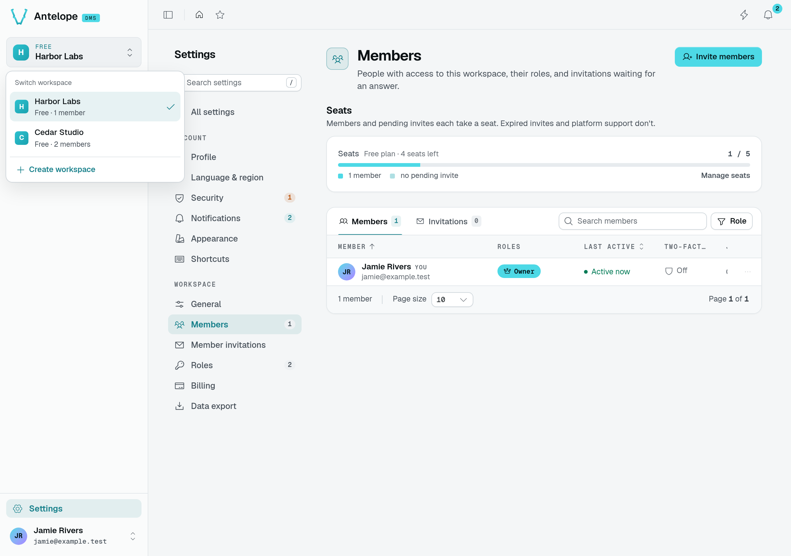
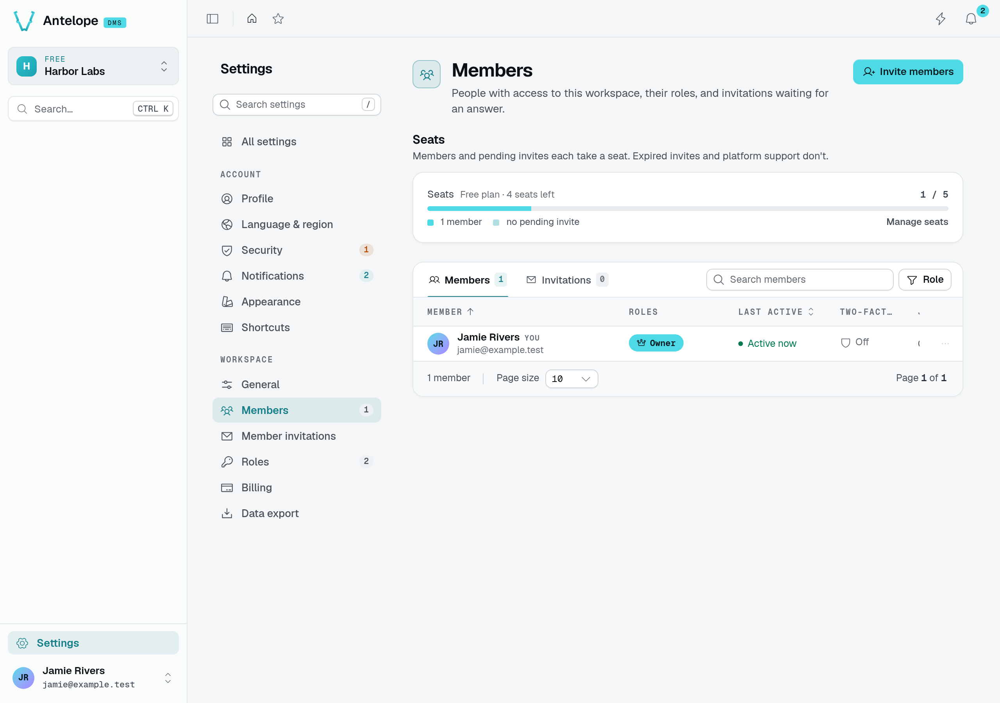
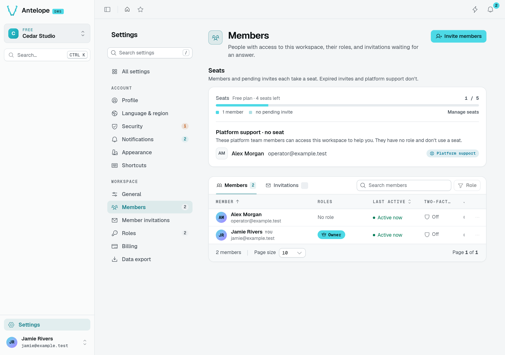
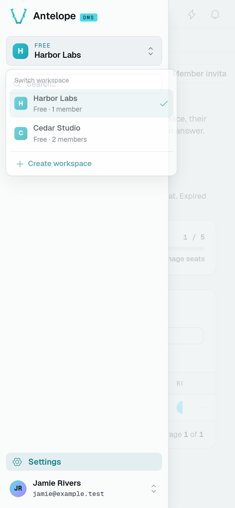
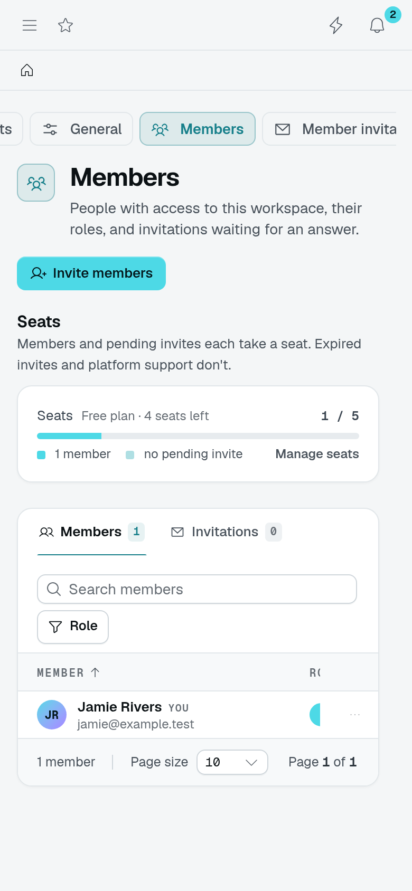
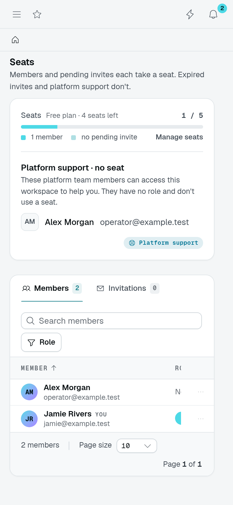

# Multi-tenant data

A **tenant** is a workspace whose records are isolated from other workspaces. The DMS supports several tenants on one backend; a single-workspace project uses the built-in `default` tenant. User accounts are global, while memberships, roles, and tenant-owned tables belong to a tenant.

Isolation needs both an authorized request and a tenant-bound model. Register tenant-owned tables in the tenant schema, then use `TenantScopedModel` to select the request's instance. See the [schema constants](/docs/interfaces/core/tenancy#constants) and [route guards](/docs/auth-and-tenancy/auth-and-permissions#authenticate-routes) for those two prerequisites.

```text [Tenant-scoped request]
┌────────────────────────┐   ┌──────────────────────────┐
│ Authenticated request  │──▶│ Membership / permission  │
│ tenantId = workspace A │   │ check on the route       │
└────────────────────────┘   └────────────┬─────────────┘
                                          │ allowed
                                          ▼
                             ┌──────────────────────────┐
                             │ Model bound to A         │
                             │ reads / writes A's rows  │
                             └──────────────────────────┘
```

The same user can belong to A and B, but a request bound to A does not read B's rows. A plain `@Model(Model)` does not provide this scoping; a permission grant alone does not provide it either.

## See the tenant boundary

In this local installation with the real `dms-saas` module, Jamie belongs to
**Harbor Labs** and **Cedar Studio**. The sidebar switcher changes the active
workspace, not the signed-in account.



Open **Settings → Workspace → Members** in each workspace. Harbor has only
Jamie; Cedar also has Alex, a platform support member. The route is the same,
but the membership rows differ. Alex does not consume a paid seat, which is why
Cedar shows two members but only one seat in use.





These screenshots illustrate the boundary; they do not establish authorization
by themselves. In this scenario, `/api/tables/members/list` returned one row
in Harbor and two in Cedar. Trying to switch Jamie to the unrelated `default`
tenant returned `403 error.not_a_member`. Test both the data returned and the
denied request when adding your own tenant-scoped tables.

### The same flow at a narrow width

At 390 CSS pixels, open the sidebar before opening the workspace switcher.
The Members table keeps its columns in a horizontally scrollable area; changing
the viewport does not change the tenant or its membership list. These are narrow
Chromium views, not captures from a physical phone.







## How the request's tenant is resolved

`getRequestTenantId(ctx)` first uses the tenant already bound by the request authenticator or tenant guards. Without a bound principal, it falls back to decoding the bearer JWT's `tenantId` claim, without verifying its signature. With neither, it returns the built-in **`default`** tenant — the one bootstrapped at first run, where a single-tenant project keeps its data.

```ts [src/data-api/invoices.ts]
import { getRequestTenantId } from "@antelopejs/interface-dms/request-tenant";
```

::warning
The fallback in `getRequestTenantId` trusts an **unverified** claim. Use it behind authentication (`@AuthUser`, `@AuthTenantMember`, or an auth-gated `PageController`), and enforce membership and permissions for the operation. Never authorize a caller from this tenant id alone — the fallback claim is forgeable.
::

## Scope a model to the tenant

The `@TenantScopedModel` decorator injects a model already bound to the request's tenant. It works in both places you bind a model: as a **parameter** decorator on a route handler, and as a **property** decorator on a DataController's model field.

**In a route:**

```ts [src/routes/billing.ts]
import { Controller, Get } from "@antelopejs/interface-api";
import { AuthTenantMember } from "@antelopejs/interface-dms/guards";
import { TenantScopedModel } from "@antelopejs/interface-dms/tenant-scoped-model";
import { User } from "@antelopejs/interface-dms/auth/db";

export class BillingController extends Controller("/api/billing") {
  @Get("/status")
  async status(
    @AuthTenantMember() _user: User,
    @TenantScopedModel(SubscriptionModel) subs: SubscriptionModel,
  ) {
    return subs.findOne(); // reads only this tenant's data
  }
}
```

**In a DataController** ([Data controller](/docs/components/data-controller)), decorate the field marked with `@ModelReference`:

```ts [src/data-api/invoices.ts]
@ModelReference()
@TenantScopedModel(InvoiceModel)
declare model: InvoiceModel;
```

`@TenantScopedModel(Model)` is shorthand for the general binding `@Model(Model, (ctx) => getRequestTenantId(ctx))` — both resolve to `GetModel(Model, <tenantId>)`. Reach for `@Model` directly when you need an instance other than the request's tenant: a static instance id, or a callback that resolves it some other way. A plain `@Model(Model)` (no second argument) is **not** tenant-scoped — use it only for registry-global tables like `TenantModel` itself.

## Query across all tenants — `CROSS_INSTANCE`

To read one table across every tenant (a platform-owner view), pass `CROSS_INSTANCE` instead of a tenant id:

```ts [src/routes/admin.ts]
import { CROSS_INSTANCE } from "@antelopejs/interface-database";
import { GetModel } from "@antelopejs/interface-database-decorators";
import { TenantMemberModel } from "@antelopejs/interface-dms/db";

const members = GetModel(TenantMemberModel, CROSS_INSTANCE);
const rows = await members.listByUserWithTenantIds(user._id);
// each row already carries its tenant: { tenantId, member }
```

::note
Cross-instance queries only make sense on a per-tenant schema, where rows come from many instances. Prefer model methods that already pair each row with its tenant — `listByUserWithTenantIds` returns `{ tenantId, member }`.
::

## List the tenant instances

Each tenant is a named instance of the `dms-tenant` schema (`TENANT_SCHEMA_NAME`), so a tool browsing the database finds every tenant through `Schema.get(TENANT_SCHEMA_NAME).listInstances()`. The DMS registers that instance when `Hook.TENANT_BEING_PROVISIONED` fires, and at every start for any tenant row that has none yet — the `default` tenant included — so a tenant inserted without the hook shows up after the next restart. Registration is idempotent and never touches the instance's data. Deleting a tenant keeps its instance: destroying it would also wipe the closed lifecycle marker the deletion cleanup leaves behind. Code that writes to a tenant outside a request (content declared at startup, a hook handler) waits for its instance with `await WaitForTenantInstance(tenantId)` (`@antelopejs/interface-dms/tenant-instances`) rather than polling `listInstances()`; see [Tenancy](/docs/interfaces/core/tenancy#wait-for-a-tenants-instance).

## Grant or change tenant membership

`applyTenantOwnership(userModel, userId, tenantId, patch)` upserts a tenant membership. It fires `Hook.MEMBER_BEING_ADDED` then `Hook.MEMBER_ADDED` — but only when the member is **new**:

```ts [src/routes/members.ts]
import { GetModel } from "@antelopejs/interface-database-decorators";
import { UserModel } from "@antelopejs/interface-dms/auth/db";
import { applyTenantOwnership } from "@antelopejs/interface-dms/tenant-ownership";

await applyTenantOwnership(GetModel(UserModel), user._id, tenantId, {
  roleIds: [],
  isTenantOwner: false,
});
```

Run this inside an authorized handler after resolving the target `user` and `tenantId`. The helper changes membership; it does not authorize the caller.

## Invites

`inviteUserToTenant` handles both adding an existing user to a tenant and inviting a new one by email, through a single call.

```ts [src/routes/team.ts]
import { inviteUserToTenant } from "@antelopejs/interface-dms/invites";

const result = await inviteUserToTenant({
  tenantId,
  email,
  roleIds: [],
  asTenantOwner: false,
  sendEmail: true, // opt-in — off by default
});

if (result.kind === "added") {
  // existing user → added directly (member hooks fired), result.userId
} else {
  // new email → invite row created, result.inviteId + result.token
}
```

The flow branches on whether a user with that email already exists:

- **Existing user** → `applyTenantOwnership(...)` runs directly (no token); returns `{ kind: "added", userId }`.
- **New email** → a 7-day invite is created; if `sendEmail` is set, the admin-invite email dispatches fire-and-forget; returns `{ kind: "invited", inviteId, token }`. Add `awaitEmailDelivery: true` to wait for the email instead: the result then carries `emailDelivery: "sent" | "failed"`, and the invite is kept even when the email fails.

Optional `firstname` / `lastname` are stored on the invite and prefill the name field of the signup page through the invite link.

Signing up through the invite link validates the account's email on the spot, with no separate validation round, even with `auth.mustValidateEmail` on ([Authentication](/docs/auth-and-tenancy/authentication#email-validation)).

Creating an invite replaces any existing invite for the same email (firing `INVITE_DELETED`), then fires `INVITE_BEING_CREATED` and `INVITE_CREATED`. Subscribe to those hooks ([Backend services](/docs/building/backend-services)) to react.

The signup page checks its link as it opens (`POST /api/auth/validate-invite-token`, with the link's `token` and `email`), running the same check as the signup itself. A link the signup would refuse shows why instead of the form: revoked, replaced by a newer invitation (a resend or a new invite to the same address), expired, or already used. Only a caller holding both the token and its address gets that reason; anything else reads as an invalid link.

::note
`inviteUserToTenant` does not throw on duplicates — it's deliberately side-effect-light. Do context-specific pre-checks in the caller (for example, return 409 when the user is already a member).
::

## The SaaS module (`dms-saas`)

Everything above — tenant isolation, scoped models, invites, roles, the platform owner — is the **foundation** a SaaS needs, not the commercial layer itself. The optional **`dms-saas`** module adds that layer on top: public registration, plans, subscriptions, and billing, run from the same admin you ship your customers. [SaaS mode](/docs/auth-and-tenancy/saas-mode) covers it.
