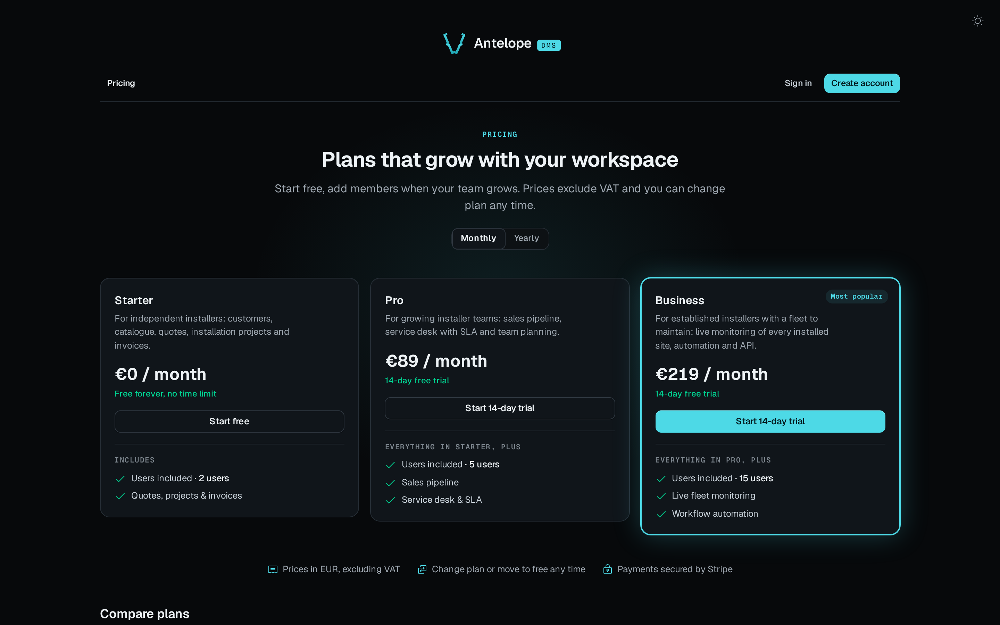
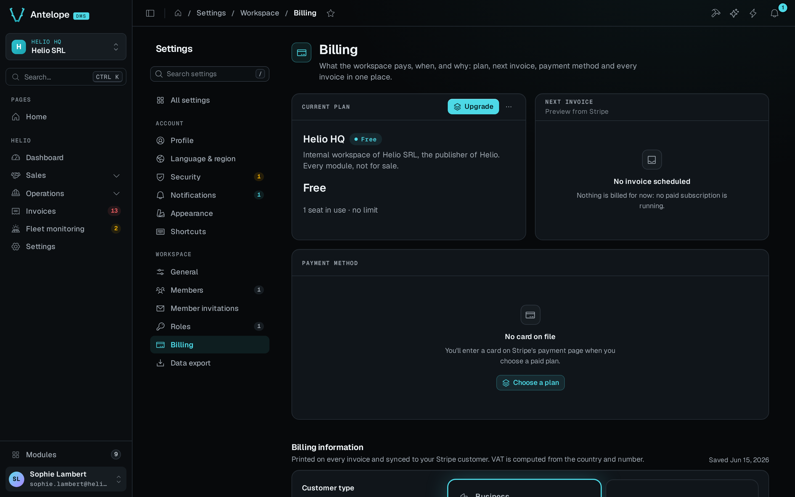

The optional `dms-saas` module turns a multi-tenant dashboard into a product you sell. Visitors sign up, pick a plan, pay through Stripe, and run their own isolated workspace. You run plans, subscriptions, invoices, and customers from the same admin. The module builds on the [multi-tenant data](/docs/auth-and-tenancy/multi-tenant) features of the DMS (tenant isolation, scoped models, invites, the platform owner) and adds the commercial layer.

## Try the free path first

Publish an active free plan and set `registration.paymentMethod: "none"` to create a workspace without calling Stripe. The registration form then collects the account details and the acceptance of terms, with no payment card. Paid upgrades are a separate flow, and placeholder Stripe keys do not make them work.

Visitors pick a plan on the public pricing page, then register for it.



The Helio demo is the example on this page: Helio SRL sells its back office to installer companies, and each of them runs its own workspace. [See the tenant boundary](/docs/auth-and-tenancy/multi-tenant#see-the-tenant-boundary) shows the switcher and the scoped Members page.

## Install and configure

`dms-saas` is a [distributable module](/docs/building/distributable-module). Declare it in `antelope.config.ts`, and its pages, tables, and routes register into the dashboard. The three `stripe` keys are required:

```ts fragment [antelope.config.ts]
"dms-saas": {
  source: { type: "package", package: "@antelopejs/dms-saas", version: "<latest>" },
  config: {
    stripe: {
      secretKey: "sk_…", // server-side Stripe API key
      publishableKey: "pk_…", // forwarded to the frontend layer automatically
      webhookSecret: "whsec_…", // verifies incoming Stripe webhook events
    },
    allowedRedirectHosts: ["localhost:3001"],
  },
},
```

`allowedRedirectHosts` lists the hosts that Stripe may redirect back to, such as the billing portal's `return_url`, and other outbound redirects. Each value is matched against the URL host. It defaults to the host of the DMS `clientBaseUrl`, and setting it replaces that default. A development runtime accepts loopback hosts without an entry. Keep real Stripe keys out of the file by mapping environment variables onto these paths with the config's `envOverrides` block ([Configuration](https://antelopejs.com/docs/concepts/configuration)).

## The two roles

`dms-saas` separates the two roles of a multi-tenant platform:

- **The platform owner** is you, the maker. A **SaaS** module joins the sidebar's Modules group, owner-only like every module ([Distributable module](/docs/building/distributable-module#module-navigation-and-access)). It is the back office for workspaces, users, plans, invoices, and the platform settings.
- **Owners** are your customers. Each one signs up publicly, receives an isolated tenant, and manages it from a **Workspace** settings category with billing, plan, and data export.

The module declares SaaS mode to the DMS with `RegisterSaasMode` when it loads, which makes the two roles independent. Owning the default tenant no longer makes a user a platform owner. Removing members no longer refuses to remove the last platform owner. Unloading the module turns the mode off again.

## How an owner signs up

The module ships the public registration screen and the legal pages behind it: the privacy policy, the terms and conditions, and the terms of use, stored as editable documents.

1. The form collects the account details and, when the registration policy asks
   for a card, a payment method through a Stripe **SetupIntent**.
2. Registration provisions the account and its first workspace on the default
   free plan. With no card, the subscription stays local. Billing address and
   paid plan selection belong to the later upgrade flow.
3. An existing user who logs in with no workspace arrives with a
   `requires_tenant_assignment` token ([Built-in authentication](/docs/auth-and-tenancy/authentication#login))
   and finalizes a workspace through the completion flow instead.

See [public screens](/docs/modules/saas/usage/public-screens) for the frontend
completion endpoint and [registration configuration](/docs/modules/saas/configuration)
for the card policy.

A plan can grant a free trial (`trialDays`). The module records trial use per payment-method identity, so the same card does not receive a second trial.

## Plans gate permissions

A plan is a record you manage from the SaaS module, and it can inherit from another plan. It carries the commercial terms:

- price and currency;
- interval, `month` or `year`;
- billing mode, flat or per seat, with seat billing starting at one seat;
- audience, `any`, `individual` or `business`;
- feature values.

The plan's list of permission ids connects it to the DMS. A registered [permissions resolver](/docs/auth-and-tenancy/auth-and-permissions#permission-resolvers) intersects each user's effective permissions with their tenant's plan.

The effective set feeds every permission surface: route guards, the sidebar, page layouts, and table-view actions. A permission outside the plan therefore disappears from the dashboard and answers `403` on its routes, even when the user's role grants it.

## Suspension and the access gate

The plan decides which features a workspace gets. A blocking subscription status cuts the workspace off entirely. The module registers a [tenant access gate](/docs/auth-and-tenancy/auth-and-permissions#tenant-access-gate) that denies every workspace whose subscription is `pending_payment`, `suspended`, or `cancelled`. A second gate denies a workspace whose guarded plan change is blocked or past its effective date. Every tenant authorization surface then answers `403` with the code `saas.errors.workspace.access_blocked`.

What a member of a blocked workspace experiences:

- The member is redirected to the `/workspace-suspended` screen, which explains the status and offers the available recovery actions. An owner can reach billing, and another active workspace remains selectable.
- The billing surfaces bypass the gate on purpose. They are the recovery path a blocked workspace uses to settle its subscription.
- Once the subscription is settled, the re-check on the suspended screen sends the user back into the dashboard.

Auth flows, registration, and the legal pages stay reachable throughout. The gate denies the tenant's product surfaces, not the session.

### Follow suspension through recovery

When an operator suspends a workspace, its members see the access restriction with **View billing**, **Check again**, and the other workspaces they can open. **View billing** opens the workspace's Billing page, which the gate never blocks: the current plan, the next invoice and the payment method.



Once the operator reactivates the workspace or the subscription is settled, **Check again** returns the member to the dashboard. Test the gate through the API too: while the workspace is blocked, its product routes answer `403 saas.errors.workspace.access_blocked`, and the same routes answer again once access returns.

## Billing operations and housekeeping

Owners manage their own billing through Stripe's customer portal, opened from the Workspace billing page. The data-export page drives the `TENANT_DATA_EXPORT` hook. Register a handler to include your module's tenant data in the ZIP archive, as JSON payloads, large files, or streamed dumps ([Tenant data export archive](/docs/building/backend-services#tenant-data-export-archive)).

The module also runs its own background jobs:

- It suspends past-due subscriptions, which trips the [access gate](#suspension-and-the-access-gate).
- It expires free workspaces, with an ending-soon notification beforehand.
- It hard-deletes cancelled workspaces after a delay.
- It recomputes billing state and segments on a schedule.
- It cleans up processed Stripe webhook events.
