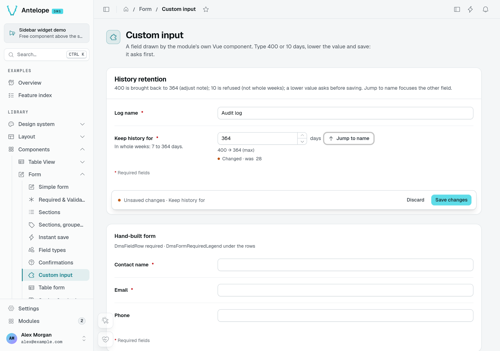
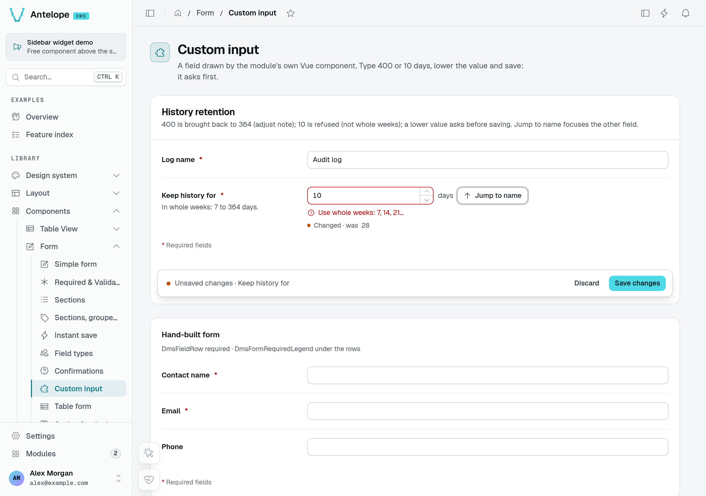
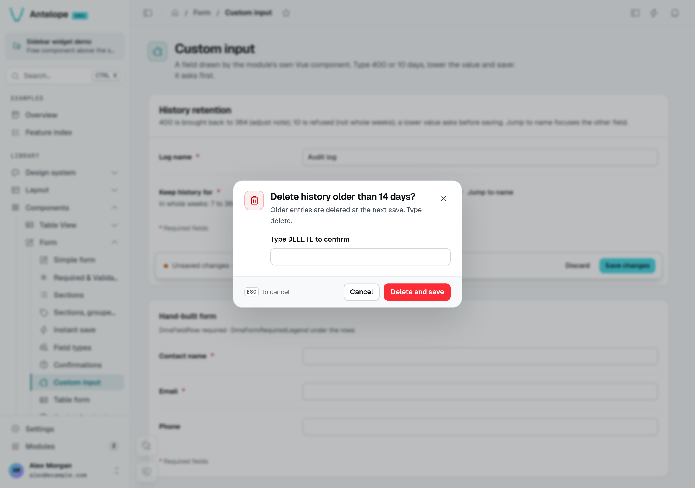

# Forms

`Form` is the component builder for data-entry screens. You declare a list of **fields** — each labelled and typed by a `DataType` ([Data types](/docs/components/data-types)) — plus where the form **loads** its values from and **submits** them to. The shared Inertia/Vue frontend turns that into rendered inputs, client-side validation, and the submit flow. You write no Vue.

Use a `Form` for create/edit screens, settings panels, and standalone data entry. For paginated, sortable, CRUD-backed lists whose add/edit forms are generated from a [Data controller](/docs/components/data-controller), use a `TableView` ([Tables](/docs/components/tables)) instead.

`Form` is a page component: assign the builder to a static field on a `PageController` (see [Pages & components](/docs/building/pages-and-components)). The field key becomes the component key and part of its permission id.

::block-playground{type="Form" example="Form" height="420"}
---
options:
  title: Workspace profile
  description: Fixed demonstration data. Changes are not saved.
  submitLabel: Save changes
  saveMode: footer
---
::

::note
The live preview includes serialized fields and a fixed record served by the preview service. You can edit the inputs, but there is no write endpoint: changes are not saved. The contact form below shows how to declare your own fields and submission route.
::

## What it renders

The frontend renders a titled card. From the top:

- An optional **title** and **description** header.
- The **fields**, each a labelled input chosen from its DataType (text box, select, date picker, file upload, rich text, …), with the field's `description` as helper text. A required field carries an asterisk after its label (a group's label when one of its fields is required), and a `* Required fields` legend closes the form; a disabled or hidden field is never marked. Invalid fields show an inline message and an error state.
- **Field groups**, whose members render together under a shared label, laid out horizontally or vertically (`orientation`).
- The **save controls** at the bottom, as `saveMode` and `kind` set them ([Saving](#saving)). On submit the form validates against its schema; on success it shows `successMessage` (and optionally navigates via `redirectOnSuccess`), on failure `errorMessage`. A failure the server ties to a field (a zod issue, a `{ message, field }` body, see [Guards](/docs/components/tables#guards)) shows under that field — marked invalid and focused — instead of the toast. A submit that went through but left something for the user to act on answers with a `warning` field (an i18n key or plain text) in its JSON response: the form then shows that warning instead of `successMessage`, and still redirects. A submit response carrying `notice: { title, description?, color?, params? }` adds a toast of its own — a partial success such as "2 invitations sent, 1 address skipped" (`$` keys pluralized on a numeric `params.count`).

When `fetchUrl` is set the form first loads existing values and pre-fills the inputs (an edit form); without it the form starts empty (a create form). An edit form loads them again every time it opens, and its submit sends only the fields the user changed, so a value someone else saved in the meantime is not written back; a form that posts its loaded values as a new row (`submitUrlMethod: "POST"`, a duplicate) still sends them all.

## Usage

Assign the builder to a static field on the page.

```ts [src/pages/contact.ts]
import {
  PageController,
  RegisterPage,
  pagesCategory,
} from "@antelopejs/interface-dms/page";
import { Form } from "@antelopejs/interface-dms/base/form";
import { DefaultDataTypes } from "@antelopejs/interface-dms/base/data-types";
import { HttpMethod } from "@antelopejs/interface-dms/base/types";

@RegisterPage()
export class ContactPage extends PageController("contact", {
  displayName: "Contact",
  icon: "i-ph-note-pencil",
  category: pagesCategory,
}) {
  static form = Form({
    title: "Contact Us",
    description: "Send us a message and we'll get back to you",
    fields: [
      {
        id: "name",
        label: "Full Name",
        type: new DefaultDataTypes.StringType({ placeholder: "Jane Doe", maxLength: 100 }),
        required: true,
      },
      {
        id: "email",
        label: "Email",
        type: new DefaultDataTypes.EmailType({ placeholder: "jane@example.com" }),
        required: true,
      },
      {
        id: "message",
        label: "Message",
        type: new DefaultDataTypes.StringType({ textarea: true, rows: 6, maxLength: 1000 }),
      },
    ],
    submitUrl: "/api/contact",
    submitUrlMethod: HttpMethod.post,
    kind: "action", // sends something new each time: Reset and Submit, emptied after a submit
    successMessage: "Thanks — we'll be in touch.",
  });
}
```

The routes behind `submitUrl` (and `fetchUrl`) are normal API controllers — see [Pages & components](/docs/building/pages-and-components) for wiring. Return `_id`, never `id`, for created rows.

## Options

::block-options{type="Form"}
::

The generated table above lists what the page editor offers. The reference below details every option, including the ones only code sets.

`Form(options)` takes a single options object (`FormProps`):

| Option              | Type                          | Default      | Purpose                                                                                |
| ------------------- | ----------------------------- | ------------ | -------------------------------------------------------------------------------------- |
| `fields`            | `(FormField \| FieldGroup)[]` | —            | Fields and field groups to render. See [Fields](#fields). Beside `sections`, they come first, outside any section. |
| `sections`          | `FormSection[]`               | —            | The fields split into titled cards on one page, saved together ([Sections](#sections)). |
| `sectionNav`        | `"side" \| "jump" \| "none"`  | `side` from 3 sections, else `none` | How a sectioned form lists its sections ([Sections](#sections)). |
| `title`             | `string`                      | —            | Heading above the fields (no heading is rendered when unset); the component's display name falls back to `"Form"`. |
| `description`       | `string`                      | —            | Sub-heading text under the title.                                                      |
| `fetchUrl`          | `string`                      | —            | URL to load existing values from (pre-fills the form). Omit for a create form.         |
| `fetchUrlMethod`    | `HttpMethod`                  | `GET`        | HTTP method for the fetch request.                                                     |
| `submitUrl`         | `string`                      | —            | URL the form submits to.                                                               |
| `submitUrlMethod`   | `HttpMethod`                  | `PUT`        | HTTP method for the submit request.                                                    |
| `submitLabel`       | `string`                      | —            | Label of the submit button (i18n key or literal). Defaults to the generic "Save changes". |
| `successMessage`    | `string`                      | —            | Toast shown after a successful submit.                                                 |
| `errorMessage`      | `string`                      | —            | Toast shown when a submit fails.                                                       |
| `saveMode`          | `"bar" \| "footer" \| "none" \| "instant"` | `"bar"` | How the form offers to save ([Saving](#saving)). |
| `kind`              | `"record" \| "action"`        | `"record"`   | What the form edits: a record keeps its values once saved; an action (send, invite, run) empties after a submit ([Saving](#saving)). |
| `backTo`            | `string`                      | —            | Where Cancel leads a `record` form on a page opened directly (a link from outside the app, a bookmark); reached from another page of the app, Cancel goes back to it. Without either, the form offers no Cancel there. Table views set it on their form pages, to the list. |
| `labelKey`          | `string`                      | —            | Field of the loaded record whose value ends the page breadcrumb once the form has loaded. Table views fill it from their own `labelKey`. A custom component reads or sets the same label with [`usePageRecordLabel()`](/docs/frontend-composables/page-context#usepagerecordlabel). |
| `requiresRecord`    | `boolean`                     | `false`      | The form is about the record `fetchUrl` loads: while a route value that URL names is missing (no `?id=`), it shows "No entry selected" instead of its fields with their defaults. A `ResourceForm` in `edit` or `view` sets it. |
| `fieldsOrientation` | `"horizontal" \| "vertical"`  | —            | Overall layout direction of the field list.                                            |
| `redirectOnSuccess` | `string`                      | —            | Path to navigate to after a successful submit. Supports token substitution.            |
| `submitDefaults`    | `Record<string, unknown>`     | —            | Extra values merged into the submit payload. String values support token substitution. |

### Saving

`saveMode` picks the controls — `bar` (default, a sticky save bar while there are unsaved changes), `footer`, `none`, or `instant` (each changed field saves on its own) — and `kind` what the form edits: a `record` (default) keeps its values once saved, an `action` (send, invite, run) empties after a submit. A form loaded from `fetchUrl` sends only the fields the user changed, a cleared one as `null` (`[]` for a list field). The modes, what a submit sends and the instant save are in [Saving a form](/docs/components/forms/saving).

### Unsaved changes

Every form tracks whether it holds unsaved changes, wherever it is rendered (a page, a drawer, a modal, a section). It is **dirty** while a field's value differs, by value, from the one it loaded (or its `defaultValue`, or what it last saved): typing a value then putting the original back makes it clean again, a successful submit makes the saved values the new starting point, and an empty, untouched create form is clean.

- **Save bar.** A `record` form's bar (or footer) shows in two states of the same height: **Cancel** while there is nothing to save (when it has somewhere to go back to), and an "Unsaved changes" mark with **Save** once there is, so switching never moves the fields. Beside Save, a form with somewhere to go back to keeps **Cancel**; one with nowhere to go back to offers **Discard**, which puts the values back and stays. A form that submits with `POST` creates a row (a table view's add form, and the duplicate it opens): its submit, **Create** by default, shows from the start, so a duplicate saves as it opened, and neither the bar nor the fields list "changes", since all it holds is new. Cancel drops any change and leaves, in one click and without asking: it closes a drawer or modal; on a page it goes back to the page of the app the user came from, or to `backTo` (the list, for a table view's form page) when the page was opened directly. The bar sticks to the bottom of the visible area (the page, the drawer or the modal body) while the form runs past it, and sits right under the fields when they fit. On a page it floats over the form: hidden, it takes no space, and showing up moves nothing above it ([The save bar on a page](/docs/components/forms/saving#the-save-bar-on-a-page)).
- **Leave guard.** While a form is dirty, leaving it asks once, in a warning dialog ("Discard unsaved changes?", with "Keep editing" and "Discard changes"): closing its drawer or modal (X, Escape, a click outside, Cancel), navigating away (sidebar, breadcrumb, links, the browser's Back and Forward buttons), switching away from the tab panel it sits in, and reloading or closing the browser tab (the browser's own prompt). Nothing asks after a save, after Discard or Cancel, or when nothing changed, and a drawer closing because the page changed never asks twice.

Hand-built forms get the same behaviour from the `useFormDirty` and `useUnsavedChanges` composables (see [Utilities](/docs/frontend-composables/utilities#leave-guard)).

`submitUrl`, `redirectOnSuccess`, `backTo` and `submitDefaults` string values support **token substitution**, resolved against the form's route at submit time (the same tokens as every other option, see [Template tokens](/docs/building/pages-and-components#template-tokens)):

- `{{params.X}}` — a route path parameter. A route can repeat a parameter name — a table view's form page under a `:id` page resolves to `/workspaces/:id/invoiceTable/:id/edit` — and `X` is then its **last** occurrence; `{{params.X:n}}` reaches the n-th one, `{{params.id:1}}` being the id of the page above.
- `{{query.X}}` — a query-string parameter.
- `{{response.X}}` — (`redirectOnSuccess` only) a field of the submit's JSON response body, a dotted path reaching into it, e.g. `/items/{{response._id}}/edit` to redirect to a freshly created entity. A create whose submit answers the list of keys it wrote, as a `DataController`'s `new` does (`["66f…"]`), names its row with `{{response._id}}`, `{{response.id}}` or `{{response.0}}`.

In a URL (`fetchUrl`, `submitUrl`, `redirectOnSuccess`) the `{{params.X}}` and `{{query.X}}` values are percent-encoded, so a value such as `GET /api/a?b=c` stays one parameter; `{{response.X}}` is written as answered, so a response may hand back a whole path, and `submitDefaults` values are written as they are.

`submitDefaults` entries whose tokens can't be resolved are dropped — this is how a page-rendered "new" form inherits context such as a parent id.

::note
`HttpMethod` is a string enum (`HttpMethod.get`, `HttpMethod.post`, `HttpMethod.put`, `HttpMethod.delete`, `HttpMethod.patch`, …). The options take the enum member or its string value (`"POST"`).
::

::warning
When `submitUrlMethod` is omitted, the frontend submits with `PUT` — a creation form must set `submitUrlMethod: HttpMethod.post` explicitly.
::

## Fields

Each entry in `fields` is either a single **field** (`FormField`) or a **field group** (`FieldGroup`).

### Field

```ts
{
  id: "email",                                   // payload key — required
  label: "Email Address",                        // visible label
  description: "We never share it",              // helper text under the label
  type: new DefaultDataTypes.EmailType({ ... }), // a DataType instance — required
  required: true,                                // marks the field and tightens validation
  defaultValue: "jane@example.com",              // initial value
  localized: true,                               // store one value per locale
  disabled: true,                                // render read-only
  inputComponent: FormComponents.InputText(),    // override the DataType's default input
}
```

| Property         | Type                      | Purpose                                                                           |
| ---------------- | ------------------------- | --------------------------------------------------------------------------------- |
| `id`             | `string`                  | The field's key in the payload. Required.                                         |
| `type`           | `DataType`                | The DataType instance driving the input, parsing, and validation. Required.       |
| `label`          | `string`                  | Field label. Use a `$`-prefixed i18n key in real modules.                         |
| `description`    | `string`                  | Helper text under the label.                                                      |
| `required`       | `boolean`                 | Marks the field required and tightens validation (see [Validation](#validation)). |
| `defaultValue`   | `DefaultValue`            | Initial value (`string \| number \| boolean \| Date \| null \| array`).           |
| `localized`      | `boolean`                 | Store the value as a per-locale record instead of a single scalar.                |
| `disabled`       | `boolean`                 | Render the input non-editable.                                                    |
| `readonly`       | `boolean \| FormFieldReadonly` | Show the value, not an input, optionally with a `badge` and a `link` ([Field notes](/docs/components/forms/field-notes)). |
| `hint`           | `string`                  | A grey help line under the control ([Field notes](/docs/components/forms/field-notes)). |
| `inputComponent` | `ComponentInfoSerialized` | Override the input the DataType would otherwise pick (see below).                 |

The `type` is always a **DataType instance** — `StringType`, `EmailType`, `SelectType`, `DateType`, `FileType`, `RichTextType`, `AddressType`, and so on. Each carries its own options (placeholders, min/max, items, constraints) and supplies both the validation rule and the default input. See [Data types](/docs/components/data-types). Choice cards, segments, boolean cards, repeaters, key-value pairs, secrets, code and tags are in [Field types](/docs/components/forms/field-types).

### Field group

A group renders related fields together under a shared label:

```ts
{
  id: "contactGroup",
  label: "Contact Information",
  description: "Your email and phone number",
  orientation: "vertical",   // or "horizontal"
  order: 1,                   // place among the groups giving an order
  fields: [
    { id: "email", type: new DefaultDataTypes.EmailType(), required: true },
    { id: "phone", type: new DefaultDataTypes.PhoneType() },
  ],
}
```

Grouped fields still submit as flat top-level keys (`email`, `phone`) — the group only affects layout. Members may omit `label`; the group's own `label` heads the cluster.

The groups giving an `order` trade the places they are declared at, lowest first (equal orders keep their declaration order); fields and groups without one keep their place.

### Field notes

Any field can carry notes under its control: a `hint` line, "Changed · was X" while a change waits for its save, "Module default: X · Use default" when it holds something other than its `defaultValue`, and `readonly` (`true`, or with a `badge` and a `link`) for a value shown, not edited. See [Field notes](/docs/components/forms/field-notes).

### Overriding the input component

Each field renders the input its DataType chooses. Set `inputComponent` to override it with a factory from the `FormComponents` namespace (same import as `Form`), each taking its own options object:

- **Text & numbers** — `InputText`, `InputTextarea`, `InputEmail`, `InputPassword`, `InputPhone`, `InputNumber`, `InputPercentage`, `InputSlider`, `RichText`.
- **Choices** — `InputSelect`, `InputRadioGroup`, `InputSwitch`, `InputCheckbox`, `InputCascader`, `InputRelation`.
- **Dates & times** — `DatePicker`, `DatePickerRange`, `Calendar`, `InputTime`.
- **Media & specialized** — `File`, `Image`, `InputColor`, `InputAddress`.

Prefer configuring the DataType; reach for `inputComponent` only when you need a different control than the type's default.

### A module's own input

An `inputComponent` may also name a component of the module's frontend layer. It receives the field's `id` (give it to its control, so the error summary and the field's anchor find it), `v-model`, `disabled` and its own options as props. What it needs of the form it sits in, it asks `useEnclosingForm()`, auto-imported, rather than the DOM (`closest("form")`, `requestSubmit()`):

| Member                    | Type                                   | Contract                                                                                                                       |
| ------------------------- | -------------------------------------- | ------------------------------------------------------------------------------------------------------------------------------ |
| `submit()`                | `() → Promise<void>`                   | Submits the form as its save button does: validation, the validators, then the request. A refused submit shows its errors.     |
| `addValidator(validator)` | `(() => boolean) → () => void`         | Runs `validator` before each submit; `false` stops the submit before anything is sent. Removed with the component, or by calling the returned function. |
| `focusField(fieldId)`     | `(string) → Promise<void>`             | Brings a field of the form into view and focuses its control (a group's first focusable part).                                  |

`useEnclosingForm()` returns `null` outside a `Form`. A field that asks before a save, then saves once confirmed:

```ts [app/components/RetentionInput.vue]
const form = useEnclosingForm();
const { confirm } = useConfirm();
let confirmedValue: number | null = null;

form?.addValidator(() => {
  if (!isLowered.value || confirmedValue === model.value) return true;
  void confirm({ title: "Delete older logs?", color: "error" }).then((accepted) => {
    if (!accepted) return;
    confirmedValue = model.value ?? null;
    void form.submit();
  });
  return false;
});
```

### A number the field adjusted

`DmsInputNumber`, the number control a module's own input can draw, keeps a typed value within its `min` and `max` when the user leaves it or presses Enter: 250 typed in a field of `max: 100` becomes 100. Its `step` only drives the steppers and the arrow keys: a value is never put on it, typed or loaded (9,692 stays 9,692 with steps of 100), unless the control is given `stepSnapping: true`, where 1020 typed in a field of steps of 50 becomes 1,000. It then shows the value it kept, never the one typed, and emits `adjust` with an `InputNumberAdjustment` (auto-imported type):

| Member   | Type                         | Contract                                                         |
| -------- | ---------------------------- | ---------------------------------------------------------------- |
| `typed`  | `number`                     | The number as typed, read in the field's `locale` ("1,020").      |
| `value`  | `number`                     | The number the field keeps, already in `v-model`.                |
| `reason` | `"min"` · `"max"` · `"step"` | Above `max`, below `min`, or off `step` (`stepSnapping` only).   |

Nothing is emitted when the field keeps what was typed, or when nothing was typed since it last settled. With `clamp: false` the field keeps a value outside `min` / `max` and reports it as its error, so only `"step"` can be emitted. A custom field says why its value changed with a note under the control, cleared once the value changes again:

```vue [app/components/BodyCapInput.vue]
<script setup lang="ts">
const model = defineModel<number | null>();
const adjustment = ref<InputNumberAdjustment | null>(null);
const { formatNumber } = useRegionalFormat();

watch(model, (value) => {
  if (value !== adjustment.value?.value) adjustment.value = null;
});
</script>

<template>
  <DmsInputNumber v-model="model" :min="0" :max="5000" :step="50" @adjust="adjustment = $event" />
  <p v-if="adjustment" class="text-muted text-xs" role="status">
    {{ formatNumber(adjustment.typed) }} → {{ formatNumber(adjustment.value) }}
  </p>
</template>
```

### Linking to a field

A page opened on the anchor of a field — its id, `/settings#retentionDays` — brings that field into view and focuses it once the form is drawn, a loaded record included, and so does a change of the anchor while the page is open. A link inside the app needs nothing more: the browser's own jump does not happen there, the form's does. A form in a drawer or a modal follows no anchor. A section has its own anchor ([Form sections](/docs/components/forms/sections)).

## Features

### Sections

A long form splits its fields into `sections`, each `{ id, label, description?, icon?, fields }`: one card per section, on one page, saved by one submit. `sectionNav` (`side`, `jump` or `none`) lists them, each entry marked while its section holds unsaved changes or invalid fields, and the save bar names the changed sections. See [Form sections](/docs/components/forms/sections).

### Validation

The form validates on the client before submit, against rules derived from the fields: each field's DataType supplies its rule, then:

- **Required** string and array fields must be non-empty (min length 1); other required fields must be non-null. Non-required fields are nullable and optional. A required boolean shown as a checkbox (`FormComponents.InputCheckbox()`) is an agreement: only ticking it fills it; a switch keeps `false` as a value.
- **Localized** fields validate as a record of locale → value, so each provided translation is checked against the field's rule.

Once a submit is refused, by the client or by the server, an alert above the fields lists the invalid ones as links that focus each; it goes away once they are fixed. An error the server raises on a part of a field (`["address", "postalCode"]`, `["title", "fr"]`) lands on that part. See [Form sections](/docs/components/forms/sections#the-validation-summary).

An input component of your own refuses what was typed into it the same way the built-in ones do, with `useControlError` (auto-imported from the UI layer, or imported from `#dms-ui/app/composables/form/useControlError`): `report(message)` makes the message the field's error, which blocks the submit and joins the summary; `report(undefined)` clears it, and so does unmounting the input. Outside a form, the returned `message` ref holds it for the component to show.

```vue [LocaleInput.vue]
<script setup lang="ts">
import { useControlError } from "#dms-ui/app/composables/form/useControlError";

const model = defineModel<string>();
const { report } = useControlError();

watch(model, (value) => {
  report(value && !isKnownLocale(value) ? t("locale.unknown") : undefined);
});
</script>
```

::note
The schema derives purely from the fields and their DataTypes — there is no separate validation option. To change a rule, configure the DataType or the field's `required` flag.
::

### Custom input in a real form

The playground's **Custom input** page uses `RetentionInput.vue` from its frontend layer. It binds a numeric model to `DmsInputNumber`, reports control errors with `useControlError`, and asks the enclosing form to confirm a reduction before submitting. This is a custom input, not a star-rating display or a replacement for the standard form.



Typing 400 and leaving the input clamps it to 364; the component's `adjust` handler explains the correction. The enclosing form still owns the pending value and its save state.



Typing 10 produces a control error because it is not a whole number of weeks. Reducing the loaded 28 days to 14 and choosing **Save changes** opens a confirmation before the form submits.



See [Custom component](/docs/components/custom-component) for rendering a module component, [Frontend layer](/docs/building/frontend-layer) for installing its Vue code, and [Component events](/docs/extending-the-dashboard/component-events) for the surrounding event system.

### Localized fields

Set `localized: true` to store one value per locale: the value becomes a record keyed by locale code (e.g. `{ en: "Title", fr: "Titre" }`) and the input renders a per-language editor. This is for **content** translated per locale — distinct from `$`-prefixed i18n **message keys** used for static labels ([Localization](/docs/building/localization)).

### Watches and reactivity

::note
Watch-actions let one component react to another's events (e.g. conditional fields). `.watch()` below is the form-flavored use of a generic builder API — the full reference (including `.watchOn()`, `watchFilter`, and the events every component emits) is [Actions & reactivity](/docs/building/actions-and-reactivity); the frontend engine and custom function handlers are in [Component events](/docs/extending-the-dashboard/component-events).
::

A form reacts to its own events through `.watch()` on the builder. A watch listens for a form **event** and runs a form **function**, optionally gated by a condition or a permission:

```ts [src/pages/demo.ts]
import {
  Form,
  FormEvents,
  FormFunctions,
} from "@antelopejs/interface-dms/base/form";

static form = Form({
  fields: [
    { id: "isOwner", label: "Is Owner", type: new DefaultDataTypes.BooleanType(), defaultValue: false },
    { id: "displayName", label: "Display Name", type: new DefaultDataTypes.StringType() },
  ],
})
  .watch(FormEvents.FIELD_CHANGE, FormFunctions.SET_FIELD_DISABLED, {
    params: { targetField: "displayName", setDisabled: true },
    onParam: [
      { key: "fieldId", value: "isOwner" },
      { key: "value", value: true },
    ],
  });
```

- **Events** (`FormEvents`): `SUBMIT`, `SUBMIT_SUCCESS`, `SUBMIT_ERROR`, `FIELD_CHANGE`, `RESET`.
- **Functions** (`FormFunctions`): `SET_FIELD_DISABLED` (`{ targetField, setDisabled }`), `SET_FIELD_HIDDEN` (`{ targetField, setHidden }`), and `SET_FIELD_REQUIRED` (`{ targetField, setRequired }`) — the last one toggles a field's required state in the client-side validation (a hidden or disabled field is never required).
- **`onParam`** — one condition or an array of conditions (`{ key, value }`) that must all match the event payload for the function to run. For `FIELD_CHANGE` the payload carries `fieldId` and `value`, so the example above disables `displayName` only when `isOwner` changes to `true`. `FIELD_CHANGE` also fires once per field with the values the form starts from (its defaults, or the record it loaded), so a watch applies to the form as it opens: one keyed on `fieldId` alone runs at load. Key it on a `value` too when it should apply only while the field holds that value, whether the form opened with it or the user picked it.
- **`requirePermission`** — only apply this watch if the calling user holds the given permission id (see [Permissions](#permissions)).
- **`.watchFilter((permissions, watches, permissionId) => watches)`** — a final hook to filter the watch list per user at serialize time.

::warning
Declaring `watchActions` inside the options object is silently stripped by the builder — those watches never reach the frontend. Use `.watch()` on the builder.
::

### Form modes and readonly behavior

A standalone `Form` has exactly two modes, decided by `fetchUrl`: present means edit, absent means create. The `new` / `edit` / `view` **form modes** and the per-mode **readonly behavior** (`disabled` / `hidden` / `default`) belong to the data-controller-generated add/edit forms behind a `TableView` ([Tables](/docs/components/tables)) — they are not props on the standalone `Form` builder. For per-field create/edit/view behavior, model the data with a `DataController` ([Data controller](/docs/components/data-controller)).

## Permissions

A `Form` is a page component: its permission id is the page's `fullId` (category chain + page id) joined with every field/child id in its position — e.g. a `form` field on the page whose `fullId` is `pages.form.form-grouped` resolves to `pages.form.form-grouped.form`, while a form nested as `details` under `panel` resolves to `pages.form.form-grouped.panel.details`. That id is also what a watch's `requirePermission` references. Derivation rules, gating the backing routes, and registering standalone permissions are covered in [Auth & permissions](/docs/auth-and-tenancy/auth-and-permissions). A `Form` gates at the component level — it does not assign a permission per field.
