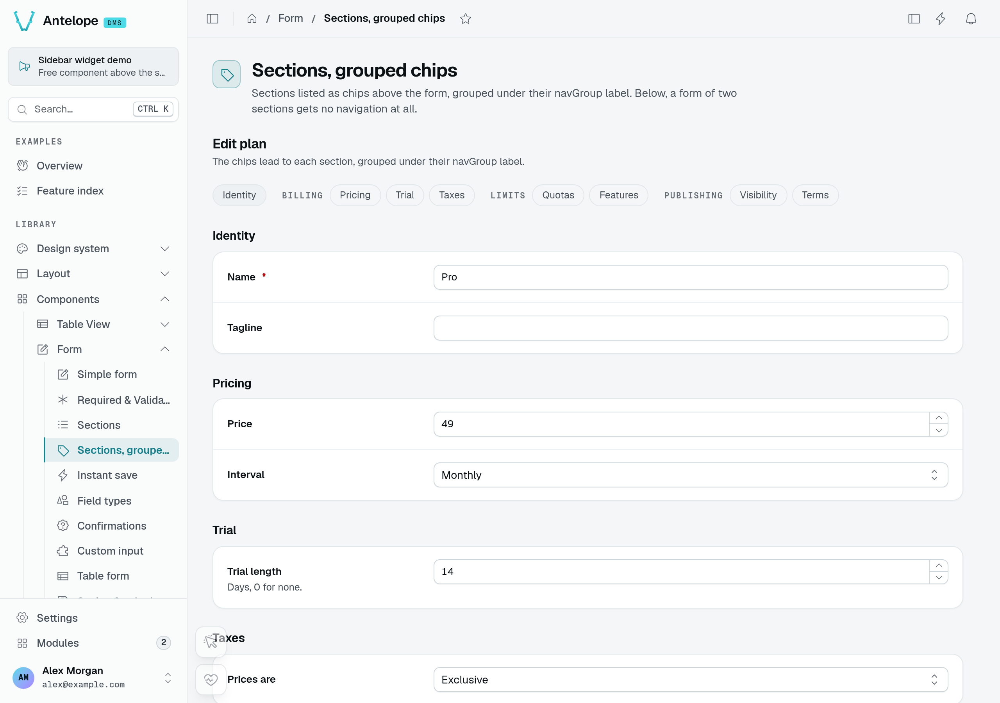
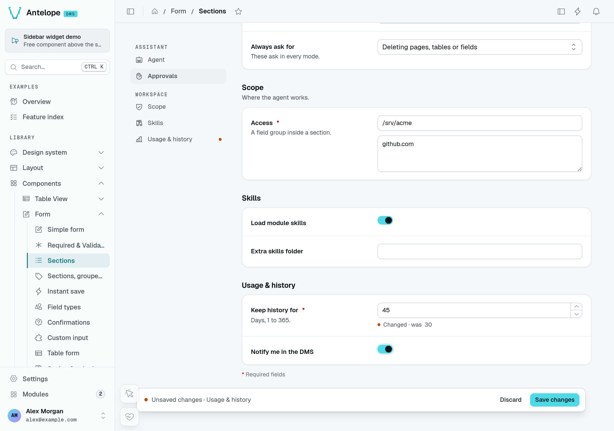
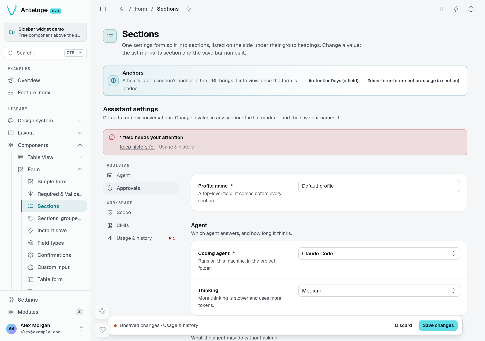
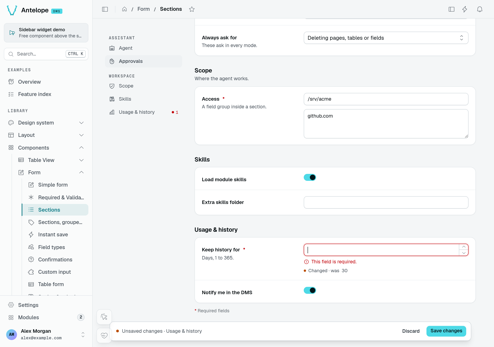

A long settings form reads better as titled parts, such as *Agent*, *Approvals* and *Limits*, than as one column of fields. Give `Form` its fields as `sections` instead of several forms: each section is a card on the same page, a navigation leads to each, and one submit saves them all.

## Declare the sections

```ts fragment [src/pages/assistant-settings.ts]
static form = Form({
  title: "Assistant settings",
  fetchUrl: "/api/assistant/settings",
  submitUrl: "/api/assistant/settings",
  sections: [
    {
      id: "agent",
      label: "Agent",
      icon: "i-ph-robot",
      description: "Which agent answers, and how long it thinks.",
      fields: [
        { id: "agent", label: "Coding agent", type: new DefaultDataTypes.SelectType({ items: AGENTS }), required: true },
        { id: "thinking", label: "Thinking", type: new DefaultDataTypes.SelectType({ items: THINKING }) },
      ],
    },
    { id: "approvals", label: "Approvals", icon: "i-ph-hand-palm", fields: [/* … */] },
    { id: "limits", label: "Limits", icon: "i-ph-gauge", fields: [/* … */] },
  ],
});
```

A section (`FormSection`) takes:

| Property      | Type                 | Purpose                                                            |
| ------------- | -------------------- | ------------------------------------------------------------------ |
| `id`          | `string`             | Anchor of the section, unique within the form. Required.           |
| `label`       | `string`             | Title of the card and of its entry in the navigation. Required.    |
| `description` | `string`             | A line under the card's title.                                     |
| `icon`        | `string`             | Icon of the section's entry in the side navigation.                |
| `navGroup`    | `string`             | Heading the section's entry sits under in the navigation, side list or chips (`$`-prefixed: i18n key). |
| `fields`      | `(FormField \| FieldGroup)[]` | The fields and groups of the section. Required.           |

`fields` and `sections` can be combined: the form's own `fields` come first, outside any section. A section's fields are ordinary form fields, so every type, group, note and watch works the same, and they still submit as flat top-level keys: sections only shape the page.

## Section navigation

`sectionNav` decides how the form lists its sections:

| `sectionNav` | Renders |
| ------------ | ------- |
| `side` | A list beside the cards that follows the scroll (scroll-spy on anchors, not tabs). On a form narrower than 880px, it becomes a row of chips above the cards. |
| `jump` | A row of chips above the cards. |
| `none` | No navigation. |

Left out, it is `side` from three sections and `none` below.



The **Sections, grouped chips** playground page groups its links under Billing, Limits and Publishing. These links scroll to cards on the same form; they do not switch tabs or submit it.

A form of six sections or more reads better in parts. Give the sections a `navGroup` and the side list sets a heading above each run of sections sharing one; a section without it, or the first ones before any group, sit at the top without a heading. Only consecutive sections share a heading: a group named again further down starts a new run.

The row of chips (`jump`, or `side` on a narrow form) groups them the same way: each run of chips follows its group's label, and the runs wrap onto as many lines as the form's width needs. Without any `navGroup`, the chips stay one row that scrolls sideways. `jump` with groups suits a form whose side column is taken, such as an editor with a live preview beside it.

```ts fragment
sections: [
  { id: "plans", label: "Plans", fields: [/* … */] },
  { id: "dunning", label: "Dunning", navGroup: "$saas.rules.billing", fields: [/* … */] },
  { id: "taxes", label: "Taxes", navGroup: "$saas.rules.billing", fields: [/* … */] },
  { id: "terms", label: "Terms", navGroup: "$saas.rules.legal", fields: [/* … */] },
],
```
 Each section has an anchor, `#dms-form-<component id>-section-<section id>`: an entry of the navigation scrolls there, and a link carrying it scrolls there on load.

## What each section shows

Every entry of the navigation carries the state of its section, with nothing to declare:

- **An amber dot** while the section holds unsaved changes.
- **A red dot and a count** ("2 fields to fix") once some of its fields are invalid.

The save bar names the changed sections (and the changed fields outside any section) instead of listing every field. In a form with `saveMode: "instant"`, the form's save state shows under the side list ([Saving](/docs/components/forms/saving#instant-save)).



In the **Sections** playground page, changing retention from 30 to 45 days marks **Usage & history** in both the navigation and the save bar.

## The validation summary

Every form, sectioned or not, gets a validation summary. Once a submit is refused, by the client's validation or by the server, an alert above the fields says how many need attention and lists them as links; each link focuses its field, and in a sectioned form it names the section too. The alert goes away once the fields are fixed or the form is saved.

A field's own error shows under it, with its border, `aria-invalid` and focus. A control can refuse what was typed into it before any submit, such as a duration it cannot read, JSON that does not parse, or an address in a list of emails that is not one. That message counts as the field's error: it blocks the submit and joins the summary.



Submitting the same form with retention empty produces a summary link at the top. The section navigation counts one invalid field, and the field explains that it is required.



## Server errors on a part of a field

The server names the field it refuses in a validation issue (`assertValidation`), a `{ message, field }` body or the data API's `{ code, fields }` ([Guards](/docs/components/tables/row-actions#guards)). When a validation issue's path reaches into a field, such as `["address", "postalCode"]`, `["title", "fr"]` or `["categories", 2, "name"]`, the form puts the error on that part when the control has one (the postal code of an address, the French translation of a localized field, the cell of a repeater row), and on the whole field otherwise. Frontend code reading the same errors through the `useFieldErrors` composable gets the part as `ApiFieldError.path` (`address.postalCode`).

A server error stays on its field until that field's value changes or the form is saved: the client's own validation of the field (as it is left, as it is typed in) does not clear it while the value is still the one the server refused. A field the form does not show (hidden, disabled, or not part of it) cannot hold the error, which then shows as a toast.

A `{ message, field }` body may carry `params`, plain values filling the placeholders of the translated message: `{ field: "budget", message: "$page.campaigns.error.budget_max", params: { max: 5000 } }` shows "At most 5000" when the key reads `"At most {max}"`. A param that is not a string, a number or a boolean is dropped. Frontend code gets them as `ApiFieldError.params`, and `useFieldErrors` fills them in the same way.

## How a sectioned form is served

The client reads a sectioned form as before: `fields` holds every entry (the form's own, then each section's), and `sections` lists `{ id, label, description?, icon?, fieldIds }`, the ids of the entries each section holds. Slot contributors and client code reading `fields` keep working.

On the backend, `FormProps.fields` is optional, since a form may declare sections only: read every entry with `formEntries(options)`, and build the schema of a section-only declaration with `formSchema(options)`, both from `@antelopejs/interface-dms/base/form`.

```ts fragment
import { formEntries, formSchema } from "@antelopejs/interface-dms/base/form";

const schema = formSchema(AssistantSettingsPage.form);     // every section's fields
const ids = formEntries({ sections }).map((entry) => entry.id);
```
