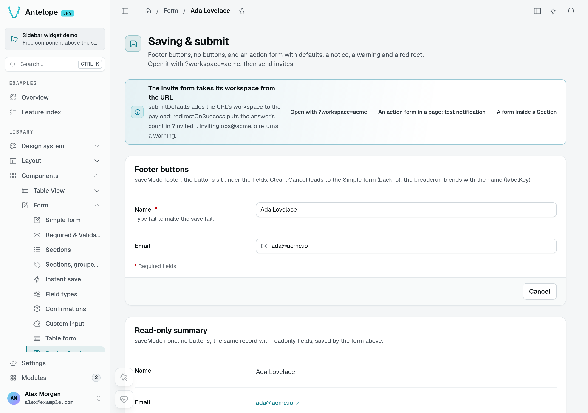
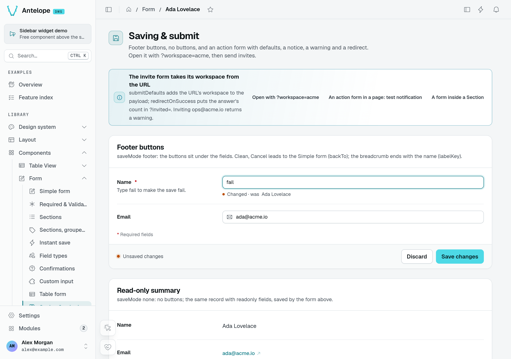
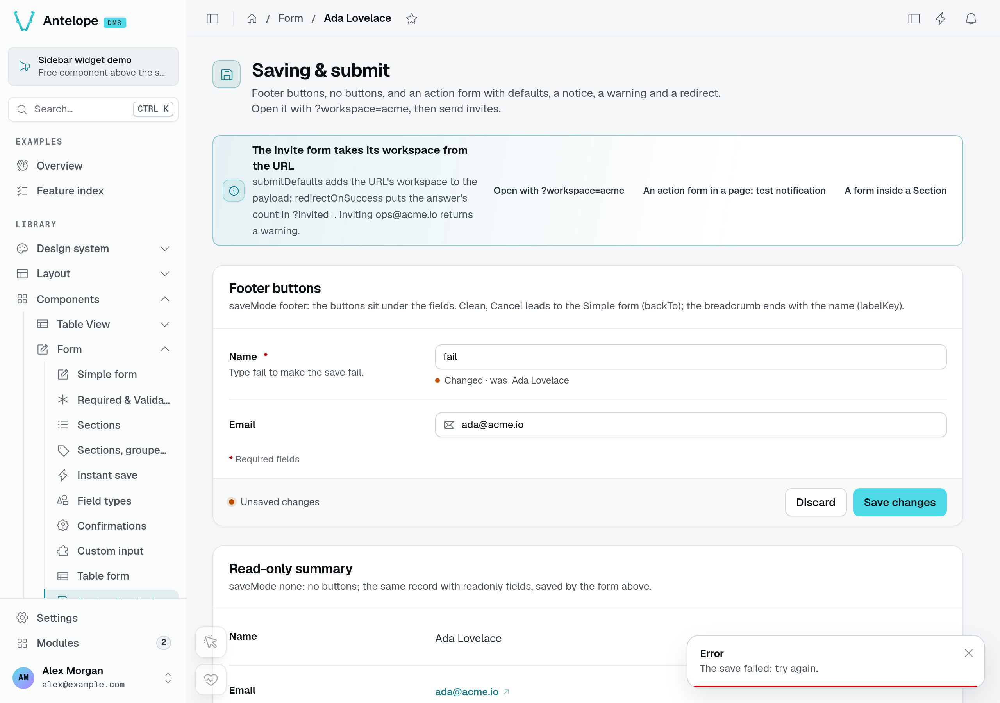
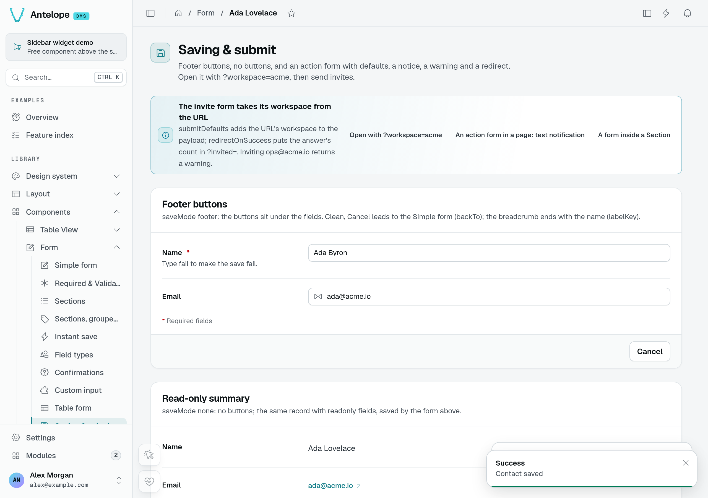
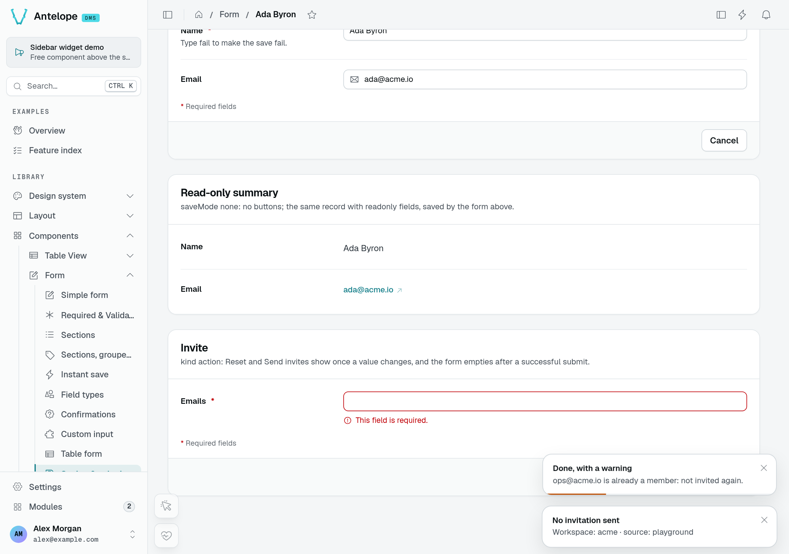
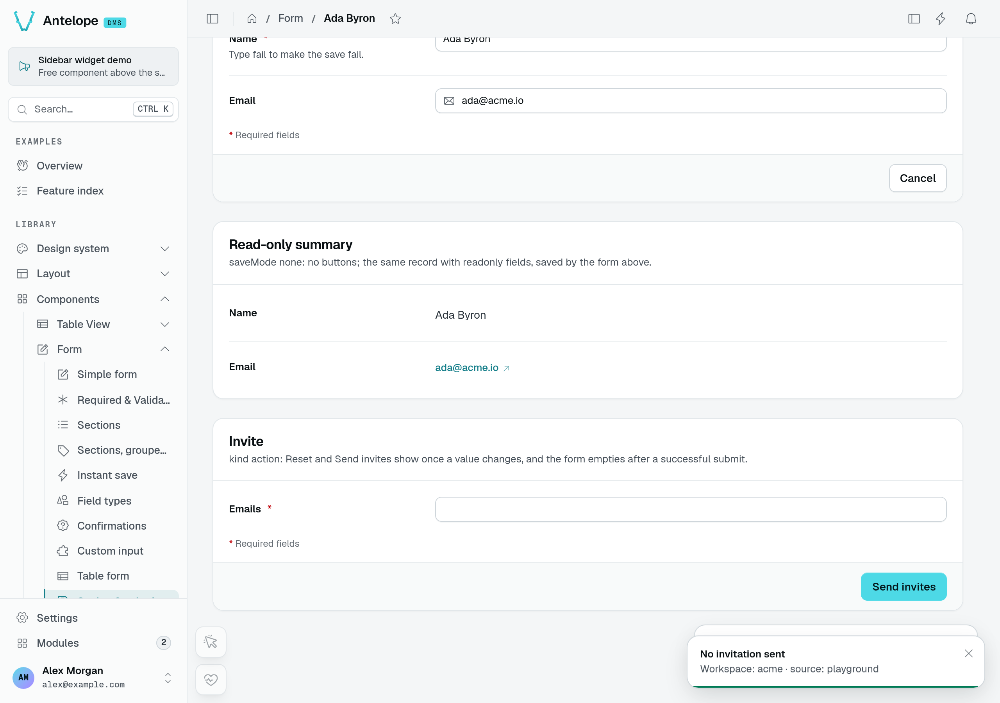

# Saving a form

Two options decide how a `Form` saves. `saveMode` picks the controls: a save bar, footer buttons, none, or an instant save of each field. `kind` says what the form edits: a record that keeps its values, or an action that empties once sent. Together they cover a settings page, a table view's edit form, an invite dialog and a page of preferences that save as you go.

## `saveMode`

| `saveMode` | Renders |
| ---------- | ------- |
| `bar` (default) | A sticky save bar, shown while there are [unsaved changes](/docs/components/forms#unsaved-changes): it names the changed fields (or [sections](/docs/components/forms/sections)) and offers **Discard** and **Save**. See [A form in a section](/docs/components/lists-and-settings/section#a-form-in-a-section). |
| `footer` | The buttons in the form's footer. |
| `none` | No buttons: something else reads or saves the form. |
| `instant` | No buttons: each field the user changes saves on its own ([Instant save](#instant-save)). |

In a drawer or a modal, `bar` and `footer` both use the container's footer.

### Footer states in the playground

The **Saving & submit** playground page uses a real endpoint with an in-memory contact. The clean record offers **Cancel**; its read-only summary has no save controls.



Changing the name reveals **Discard** and **Save changes**, together with the previous value. In this fixture, entering `fail` deliberately makes the save endpoint return an error.





The failed request leaves the input intact. Correcting the name and saving returns the footer to **Cancel** and shows **Contact saved**. The separate summary below still holds its earlier fetch result in this capture; a success toast does not imply that another form has refetched.



### The save bar on a page

The save bar stays within reach on a long form: it floats at the bottom of the visible area until the end of the form comes into view, then sits below the last field. The form makes room for it there so it does not cover the last field.

When hidden, the bar takes no space. When shown, its **Cancel** and "Unsaved changes" states (with **Discard** and **Save**) have the same height, so switching between them does not move the content.

## `kind`

- **`record`** (default) — a record, a settings page, a table view's form. It keeps its values once saved. While clean it offers **Cancel** only when it has somewhere to go back to: the drawer or modal it sits in, or `backTo` on a page. Table views set `backTo` on their form pages, to the list.
- **`action`** — a form that does something each time it is sent: send a message, invite someone, run a job. Its `submitLabel` button always shows in its footer, ready: a form pre-filled with valid defaults sends them as they are, and a form with no field to fill in is a submit button alone. **Reset** joins it once a value changes; in a drawer or a modal, **Cancel** stands there before that. After a successful submit each field goes back to the value it opened with — its `defaultValue`, or what `fetchUrl` loaded.

```ts [src/pages/invite.ts]
static invite = Form({
  submitUrl: "/api/invites",
  submitUrlMethod: HttpMethod.post,
  submitLabel: "$invite.send",
  kind: "action",
  fields: [/* … */],
});
```

::warning
A form on a page that sets neither option saves with the save bar, as a `record`. Declare `kind: "action"` on send, invite and run forms.
::

`labelKey` names the field of the loaded record whose value ends the page breadcrumb once the form has loaded ("… › Tasks › Write the docs"); table views fill it from their own `labelKey`.

### An action response with a warning

On `/form/form-saving?workspace=acme`, submitting `ops@acme.io` calls the playground's simulated invitation endpoint. It sends no email: that address is already a member, so the response reports zero invitations and a warning.



The redirect ends in `?invited=0` and the action input resets to empty. The required-field message visible after reset belongs to the empty input, not a failed invitation request.



## What a submit sends

A form loaded from `fetchUrl` and submitted with a method other than `POST` updates a record, so it sends **only the fields the user changed** (plus `submitDefaults`): a value someone else saved in the meantime is not written back. A create form, and a form posting its loaded values as a new row (`submitUrlMethod: HttpMethod.post`, a duplicate), sends every field holding a value.

A field the user cleared is sent as `null` — `[]` for a field holding a list (a multiple select, a tree, a relation, files) — so that the route clears it. An emptied text counts as cleared, whatever the input (text, textarea, e-mail, URL, phone, rich text, number). A localized field is the exception: it is stored as one value per language, so it sends each emptied language as `""`, even when every language is emptied. A field that started empty and is still empty is not sent, and a disabled field is never cleared. A required field cleared is refused by the route, and its error shows under the field.

The route behind such a form reads the body as a partial update: **an absent key means unchanged, `null` means cleared.** A table view's edit route (`TableViewRoutes.Edit`) already does. A route of your own that expects the whole record has to merge the body into the stored row instead of replacing it.

## Instant save

With `saveMode: "instant"`, a form has no save bar and no footer: each field the user changes is validated alone, then sent alone — a partial submit of that field to `submitUrl`, with `submitDefaults`, and no success toast. A cleared field goes as its empty value, `null` or `[]`.

```ts [src/pages/notifications.ts]
static preferences = Form({
  fetchUrl: "/api/preferences",
  submitUrl: "/api/preferences",
  saveMode: "instant",
  fields: [
    { id: "digest", label: "Daily digest", type: new DefaultDataTypes.BooleanType() },
    { id: "signature", label: "Signature", type: new DefaultDataTypes.StringType({ textarea: true }) },
  ],
});
```

- **When a field saves.** A pick — a select, a switch, a date, tags — saves at once. A typed field — a text, a number, an address, the rows of a repeater, code, a secret, a localized field — saves once typing pauses (500 ms). A change made while the same field is saving is sent once that save ends, so the last value always wins; a slow validation of an older value never queues a newer one. A text still waiting when the user leaves the page is saved.
- **What the user sees.** Each row shows its state: *Saving*, then *Saved* for two seconds, or *Not saved* with **Retry**. On a page, the header carries the "Saved instantly" pill, which reads "Saving" while a change is being written and turns red with "Not saved" while a save failed; a sectioned form also shows its state under its side list.
- **When it fails.** An invalid value is shown with its error, never sent. A save the server refuses puts back the value the server last confirmed — not the one the form opened with — then says why under the field (or in a toast), leaving the other fields' errors in place; **Retry** sends the change again.
- **What it excludes.** An `action` form ignores `instant` and saves with the bar. An instant form shows no "Changed · was X" [field note](/docs/components/forms/field-notes), since nothing waits for a save.

Since it sends one field at a time, the `submitUrl` of an instant form must accept a partial body — a table view's edit route does. The DMS's own Language & region page is such a form, and the notification preferences and Appearance pages save through the same mechanism.

::note
A custom Vue page that saves as it goes shows the same pill with `useInstantSaveHeader` and `DmsSaveStatus` ([Lists & settings](/docs/components/lists-and-settings/section#instant-save-or-a-save-bar)).
::
