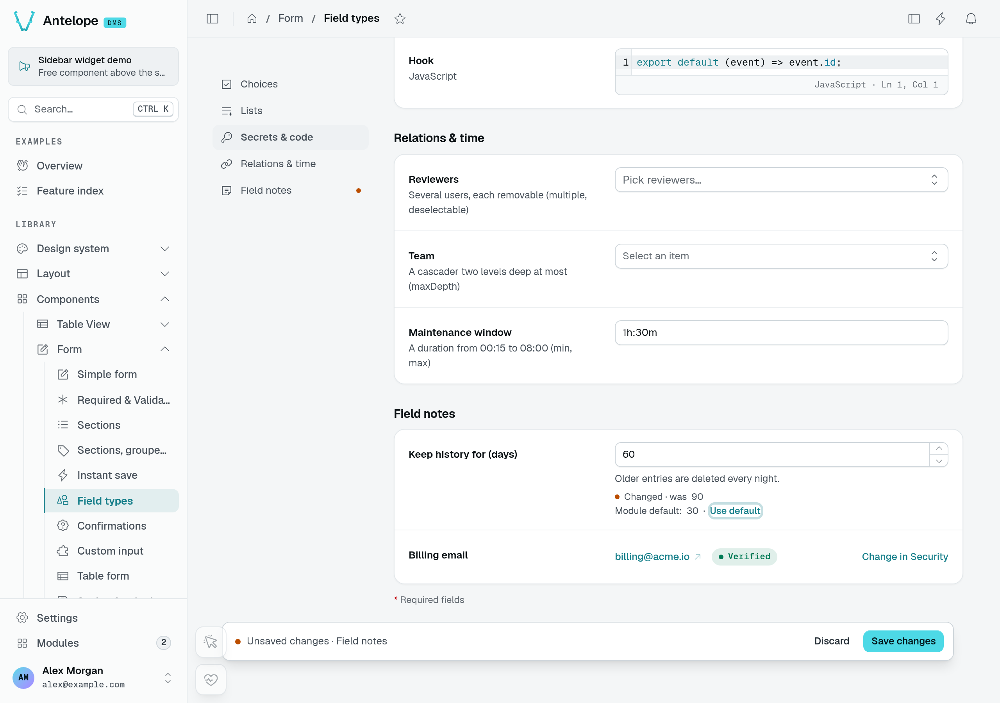

# Field notes

A field row says more than its label and its control. Under the control, the form draws short notes: a help line the module writes, the value a pending change replaces, the module's default, or why a value cannot be edited here. Declare them on the field; the form decides when each shows.

```ts [src/pages/workspace-settings.ts]
fields: [
  {
    id: "retention",
    label: "Keep history for",
    type: new DefaultDataTypes.NumberType({ min: 1, max: 365 }),
    defaultValue: 30,
    offersDefault: true,
    hint: "Older entries are deleted every night.",
  },
  {
    id: "email",
    label: "Email",
    type: new DefaultDataTypes.EmailType(),
    readonly: {
      badge: { label: "Verified", tone: "success" },
      link: { label: "Change in Security", to: "/settings/user/security" },
    },
  },
],
```

## Help line: `hint`

`hint` (an i18n key or a literal) is a grey line under the control. It describes the control to assistive technology too (`aria-describedby`). While the field has an error, the error takes its place.

`hint` differs from `description`, which sits under the label: use `description` for what the field is, `hint` for what happens with the value.

A read-only field (`disabled` or `readonly`) shows no `hint`: there is no control to describe. A form where nothing can be changed (a record's details) shows no `description` either — "Left empty, the default rate applies" says nothing to someone reading the value.

## Pending change: "Changed · was X"

While a field holds a value it did not load with (or last save), a "Changed · was 30" line shows under it, worded by the field's type ("was empty" for a field that had none). Values that do not fit a line — a password, code, rich text — say "Changed" alone. It needs nothing declared and shows only while a change waits for its save: not in an [instant](/docs/components/forms/saving#instant-save) form, nor in an `action` form.



The **Field types** playground page shows three distinct facts together: 90 is the loaded value, 60 is the pending value, and 30 is the module default. The billing email below is read-only, with a **Verified** badge and a link to its editing page.

## Module default: "Use default"

`defaultValue` is the value a new record starts with. On a setting, it is also the module's default: declare `offersDefault: true`, and while the field holds something else it shows "Module default: 30 · Use default"; **Use default** puts the default back (as an unsaved change). A disabled field offers no **Use default**.

Without `offersDefault`, the field shows no such note: a record form, such as the one a table view generates from its columns, edits a record whose values owe nothing to the column's initial value, so straying from it is not news.

## Read-only values: `readonly`

`readonly: true` shows the value with its type's display, not an input: it is not edited, and not marked required. To say why, or where it is changed, give an object:

| Property | Type                     | Purpose                                                     |
| -------- | ------------------------ | ----------------------------------------------------------- |
| `badge`  | `{ label: string; tone: Tone }` | A pill beside the value ("Verified", "Managed by SSO"). |
| `link`   | `{ label: string; to: string }` | A link to where the value is changed.                   |

`label` is an i18n key or a literal; `tone` is one of the seven [tones](/docs/interfaces/base/types#colors-and-sizes). Unlike `disabled`, which greys an input out, `readonly` presents a value the user is not meant to edit on this form.

### On a create form

A create form (`kind: "create"`) leaves out a read-only field (`disabled` or `readonly`) that holds nothing yet: a number, a date or a total the server sets once the record exists would only read "—". The field shows as soon as it holds a value (a `defaultValue`, one a rule computes). To keep it in place, empty, set `showEmptyOnCreate: true` on the field (or on its `@Column`). To leave a column out of the create form whatever it holds, give it `readonlyBehavior: { new: "hidden" }`.
