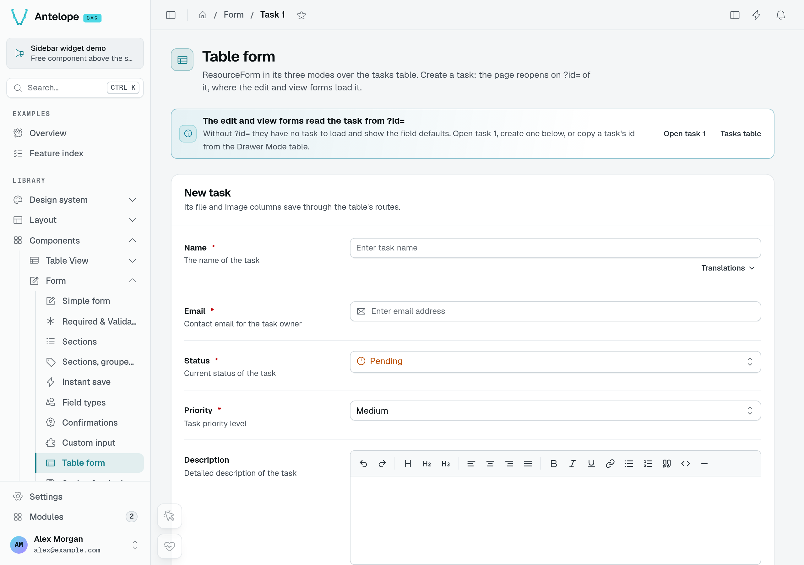
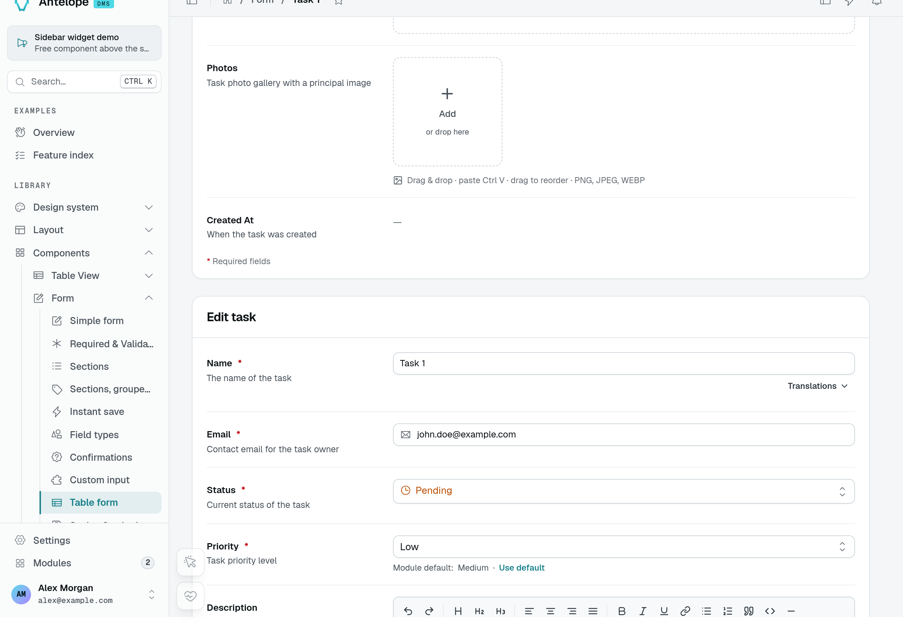
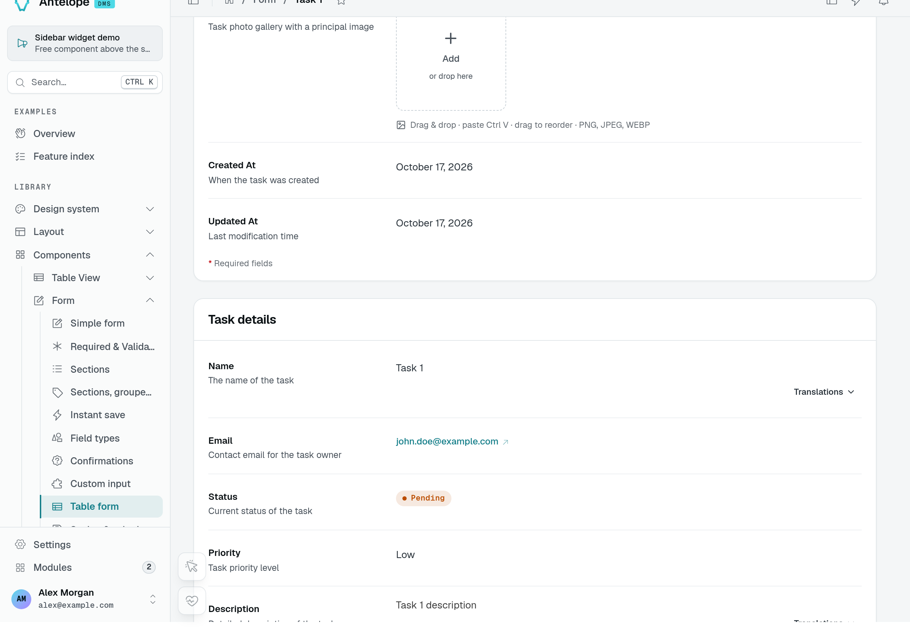
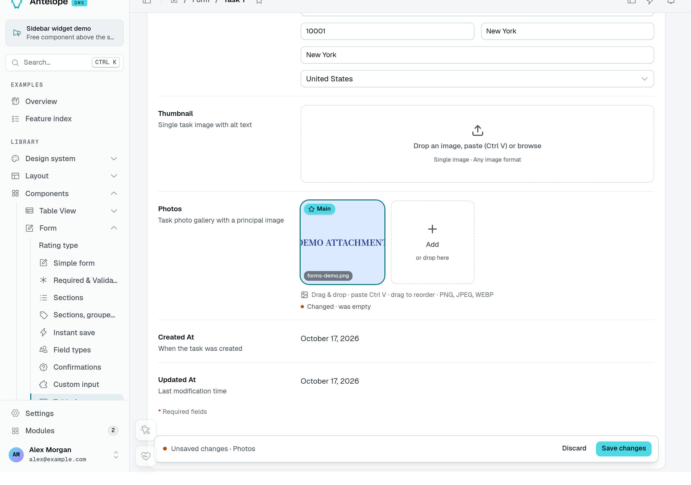
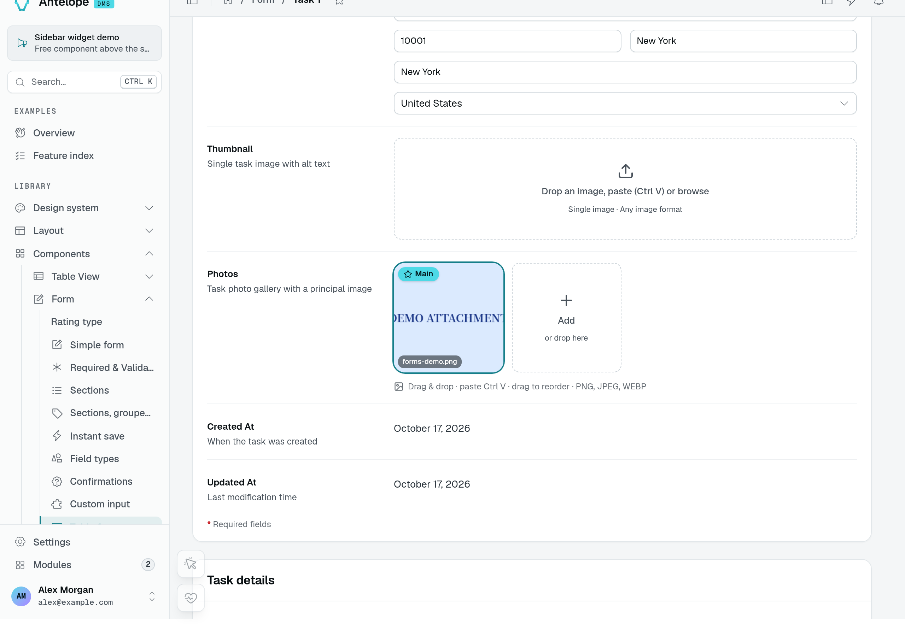
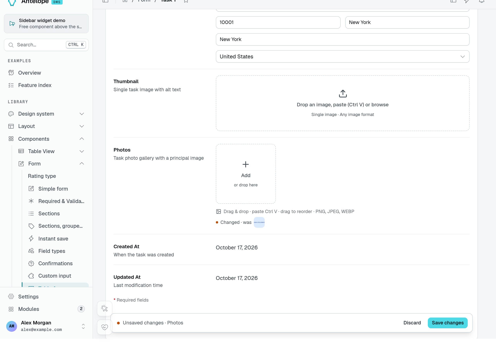

# Table form

`ResourceForm` is a form over a [data controller](/docs/components/data-controller): pick the table and the mode, and its fields, routes and methods follow. It is the same form a [`TableView`](/docs/components/tables) opens for that mode, placed on a page of its own. Use it for a dedicated "New task" page or a record's detail page; use [`Form`](/docs/components/forms) to reach an endpoint of your own.

::block-playground{type="ResourceForm" example="ResourceForm" height="420"}
---
options:
  title: Workspace record
  description: Fixed demonstration data. Changes are not saved.
---
::

::note
The preview uses serialized resource fields and a fixed record served by the preview service. It renders the same form component as a resource-backed page, but has no write route: editing it does not save anything. In your application, the controller supplies the fields, permissions and persistence shown below.
::

## Usage

```ts [src/pages/task-form.ts]
import { PageController, RegisterPage } from "@antelopejs/interface-dms/page";
import { FormPageLayout } from "@antelopejs/interface-dms/base/layouts";
import { ResourceForm } from "@antelopejs/interface-dms/base/table-view";
import { taskDataAPI } from "../data-api/tasks";

const PAGE_PATH = "/tasks/form";

@RegisterPage()
export class TaskFormPage extends PageController(
  "task-form",
  { displayName: "$app.tasks.form", icon: "i-ph-note-pencil", category: tasksCategory },
  FormPageLayout(),
) {
  static create = ResourceForm(taskDataAPI, {
    mode: "new",
    title: "$app.tasks.new",
    redirectOnSuccess: `${PAGE_PATH}?id={{response._id}}`,
  });

  static edit = ResourceForm(taskDataAPI, { mode: "edit", title: "$app.tasks.edit", labelKey: "name" });

  static view = ResourceForm(taskDataAPI, { mode: "view", title: "$app.tasks.details" });
}
```

## Options

::block-options{type="ResourceForm"}
::

| `mode` | The form…                                                        |
| ------ | ---------------------------------------------------------------- |
| `new`  | Creates a row through the controller's `new` route.              |
| `edit` | Loads the row named by `rowId`, then saves it through `edit`.     |
| `view` | Loads the row named by `rowId` and shows it read-only.           |

### Three modes over the same controller

The **Table form** playground page places all three modes on one page. Its new form starts with empty Name and Email fields and the controller's default status and priority.



Opening `/form/form-resource?id=1` loads the seeded **Task 1** into the edit form. Its email and Low priority come from that record, not the new form's defaults.



The view form displays the same record without editable fields. These captures demonstrate loaded data; they do not demonstrate an upload or a create request.



## Recipes

### Read the row from the route

`edit` and `view` read the row id from `?id=` by default (`QUERY_ROW_ID`, `{{query.id}}`). A page served under a `:id` route segment passes `rowId: ROUTE_PARAM_ROW_ID` (`{{params.id}}`, from `@antelopejs/interface-dms/base/table-view`) instead. `QUERY_ROW_ID` comes from `@antelopejs/interface-dms/base/resource-form-schema`.

### Open the row just created

`redirectOnSuccess: "/tasks/form?id={{response._id}}"` reopens the page on the row the `new` form wrote: the controller's `new` answers the list of keys it inserted, and `{{response._id}}` (as `{{response.id}}` or `{{response.0}}`) names its one key.

### Add and remove a photo

The playground task controller exposes a **Photos** image list. Adding the fictional `forms-demo.png` uploads the image, then leaves the record's photo list as an unsaved change. Uploading the bytes and saving the record are separate steps.



After **Save changes** and a page reload, the image is still attached to Task 1. This capture uses disposable local storage, not an external upload destination.



Removing the image clears its tile and marks Photos as changed again. Save the form to persist the empty list; in this run, another reload confirmed that the attachment was absent. This verifies removal from the record, not physical deletion of the stored file.



See [File storage](/docs/components/file-storage) for upload destinations and storage configuration. The upload URL must reach the storage provider's HTTP route, including when a local frontend proxy sits in front of the backend.

## Pitfalls

- In `edit` and `view`, a page reached without its id shows "No entry selected" instead of empty fields (`requiresRecord`).
- The form's routes still require the action's permission from a table view of the controller when one is mounted: a table form adds no permission of its own.

## Next steps

::card-group
:::card{title="Data controller" icon="i-lucide-database" to="/docs/components/data-controller"}
Declare the table the form is about.
:::

:::card{title="Saving a form" icon="i-lucide-save" to="/docs/components/forms/saving"}
Save bars, footers and instant save.
:::
::
