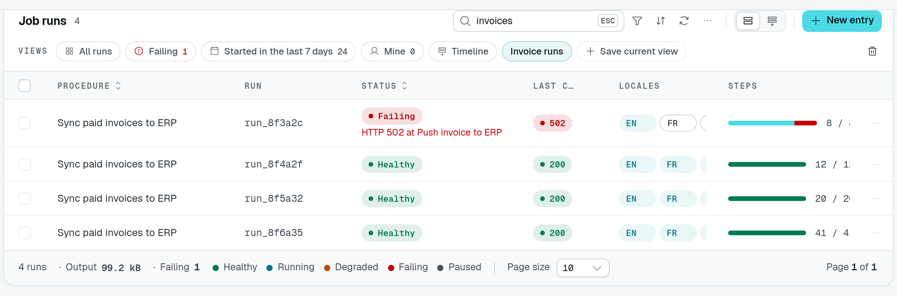
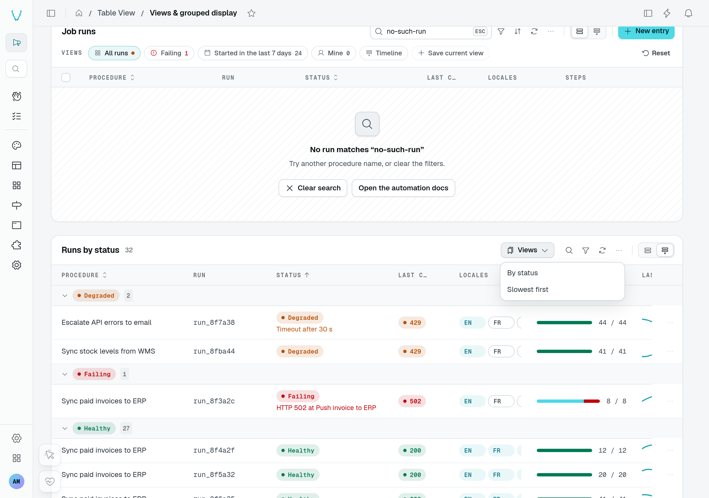

# Views

A **view** is a named state of the whole table: its filters, search, sort, visible columns and their order, display and density. "Failing", "Mine", "Started this week", "Timeline": the module declares them once, the table draws them as tabs, a strip or a menu, and a link opens one directly. With `userViews`, users save the state they reached as views of their own.

Views and [tabs](/docs/components/tables#filtering-search-and-sorting) coexist. A tab filters on **one column** (`filter`) or links to another page; a view sets **everything at once**. Use tabs for a status strip, views for saved ways of looking at the rows.


The playground's **Failing** view applies the status filter and updates the count and footer together. The failure shown here is demo row data, not a table-loading error.



Search for `invoices`, then choose **Save current view** to keep that search as **Invoice runs**. The original module views remain available beside it.



The same playground page also demonstrates the compact menu layout on **Runs by status**.

## Usage

```ts [src/pages/job-runs.ts]
static runs = TableView(jobRunDataAPI, {
  caption: "Job runs",
  grouped: { groupByField: "startedAt", by: "day" },
  views: {
    layout: "strip",
    defaultView: "all",
    userViews: true,
    items: [
      { id: "all", label: "All runs", icon: "i-ph-squares-four" },
      { id: "failing", label: "Failing", icon: "i-ph-warning-circle", tone: "error", count: true,
        filters: [{ accessorKey: "status", mode: "is", value: "failing" }] },
      { id: "this-week", label: "Started in the last 7 days", count: true,
        filters: [{ accessorKey: "startedAt", mode: "greater_than", value: "{{now-7d}}" }],
        sort: [{ field: "startedAt", desc: true }] },
      { id: "mine", label: "Mine", count: true,
        filters: [{ accessorKey: "ownerId", mode: "is", value: "{{user.id}}" }] },
      { id: "timeline", label: "Timeline", display: "grouped",
        columns: { hidden: ["runId"] }, density: "compact" },
    ],
  },
});
```

## Options

`views` takes a `TableViewViewsOptions`:

| Option        | Type                             | Default  | Purpose                                                                                                   |
| ------------- | -------------------------------- | -------- | --------------------------------------------------------------------------------------------------------- |
| `items`       | `TableViewView[]`                | required | The module's views, in order. Ids are unique (registration throws for a duplicate).                       |
| `layout`      | `"tabs" \| "strip" \| "menu"`     | `"tabs"` | A tab strip above the table, a row of pills above the status tabs, or a menu button in the toolbar.       |
| `defaultView` | `string`                         | —        | View opened on a first visit when the URL names none. Without it the table opens in its own default state. Must be a declared view. |
| `userViews`   | `boolean`                        | `false`  | Users may save the current state as a view of their own, then update or delete it.                        |

Each `TableViewView` names the view and the state it sets. What a view leaves out falls back to the table's defaults (`defaultFilters`, `defaultSort`, the declared columns, `defaultDisplay`, `density`), so opening a view always shows the same rows the same way.

| Field          | Type                                         | Purpose                                                                                                   |
| -------------- | -------------------------------------------- | --------------------------------------------------------------------------------------------------------- |
| `id`           | `string`                                     | Stable id, used in the URL.                                                                               |
| `label`        | `string`                                     | Label (`$`-prefixed: i18n key).                                                                           |
| `icon`         | `string`                                     | Icon before the label.                                                                                    |
| `tone`         | `Tone`                                       | Colors the icon and the counter.                                                                          |
| `dot`          | `Tone`                                       | A status dot drawn before the label.                                                                      |
| `count`        | `boolean`                                    | Shows how many rows the view lists.                                                                       |
| `permission`   | `ButtonPermission`                           | Serves the view only to callers holding one of the table's actions by name (`"export"`) or an `Action` of any component. |
| `permissionId` | `string`                                     | Absolute permission id the view requires; wins over `permission`.                                         |
| `filters`      | `{ accessorKey; mode; value? }[]`            | Filters on filterable columns, shown as the table's filter chips.                                         |
| `search`       | `string`                                     | Text in the search field.                                                                                 |
| `sort`         | `{ field; desc? }[]`                         | Sort of the rows (the list sorts on the first entry); each field must be `@Sortable()`.                   |
| `columns`      | `{ visible?; hidden?; order? }`              | Columns shown or hidden whatever their default visibility, and their order (left out: declared order).    |
| `display`      | `string`                                     | Display the view opens in — `"table"`, `"grouped"`, `"kanban"` or a module's `<module>:<id>` — one the table offers. |
| `density`      | `"default" \| "compact"`                     | Row height of the grid.                                                                                   |

Registration throws for a view that filters on a column that is not filterable, sorts on one that is not `@Sortable()`, names an unknown column, or opens a display the table does not offer.

## Filter tokens

A filter value may hold tokens the server replaces on every request, in the list, its counts and its export, so the rows and the counters follow the caller and the clock:

| Token                    | Replaced by                                      |
| ------------------------ | ------------------------------------------------ |
| `{{user.id}}`            | The signed-in user's id.                         |
| `{{now}}`                | The current instant.                             |
| `{{now-7d}}`, `{{now+14d}}` | The current instant moved by whole days.      |

Tokens work in any filter the table sends, not only in views: `defaultFilters` and tab filters resolve them the same way.

## Modified views and user views

Changing the filters, search, sort, columns, display or density of the open view marks it modified, with a dot and **Reset**, which brings the view back. With `userViews: true` the user can also **Save as new view**: a dialog asks for a name, and the view joins the list. A user's own views also offer **Save** (keep the current state in it) and **Delete view**, which asks for confirmation; deleting the open view brings the table back to its default state, its search, filters and sort included. A view the module declares is never overwritten.

Clicking the open view again, in the strip or the menu, closes it: no view is open, and the table goes back to its default state (default filters, no search, default sort). That is the way back to "no view" on a table whose views do not include an "All" one. The tabs layout keeps a view open: clicking its tab again does nothing.

User views are kept with the rest of the user's table preferences, stamped with their owner, and never served to anyone else. Opening another view and coming back opens the view clean: nothing is remembered behind the user's back. The table remembers which view was open for the next visit, with its search.

## Counters

`count: true` shows the number of rows a view lists, counted by the server with the view's filters. Like tab counters, it needs the controller to mount `countBatch: TableViewRoutes.CountBatch` (`POST <location>/count/batch`, part of `TableViewRoutes.All`); `TableView()` logs a warning at registration when a counted view has no route to count with.

## Links to a view

The URL opens a view or a tab: `?<tableId>.view=<id>` and `?<tableId>.tab=<id>`, where `tableId` is the key the table view is mounted under in its page (`static runs = TableView(...)` → `?runs.view=failing`). On a page carrying a single table view, the short `?view=` and `?tab=` work too; with several, they are ignored (`?view=` with a warning in development). A view named by the URL wins over the one open on the last visit. The tab the user opens is written back to the URL in place — the history entry is replaced, nothing is reloaded — under the same key (`?<tableId>.tab=`, or `?tab=` on a page with a single table view), so a reload or a copied link opens that tab again; a link tab, which opens another page, writes nothing. The tab follows the URL afterwards too: a link or a `router.replace` that changes `?<tableId>.tab=` (or `?tab=`) on the page already shown switches the tab in place, without remounting the page; a URL dropping the key, or naming an unknown or link tab, leaves the open tab alone. A view the caller cannot open — an unknown id, another user's view, a view their permissions leave out — falls back to the default view, with a message. An empty key (`?<tableId>.view=`, or `?view=`) is a link to no view: the table opens on its default filters, search and sort, with no view open, even when it declares a default view.

A link that names what the table lists — a view, a tab, a row (`?<tableId>.record=`) or a filter declared in `queryParamFilters` — opens the table as a first visit would, plus what it names: the view, tab, filters, sort and page kept from the last visit are not applied under it, so `?runs.view=failing` never lands on the tab the user left open, nor `?customer=c1` on their last filters. The reader's own presentation (display, columns, density) stays. The kept state is not overwritten while the table shows what the link opened: the next visit without such a key finds it again. Once the user picks their own view, tab, filter or sort, the state on screen becomes theirs: it is kept whole, as on a plain visit, the view the link named leaves the URL, and the URL filters still applied are kept with it. A reload then restores what the user chose, not the link. A link followed from the dashboard (a click, a notification) is always a link, even when it names the tab the user left open: a KPI card linking to `?invoices.tab=overdue` does not land on the view they had picked over that tab. Only a full load of the page (a reload) or Back can find the URL the table wrote for the user's own choices: there, naming the tab they left open, or the URL filters their kept state was chosen under, is not a link, while a link the table showed and the user has not made their own yet shows again. The server render cannot tell a reload from the same URL opened in a new browser tab, so both read alike. A link to the page already shown — a notification for one ticket while the user is on another tab, say — is read the same way: the table goes back to its defaults plus what the link names, and the kept state is left as it was. A link clicked on that page counts whenever it names a view or a tab the table can open, or a `queryParamFilters` value, even what is already shown. Back and Forward count when they name a view or a tab other than the one open, or a `queryParamFilters` value the last visit did not. A row named on that page (`?record=`, a row's link to its own drawer) opens on the table as it stands, on the page the user reached: it counts only with a view, a tab or a `queryParamFilters` value that changes what the table lists. A page control rebuilding the query in place (removing a URL filter, say) is no link and changes nothing.

On the backend, build such a link with `tableViewLink(page, tableId, { view, tab })`, for a StatGroup item, a KPI card or a notification:

```ts [src/pages/overview.ts]
import { tableViewLink } from "@antelopejs/interface-dms/base/table-view";

const failingRuns = tableViewLink(PageJobRuns, "runs", { view: "failing" });
// "/job-runs?runs.view=failing"
```

It throws when `page` is not a page controller. The link always carries the prefixed key (`?runs.tab=`), even to a page whose single table view writes the short `?tab=` itself: the table reads both spellings as the same tab.

## Permissions

A view gated by `permission` or `permissionId` is left out of the options served to a caller who lacks it; a `defaultView` left out falls back to the table's own state. Views add no permission of their own: the rows a view lists are those the caller's `list` permission reads.
