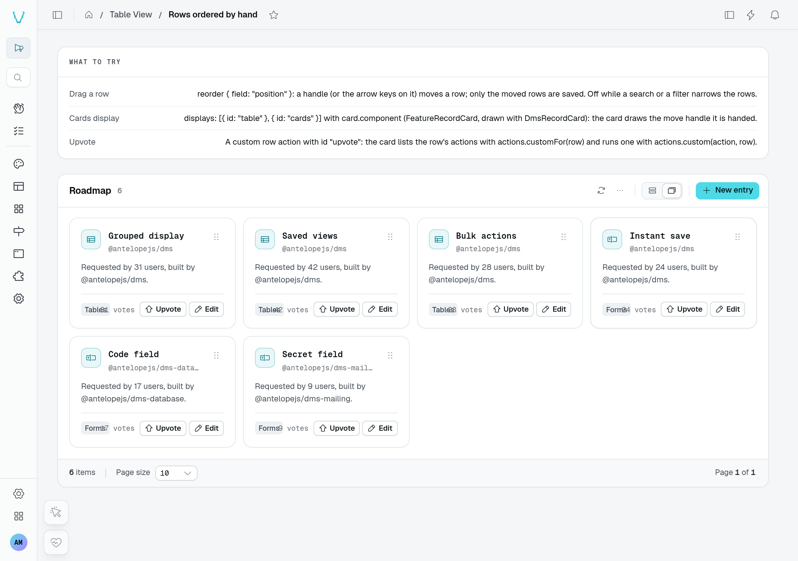
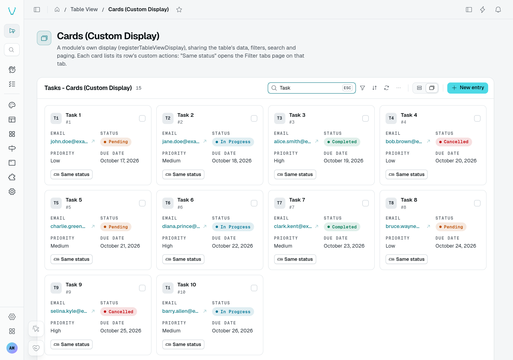
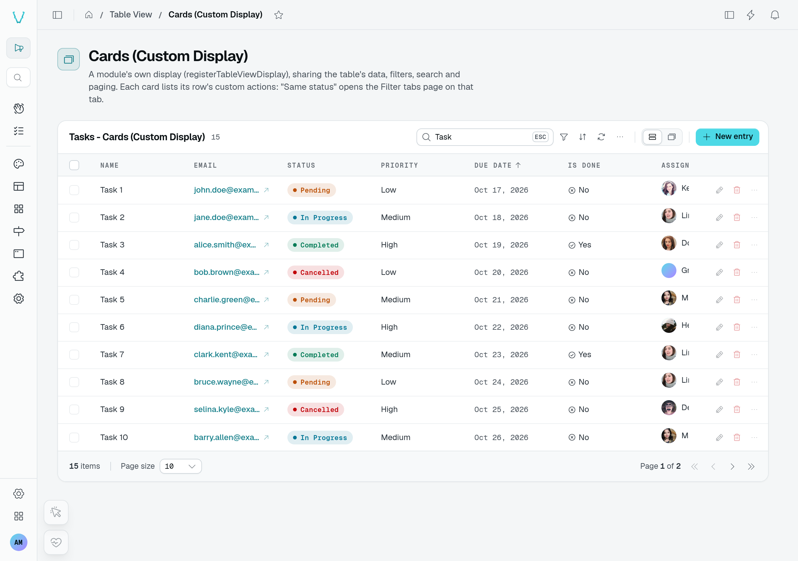

Two built-in displays draw one card per row instead of a grid row: the **kanban board** (the `kanban` option) and the **cards** grid (offered by listing `{ id: "cards" }` in `displays`, beside `{ id: "table" }` to keep the grid). Both draw the same card, configured once with the table view's `card` option. Left out, a card shows the row's label (`labelKey`) with its first few listable columns, in the cards grid and on the board alike (the board leaves out the column it groups on, which a card's place already tells).

A built-in card is titled with the row's label (`labelKey`), and draws the row as its title column's cell does: when that column has an `identity` display, its `subtitleField` is the card's second line and its `avatarField` the picture in front of the title (the title's initials otherwise). A table naming its rows by a key of its own (`rowIdKey: "code"`) shows that key on the second line instead when the identity gives none. The database `_id` shows on a card only as the title of a row without a label.



The playground's **Rows ordered by hand** page uses the built-in `cards` display with a custom `card.component`. Each roadmap card keeps its move handle and actions.





The separate **Cards (Custom Display)** page replaces the whole display through `registerTableViewDisplay`. Switching between its cards and grid preserves the `Task` search and the 15 matching records. This is different from replacing only the card content.

## Usage

```ts fragment [src/pages/tasks.ts]
static tasks = TableView(taskDataAPI, {
  labelKey: "name",
  kanban: { groupByField: "status" },
  displays: [{ id: "table" }, { id: "cards" }],
  card: { fields: ["priority", "assignee"] },
});
```

To draw the whole card yourself, name a frontend component instead:

```ts fragment [src/pages/roadmap.ts]
static roadmap = TableView(roadmapFeatureDataAPI, {
  labelKey: "name",
  displays: [{ id: "table" }, { id: "cards" }],
  card: { component: CustomComponent("FeatureRecordCard") },
});
```

On a phone, a card per row reads better than a grid cut after its first columns: `mobileDisplay: "cards"` opens phones on the cards while wide screens keep the grid ([Narrow screens](/docs/components/tables/columns-and-displays#narrow-screens)).

## Options

| Option      | Type        | Purpose                                                                                                                                   |
| ----------- | ----------- | ----------------------------------------------------------------------------------------------------------------------------------------- |
| `fields`    | `string[]`  | Columns shown under the card's title, each value drawn like a cell: through its column's `display` (an `IndicatorDisplay`, a `toneField`, a `ProgressDisplay`…), else its data type. Registration throws for an unknown column. |
| `component` | `Component` | Frontend component drawing the whole card, resolved by name from the global registry (declare its directory as global). Replaces `fields`. |
| `minWidth`  | `string`    | `cards` grid only: the narrowest a card gets, a CSS length (`"300px"`, `"20rem"`). Defaults to `"230px"`. The loading placeholder draws its cards at the same width. |
| `skeletonHeight` | `string` | `cards` grid only: the height of a loading placeholder card, a CSS length (`"260px"`). Left out, a placeholder is as tall as the built-in card. See [Loading placeholder](#loading-placeholder). |

## Card width

The cards grid fits as many cards of `card.minWidth` as the row holds, and stretches them to fill it: no empty space is left at the end of a row. A list too short to fill one row (two cards on a wide screen) does not keep empty columns either; its cards share the row, each one up to twice `minWidth`, so a single card does not run across the whole screen. A list that fills its rows is not capped. A screen narrower than `minWidth` shows one card across it.

```ts fragment [src/pages/websites.ts]
static websites = TableView(websiteDataAPI, {
  labelKey: "name",
  displays: [{ id: "table" }, { id: "cards" }],
  card: { component: CustomComponent("WebsiteCard"), minWidth: "320px" },
});
```

The board's cards keep the width of its columns: the kanban ignores `minWidth`.

## Loading placeholder

While its first page loads, the cards grid draws a page of placeholder cards built like the built-in card, so the pagination footer below the grid already stands where the loaded page puts it. A `component` loads lazily, and so may the components it draws: the placeholder stays until every one of them is there, rather than an empty grid lifting the footer for a beat.

A custom card taller than the built-in one sets `skeletonHeight` to its own height, or the footer drops when the cards land. It sizes the placeholder only: the cards keep their own height.

```ts fragment [src/pages/websites.ts]
card: { component: CustomComponent("WebsiteCard"), skeletonHeight: "260px" },
```

The kanban ignores `skeletonHeight`.

## Row actions

A built-in card of the cards grid carries its row's actions in its top-right corner, after its checkbox: the buttons and the … menu the row shows in the grid's actions column, with the same entries, the same per-row `rule`s and the same confirmations. On a phone, where a tap on the card opens it, this is how a row is edited, duplicated, deleted or sent through a custom action. The menu is a button of its own: a tap or Enter on it opens the menu without opening the card, and a table with no row action draws none.

A card component opts in with the `rowActions` prop, drawn wherever the card wants it:

```vue [app/components/TicketCard.vue]
<script setup lang="ts">
import type { Component } from "vue";

const props = defineProps<{ row: { subject: string }; open: () => void; rowActions?: Component }>();
</script>

<template>
  <article class="flex items-start gap-2" @click="props.open()">
    <h3 class="flex-1">{{ props.row.subject }}</h3>
    <component :is="props.rowActions" v-if="props.rowActions" />
  </article>
</template>
```

## A card component

The component receives the same props in both displays (`TableViewCardProps`), so one card serves the board and the grid:

| Prop          | Type                          | Purpose                                                                                     |
| ------------- | ----------------------------- | ------------------------------------------------------------------------------------------- |
| `row`         | `T`                           | The row the card stands for.                                                                |
| `rowId`       | `string`                      | Its id (the `rowIdKey` value).                                                              |
| `columns`     | `TableViewColumn[]`           | The table view's column metadata (types, labels).                                           |
| `labelKey`    | `string \| undefined`         | Field naming the row.                                                                       |
| `actions`     | `TableViewDisplayActions<T>`  | The table's row actions, with the per-row predicates `canEditRow(row)` and `canDeleteRow(row)`, and `customFor(row)`, the custom row actions the row offers (their `rule` accepted), run with `custom(action, row)`. |
| `selected`    | `boolean`                     | The row is selected.                                                                        |
| `select`      | `(value?: boolean) => void`   | Selects or unselects the row; toggles without a value.                                      |
| `open`        | `() => void`                  | Does what a click on the row does in the grid.                                              |
| `groupValue`  | `string \| undefined`         | Board only: the value of the column the card sits in.                                       |
| `reorder`     | `TableViewCardReorder \| undefined` | Cards grid of a table ordered by hand (`reorder`) only: the card's move handle, `{ enabled, dragging, handle }`, `handle` bound with `v-bind` on a button (see [Rows ordered by hand](/docs/components/tables/reorder#on-the-cards-display)). |
| `rowActions`  | `Component \| undefined`      | Cards grid only: the row's actions as the grid row offers them, drawn with `<component :is="rowActions" />` (see [Row actions](#row-actions)). |

A card can draw itself with `DmsRecordCard`, the v2 record card: icon well, mono title and subtitle, badge, description, tags, a mono note and footer buttons that act without opening the card (see [UI toolkit](/docs/frontend-composables/ui-toolkit)):

```vue [app/components/FeatureRecordCard.vue]
<script setup lang="ts">
interface FeatureRow {
  name: string;
  owner: string;
  area: string;
}

interface Props {
  row: FeatureRow;
  selected: boolean;
  actions: { canEditRow: (row: FeatureRow) => boolean; edit: (row: FeatureRow) => void };
  open: () => void;
}

const props = defineProps<Props>();

const cardActions = computed(() =>
  props.actions.canEditRow(props.row)
    ? [{ label: "Edit", icon: "i-ph-pencil-simple", onClick: () => props.actions.edit(props.row) }]
    : [],
);
</script>

<template>
  <DmsRecordCard
    icon="i-ph-sparkle"
    :title="props.row.name"
    :subtitle="props.row.owner"
    :tags="[props.row.area]"
    :actions="cardActions"
    :selected="props.selected"
    interactive
    @open="props.open()"
  />
</template>
```

## Kanban aliases

The kanban takes no card options of its own: `card` draws its cards.
