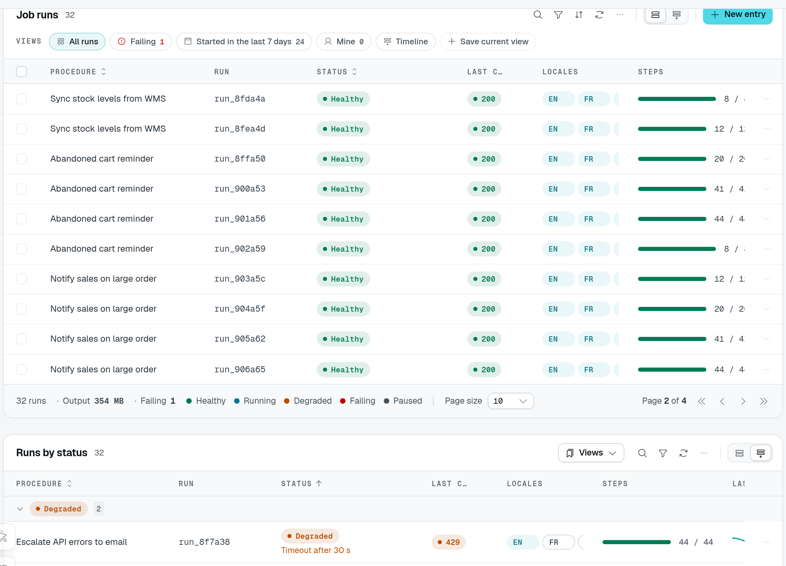
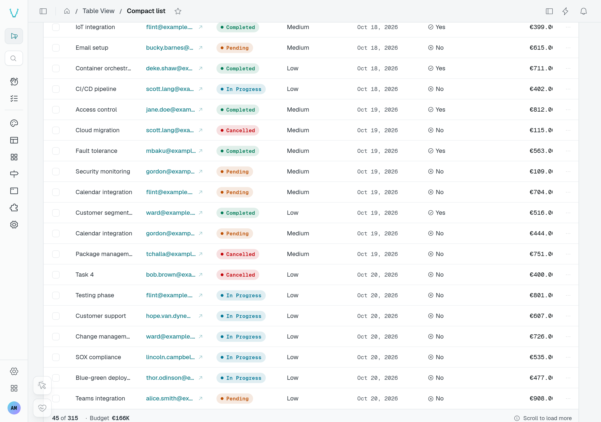

# Pagination

A table view lists its rows a page at a time. `pagination` decides how the user reaches the rows beyond the first page: a **pager** (the default), a **"Load more"** button, or **infinite scroll** for a feed. `pageSize` sets how many rows a page holds.

## Usage

```ts fragment [src/pages/activity.ts]
static activity = TableView(activityDataAPI, {
  caption: "Activity",
  pagination: "infinite",
  pageSize: 20,
});
```

## Options

| Option       | Type                                  | Default   | Purpose                                                                                       |
| ------------ | ------------------------------------- | --------- | --------------------------------------------------------------------------------------------- |
| `pagination` | `"pages" \| "loadMore" \| "infinite"` | `"pages"` | A pager; a "Load more" button appending the next page; the next page appended as the end of the list scrolls into view. |
| `pageSize`   | `number`                              | `10`      | Rows per page while the user picked none, a whole number from 1 to 50 (registration throws otherwise). Under `loadMore` and `infinite`, the step. |

## Pages

With `pages`, the footer shows the row count and the page size picker on the left, then any [summaries and legend](/docs/components/tables/footer-summaries), and the pager on the right. The picker offers 10, 25 and 50; a `pageSize` outside them (say 20) joins them in this table's picker. The size the user picks is kept with the table's state.



The playground shows ten rows on **Page 2 of 4**. The **32 runs** count and summary describe all matching rows, not only these ten.

## Load more and infinite

`loadMore` replaces the pager with a **Load more** button; `infinite` loads the next page as the footer scrolls into view, a spinner standing in while it loads. Both show how far the user got ("20 of 128") and have no page size picker.




In the playground, **Sources** appends another ten requests when you press **Load more**. **Compact list** starts with 15 tasks and loads more as its footer comes into view, without a button press. This capture shows the footer after three batches: **45 of 315**.

The table asks for every page loaded so far in one request, from the first row (`limit` = `pageSize` × pages loaded). A refresh or a realtime change therefore re-reads the same rows. A new filter, search, sort, tab or archive view starts over from one page.

Use them for feeds — notifications, activity, logs — where the newest rows matter and nobody jumps to page 12. The DMS's own notification inbox is a table view with `pagination: "infinite"`.

## In a custom display

A custom display reads the mode from its context (see [TableView displays](/docs/extending-the-dashboard/table-view-displays#the-display-context)): `context.pagination` carries `mode`, `hasMore` and `loadMore()` beside `pageIndex`, `pageSize`, `total`, `setPage()` and `setPageSize()`. Under `loadMore` and `infinite`, `context.items` holds every row loaded so far; call `loadMore()` while `hasMore` to append the next page.
