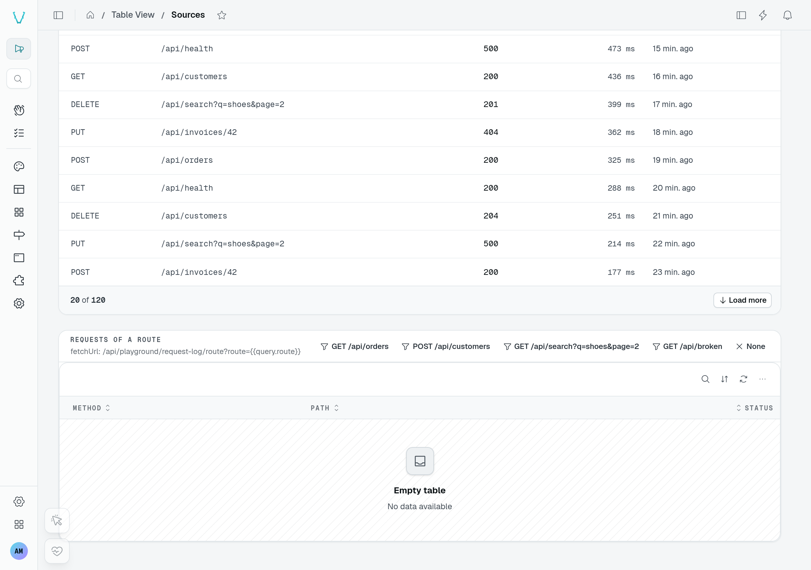
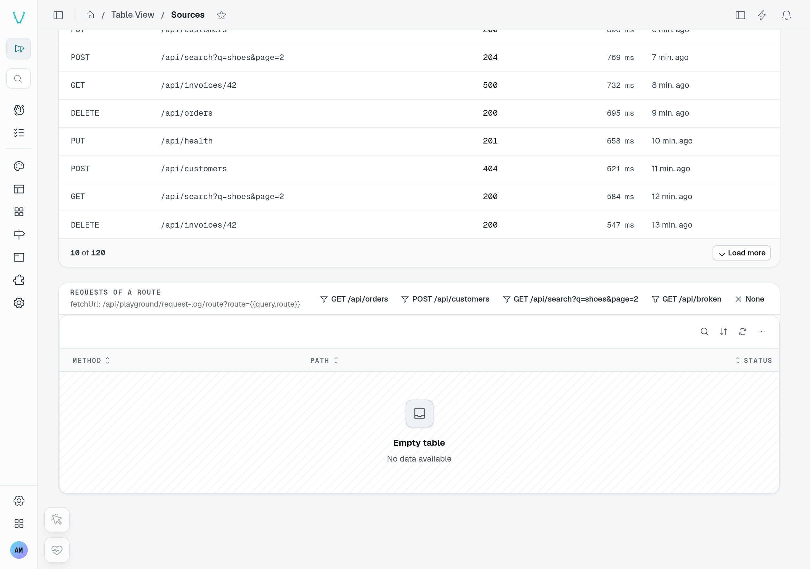

# Source tables

`TableView.fromSource(options)` lists the rows a module's own route answers, with **no data controller** behind them: an external API's logs, a database query result, a report. The table looks and behaves like any table view — columns drawn by their data types and [cell displays](/docs/components/tables/cell-displays), search, sort, tabs, quick filters, pagination, custom row actions and buttons — but it is **read-only**: there are no built-in forms, no export, no realtime and no footer summaries.



The playground's **Sources** page reads a request log from a custom endpoint. The **Load more** control pages through its 120 demo requests; it does not need a data controller.



The second table is empty until you choose a route. Its deliberately failing route demonstrates the separate [error state](/docs/components/tables/empty-states).

## Usage

```ts [src/pages/request-log.ts]
static requests = TableView.fromSource({
  caption: "Request log",
  fetchUrl: "/api/request-log",
  capabilities: { filter: true },
  pagination: "loadMore",
  columns: {
    method: { name: "Method", type: new DefaultDataTypes.StringType(), display: new DefaultDisplays.MonoDisplay(), sortable: true, order: 1 },
    status: { name: "Status", type: new DefaultDataTypes.NumberType(), sortable: true, order: 2 },
    durationMs: { name: "Duration", type: new DefaultDataTypes.NumberType(), display: new DefaultDisplays.DurationDisplay(), sortable: true, order: 3 },
  },
  tabs: [
    { id: "get", label: "GET", filter: { accessorKey: "method", mode: "is", value: "GET" } },
    { id: "post", label: "POST", filter: { accessorKey: "method", mode: "is", value: "POST" } },
  ],
});
```

```ts [src/controllers/request-log.ts]
export class RequestLogController extends Controller("/api/request-log") {
  @Get("/")
  list(@Context() ctx: RequestContext) {
    const method = ctx.url.searchParams.get("filter_method")?.replace(/^is:/, "");
    const rows = method ? entries.filter((entry) => entry.method === method) : entries;
    return { results: rows, total: rows.length };
  }
}
```

## Options

| Option         | Type                                     | Default | Purpose                                                                                                     |
| -------------- | ---------------------------------------- | ------- | ----------------------------------------------------------------------------------------------------------- |
| `fetchUrl`     | `string`                                 | required | Route answering `{ results, total }` for the list query. Accepts `{{params.X}}` / `{{query.X}}` (below).    |
| `fetchRowUrl`  | `string`                                 | —        | Route answering one row by id, `{{row.id}}` its id (percent-encoded), with the same tokens as `fetchUrl`, e.g. `"/api/request-log/{{row.id}}"`. A deep link to a row the table does not list opens through it (see [below](#reading-one-row)). |
| `columns`      | `Record<string, TableViewSourceColumn>`  | required | The columns, keyed by row field, in their `order`.                                                          |
| `rowIdKey`     | `string`                                 | `"_id"` | Field holding a row's id.                                                                                   |
| `periodScope`  | `string`                                 | —       | Id of the `PeriodSelector` the rows follow: the route is sent its period (below).                           |
| `capabilities` | `TableViewSourceCapabilities`            | `{}`    | What the route does with the list query; the browser does the rest (below).                                 |
| `rowActions`   | `{ custom?, hasSelection?, menuLabel? }` | —       | Custom row actions only (a drawer, a route), the selection column, and the name of the row's ⋯ button.      |
| `footer`       | `{ countLabel?, hint?, legend? }`        | —       | The footer's texts and legend; summaries need a data controller.                                            |

A source table also takes these table view options, with their usual meaning: `caption`, `layout`, `density`, `maxHeight`, `rowClick`, `pageSize`, [`pagination`](/docs/components/tables/pagination), `emptyStates`, `searchPlaceholder`, `searchShortcut`, `labelKey`, `customButtons`, `displays`, `defaultDisplay`, [`card`](/docs/components/tables/cards), `expandable`, `tabs`, `quickFilters`, [`queryParamFilters`](/docs/components/tables#tableview-options), `defaultSort` and [`pinnedRows`](/docs/components/tables#pinned-rows). Views, the grouped and kanban displays, `reorder` and the other options that write or need a data controller are not available. Registration runs the checks `TableView()` runs on those options — the `pageSize` range, display ids and the `defaultDisplay`, a tab giving both `filter` and `to` — plus its own: tabs, quick filters and `queryParamFilters` need `capabilities.filter`, and every column they, `labelKey`, `card.fields` and `expandable` name must be declared. `expandable.lazyLoad` is refused: a source has no `get` route to read a row from. A `fetchRowUrl` without `{{row.id}}` is refused too. A quick filter on a column with no values to pick (a free-text column, say) is refused too: see [Quick filters](/docs/components/tables#quick-filters).

A column takes a `@Column`'s options — `name`, `description`, `type`, `order`, `isVisible`, `filterable`, `cellWrap`, `size`, `display` — plus `sortable: true` to let the rows be sorted on it.

## The route

The route receives the part of the list query its `capabilities` name, and nothing else: the parameters of a capability it does not declare, and any parameter no capability names, are left out:

| Capability | Query parameters                         | The route…                                       |
| ---------- | ---------------------------------------- | ------------------------------------------------ |
| `search`   | `search`                                 | narrows its rows on the text.                    |
| `sort`     | `sortKey`, `sortDirection` (`asc`/`desc`) | sorts its rows.                                  |
| `paginate` | `offset`, `limit`                        | answers one page; `total` counts every matching row. |
| `filter`   | `filter_<column>=<mode>:<value>`         | applies column filters (`filter_method=is:GET`). |

A link narrows a source table with `queryParamFilters`, as any table: `{ route: { field: "route", mode: "is" } }` sends `filter_route=is:<value>` to the route while the page URL carries `?route=<value>`. The filter is hidden, counts as one in the empty state, and needs `capabilities.filter`; its `field` need not be a column, since the route alone applies it.

One parameter reaches the route whatever its capabilities: `liveHeldAt`, an ISO 8601 date, sent while the table is held (`liveHold` on a paused [live page](/docs/building/pages-and-components#live-pages-direct-and-pause)). A route that reads it answers the rows as they stood at that moment, so the user's search, sort and pagination do not bring in what arrived since; a route that ignores it lists as usual.

It answers `{ results, total }`. The request carries the caller's session like any dashboard request, so the route reads the user with `@AuthUser()` and checks their rights itself.

What the route does not handle, the browser does over the rows it answered:

- **A route that does not page** answers every matching row. The browser then searches the listed columns' text, sorts on one column and pages, so search and sort are always offered.
- **A route that pages** is taken as it answers: the browser cannot search or sort rows it never received, so the table offers the search box only with `capabilities.search` and sortable headers only with `capabilities.sort`.
- **Filters** are never applied by the browser. A `filterable` column gets a filter only with `capabilities.filter`, and tabs, quick filters and `queryParamFilters` need it too: registration throws otherwise, and for a tab, a quick filter, a `labelKey`, a card field or an expandable field naming an unknown column.

Tab counters ask the route once per tab (`limit=1`) and read its `total`.

**The period of a selector.** With `periodScope`, the table follows a [`PeriodSelector`](/docs/components/charts-and-widgets/period-selector) like a chart: each request, tab counters included, carries `from`, `to`, `preset` and `comparison` (plus `compareFrom` / `compareTo` while a comparison is on), as ISO dates, and the table lists again when the period changes. Until the selector is on the page, nothing is requested and the table keeps its skeleton.

```ts
static payouts = TableView.fromSource({
  caption: "Payouts",
  fetchUrl: "/api/payouts",
  periodScope: "page",
  columns: { amount: { name: "Amount", type: new DefaultDataTypes.NumberType(), sortable: true } },
});
```

**The record of the page.** `fetchUrl` may name the page the table is on, like a [display block's](/docs/components/block-fundamentals#blocks-that-read-their-data): `{{params.X}}` is filled with the route parameter `X` of the page URL (`{{params.id:1}}` for the first of a repeated name), `{{query.X}}` with its query parameter `X`, both percent-encoded. The table and its tab counters list again when the page URL changes them, and request nothing while a token has no value: the table shows its empty state.

```ts
static languages = TableView.fromSource({
  fetchUrl: "/api/lang/workspaces/{{params.id}}/languages",
  columns: { code: { name: "Code", type: new DefaultDataTypes.StringType(), order: 1 } },
});
```

## Limits

- Row actions are custom ones only: a drawer component, a page, an API route. The built-in add, edit, duplicate, details, delete and copy-link are never offered.
- No export, no footer `summary`, and no realtime beyond a `realtimeTopic` the module publishes on.
- `navBadge` on a tab publishes nothing: there is no data controller to count with.
- The table declares one permission, `list`, like any table view; custom buttons and row actions take a `permission` or `permissionId` as usual, and only hide what the caller lacks — the route still decides what it answers.

## Reading one row

A row action with `deepLink` keeps the open row in the URL (`?record=<id>`, see [Row drawers](/docs/components/tables/row-drawers#deep-links)). A source table finds that row among the rows it lists, once they arrived; a link to an older row — beyond the first page, or filtered out — opens only if the source can read one row by id: `fetchRowUrl`.

```ts [src/pages/requests.ts]
TableView.fromSource({
  fetchUrl: "/api/request-log",
  fetchRowUrl: "/api/request-log/{{row.id}}",
  // …
});
```

`{{row.id}}` is the row's id, percent-encoded; `{{params.X}}` and `{{query.X}}` are filled as in `fetchUrl`. The route answers the row itself, as the list answers it; an error (a 404, the row is gone) opens nothing. A row read this way is not among the rows shown: its drawer or side panel opens without its position, and J / K step from the next row the user opens from the list. Without `fetchRowUrl`, a deep link opens only a listed row, as before.
