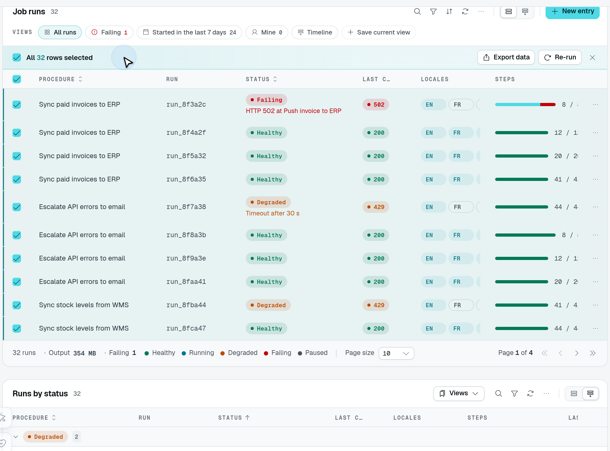
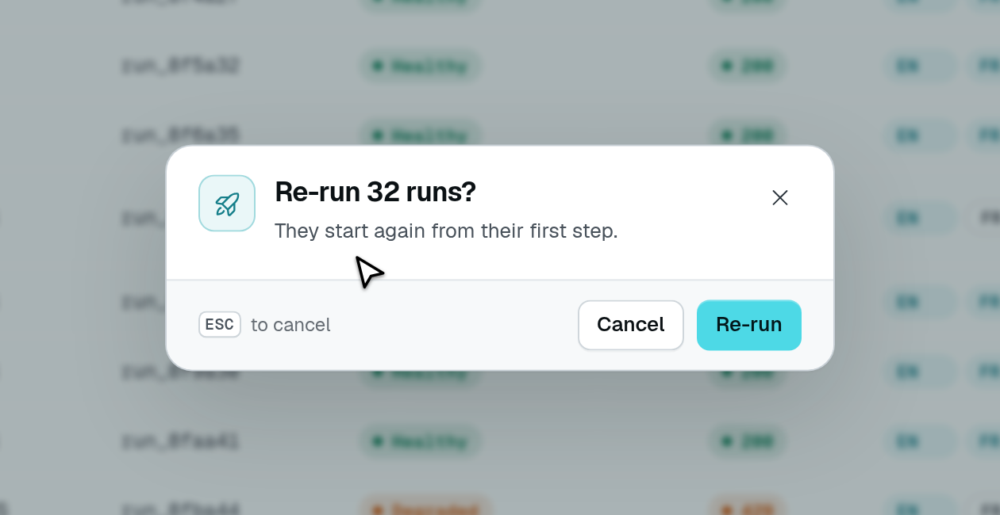

# Bulk actions

With `rowActions.hasSelection`, each row gets a checkbox, and selecting rows opens the **selection bar**. The bar carries the built-in actions that run on several rows at once — delete, and archive / restore in [archive mode](/docs/components/tables#archive-mode) — the export of the selection, and every custom row action flagged `bulk`.



Select the page, then choose **Select all 32 matching**. The selection bar explicitly changes to **All 32 rows selected**; the page size remains ten.



The playground's **Re-run** action confirms that wider selection. This capture stops before execution; **Cancel** leaves the rows unchanged.

```ts fragment [src/pages/runs.ts]
static runs = TableView(jobRunDataAPI, {
  caption: "Runs",
  rowActions: {
    hasSelection: true,
    delete: { isEnabled: true, successMessage: "$runs.deleted" }, // "{count} runs deleted"
    custom: [
      {
        label: "Re-run",
        icon: "i-ph-arrow-clockwise",
        bulk: { allMatching: true },
        confirm: { title: "$runs.rerun_title" }, // "Re-run {count} runs?"
        target: { type: "api", url: "/api/runs/rerun", successMessage: "$runs.rerun_done" },
      },
    ],
  },
});
```

## Custom actions on the selection

`bulk` offers a custom row action on the selection bar. It runs **once** for the selected rows, and what it receives depends on its target:

| Target                                  | Receives                                                                     |
| --------------------------------------- | ---------------------------------------------------------------------------- |
| `api`, `exportJob`, `page`, `external`, `download` | The ids in its URL, as a repeated query parameter: `?ids=a&ids=b`.           |
| `drawer`, `modal`                       | A `selection` prop, `{ ids, count }`, instead of a row (`rowData` is unset). |

The texts of a fixed confirmation and the `successMessage` of an `api` target receive `{ count }`, and an i18n key is pluralized on it. The confirmation counts the selected rows; the success message counts the rows the route says it changed — a response `{ count: n }` or a bare number — and the selected rows when the route answers without a count. A route that skips some of the rows (already resolved, refused by a rule) returns its own count so the message does not claim them. A `confirm: { from }` URL gets the same `ids` query as the target. The action's `rule` does not apply on the bar: the route decides which of the rows it acts on.

| Value                      | Offered on the selection bar for                                                         |
| -------------------------- | ---------------------------------------------------------------------------------------- |
| `bulk: true`               | The selected rows.                                                                       |
| `bulk: { allMatching: true }` | The selected rows, and every row the table's filters match once the user picks "Select all N matching". |

A `bulk` action is still offered on each row as well, where its `rule` applies. There it runs on that one row the way the bar runs on several: a URL target, and a `confirm: { from }` URL, receive the row's id (read through the table's `rowIdKey`) as `?ids=<id>`, so one route serves both; a drawer, modal or side panel receives the row as `rowData`, and the selection of that row as `selection: { ids: [id], count: 1 }`, so a component written for the bar opens on the row too. Its confirmation's texts, and the `successMessage` of a URL target, receive the row's fields with `{ count: 1 }`, so a key pluralized on `count` reads in the singular ("Resolve this ticket?"). A URL naming a row field itself (`/api/runs/{{row._id}}/rerun`) is filled from the row instead, and gets no `ids`.

On the bar there is no row to fill a `{{row.X}}` token with: a query pair whose value is one is left out, as a page token the page has no value for is, and any other is left empty. `?ids={{row._id}}` thus sends the row's id from a row and the selection's ids from the bar.

## Select all N matching

Once the whole page is selected and more rows match than the page shows, the bar offers **Select all N matching** — when the table has at least one `allMatching` action, or when the caller may export. After that pick, the bar keeps only the `allMatching` actions and the export (which then exports the whole query); the built-in delete, archive and restore are not offered.

An `allMatching` action does not receive ids: it is sent `allMatching=true` with the table's current filters, search and archive view, and a drawer or modal receives `selection.matching` (the list query) and `selection.count`. The selection — and "all matching" with it — is dropped when the filters, the search or the tab change; paging and sorting keep the selected rows, and a new sort also drops "all matching".

## The route: `resolveBulkRowIds`

A bulk route on the table's data controller reads its rows with `resolveBulkRowIds(this, ctx, user)` (from `@antelopejs/interface-dms/base/table-view`). It returns the `ids` the selection sent, or, for `allMatching=true`, every row the filters, search and archive view match, read like the list reads them. Either way it refuses (403) a caller without the table's `list` permission.

```ts fragment [src/data/job-runs.ts]
import { Context, Post, type RequestContext } from "@antelopejs/interface-api";
import { AuthUser } from "@antelopejs/interface-dms/auth";
import type { User } from "@antelopejs/interface-dms/auth/db";
import { resolveBulkRowIds } from "@antelopejs/interface-dms/base/table-view";

@Post("rerun")
async rerun(
  @Context() ctx: RequestContext,
  @AuthUser() user: User,
) {
  const ids = await resolveBulkRowIds(this, ctx, user);
  await Promise.all(ids.map((id) => this.model.update(id, { status: "running" })));
  return { count: ids.length }; // the rows changed: "{count} runs re-run"
}
```

A route that is not on the table's data controller — a route of the page carrying the table, or of another controller — passes a `BulkRowSource` instead of `this`: the model its own controller is given for the request, and the table's `TableViewMeta`. No controller instance is built for it, and the caller still needs the table's `list` permission. A filter or a locked field that reads another property of the data controller throws, naming it: resolve that selection from a route of the data controller.

```ts fragment [src/pages/job-runs.ts]
@Model(JobRunModel)
declare jobRuns: JobRunModel;

@Post("rerun")
async rerun(@Context() ctx: RequestContext, @AuthUser() user: User) {
  const tableView = GetMetadata(JobRunDataAPI, TableViewMeta);
  const ids = await resolveBulkRowIds({ model: this.jobRuns, tableView }, ctx, user);
  // …
}
```

At most `MAX_BULK_MATCHING_ROWS` (10,000) matching rows are resolved; above that, the route answers **413** and asks the user to narrow the filters.

::note
`resolveBulkRowIds` only finds the rows, and checks only `list`. Like any route a custom action calls, the bulk route checks the permission of the action itself (`@AuthUserWithPermission(...)` from `@antelopejs/interface-dms/guards`): a `permission` on the action only hides it.
::

## Built-in bulk actions

Delete, archive and restore run on the selection through the controller's own routes (`DELETE <location>/delete?id=…`, `PUT <location>/archive?ids=…`, `PUT <location>/restore?ids=…`). Their `RowActionConfig` (`BulkRowActionConfig`) takes a `successMessage`, toasted once they succeeded and receiving `{ count }`. Delete and archive always ask a confirmation; restore asks only when it declares one (see [Confirmations](/docs/components/tables/confirmations)). Rows a row rule refuses are left out by the server: the dialog says how many went through and why the rest did not.
