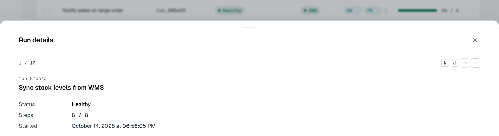
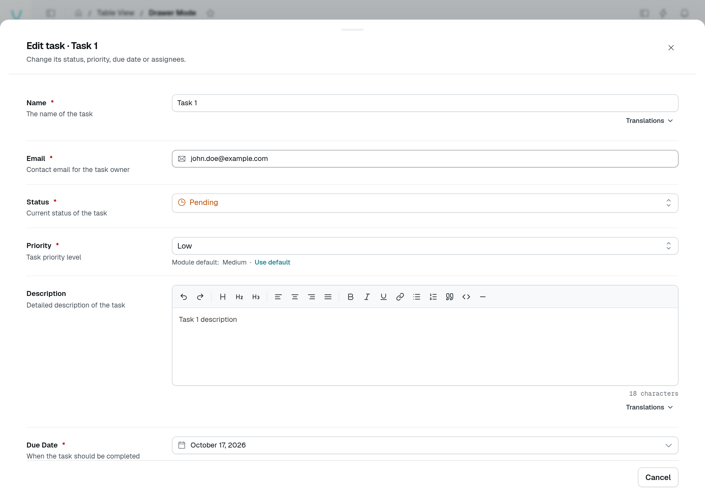
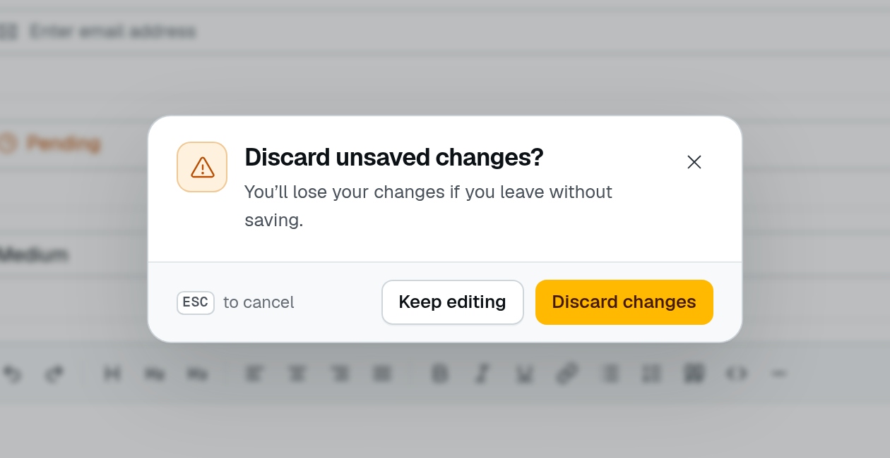

# Row drawers

A detail drawer — an API request, an automation run, a sent email — is a custom row action whose target opens a component of your frontend layer in a `drawer`, a `modal` or a [`sidePanel`](#side-panel). The table hands that component the row, and the means to step to the neighbouring rows; `deepLink` keeps the open row in the URL.



Open **Run details** on the playground's **Views & grouped display** page. The drawer shows the selected run without leaving the table. Pressing **J** advances to the next row and changes `runs.record` in the URL; **K** goes back.





The separate **Drawer Mode** playground page uses the built-in CRUD form, rather than a custom run-details component. Opening **New entry**, changing its name and closing it asks whether to keep editing or discard the unsaved changes.

```ts [src/pages/runs.ts]
rowActions: {
  custom: [
    {
      label: "Run details",
      icon: "i-ph-sidebar-simple",
      isDefault: true, // a click on the row opens it
      deepLink: true,  // ?record=<id>
      target: {
        type: "drawer",
        component: CustomComponent("RunDetailsDrawer"),
        title: "Run details",
      },
    },
  ],
},
```

The drawer slides in from the bottom. `direction: "right"` (or `"left"`, `"top"`) opens it from that edge instead: a left or right drawer is a side sheet 440px wide, a side panel's default width, spanning the window's height — the shape of an inspector or a detail panel.

`isDefault: true` makes the action what a click on the row does, ahead of the built-in edit and details. The first flagged action whose `rule` accepts the row wins.

## The component's props

The component receives the target's own component options, plus:

| Prop                | Type                                     | Purpose                                                                                   |
| ------------------- | ---------------------------------------- | ----------------------------------------------------------------------------------------- |
| `rowData`           | `object`                                 | The row, as the list returned it.                                                         |
| `navigation`        | `RowNavigation \| undefined`             | Steps through the rows the table shows (below). Unset when the row is not among them.    |
| `showRow`           | `(row: object \| string) => Promise<void>` | Shows another row of the same table in place, by row or by id ([below](#showing-another-row)). |
| `onSuccessCallback` | `() => void`                             | Closes the container and refreshes the table, for a component that changed the row.      |
| `pageId`, `componentId`, `containerId` | `string`              | Where the container belongs.                                                              |

`RowNavigation` is `{ index, total, hasPrev, hasNext, prev(), next() }`: `index` is the row's position among the rows the table shows (from 0), `total` their number. `prev()` and `next()` show the neighbouring row **in place**: the drawer or modal stays open, its component is mounted again with the new `rowData` and `navigation`. **J** and **K** do the same while the container is open, unless the user types in a field.

```vue [app/components/RunDetailsDrawer.vue]
<script setup lang="ts">
interface RowNavigation {
  index: number;
  total: number;
  hasPrev: boolean;
  hasNext: boolean;
  prev: () => void;
  next: () => void;
}

const props = defineProps<{ rowData?: { name?: string }; navigation?: RowNavigation }>();
</script>

<template>
  <div v-if="props.navigation" class="flex items-center gap-1">
    <span>{{ props.navigation.index + 1 }} / {{ props.navigation.total }}</span>
    <UButton icon="i-ph-caret-up" :disabled="!props.navigation.hasPrev" @click="props.navigation.prev()" />
    <UButton icon="i-ph-caret-down" :disabled="!props.navigation.hasNext" @click="props.navigation.next()" />
  </div>
  <h3>{{ props.rowData?.name }}</h3>
</template>
```

The steps follow the rows on screen — the current page, in the current sort — not the whole query.

### Showing another row

A component that links to another row of the same table — a send and the send it replays, an order and its refund — calls `showRow` with that row, or its id, rather than drawing it on its own. The container shows it **in place**, exactly as a step does: its component is mounted again with the new `rowData` and `navigation`, the URL's `?record=` names it on a deep-linked action, and a side panel moves its header's position and the table's highlight onto it.

An id is looked up among the rows the table shows, else read through the controller's `get` route — on a `TableView.fromSource` table, its [`fetchRowUrl`](/docs/components/tables/source-tables#reading-one-row) — as a [deep link](#deep-links) is. A row the table does not list opens without `navigation`: the side panel then shows no position, and J / K wait until a listed row is open. When the route answers 404, a side panel shows its [not-found state](#side-panel); otherwise — a drawer or a modal on a missing row, a refused read, a source table without `fetchRowUrl` — the promise rejects and the container keeps the row it had.

```vue [app/components/SendPanel.vue]
<script setup lang="ts">
const props = defineProps<{
  rowData?: { replayOf?: string };
  showRow?: (row: object | string) => Promise<void>;
}>();
const toast = useToast();

const openReplayed = (id: string) =>
  props.showRow?.(id).catch(() => toast.add({ color: "error", title: "This send could not be opened" }));
</script>

<template>
  <UButton v-if="props.rowData?.replayOf" label="See the original send" @click="openReplayed(props.rowData.replayOf)" />
</template>
```

## Deep links

With `deepLink: true`, the open row is written to the URL while its container is open: `?record=<id>`, or `?<tableId>.record=<id>` on a page carrying several table views (`tableId` being the key the table view is mounted under). Opening that URL — a link, a reload, a notification — opens the action again on that row. A row the page does not list is read through the controller's `get` route — on a `TableView.fromSource` table, through its [`fetchRowUrl`](/docs/components/tables/source-tables#reading-one-row) — and then opens without `navigation`. A table restores the first of its custom actions declaring `deepLink` — or opening a side panel, which keeps the row in the URL by default. A visit that keeps the page mounted — a link to the same page naming another row, or the same row again once its container closed — opens that row too, as a fresh load would; a link to the row already open opens nothing more.

When no row answers the link — the row was deleted, or a source table has no `fetchRowUrl` to read a row it does not list — the table removes the key from the URL and shows a warning toast, "This entry is no longer available". A side panel target shows that state in the panel instead (see [Side panel](#side-panel)). When the read fails for another reason — the route refused it, the network, a server error — the row may still exist: the table removes the key too, but says "This entry could not be opened" instead, for every target.

## Side panel

A drawer covers the list. To read the rows one after the other next to the table — a request log, a run history — open them in a `sidePanel` instead: a non-modal panel docked on the right of the page, which shrinks to make room and stays usable. The DMS draws the panel's header, so the component only renders the row:

- the action's title — or, with `rowTitle`, a title naming the open row: an i18n key or a literal receiving the row's fields, as a confirmation's texts do (`"{method} {path}"` reads "POST /api/orders");
- the row's position among the rows the table shows, "3 of 20" by default — `positionLabel` words it, an i18n key receiving `{index}` (from 1) and `{total}`;
- previous and next buttons, and **J** / **K**;
- a close button, and **Escape** (once the table has no search or selection to clear).

J, K and Escape are listed in the shortcuts help, under the table view.

```ts [src/pages/requests.ts]
TableView.fromSource({
  fetchUrl: "/api/requests",
  columns: { method: { label: "Method" }, path: { label: "Path" } },
  rowClick: "single", // one click opens the row
  rowActions: {
    custom: [
      {
        label: "Request",
        isDefault: true,
        target: {
          type: "sidePanel",
          component: CustomComponent("RequestPanel"),
          title: "$api.request.title",
          rowTitle: "$api.request.heading", // "{method} {path}"
          positionLabel: "$api.request.position", // "Request {index} of {total} shown"
          notFound: {
            title: "$api.request.not_found_title", // "This request is no longer stored"
            description: "$api.request.not_found_description",
          },
          // ?record=<id> by default; deepLink: false opts out
        },
      },
    ],
  },
});
```

```vue [app/components/RequestPanel.vue]
<script setup lang="ts">
const props = defineProps<{ rowData?: { method?: string; path?: string } }>();
</script>

<template>
  <dl>
    <dt>Method</dt>
    <dd>{{ props.rowData?.method }}</dd>
    <dt>Path</dt>
    <dd>{{ props.rowData?.path }}</dd>
  </dl>
</template>
```

The component receives the same props as a drawer's ([above](#the-components-props)) and is mounted anew on each row; `onSuccessCallback` closes the panel and refreshes the table. Moving to another row swaps the content in place, and the table highlights the open row: the accent tint of a selected row, with a 2px accent bar on its leading edge. The position follows the rows on screen: a refresh that moves the row updates it, and a row no longer listed shows without it.

A side panel keeps the open row in the URL by default, as a drawer with `deepLink` does — `deepLink: false` on the target or the action opts out: a reload or a shared link opens the panel again on that row, and closing it removes the key — the key of that row on that page only, so a panel closing as the user follows a link leaves the next page's `?record=` alone. A `TableView.fromSource` table reads that row among the rows it lists, once they arrived, else through its `fetchRowUrl`: the panel then shows the row without its position, and J / K wait until a listed row is open.

When that read answers 404 — a row deleted, pruned by a retention, a link with a wrong id — the panel still opens, under the target's `title`, and says the row is gone in place of the component: "This entry is no longer available", with a **Close** button that also removes the `?record=` key. `notFound: { title, description }` words it in the module's terms (i18n keys or literals). Any other failure (a refusal, the network) opens nothing and shows the "could not be opened" toast described [above](#deep-links).

One side panel is open at a time: the row panel closes a module's side panel ([Dashboard chrome](/docs/extending-the-dashboard/dashboard-chrome#side-panels-docked)), and the other way round. It closes with its table, when the user leaves the page. Below `lg`, it is a sheet over the page. A side panel cookie naming it after a reload shows nothing until a row opens.

A custom toolbar or header button can open a `sidePanel` too: its component then receives no row, and the header has no position.

## Row click

A double-click on a row runs its click action — the `isDefault` custom action, else edit or details. `rowClick: "single"`, on `TableView` and `TableView.fromSource`, makes it a single click, the way a list read in a side panel expects. A click on a control of the row (a button, a link, the selection checkbox, the row menu) stays that control's, and a click ending a text selection opens nothing. Without the option, a table keeps the double-click.

## Bulk actions in a drawer

A `bulk` action whose target is a drawer, a modal or a side panel receives a `selection` prop instead of `rowData` and `navigation`: see [Bulk actions](/docs/components/tables/bulk-actions).
