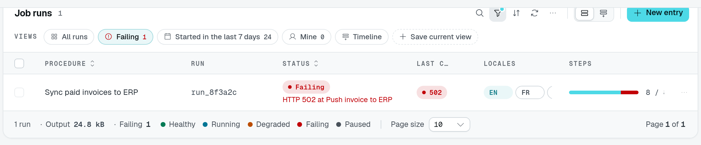

The footer band of a table view shows how many rows the table lists. `footer` words that count, adds a hint, figures the server computes over the listed rows — a total, a count of failures — and a legend of a select column's colors.

Every table view lays the band out the same way, left to right: the row count, a rule and the page size picker, then the summaries (each after a `·`) and the legend; the hint and the pager close it on the right. On a narrow screen the count and the page size stay together on the first line, and the rest wraps below them.



The playground's **Failing** view narrows the dataset to one run. Its footer shows that run's output, the failure count and the status legend. Compare the [unfiltered paginated view](/docs/components/tables/pagination#pages), whose footer covers all 32 runs even while only ten are displayed.

```ts fragment [src/pages/subscriptions.ts]
static subscriptions = TableView(subscriptionDataAPI, {
  caption: "Subscriptions",
  footer: {
    countLabel: "$billing.subscriptions.count", // "{count} subscriptions"
    summary: [
      { label: "MRR", field: "mrr", op: "sum" },
      { label: "Past due", op: "count", where: { field: "status", equals: "past_due" } },
    ],
    legend: "status",
  },
});
```

## Options

`TableViewFooterOptions`:

| Option       | Type                       | Purpose                                                                                       |
| ------------ | -------------------------- | --------------------------------------------------------------------------------------------- |
| `countLabel` | `string`                   | Row count text: an i18n key (`$`) receiving `{ count }`, pluralized on it. Defaults to "{count} items". |
| `hint`       | `string`                   | A hint right of the count (`$`: i18n key).                                                    |
| `summary`    | `TableViewFooterSummary[]` | Figures after the page size picker (below).                                                   |
| `legend`     | `string`                   | A `SelectType` column whose items, with their colors, the footer lists. Registration throws for another column. |

A summary, `TableViewFooterSummary`:

| Field    | Type                     | Purpose                                                                                                   |
| -------- | ------------------------ | --------------------------------------------------------------------------------------------------------- |
| `label`  | `string`                 | Shown before the figure (`$`: i18n key).                                                                  |
| `op`     | `"sum" \| "count"`       | Sum a column, or count rows.                                                                              |
| `field`  | `string`                 | The column summed; required by `sum`.                                                                     |
| `where`  | `RowActionRule`          | Only the rows this rule accepts are summed or counted. The [row action rule](/docs/components/tables#row-actions) grammar: `equals`, `notEquals`, `in`, `notIn`, combined with `and`, `or`, `not`. |
| `format` | `TableViewSummaryFormat` | `Intl.NumberFormat` options: `style` (`decimal`, `percent`, `currency`), `currency`, `notation` (`standard`, `compact`), `minimumFractionDigits`, `maximumFractionDigits`. |

Without `format`, a sum reads like its column's cells (a price as a price) and a count as a whole number. Registration throws for a `sum` without `field`, for a `field` or a `where` naming an unknown column, and for a malformed `where` rule: an `and` or `or` operand that is not an array of rules, a `not` operand that is not a rule, an `in` or `notIn` operand that is not an array, or a nested rule that is not an object. Only the operator the rule dispatches on is checked (`and`, `or`, `not` first, then the first of `equals`, `notEquals`, `in`, `notIn`).

A `where` operand is checked when a summary is requested, not at registration: a value that is not plain data (a `bigint`, a `symbol`, a function, a `Map`, a class instance or a cyclic structure) makes the summary request throw `Malformed row rule`. Strings, numbers, booleans, `null`, dates, and lists or plain objects of those are accepted.

## How the figures are computed

The figures cover **every row the table lists** — its filters, search and tab — not only the page on screen. The server computes them in the database: `where` reads the stored fields of a row, and it never leaves the server (the client only knows a summary by an id).

They are served by the controller's `summary` route, `GET <location>/summary?ids=<id>`, which computes only the summaries a table view declared, with the caller's `list` permission. `TableViewRoutes.All` includes it; a controller listing its routes one by one mounts it itself:

```ts fragment [src/data/subscriptions.ts]
DataController(
  Subscription,
  {
    get: TableViewRoutes.Get,
    list: TableViewRoutes.List,
    countBatch: TableViewRoutes.CountBatch,
    summary: TableViewRoutes.Summary,
  },
  Controller("/api/subscriptions"),
)
```

A table view declaring summaries over a controller that mounts no `GET summary` route logs a warning at registration, and its figures do not show.

A [`TableView.fromSource`](/docs/components/tables/source-tables) table takes `countLabel`, `hint` and `legend`, but no `summary`: there is no data controller to compute it.
