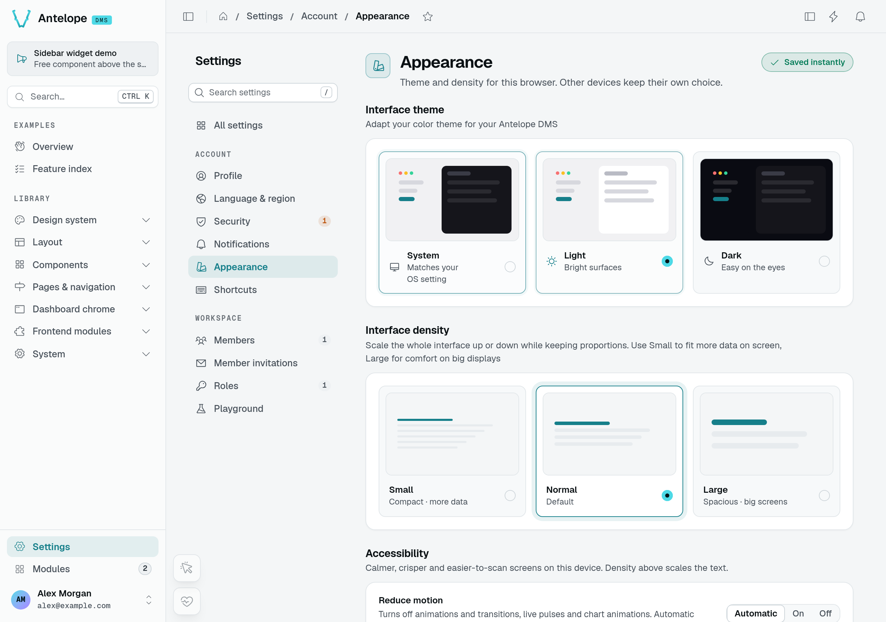
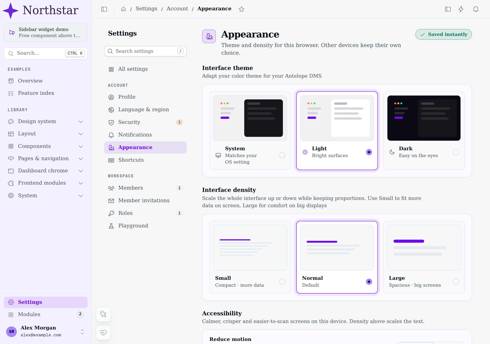
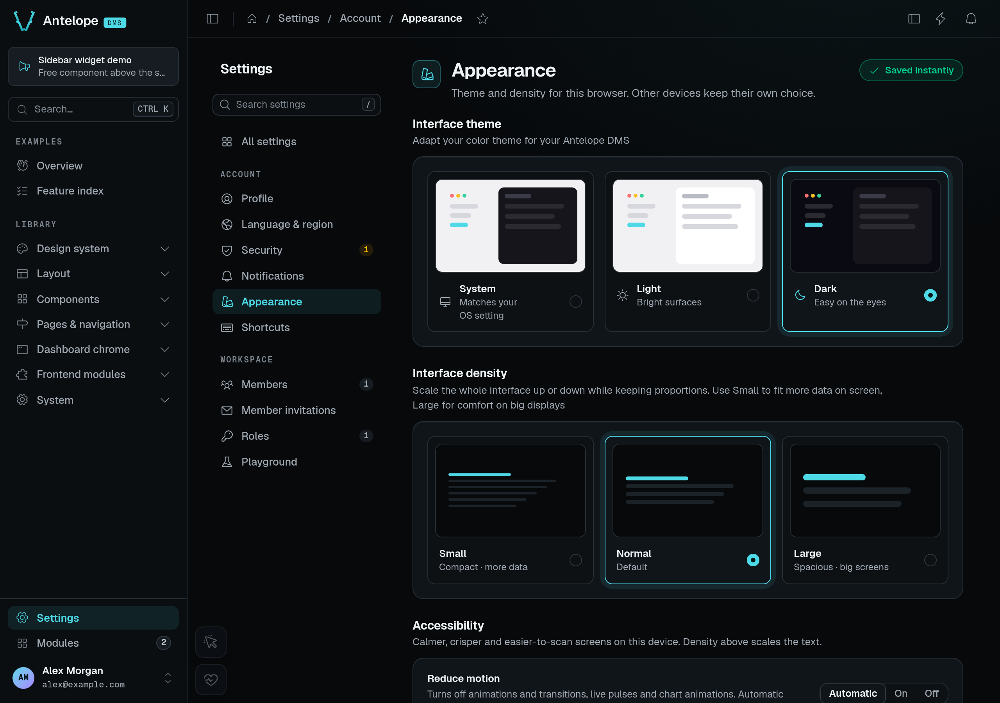
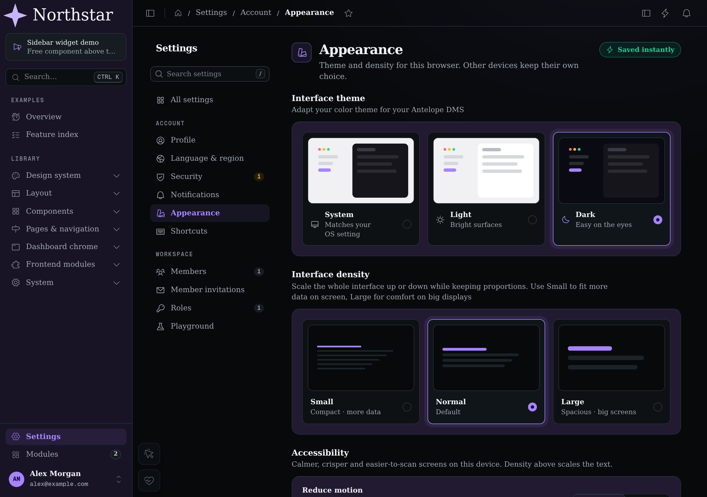
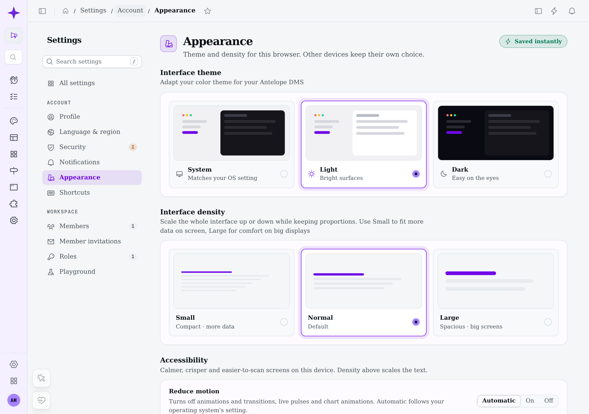
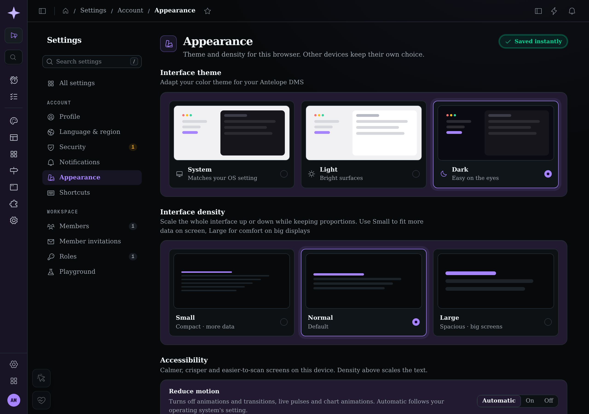
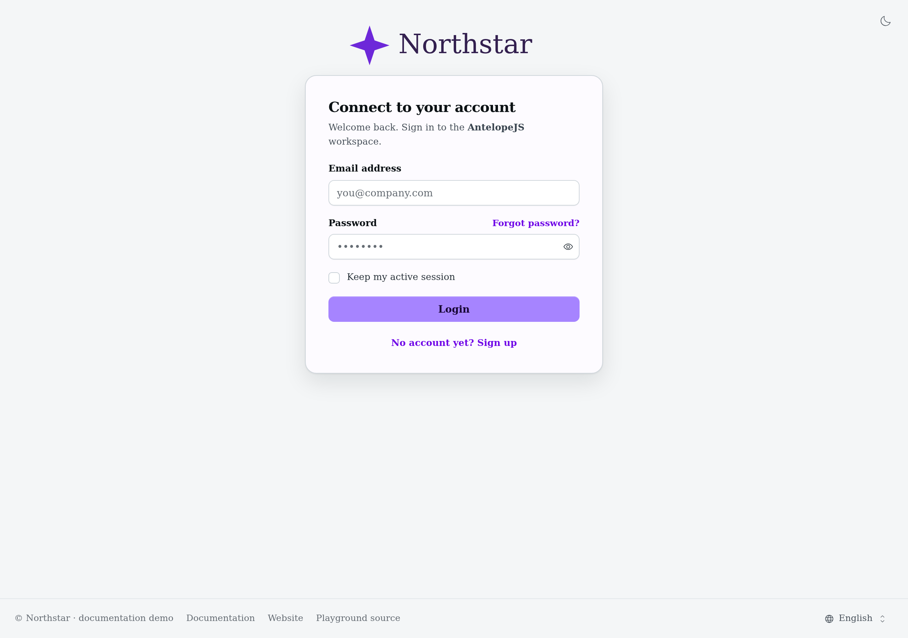
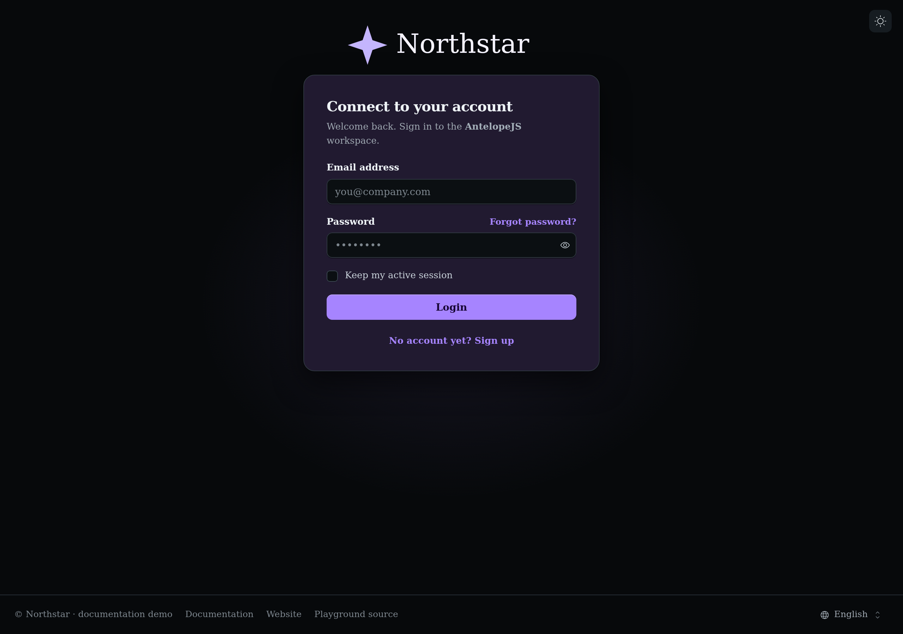
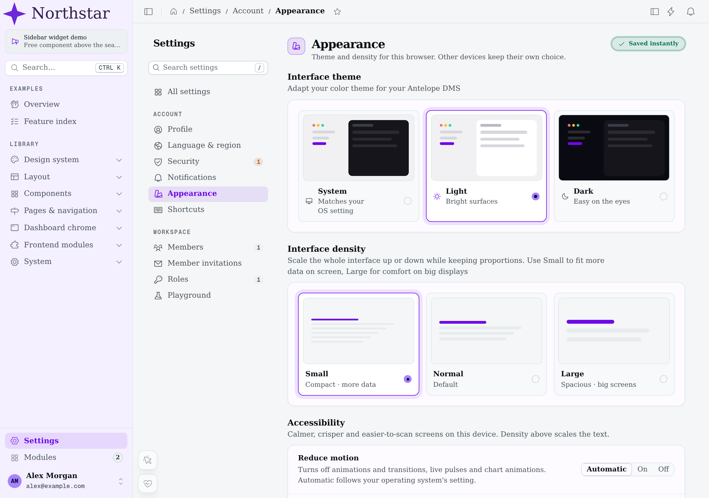
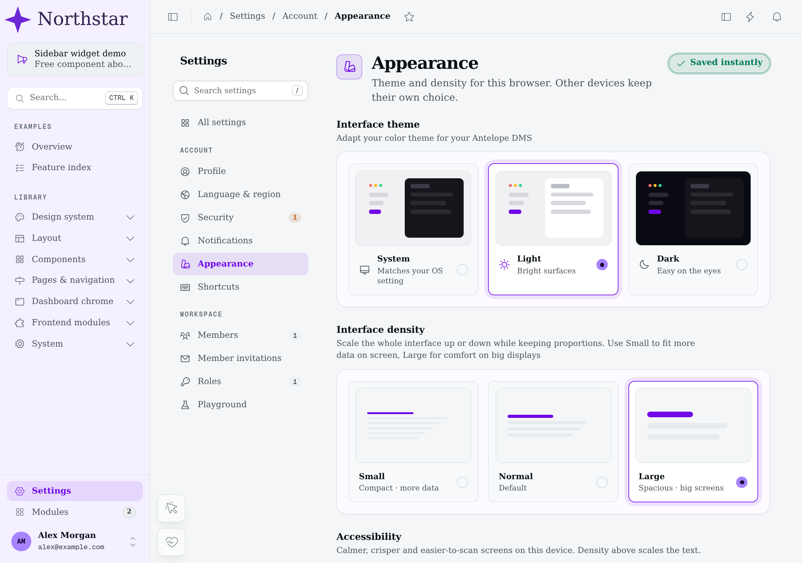

# Theming & branding

The dashboard's look is driven by **app config** and **CSS design tokens**, both of which your frontend layer can override — no component forking required. The surfaces below are ordered by how often you'll touch them: the logo, the colors, deeper token overrides, and the sizing system.

Everything here lives in a [frontend layer](/docs/building/frontend-layer). Values merge across layers; if an override doesn't take effect, make your layer win precedence the same way as a component override — a **higher** `priority` on `AddFrontendModule`, such as `1` above DMS at `0` ([Frontend layer](/docs/building/frontend-layer#overriding-an-existing-component)).

The loader applies a layer's `app/app.config.ts` on its own (`@antelopejs/dms-frontend` 0.6.0 or later): it merges every layer's file, in priority order, into `useDmsAppConfig()` before any module's `setup` runs, hands the same config to the email renderer, and applies an edit in development without a restart. The entry, `dms.frontend.ts`, neither imports nor merges it.

## A running branding example

Compare the same **Appearance** page at normal density, first with the DMS defaults, then with a **Northstar** demonstration layer. The layer supplies light/dark logos, maps `primary` to `violet`, gives the sidebar mode-specific surface colors, and sets a `Georgia, serif` font stack through CSS tokens. On this Linux browser, the font falls back to an installed serif. Northstar is an example, not a built-in theme; it changes configuration without replacing the page or its components.









The settings text still names Antelope DMS: logo and token overrides do not rewrite application copy. The captures intentionally keep that distinction visible.

## Your logo

The shell reads its logos from `appConfig.branding.logo`, one slot per place a logo is drawn, each with a light and a dark asset. Override the slots in your layer's `app.config.ts` and ship the files in your layer's `public/` directory. A slot you leave out keeps the DMS's, and so does a file: give both `light` and `dark` of a slot you override.

```ts [frontend-vue/app/app.config.ts]
export default defineDmsAppConfig({
  branding: {
    logo: {
      default: {
        light: "/branding/logo-light.svg",
        dark: "/branding/logo-dark.svg",
      },
      collapsed: {
        light: "/branding/icon.svg",
        dark: "/branding/icon.svg",
      },
      email: {
        light: "/branding/logo-email.png",
        dark: "/branding/logo-email-dark.png",
      },
      favicon: {
        light: "/branding/favicon.svg",
        dark: "/branding/favicon-dark.svg",
      },
    },
  },
});
```

| Slot        | Drawn                                                 | Light / dark follows                          |
| ----------- | ----------------------------------------------------- | --------------------------------------------- |
| `default`   | The expanded sidebar and the auth pages               | The dashboard's color mode                    |
| `collapsed` | The icon-only sidebar                                 | The dashboard's color mode                    |
| `email`     | The header of the emails, in place of `default.light` | The mail client's dark mode, where it has one |
| `favicon`   | The browser tab                                       | The operating system's color scheme           |

Collapsing the sidebar selects the icon-only slot rather than squeezing the wordmark. Both variants below use the same demo layer and normal interface density.





The authentication page uses the full logo slot too. These are real sign-in screens with empty fields, not a separate mockup of the branding.





**Email.** Use a PNG (or a JPEG): Gmail and Outlook refuse SVG, and an email leaves out a logo a mail client cannot load rather than draw a broken image. It also needs a public `clientBaseUrl` ([Built-in emails](/docs/interfaces/html-render/built-in-emails#logo)). The `dark` file is offered, through a `<picture>` source, to the clients that follow the reader's dark mode; the others draw `light`. Without an `email` slot, the emails draw `default.light`, so the DMS's SVG logo leaves them without one.

For an actual rendered email rather than the dashboard logo, see [A rendered custom digest](/docs/interfaces/html-render/introduction#a-rendered-custom-digest).

**Favicon.** `light` and `dark` follow the operating system's `prefers-color-scheme`, not the dashboard's light/dark toggle: the browser draws the tab outside the page. Give the same file to both for one icon. The `type` of each link comes from the extension (`.svg`, `.png`, `.ico`, `.webp`). The DMS's default is its collapsed icon.

The demo's favicon check uses the actual document links, not a screenshot of a browser tab. With the DMS kept in **Light**, emulating the OS dark preference makes the `/branding-demo/icon-dark.svg` link's media query match; switching the OS preference to light makes `/branding-demo/icon-light.svg` match instead. Both links declare `image/svg+xml`. A viewport screenshot cannot show which icon the browser paints in its own tab bar.

The document **title and description** are not app config — they come from the DMS backend config's `meta` block ([Configuration](/docs/building/configuration)).

### The DMS defaults

Whatever a layer sets, `appConfig.branding.defaults` keeps the DMS's own logos and palettes, for a tool that previews a return to the DMS look, such as the builder's theme editor:

```ts [what the base layer ships]
branding: {
  defaults: {
    logo: { default, collapsed, favicon }, // the AntelopeJS logos; no email logo
    colors: { primary: "dms", secondary: "violet", neutral: "neutral", success: "emerald", warning: "amber", error: "red", info: "cyan" },
  },
}
```

Read it through `useDmsAppConfig().branding.defaults`. It is not a setting: a layer overrides `branding.logo` and `ui.colors`, never `branding.defaults`.

## Footer

The footer of the public and auth pages reads `appConfig.branding.footer`. Each key is optional, and a key left out keeps the default:

```ts [frontend-vue/app/app.config.ts]
export default defineDmsAppConfig({
  branding: {
    footer: {
      copyright: "Acme", // "© Acme"; a `$`-prefixed i18n key works too, `false` drops it
      localeSwitcher: true, // the language picker
    },
  },
});
```

The defaults are `copyright: "Antelope"` and `localeSwitcher: true`. The links of the row are a registry: add, replace or remove them with `registerFooterLink` and `unregisterFooterLink` ([Dashboard chrome](/docs/extending-the-dashboard/dashboard-chrome#footer-links)).

## Colors

The dashboard is themed with Nuxt UI's semantic color tokens. The base layer maps them in `app.config.ts`:

```ts [what the base layer ships]
ui: {
  colors: {
    primary: "dms",       // the DMS cyan — a custom palette
    secondary: "violet",  // the assistant's accent
    neutral: "neutral",   // re-tuned neutral scale
    success: "emerald",
    warning: "amber",
    error: "red",
    info: "cyan",
  },
}
```

To rebrand, point `primary` (or any semantic token) at another palette in your own `app.config.ts` — a stock Tailwind palette name works as-is:

```ts [frontend-vue/app/app.config.ts]
export default defineDmsAppConfig({
  ui: { colors: { primary: "violet" } },
});
```

For a brand-exact palette in a separate consumer stylesheet, declare the 11 shade variables as ordinary CSS properties, then reference the palette by name. Nuxt UI resolves the aliases at runtime; the stylesheet does not need its own Tailwind compilation entry:

```css [frontend-vue/app/assets/css/theme.css]
:root {
  --color-acme-50: #f2f8ff;
  /* … --color-acme-100 through --color-acme-900 … */
  --color-acme-950: #0a1a2e;
}
```

```ts [frontend-vue/app/app.config.ts]
export default defineDmsAppConfig({
  ui: { colors: { primary: "acme" } },
});
```

Charts, badges, buttons, and the component vocabulary all resolve their colors from these tokens (the chart renderer reads the live theme), so one palette change restyles data-viz and chrome together. The DMS's accent family follows `primary` as well: `--dms-accent`, the solid fill with its hover and ink, the tints and lines, the focus ring, the halos and glows are all derived from the palette's shades (`--ui-color-primary-*`), so no DMS cyan is left behind.

Import the stylesheet from your layer's entry, `dms.frontend.ts` (`import "./app/assets/css/theme.css";`), as the DMS layer does with its own. Use `@theme static` instead if the palette belongs to a stylesheet processed by Tailwind and you also need generated palette utilities such as `bg-acme-600`.

## Deeper token overrides

Beyond the palette, four surfaces give finer control. All of them are standard Nuxt UI / Tailwind mechanics, not DMS inventions.

**Component theme slots.** The `ui` app-config key also carries per-component overrides (`ui.card.slots`, `ui.navigationMenu`, …). Use one to restyle a component family everywhere. To see what the DMS already overrides, read the base layer's `app.config.ts`.

**CSS variables.** The base layer's stylesheet defines the surface system as CSS variables, each with a dark-mode variant: `--ui-bg*` for canvas and elevated surfaces, `--ui-border*` for hairlines, `--ui-text*` for the text tiers, `--ui-radius` for corner rounding, `--dms-surface-card` and `--dms-radius-card` for card frames, `--dms-radius-tab-list`, `--dms-radius-tab` and `--dms-radius-tab-badge` for pill tabs (derived from `--ui-radius`, so they follow it), `--dms-bg-sidebar` and `--dms-bg-field` for the sidebar and form fields, `--dms-canvas-glow` for the background image behind the page (a glow of the primary color in dark mode, `none` in light), plus the shadow tokens. Solid primary buttons use `--dms-accent-fill`, `--dms-accent-fill-hover` and `--dms-accent-on-fill` rather than `--ui-primary`, which is the accent for text and icons. Override them in your own unlayered CSS to shift the whole surface palette at once, each value under the selector of the mode it is for.

DMS defaults live in the `dms` cascade layer. Unlayered consumer declarations override those defaults in either stylesheet order, without doubled selectors or `!important`. The primary switch uses shade 600 in dark mode for thumb contrast; other switch colors retain their semantic tokens. Glow and live-edit highlights follow `--dms-accent` (primary shade 500 in light mode, 400 in dark mode), replacing the internal `--dms-accent-rgb` channel token.

Scope each override to its mode. `.dark` sits on the same `<html>` element as `:root`, so an unlayered `:root` block also applies to the dark page, and, being outside the `dms` layer, it beats the DMS's own `.dark` values: a light surface color declared there shows in dark mode too. Declare light values under `:root:not(.dark)` and dark ones under `.dark`, and keep `:root` for the tokens that do not change with the mode, such as the font, the radius or a palette's shades:

```css [frontend-vue/app/assets/css/theme.css]
:root {
  --font-sans: "Inter", sans-serif;
  --ui-radius: 0.5rem;
}
:root:not(.dark) {
  --ui-bg-muted: #f6f5fb;
  --dms-surface-card: #ffffff;
}
.dark {
  --ui-bg-muted: #0c0b12;
  --dms-surface-card: #181525;
}
```

This order independence applies to token declarations, not arbitrary competing component rules. If your stylesheet declares Tailwind cascade layers before importing the DMS stylesheet, preserve the canonical order with `@layer theme, base, dms, components, utilities;`. Keep utility and component customizations in their corresponding layers.

**Fonts.** The DMS self-hosts Geist and Geist Mono, wired through `--font-sans` / `--font-mono` (plus Tailwind's `--default-font-family`). Declare your own `@font-face` and reassign those variables to change the typeface globally.

**Icons.** The shell's icons resolve through `ui.icons` in app config — the base layer maps them to Phosphor. Remap them there to use another icon set.

## Theme & branding in the builder

With `@antelopejs/dms-builder` loaded in development, the builder's **Theme** workspace edits these same files when you save: the tokens in `app/assets/css/theme.css` (scoped to the mode as above), the palettes and logos in `app/app.config.ts` (`ui.colors`, `branding.logo`), and the logo files in `public/branding/`. They stay plain files: edit them by hand, review and commit them like the rest of the layer.

## Interface scale

The whole UI scales from the root font size: the `data-scale` attribute on `<html>` switches between `small` (87.5%), `normal`, and `large` (112.5%). Users pick theirs on the built-in **Appearance** settings page; your code reads or sets it through the `useInterfaceScale()` cookie ref ([Page context](/docs/frontend-composables/page-context#useinterfacescale)).





At the same 1280 × 900 viewport, **Small** computes a 14px root font size and **Large** computes 18px; **Normal** computes 16px. The font stack and branding stay unchanged, so these captures isolate interface scale rather than a second font change.

Because everything is `rem`-based, custom components inherit the scaling for free — prefer `rem`/`em` units in your own CSS to keep it that way.

## Color mode

Users pick light, dark or system on the same **Appearance** page, or from the Theme submenu of the user menu in the sidebar footer. The choice lives in the `dms-color-mode` cookie, so an explicit `light` or `dark` class is already on `<html>` in the server-rendered page; `system` follows the operating system and resolves in the browser before the first paint. Your code reads or sets it through the `useColorModePreference()` cookie ref ([Page context](/docs/frontend-composables/page-context#usecolormodepreference)).

Nuxt UI's color-mode components (`UColorModeSelect`, `UColorModeButton`, the theme group of the dashboard search) stay in sync with it both ways. Style dark mode with Tailwind's `dark:` variant, which keys on the `dark` class.

## Accessibility

The **Accessibility** block of the same **Appearance** page holds three options. Like the theme and the density they are per device: they live in the `dms-accessibility` cookie, which the server reads, so their classes are already on `<html>` in the first paint. Your code reads or sets them through `useAccessibilityPreferences()` ([Page context](/docs/frontend-composables/page-context#useaccessibilitypreferences)).

| Option                 | Values                         | On `<html>`                                       | Effect                                                                                                                                                                                                                       |
| ---------------------- | ------------------------------ | ------------------------------------------------- | ---------------------------------------------------------------------------------------------------------------------------------------------------------------------------------------------------------------------------- |
| Reduce motion          | Automatic (default) / On / Off | `dms-reduce-motion` (On), `dms-full-motion` (Off) | Animations and transitions run in about 0 ms and play once. Spinners (`animate-spin`) keep turning. Charts are drawn without animation. Automatic sets no class and follows the operating system's `prefers-reduced-motion`. |
| Increase contrast      | On / Off                       | `dms-increase-contrast`                           | Darker (light theme) or lighter (dark theme) `--ui-text*`, `--ui-border*` and `--dms-*` line tokens. Muted and dimmed text clear WCAG AA (4.5:1) on cards and the canvas, and field borders clear 3:1.                       |
| Always underline links | On / Off                       | `dms-underline-links`                             | Underlines content links: the text links that underline on hover (`ULink`, table link cells, inline links) and anything with the `dms-text-link` class. Menu items, tabs, cards and buttons are left alone.                  |

There is no text-size option: the interface density already scales the text with the rest of the interface.

To keep your module in line:

- Use Tailwind's `motion-safe:` and `motion-reduce:` variants for decorative motion. The DMS redefines them so they follow the device setting first and the system setting under Automatic.
- In JavaScript-driven motion (a canvas, a chart library, a count-up), call `isReducedMotionActive()` (from the dms-ui layer's `utils/accessibilityPreferences`) before animating.
- Style secondary text and borders with the `text-muted`, `text-dimmed` and `border-*` tokens rather than fixed colors, so high contrast reaches them.
- Give a content link built on a bare `<DmsLink>` or `<a>` the `dms-text-link` class (or the v2 `hover:underline` text-link classes) so the underline option covers it.
