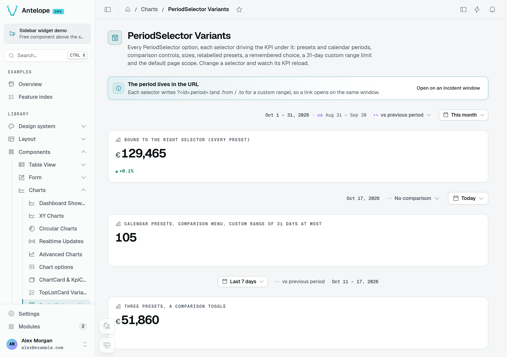
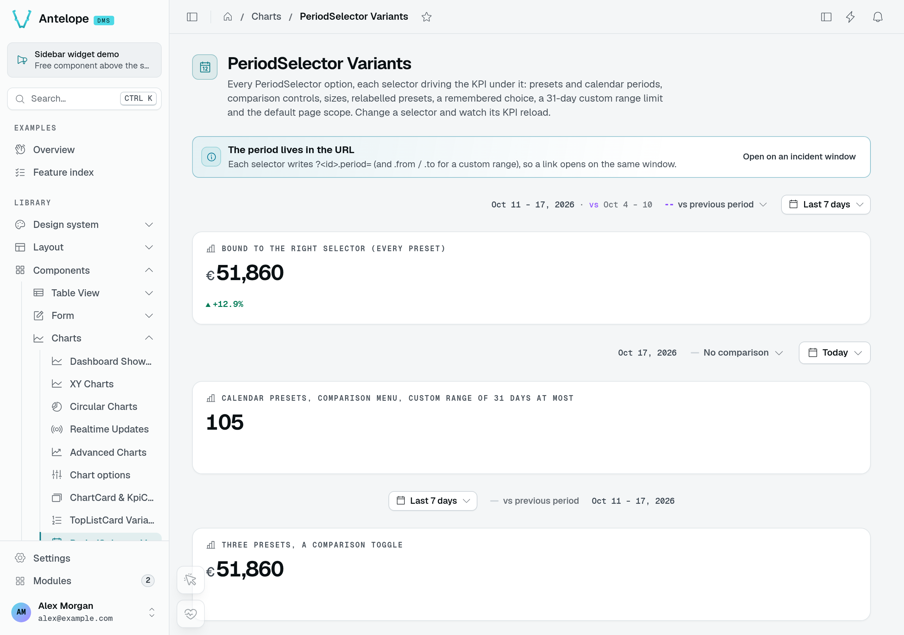
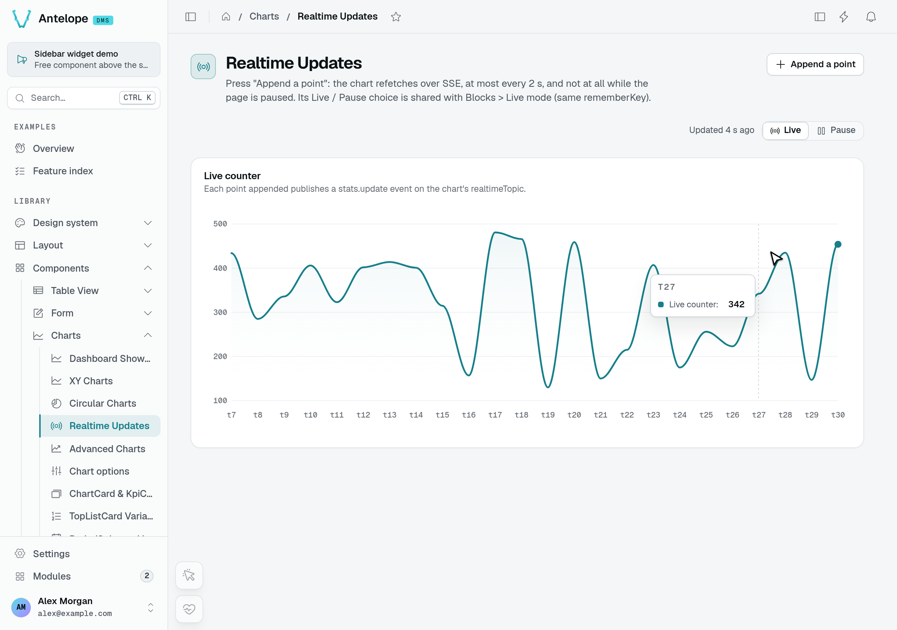
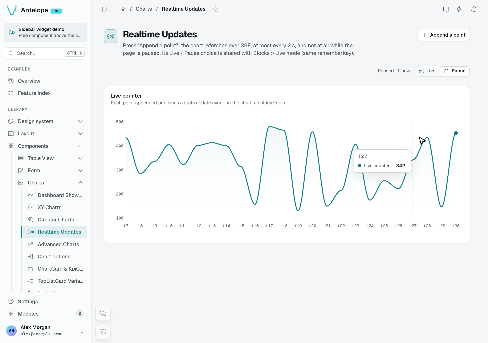
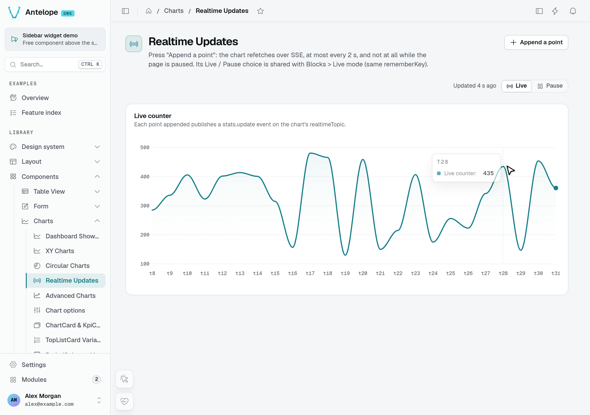

# Period filtering

A dashboard date-range is shared, not passed. A `PeriodSelector` resolves the chosen preset and comparison into a `PeriodState` and **publishes** it under a string `id`; every widget naming that same string in its `periodScope` **reads** the state and refetches when it changes. A client-side registry keyed by id mediates between them — no `provide`/`inject`, no prop drilling, producer and consumers anywhere on the page.

This page covers the linking mechanism; the page-level components — `PeriodSelector` and the chart/card widgets — are in [Charts & widgets](/docs/components/charts-and-widgets).

## See a shared period change

On the playground's **PeriodSelector Variants** page, the first selector and the revenue KPI below it share `period-right`. These captures show the same demo data with **This month** (€129,465) and **Last 7 days** (€51,860). The comparison changes from +0.1% to +12.9%; the calendar KPI below stays at 105 because it belongs to a different scope. These are playground values, not production revenue.





Open the first **Preset** control, choose **Last 7 days**, then **Apply**. The URL changes to `period-right.period=last-7-days`; only consumers of that scope refetch.

### Live and Pause are separate from period selection

The playground's **Realtime Updates** page demonstrates incoming updates rather than date filtering. To isolate those updates, open the page in two tabs and click **Append a point** in the second tab while observing the first. With **Live** selected, the first tab refetches and advances to `t30` in this run.



Select **Pause** in the first tab and append another point in the second. The first chart stays at `t30`, makes no new data request, and displays **1 new**. Selecting **Live** catches up to `t31`.





::note
Pause stops automatic live refreshes, not explicit user actions. **Append a point** in the tab you are observing also requests a page refresh after its POST, so that tab updates even while paused. Use the two-tab procedure above to test the SSE gate; a paused toggle beside an updated chart is not proof that incoming updates were blocked. See [Live toggle](/docs/components/charts-and-widgets/live-toggle), and [What Pause freezes](/docs/building/pages-and-components#what-pause-freezes) for every block a pause holds.
::

## The contract

```ts fragment
const cleanup = registerPeriodScope(id, state); // producer side
const scope = usePeriodScope(id); // consumer side → ComputedRef<PeriodState | null>
const url = appendPeriodToUrl(baseUrl, scope.value); // fold state into a request
const preset = usePeriodScopePreset(id); // a badge naming the period → ComputedRef<PeriodState["preset"] | null>
```

- **`registerPeriodScope(id, state)`** registers a `ComputedRef<PeriodState>` under `id` and returns a cleanup — call it in `onBeforeUnmount`. Registering the same `id` from several producers is safe: the entry lives until the last one unregisters. A producer of your own (a month picker) computes its bounds in the reader's calendar, with `readerClock()` (`wall(date)` and `instant(wall)`), as `usePeriod` does: a server render then resolves them in the browser's zone, as the browser will.
- **`usePeriodScope(id)`** returns the producer's current state, or `null` when `id` is falsy or no producer is registered. The lookup is reactive, so a consumer rendered before its producer updates automatically once the selector registers. A lookup that stays unmatched logs a one-shot console warning (after 250 ms, once per id) telling you to add a `PeriodSelector` with that `id`.
- **`usePeriodScopePreset(id)`** returns the producer's preset alone (`this-month`, `last-24h`), or `null` as `usePeriodScope` does: what a badge naming the period shows, like `TopListCard`'s. A preset is the same name in every time zone and at every instant, so the server prints it whenever the selector set up before the caller, also where it leaves the bounds to the browser (below), and the browser hydrates it.
- **`appendPeriodToUrl(url, state)`** serializes the state onto a URL as query params: always `preset` and `comparison`, `from` / `to` (ISO dates) when the range has bounds — every period (`all`) has none, so a route reads their absence as no time filter — plus `compareFrom` / `compareTo` when a compare range is set. With a missing `url` or `state` it returns `url` unchanged.

::note
**On the server**, each request has its own registry, and a widget reads its scope once, as it sets up. The server renders a scoped widget with its data when it resolves the period as the browser will, and its skeleton otherwise, leaving the request to the browser once mounted:

- the server knows the browser's time zone, which the browser keeps in the `dms-time-zone` cookie: presets are calendar days in the browser's zone, and the server resolves them, the URL's days and the selector's label in it (no cookie yet on a first visit: the browser loads);
- a relative preset (`last-hour`, `last-24h`) resolves from the instant the server hands the browser with the page, so both read the same bounds;
- the selector sets up before the widget (higher on the page).

The selector itself always renders on the server with the period of the URL (see below), so the control never shows the default first.
::

## `PeriodState`

The resolved, serializable value that flows from producer to consumer:

| Field          | Type                               | Meaning                                                             |
| -------------- | ---------------------------------- | ------------------------------------------------------------------- |
| `preset`       | `PeriodPreset`                     | The chosen preset (or `"custom"`).                                  |
| `comparison`   | `PeriodComparison`                 | The chosen comparison mode.                                         |
| `range`        | `{ from: Date; to: Date } \| null` | The resolved primary date range, or `null` for `all`.               |
| `compareRange` | `{ from: Date; to: Date } \| null` | The resolved comparison range, or `null` when comparison is `none` or the range has no bounds. |
| `key`          | `string`                           | A stable digest of all of the above.                                |

Consumers watch `key` rather than the object, so a refetch fires once per real change and not on every re-render.

## Presets & comparisons

`preset` and `comparison` are **closed unions** — there is no runtime "register a preset" hook; the DMS resolves each literal's range internally. Calendar presets use day boundaries (start-of-day to end-of-day) and day-count presets include today; the two **relative** presets are the exception and keep instant bounds, so an ops dashboard can look at the last hour rather than the last calendar day. While a relative preset is active its published state re-resolves every minute, so the window actually slides and bound widgets refetch; a calendar preset re-resolves at each local midnight, so a dashboard left open overnight moves on to the new day (`today` becomes the new day, `last-7-days` drops its oldest day). `custom` and `all` never move on their own.

| Preset         | Resolved range                                              | In default menu |
| -------------- | ----------------------------------------------------------- | --------------- |
| `last-hour`    | Exactly 60 minutes ending now — not snapped to a day        | —               |
| `last-24h`     | Exactly 24 hours ending now — not snapped to a day          | —               |
| `today`        | Start to end of today                                       | —               |
| `yesterday`    | The full previous day                                       | —               |
| `last-7-days`  | 7 days ending today                                         | yes             |
| `last-30-days` | 30 days ending today                                        | yes             |
| `last-90-days` | 90 days ending today                                        | —               |
| `this-month`   | 1st of this month → end of month                            | yes             |
| `last-month`   | The full previous calendar month                            | yes             |
| `this-quarter` | Start → end of the current quarter                          | yes             |
| `last-quarter` | The full previous quarter                                   | yes             |
| `ytd`          | Jan 1 of this year → end of today                           | yes             |
| `last-year`    | The full previous calendar year                             | yes             |
| `all`          | Every period: no bounds (`range` is `null`)                 | —               |
| `custom`       | The range set via `setCustomRange` (fallback: last 30 days) | —               |

| Comparison        | Resolved compare range                                                              | In default menu |
| ----------------- | ----------------------------------------------------------------------------------- | --------------- |
| `none`            | `null` (no comparison)                                                              | yes             |
| `previous-period` | The calendar period before a month, quarter or year (`this-month`, `last-quarter`, `ytd`…, or a custom range of whole months); else the equal-length span immediately before `range`, one millisecond clear of it | yes |
| `previous-year`   | The same dates one calendar year earlier                                            | yes             |
| `custom`          | The range set via `setCustomCompareRange`                                           | —               |

A calendar period compares to the one before it in the calendar: September (`last-month`) to August, not to the 30 days before; the third quarter to the second. A period still under way — `this-month` runs to the end of the month, `this-quarter` to the end of the quarter — is compared on what has elapsed of it: on October 18, `this-month` with `previous-period` compares October 1–31 to September 1–18, and with `previous-year` to October 1–18 of last year, so a month just started does not read as a fall against a whole one. The range itself still covers the whole month, for a chart's axis; the days to come hold no data.

The defaults are `this-month` and `none`. The relative presets, `today`, `yesterday`, `last-90-days`, `all` and the two `custom` literals are valid states but only offered when you pass them in `presets` / `comparisons` — the default menu stays the business-reporting set.

## Wiring a selector to widgets

At the page-builder level you never touch the registry — you set two matching strings. Give the `PeriodSelector` an `id`, and give each widget the same value as its `periodScope`:

```ts [src/pages/dashboard.ts]
import { PeriodSelector } from "@antelopejs/interface-dms/base/period-selector";
import { ChartCard } from "@antelopejs/interface-dms/base/chart-card";
import { KpiCard } from "@antelopejs/interface-dms/base/kpi-card";
import { ChartArea } from "@antelopejs/interface-dms/base/chart";

// Producer: publishes a PeriodState under "sales"
PeriodSelector({ id: "sales", defaultPreset: "this-month" });

// Consumers: read the same scope and refetch on change
KpiCard({ title: "Revenue", fetchUrl: "/dashboard/revenue", periodScope: "sales" });
ChartCard({
  title: "Sales",
  fetchUrl: "/dashboard/sales",
  periodScope: "sales",
  chart: ChartArea({ smooth: true }),
});
```

Under the hood each widget reads its `fetchUrl` through [`useApiData`](/docs/frontend-composables/authenticated-requests), with the range and comparison params appended, and reads again when the period changes (debounced — the first read runs immediately). While a `periodScope` is set but unresolved nothing is requested: a typo'd id leaves the widget empty, plus the console warning, until a selector with that id mounts.

A widget shows the comparison the selector applies. A [`KpiCard`](/docs/components/charts-and-widgets/kpi-card#comparison) prints the value compared against (`previousValue`) next to its change and names the comparison ("vs previous year") unless its `compareLabel` or `description` says otherwise; a [`ChartCard`](/docs/components/charts-and-widgets/chart-card) names its comparison series after it. With **No comparison** selected, or a period with nothing to compare against (`all`), the request carries no `compareFrom` / `compareTo`, and the KPI cards, chart cards and top lists hide their change, the value compared against and the comparison label, whatever the route answers.

Use multiple distinct ids on one page to drive disjoint widget groups independently; reuse one id to move a group together. A widget with **no** `periodScope` ignores the registry entirely and fetches its raw `fetchUrl`.

A [`TableView.fromSource`](/docs/components/tables/source-tables) table takes a `periodScope` too: its route and its tab counters are sent the same parameters, the table lists again when the period changes, and its rows and its tab counters keep their skeleton until the scope registers — on the server too, under the rules of the note above, so the server render and the browser's hydration agree.

## The period in the page URL

Every `PeriodSelector` keeps its period in the page URL. There is no option: a dashboard link, a bookmark or a reload always opens the period it was showing. The keys are prefixed with the selector's `id`, like a table view's (`?requests.tab=`), so several selectors on one page never read each other's:

| Selection           | URL                                                                   |
| ------------------- | --------------------------------------------------------------------- |
| A preset            | `?sales.period=last-7-days&sales.compare=previous-period`              |
| A custom range      | `?sales.from=2026-10-01&sales.to=2026-10-31&sales.compare=none`        |
| A custom comparison | adds `&sales.compareFrom=2025-10-01&sales.compareTo=2025-10-31`        |
| Every period        | `?sales.period=all&sales.compare=none`                                 |

A bound is an ISO date (`2026-10-01`, the whole local day: its start for `from`, its end for `to`) or an ISO date-time (`2026-10-01T08:00:00Z`, that instant). A range picked in the calendar is written as bare dates.

On load the selector takes its period from, in order:

1. **The URL** — its own keys only.
2. **The user's last choice** on that selector of that page — or, with `rememberKey`, on any selector carrying the same key, so a module's pages share one period — kept in the browser (in the `dms-preferences` cookie, so the server reads it too; only the 20 most recent selectors are kept).
3. **`defaultPreset` / `defaultComparison`.**

The range and the comparison are resolved apart: `?sales.period=ytd` alone takes the comparison from the next source. A value the selector cannot honour — an unknown preset, one missing from its `presets` / `comparisons`, a malformed date, a range ending before it starts, `custom` without its dates — is skipped silently for the next source. One exception: a URL naming `from` / `to` opens on that range even when `custom` is not offered — a link framing an incident's window, say. No preset is selected then, and the range is not remembered as the user's choice.

The selector resolves its period during setup, on the server as well, so the server-rendered page already shows the URL's period. Once mounted it writes that period into the URL, so a copied URL always carries it, the default included. A change writes the URL in place: the history entry is replaced rather than pushed, so Back leaves the page instead of walking through every pick, and the page is not requested again — only the bound widgets refetch. The route's query (`useDmsRoute().query`) follows each write at once, before Inertia's page catches up, so a tab, a quick action or a module component building a query from the route afterwards keeps the new period; there is no need to read `window.location`. A navigation that changes the selector's keys (Back to the page with another period, a link) moves the period with it.

### Carrying the period on a link

A link from one page to another keeps the period when the target page's selector has the same `id`. A declared link — a page header button, a `TopListItem.to`, a `page` row action — names the keys with `{{query.X}}` tokens, a pair the page has no value for being left out: `"/sales/region?id=eu&sales.period={{query.sales.period}}&sales.compare={{query.sales.compare}}&sales.from={{query.sales.from}}&sales.to={{query.sales.to}}"`. A module component builds it with `withPeriodQuery(link, route.query, id)`, which adds what the page holds under the selector's six keys (`periodQueryKeys(id)`), the link's own keys winning:

```ts fragment
const route = useDmsRoute();
const reportLink = computed(() =>
  withPeriodQuery(`/modules/shop/report?id=${id}`, route.query, "sales"),
);
// "/modules/shop/report?id=42&sales.period=last-7-days&sales.compare=none"
```

## Public layer API

Everything on this page is part of the layer's **public surface**, auto-imported in any frontend layer — your module's components included. No import statement, no deep path:

| Auto-imported                                                            | Kind      |
| ------------------------------------------------------------------------ | --------- |
| `usePeriod`, `usePeriodScope`, `registerPeriodScope`, `appendPeriodToUrl`, `periodQueryKeys`, `withPeriodQuery` | functions |
| `PeriodState`, `PeriodRange`, `PeriodPreset`, `PeriodComparison`, `PeriodQueryKeys` | types     |
| `DEFAULT_PRESETS`, `DEFAULT_COMPARISONS`, `MS_PER_HOUR`, `MS_PER_DAY`, `END_OF_DAY_*` | constants |

That is what lets a module own a period scope without a `PeriodSelector` anywhere on the page — see the section below. The URL keys and the remembered choice belong to the stock `PeriodSelector`: a control built on `usePeriod` keeps its period wherever it wants.

## `usePeriod`

When the stock `PeriodSelector` UI doesn't fit, build your own control on `usePeriod` — the reactive state machine behind it. It owns the preset/comparison/custom refs and derives the resolved `state` you publish.

`usePeriod(options?)` returns:

| Member                                    | Kind                       | Purpose                                                                                    |
| ----------------------------------------- | -------------------------- | ------------------------------------------------------------------------------------------ |
| `preset`, `comparison`                    | `Ref`                      | The selected preset / comparison literals.                                                 |
| `customRange`, `customCompareRange`       | `Ref<PeriodRange \| null>` | User-picked ranges backing the `custom` modes.                                             |
| `presets`, `comparisons`                  | `ComputedRef<[]>`          | The offered options (from `options` or the defaults).                                      |
| `state`                                   | `ComputedRef<PeriodState>` | The resolved state to hand to `registerPeriodScope`.                                       |
| `setPreset`, `setComparison`              | setters                    | Switch preset / comparison.                                                                |
| `setCustomRange`, `setCustomCompareRange` | setters                    | Set a custom range; a non-null value **auto-flips** `preset` / `comparison` to `"custom"`. |

`options` accepts `defaultPreset`, `defaultComparison`, `presets`, and `comparisons` (the last two narrow the offered menus).

To act as a producer, register `state` and clean up on unmount — exactly what `PeriodSelector` does:

```vue [app/components/MyPeriodControl.vue]
<script setup lang="ts">
import { onBeforeUnmount } from "vue";

const props = defineProps<{ id: string }>();
const period = usePeriod({ defaultPreset: "this-quarter" });

// Publish under the scope id, and release it on unmount.
const cleanup = registerPeriodScope(props.id, period.state);
onBeforeUnmount(cleanup);
</script>

<template>
  <button @click="period.setPreset('last-month')">Last month</button>
  <button @click="period.setComparison('previous-year')">vs last year</button>
</template>
```

Any widget pointing its `periodScope` at `props.id` now follows your control just as it would the stock selector.

A module control is free to bypass presets entirely and publish arbitrary ranges through `setCustomRange` — a billing-month picker with its own labels, for instance:

```vue [app/components/BillingMonthPicker.vue]
<script setup lang="ts">
const props = defineProps<{ scopeId: string }>();

const period = usePeriod();
const cleanup = registerPeriodScope(props.scopeId, period.state);
onBeforeUnmount(cleanup);

function selectMonth(range: PeriodRange) {
  period.setCustomRange(range);
  period.setComparison("previous-period");
}
</script>
```

Mount it with `CustomComponent("BillingMonthPicker").options({ scopeId: "billing" })` and give the surrounding `KpiCard`s `periodScope: "billing"`; they pick up the range and their comparison deltas through the same registry as any other scope. The playground's *PeriodSelector Variants* page runs exactly this setup.
