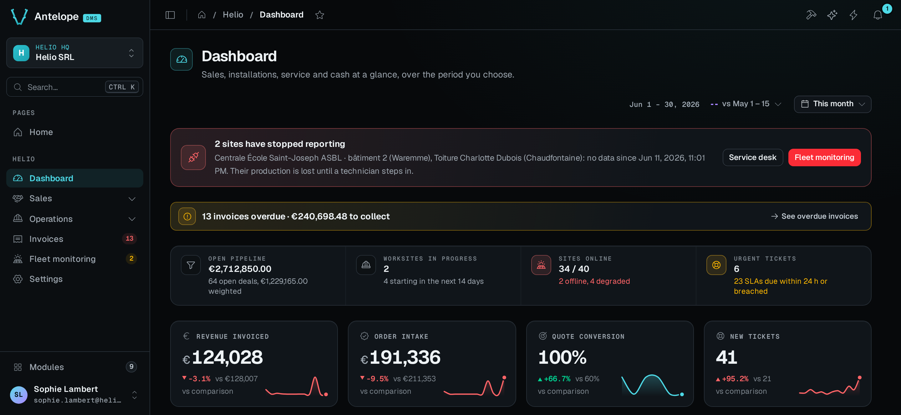
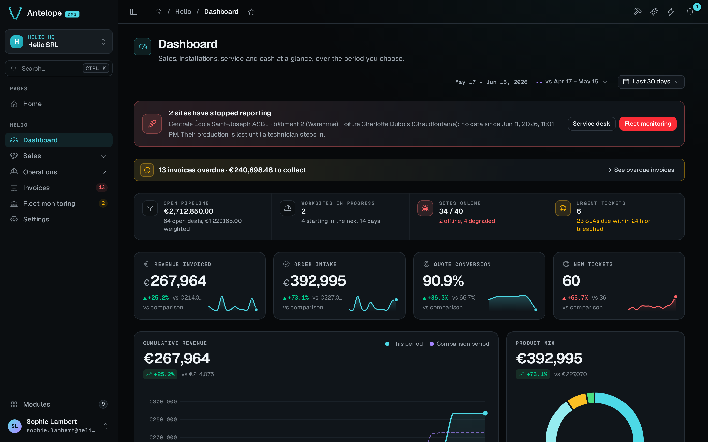

A dashboard shares its date range through a registry instead of passing it down. A `PeriodSelector` resolves the chosen preset and comparison into a `PeriodState` and **publishes** it under a string `id`. Every widget that names the same string in its `periodScope` **reads** that state and fetches again when it changes. A client-side registry keyed by id sits between them, so the selector and its widgets can sit anywhere on the page, with no `provide`, `inject` or props.

This page covers the link between them. The components themselves, `PeriodSelector` and the chart and card widgets, are in [Charts & widgets](/docs/components/charts-and-widgets).

## A shared period on the Helio dashboard

On the Helio demo's dashboard, the period selector and every KPI card and chart below it share the scope `helio`. Switch the selector between **This month** and **Last 30 days**. The URL changes to `?helio.period=last-30-days`, and each widget bound to `helio`, the revenue KPI among them, fetches its data for the new period.





### Live and Pause are separate from the period

The **Live** toggle of a page declared with `live` controls the updates that arrive by themselves, not the period. To see it, open the playground's **Realtime Updates** page in two tabs and click **Append a point** in the second tab. With **Live** selected, the chart in the first tab reads again and shows the new point. Select **Pause** in the first tab and append another point from the second. The first chart keeps its points, makes no request and shows **1 new**. Select **Live** again and the chart reads once and shows the point it missed.

::note
Pause holds the reads that arrive by themselves, not the user's own actions. **Append a point** in the tab you watch asks the page to refresh after its POST, so that tab reads the point even while paused. Test the pause from a second tab, as above. While its page is paused, a `PeriodSelector` also stops following the clock (see [Presets and comparisons](#presets-and-comparisons)). See [Live toggle](/docs/components/charts-and-widgets/live-toggle), and [What Pause freezes](/docs/building/pages-and-components#what-pause-freezes) for every block a pause holds.
::

## The contract

```ts fragment
const cleanup = registerPeriodScope(id, state);
const scope = usePeriodScope(id);
const url = appendPeriodToUrl(baseUrl, scope.value);
const preset = usePeriodScopePreset(id);
const comparison = usePeriodScopeComparison(id);
```

- **`registerPeriodScope(id, state)`** registers a `ComputedRef<PeriodState>` under `id` and returns a cleanup function. Call the cleanup in `onBeforeUnmount`. Several producers can register the same `id`: the last registration's state is the one read, and the entry stays until the last producer calls its cleanup. A producer of your own, such as a month picker, computes its bounds in the reader's calendar with `readerClock()` (`wall(date)` and `instant(wall)`), as `usePeriod` does. A server render then resolves them in the browser's time zone.
- **`usePeriodScope(id)`** returns a `ComputedRef<PeriodState | null>`: the producer's current state, or `null` when `id` is empty or no producer has registered it. The lookup is reactive, so a widget rendered before its selector updates once the selector registers. A lookup that finds no producer logs a console warning after 250 ms, once per id, telling you to add a `PeriodSelector` with that `id`.
- **`usePeriodScopePreset(id)`** returns the producer's preset alone (`this-month`, `last-24h`), or `null` as `usePeriodScope` does. A badge naming the period, like `TopListCard`'s, reads it. A preset has the same name in every time zone and at every instant, so the server prints it whenever the selector set up before the caller, even when the server leaves the bounds to the browser (below).
- **`usePeriodScopeComparison(id)`** returns the comparison the scope applies, or `null` as `usePeriodScope` does. It returns `none` when the comparison resolves to no range, so a widget hides its comparison exactly when the request carries no `compareFrom` and `compareTo`.
- **`appendPeriodToUrl(url, state)`** adds the state to a URL as query parameters. It always adds `preset` and `comparison`. It adds `from` and `to`, as ISO date-times, when the range has bounds. Every period (`all`) has none, so a route reads their absence as no time filter. It adds `compareFrom` and `compareTo` when a comparison range is set. With no `url` or no `state`, it returns `url` unchanged.

::note
**On the server**, each request has its own registry, and a widget reads its scope once, as it sets up. The server renders a scoped widget with its data when it resolves the period as the browser will. Otherwise it renders the skeleton and leaves the request to the browser, once mounted. The server resolves the period as the browser will when all of these hold:

- The server knows the browser's time zone. The browser keeps it in the `dms-time-zone` cookie. Presets are calendar days in the browser's zone, and the server resolves the presets, the URL's days and the selector's label in that zone. On a first visit there is no cookie yet, and the browser loads the data.
- A relative preset (`last-hour`, `last-24h`) resolves from the instant the server hands the browser with the page, so both read the same bounds.
- The selector sets up before the widget, which means it sits higher on the page.

The selector itself always renders on the server with the period of the URL (see below), so the control never shows the default first.
::

## `PeriodState`

`PeriodState` is the resolved value that goes from the producer to the widgets:

| Field          | Type                               | Meaning                                                             |
| -------------- | ---------------------------------- | ------------------------------------------------------------------- |
| `preset`       | `PeriodPreset`                     | The chosen preset, or `"custom"`.                                   |
| `comparison`   | `PeriodComparison`                 | The chosen comparison.                                              |
| `range`        | `PeriodRange \| null`              | The resolved range, `{ from: Date; to: Date }`, or `null` for `all`. |
| `compareRange` | `PeriodRange \| null`              | The resolved comparison range, or `null` when the comparison is `none` or the range has no bounds. |
| `key`          | `string`                           | A string built from all of the above.                               |

A widget watches `key` rather than the object, so it fetches once per real change.

## Presets and comparisons

`PeriodPreset` and `PeriodComparison` are closed unions. There is no way to register a preset at runtime, and the DMS resolves each literal's range itself.

- Calendar presets snap to day boundaries, from the start of the first day to the end of the last. Presets that count days include today.
- The two relative presets keep exact instants, so an operations dashboard can show the last hour rather than the last calendar day. While one is active, its state resolves again every minute, so the range slides and the bound widgets fetch again.
- A calendar preset resolves again at each local midnight, so a dashboard left open overnight moves on to the new day: `today` becomes the new day, and `last-7-days` drops its oldest day.
- `custom` and `all` never move by themselves.

| Preset         | Resolved range                                              | In the default menu |
| -------------- | ----------------------------------------------------------- | ------------------- |
| `last-hour`    | Exactly 60 minutes ending now, not snapped to a day         | no                  |
| `last-24h`     | Exactly 24 hours ending now, not snapped to a day           | no                  |
| `today`        | The start to the end of today                               | no                  |
| `yesterday`    | The whole previous day                                      | no                  |
| `last-7-days`  | 7 days ending today                                         | yes                 |
| `last-30-days` | 30 days ending today                                        | yes                 |
| `last-90-days` | 90 days ending today                                        | no                  |
| `this-month`   | The 1st of this month to the end of the month               | yes                 |
| `last-month`   | The whole previous calendar month                           | yes                 |
| `this-quarter` | The start to the end of the current quarter                 | yes                 |
| `last-quarter` | The whole previous quarter                                  | yes                 |
| `ytd`          | January 1 of this year to the end of today                  | yes                 |
| `last-year`    | The whole previous calendar year                            | yes                 |
| `all`          | Every period, with no bounds (`range` is `null`)            | no                  |
| `custom`       | The range set with `setCustomRange`, else the last 30 days  | no                  |

| Comparison        | Resolved comparison range                                                           | In the default menu |
| ----------------- | ----------------------------------------------------------------------------------- | ------------------- |
| `none`            | `null`, no comparison                                                               | yes                 |
| `previous-period` | For a month, a quarter or a year (`this-month`, `last-quarter`, `ytd`, or a custom range of whole months), the calendar period before it. Otherwise, the span of equal length right before `range`, one millisecond clear of it. | yes |
| `previous-year`   | The same dates one calendar year earlier                                            | yes                 |
| `custom`          | The range set with `setCustomCompareRange`                                          | no                  |

A calendar period compares to the one before it in the calendar. September (`last-month`) compares to August, not to the 30 days before, and the third quarter compares to the second. A period still under way compares on the part that has elapsed. On October 18, `this-month` with `previous-period` compares October 1 to 31 with September 1 to 18. With `previous-year`, it compares with October 1 to 18 of last year. A month that has just started then does not read as a fall against a whole month. The range itself still covers the whole month, for a chart's axis, and the days to come hold no data.

The defaults are `this-month` and `none`. The relative presets, `today`, `yesterday`, `last-90-days`, `all` and the two `custom` literals are valid states, but the selector offers them only when you pass them in `presets` or `comparisons`.

## Wiring a selector to widgets

A page builder never touches the registry. It sets two matching strings: the `PeriodSelector`'s `id` and each widget's `periodScope`.

```ts [src/pages/dashboard.ts]
import { PeriodSelector } from "@antelopejs/interface-dms/base/period-selector";
import { ChartCard } from "@antelopejs/interface-dms/base/chart-card";
import { KpiCard } from "@antelopejs/interface-dms/base/kpi-card";
import { ChartArea } from "@antelopejs/interface-dms/base/chart";

PeriodSelector({ id: "sales", defaultPreset: "this-month" });

KpiCard({ title: "Revenue", fetchUrl: "/dashboard/revenue", periodScope: "sales" });
ChartCard({
  title: "Sales",
  fetchUrl: "/dashboard/sales",
  periodScope: "sales",
  chart: ChartArea({ smooth: true }),
});
```

Each widget reads its `fetchUrl` through [`useApiData`](/docs/frontend-composables/authenticated-requests), with the period's parameters added. Its first read runs at once. When the period changes, it reads again once the inputs have held still for 180 ms, so a period changed and changed back requests nothing. While its scope has no producer, the widget requests nothing and shows its loading state. After 10 seconds it stops waiting and shows no data. A mistyped id therefore leaves the widget empty, with the console warning, until a selector with that id mounts.

A widget shows the comparison the selector applies. A [`KpiCard`](/docs/components/charts-and-widgets/kpi-card#comparison) names the comparison ("vs previous year") unless its `compareLabel` or `description` sets another text, and with `showPreviousValue` it prints the value compared against next to its change. A [`ChartCard`](/docs/components/charts-and-widgets/chart-card) names its comparison series after the comparison. With **No comparison** selected, or a period with nothing to compare against (`all`), the request carries no `compareFrom` or `compareTo`. The KPI cards, chart cards and top lists then hide their change, the value compared against and the comparison label, whatever the route answers.

Use distinct ids on one page to drive separate groups of widgets, and reuse one id to move a group together. A widget with no `periodScope` ignores the registry and fetches its `fetchUrl` as it is.

A [`TableView.fromSource`](/docs/components/tables/source-tables) table takes a `periodScope` too. Its route and its tab counters receive the same parameters, and the table lists its rows again when the period changes. Until the scope registers, the rows and the tab counters keep their skeleton, on the server too under the rules of the note above, so the server render and the browser's hydration agree.

## The period in the page URL

Every `PeriodSelector` keeps its period in the page URL, with no option to turn it off. A dashboard link, a bookmark or a reload opens the period it was showing. The keys start with the selector's `id`, like a table view's (`?requests.tab=`), so several selectors on one page never read each other's keys:

| Selection           | URL                                                                   |
| ------------------- | --------------------------------------------------------------------- |
| A preset            | `?sales.period=last-7-days&sales.compare=previous-period`              |
| A custom range      | `?sales.from=2026-10-01&sales.to=2026-10-31&sales.compare=none`        |
| A custom comparison | adds `&sales.compareFrom=2025-10-01&sales.compareTo=2025-10-31`        |
| Every period        | `?sales.period=all&sales.compare=none`                                 |

A bound is an ISO date (`2026-10-01`) or an ISO date-time (`2026-10-01T08:00:00Z`). An ISO date stands for the whole local day: its start for `from`, its end for `to`. An ISO date-time is that instant. A range picked in the calendar is written as bare dates.

On load, the selector takes its period from the first of these sources that names a valid one:

1. The URL, its own keys only.
2. The user's last choice on that selector of that page. With `rememberKey`, the last choice on any selector with the same key, so a module's pages share one period. The browser keeps the last choices of the 20 most recent selectors in the `dms-preferences` cookie, so the server reads them too.
3. `defaultPreset` and `defaultComparison`.

The selector resolves the range and the comparison separately: `?sales.period=ytd` alone takes the comparison from the next source. The selector skips a value it cannot honour, silently, and moves to the next source. Such values are an unknown preset, a preset or comparison missing from its `presets` or `comparisons`, a malformed date, a range that ends before it starts, and `custom` without its dates. One exception applies: a URL that names `from` and `to` opens on that range even when `custom` is not offered, for example a link to an incident's window. No preset is selected then, and the range is not remembered as the user's choice.

The selector resolves its period during setup, on the server as well, so the server-rendered page already shows the URL's period. Once mounted, the selector writes that period into the URL, so a copied URL always carries it, the default included. A change writes the URL in place. The selector replaces the history entry rather than pushing a new one, so Back leaves the page instead of walking through every pick. The page is not requested again, and only the bound widgets fetch. The route's query (`useDmsRoute().query`) follows each write at once, before Inertia's page catches up. A tab, a quick action or a module component that builds a query from the route afterwards therefore keeps the new period, with no need to read `window.location`. A navigation that changes the selector's keys, such as Back to the page with another period or a link, changes the period with it.

### Carrying the period on a link

A link from one page to another keeps the period when the target page's selector has the same `id`. A declared link, such as a page header button, a `TopListItem.to` or a `page` row action, names the keys with `{{query.X}}` tokens. The link leaves out a pair the page has no value for: `"/sales/region?id=eu&sales.period={{query.sales.period}}&sales.compare={{query.sales.compare}}&sales.from={{query.sales.from}}&sales.to={{query.sales.to}}"`.

A module component builds the link with `withPeriodQuery(link, route.query, id)`. It adds the values the page holds under the selector's six keys (`periodQueryKeys(id)`), and a key the link already names keeps the link's value:

```ts fragment
const route = useDmsRoute();
const reportLink = computed(() =>
  withPeriodQuery(`/modules/shop/report?id=${id}`, route.query, "sales"),
);
```

With `?sales.period=last-7-days&sales.compare=none` on the page and an `id` of `42`, `reportLink` is `/modules/shop/report?id=42&sales.period=last-7-days&sales.compare=none`.

## Public layer API

Everything on this page is auto-imported in any frontend layer, your module's components included, with no import statement:

| Auto-imported                                                            | Kind      |
| ------------------------------------------------------------------------ | --------- |
| `usePeriod`, `usePeriodScope`, `usePeriodScopePreset`, `usePeriodScopeComparison`, `registerPeriodScope`, `appendPeriodToUrl`, `periodQueryKeys`, `withPeriodQuery`, `readerClock` | functions |
| `PeriodState`, `PeriodRange`, `PeriodPreset`, `PeriodComparison`, `PeriodQueryKeys` | types     |
| `DEFAULT_PRESETS`, `DEFAULT_COMPARISONS`, `MS_PER_HOUR`, `MS_PER_DAY`, `END_OF_DAY_HOURS`, `END_OF_DAY_MINUTES`, `END_OF_DAY_SECONDS`, `END_OF_DAY_MS` | constants |

A module can therefore own a period scope with no `PeriodSelector` on the page (see the next section). The URL keys and the remembered choice belong to the stock `PeriodSelector`. A control built on `usePeriod` keeps its period wherever it chooses.

## `usePeriod`

When the stock `PeriodSelector` does not fit, build your own control on `usePeriod`, the reactive state behind the selector. It holds the preset, comparison and custom refs, and derives the resolved `state` you publish.

`usePeriod(options?)` returns:

| Member                                    | Type                       | Purpose                                                                                    |
| ----------------------------------------- | -------------------------- | ------------------------------------------------------------------------------------------ |
| `preset`, `comparison`                    | `Ref`                      | The selected preset and comparison.                                                        |
| `customRange`, `customCompareRange`       | `Ref<PeriodRange \| null>` | The ranges the user picked for the `custom` literals.                                      |
| `presets`, `comparisons`                  | `ComputedRef`              | The offered options, from `options` or the defaults.                                       |
| `state`                                   | `ComputedRef<PeriodState>` | The resolved state to pass to `registerPeriodScope`.                                       |
| `resolvedAt`                              | `ComputedRef<Date>`        | The instant `state` was resolved from, for a label relative to now.                       |
| `setPreset`, `setComparison`              | functions                  | Set the preset or the comparison.                                                          |
| `setCustomRange`, `setCustomCompareRange` | functions                  | Set a custom range. A non-null value also sets `preset` or `comparison` to `"custom"`.    |

`options` accepts `defaultPreset`, `defaultComparison`, `presets` and `comparisons`, the last two narrowing the offered menus. It also accepts `holdClock`, a function: while it returns `true`, the period stops following the clock, and the period catches up once when it returns `false` again. A change the user makes still applies at once. Call `usePeriod` inside a component's `setup` or an `effectScope`, which stops its clock timer when disposed.

To act as a producer, register `state` and call the cleanup on unmount, as `PeriodSelector` does:

```vue [app/components/MyPeriodControl.vue]
<script setup lang="ts">
import { onBeforeUnmount } from "vue";

const props = defineProps<{ id: string }>();
const period = usePeriod({ defaultPreset: "this-quarter" });

const cleanup = registerPeriodScope(props.id, period.state);
onBeforeUnmount(cleanup);
</script>

<template>
  <button @click="period.setPreset('last-month')">Last month</button>
  <button @click="period.setComparison('previous-year')">vs last year</button>
</template>
```

Any widget whose `periodScope` is `props.id` now follows this control as it would follow the stock selector.

A module control can skip the presets and publish its own ranges through `setCustomRange`, for example a billing-month picker with its own labels:

```vue [app/components/BillingMonthPicker.vue]
<script setup lang="ts">
const props = defineProps<{ scopeId: string }>();

const period = usePeriod();
const cleanup = registerPeriodScope(props.scopeId, period.state);
onBeforeUnmount(cleanup);

function selectMonth(range: PeriodRange) {
  period.setCustomRange(range);
  period.setComparison("previous-period");
}
</script>
```

Mount it with `CustomComponent("BillingMonthPicker").options({ scopeId: "billing" })` and give the `KpiCard`s around it `periodScope: "billing"`. They read the range, and their comparison, through the same registry as any other scope. The playground's **PeriodSelector Variants** page runs this setup.
