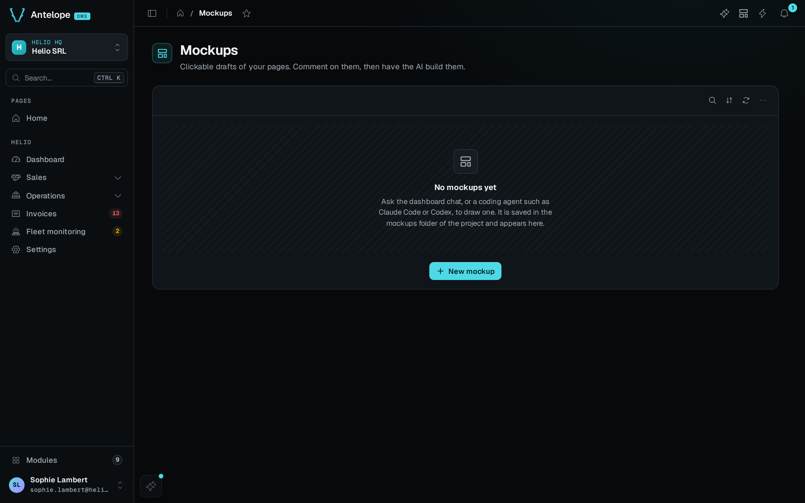
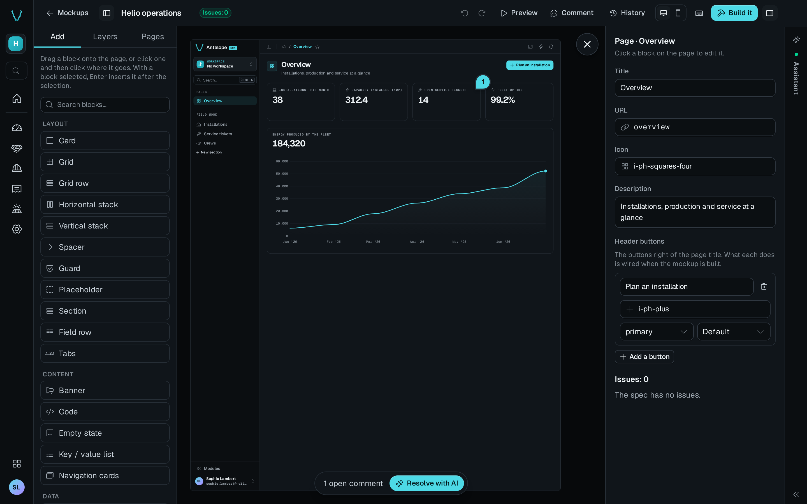

The Mockups page lists the [mockups](/docs/ai-and-claude-code/mockups) of the project. The viewer draws one mockup as the dashboard would draw its pages, and lets you edit it in place. Both exist only in development. The Mockups page is the platform owner's; the viewer opens to the owner, who edits, and to a member whose role holds **Review mockups**, who [comments](/docs/ai-and-claude-code/mockups/comments#let-a-client-review).

## Mockups page

The **Mockups** icon in the dashboard's header opens `/mockups`. The page has no menu entry. Each mockup is a card that opens it in the viewer.

A card shows:

- The first page of the mockup, drawn at desktop width.
- The title, or the folder name when the spec has no title.
- A status badge. **Draft** means the mockup was never built. **2 of 5 pages built** means the build made some of its pages. **Built** means it made them all. **Out of sync** means a built page changed after the build.
- The number of open comments, when there are any.
- The page count, where the mockup came from (the chat, Claude Code or Codex), and when the spec last changed.
- For a built mockup, a link to each page it made. A page marked **Out of sync** offers **Update from page**, which converts that page into its mockup page again.
- A menu with **Open**, **Rename**, **Duplicate** and **Delete**. **Rename** changes the title and the folder name. **Delete** asks first. The pages a mockup built stay when you delete it.

The first card is **New mockup**. It opens the assistant with the start of a request, "Draft a mockup of ", for you to finish. Without the assistant, it shows the request to copy into another AI tool.

When an agent creates a mockup while you are on the Mockups page, the viewer opens it. On any other page, a toast says `Mockup "<title>" created` and offers **Open**.

## Viewer layout

`/mockup?name=<name>` opens the viewer. It keeps the dashboard's sidebar folded to its icon rail, so settings stay one click away.

| Area | What it holds |
| --- | --- |
| Top bar | **← Mockups**, the mockup's title, **Comment**, **▶ Preview**, **History**, **Build it**, the panel buttons and the shortcuts button. |
| Left panel | The block catalog, the page's layers, and the **Pages** tab. |
| Canvas | The current page, or the [Overview](/docs/ai-and-claude-code/mockups/comments#browse-every-page-on-the-overview) of every page. |
| Right panel | The inspector of the selected block or page, or the version list of **History**. |

Click the title to rename the mockup. Enter or a click away saves it, and Escape cancels. The folder name stays the same.

The canvas draws each page as the dashboard draws it. The top bar of the dashboard, the page header with its title, icon, description and buttons, and the sidebar with the mockup's own pages all appear. None of the top bar's controls act, and the header buttons do nothing. They show what the built page will look like.

### Query parameters

| Parameter | Meaning |
| --- | --- |
| `name` | The mockup to show. Without it, `/mockup` lists the mockups. |
| `page` | The id of the page to show. Without it, the viewer opens on the Overview. |
| `record` | The row that a page with a route shows. A link from a table row passes it. |
| `width` | `desktop` or `mobile`. |
| `data` | `real` or `sample`. Sets the **Real data** switch. |

Each page you open is a new browser history entry, so the back and forward buttons step through the pages.

## Edit a page

While you edit, a click selects a block and the inspector shows its options. The inspector offers the visual options only, from the groups `content`, `appearance`, `layout` and `features`. Data wiring is not edited in the viewer. Ask the agent for it.

- **Add a block.** Drag it from the catalog onto the page. You can also click it in the catalog to arm it, then click on the page where it goes. Enter inserts the armed block after the selected one.
- **Change a block.** Move, duplicate, delete or restyle it from its toolbar or with the shortcuts. Double-click a text to edit it in place.
- **Change a page.** Click the page header to select the page. Its inspector holds the title, icon, description and header buttons. Add, rename, reorder and remove pages from the **Pages** tab.

The viewer saves each edit to `spec.json` and records it in the undo history. When another writer, such as the agent, changed the file in between, the viewer loads the file as it is now, starts a new undo history and tells you. An edit you have not saved yet survives when it is all inside the block you are editing.

### Edit together

Several people can open the same mockup. Each sees the others' changes as they are saved. The block someone selects is theirs until they select another, let it go with Escape or a click on the empty canvas, or leave: its name shows on the block's row in the **Layers** tab, and the inspector shows who is editing it and keeps its fields read-only. A block, a block it sits in or a block inside it is held by one person at a time. A lock frees when its holder saves and moves on, closes the mockup, or stays idle for 2 minutes. The agent cannot change a held block either: its write is refused and names the holder.

### Sidebar sections

A spec's `categories` are the sections of the sidebar. Pages without a category sit in the default **Pages** section. Both the sidebar in the canvas and the **Pages** tab edit the sections while you edit:

- **New section** adds one. Its id comes from its name, so `Billing` gets the id `billing`.
- Double-click a section title to rename it. Its menu also offers **Icon** and **Delete**. Deleting a section moves its pages to the default section.
- Drag a page onto a section to move it there. Drag a section to reorder the menu.

A page with `menu: false` stays out of the sidebar. The **Pages** tab still lists it, with an eye-slash mark, and lists each sub-page under its parent.

## Preview the mockup

**▶ Preview**, or `P`, hands every click to the page as the dashboard would run it. Links open their pages, rows open their row actions and buttons open their forms. Nothing can be selected or commented in Preview. Press `Esc` or the toggle again to leave it.

Outside Preview, `Ctrl` + click (`⌘` + click on a Mac) follows a block's link to another page of the mockup. A link inside a sketch opens only in Preview.

The **Real data** switch appears on a page with live routes. It reads the page's data from the routes of your running app instead of the samples. See [Live routes](/docs/ai-and-claude-code/mockups/controller-blocks#live-routes).

## Keyboard shortcuts

`?` opens the list of shortcuts. A shortcut does nothing while the focus is in a text field or a dialog. On a Mac, `Ctrl` reads `⌘` and `Alt` reads `⌥`.

| Group | Keys | Action |
| --- | --- | --- |
| Panels and help | `[` | Show or hide the edit panel. |
| Panels and help | `]` | Show or hide the inspector. |
| Panels and help | `?` | Show the shortcuts. |
| Editing | `↑` or `↓` | Select the previous or next block. |
| Editing | `Alt` + `↑` or `↓` | Move the selected block up or down. |
| Editing | `Ctrl` + `D` | Duplicate the selected block. |
| Editing | `Delete` or `Backspace` | Delete the selected block. |
| Editing | `Enter` | Insert the armed block after the selection. |
| Editing | `Esc` | Cancel the armed block or tool, then clear the selection. |
| Comments | `C` | Arm the Comment tool. |
| History | `Ctrl` + `Z` | Undo. |
| History | `Ctrl` + `Shift` + `Z` or `Ctrl` + `Y` | Redo. |
| History | `Esc` | Leave the previewed version and go back to the current one. |
| Overview | `Esc` | Close the page and go back to the Overview. |
| Overview | `Shift` + `1` | Fit every page in view. |
| Preview | `P` | Turn Preview on or off. |
| Preview | `Esc` | Leave Preview. |

On the Overview, only `?`, `Esc`, `Shift` + `1` and `C` work. In Preview, only `?`, `P` and `Esc` work.
