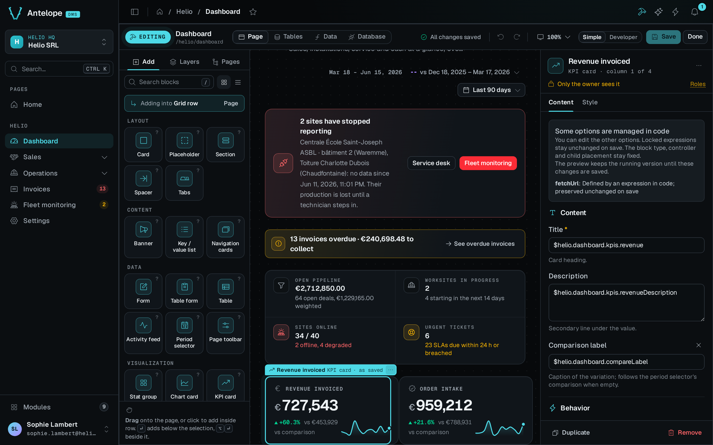

In this tutorial we save a revenue chart grouped by month without writing its data route by hand. We follow the interface calls that the visual builder makes when someone picks a table, a measure and a grouping. The calls run inside a project, so this page is not a standalone script.



Before we start, we need an existing `/shop/board` page and an `order` resource with a numeric `amount` field, a date `createdAt` field and a `status` field. Run the calls inside a project that loads the builder. Use a disposable page for the save step, because its draft replaces the page's existing blocks.

We start with all paid orders. Period controls and a comparison come after the first chart works.

## Show the data before writing anything

While the person is still choosing, `PreviewQuery` runs the calculation against the real table and answers what the route would:

```typescript
import { PreviewQuery } from "@antelopejs/interface-dms-builder";

const preview = await PreviewQuery({
  query: {
    name: "revenueChart",
    resource: "order",
    template: "series",
    params: {
      op: "sum",
      field: "amount",
      groupBy: "createdAt",
      bucket: "month",
      timezone: "Europe/Brussels",
      where: [{ field: "status", op: "eq", value: "paid" }],
    },
    response: "card",
  },
});
if (preview.ok) {
  console.log(preview.data.body); // Chart-card data from the current rows
  console.log(preview.data.truncated);
} else {
  console.error(preview.error);
}
```

Nothing is written yet. On success, `preview.data.body` holds the response that the chart card reads, headline figure included. The saved route runs the same calculation, but its values change as the rows change. The preview stops at 500 points, so check `truncated` before you treat the preview as complete. For a per-tenant resource, also pass the tenant id in the `tenant` field of the `PreviewQuery` request.

## Save the block and its data together

The query travels in the page draft, so one save writes the block, the model method and the route in a single transaction:

```typescript
import { GetPageStructure, SetPageBlocks } from "@antelopejs/interface-dms-builder";

const current = await GetPageStructure("/shop/board");
if (!current.ok) throw new Error(current.error.code);

const saved = await SetPageBlocks("/shop/board", {
  blocks: [
    {
      name: "revenueCard",
      type: "ChartCard",
      config: {
        title: "Revenue",
        fetchUrl: "/dms/pages/shop/board/stats/revenue-chart",
        chart: {
          $block: { type: "ChartArea", config: { xaxisType: "category" } },
        },
      },
    },
  ],
  queries: [
    {
      name: "revenueChart",
      resource: "order",
      template: "series",
      params: {
        op: "sum",
        field: "amount",
        groupBy: "createdAt",
        bucket: "month",
        timezone: "Europe/Brussels",
        where: [{ field: "status", op: "eq", value: "paid" }],
      },
      response: "card",
    },
  ],
}, { expectedVersion: current.data.version });
if (!saved.ok) throw new Error(saved.error.code);
```

After the backend reloads, open `/shop/board` as a tenant owner. The card reads `/dms/pages/shop/board/stats/revenue-chart` and shows the saved calculation. The blocks and the query save together, or neither changes.

The engine holds us to two details:

- Give the block and the query different names. Name the block for what it is and the query for what it answers, so the page class reads clearly.
- A `ChartCard` requires the chart it wraps. A config without `chart` fails the save with `typecheck_failed`, not with a validation issue.

## Add a period and a comparison

The first chart has no period filter. To make the chart follow a page period, we make three changes:

1. Add `periodScope` to the card, set to the id of the page's `PeriodSelector`, such as `"page"`.
2. Bind `from` and `to` in the query's date filters. See [request-time bindings](./6.queries.md#bind-a-value-at-request-time).
3. Add the `PeriodSelector` with that id to the page.

To show a comparison, set `compare: true` on the query. The route then also reads `compareFrom` and `compareTo`, which the selector sends while a comparison is on. To preview that period instead of all paid orders, pass the same filters to `PreviewQuery`, with the period values in `args`.

With those period filters added, the builder writes code of the following shape. We do not write these fragments ourselves. They show what the save produces.

A method on the resource's model:

```typescript fragment
revenueChart(minCreatedAt: Date, maxCreatedAt: Date) {
  return this.table
    .filter((row) => row.key("status").eq("paid"))
    .filter((row) => row.key("createdAt").ge(minCreatedAt))
    .filter((row) => row.key("createdAt").le(maxCreatedAt))
    .map((row) => ({
      bucket: row.key("createdAt").year("Europe/Brussels").mul(100).add(row.key("createdAt").month("Europe/Brussels")),
      value: row.key("amount"),
    }))
    .group("bucket", (rows, group) => ({ x: group, y: rows.sum("value") }))
    .orderBy("x", "asc");
}
```

A route on the page, guarded with the page's own permission:

```typescript fragment
@Get("/stats/revenue-chart")
async revenueChart(
  @AuthUserWithPermission(BoardPage) _user: User,
  @Model(OrderModel) model: OrderModel,
  @Parameter("from", "query") from: string | true | undefined,
  @Parameter("to", "query") to: string | true | undefined,
  @Parameter("compareFrom", "query") compareFrom: string | true | undefined,
  @Parameter("compareTo", "query") compareTo: string | true | undefined,
): Promise<ChartCardData> {
  return chartCardData(
    await model.revenueChart(new Date(String(from)), new Date(String(to))).run(),
    {
      measure: "sum",
      label: "Amount",
      previous: await model.revenueChart(new Date(String(compareFrom)), new Date(String(compareTo))).run(),
    },
  );
}
```

Both fragments are ordinary code in the application's own files. A developer can read, edit and own them.

`label` is what a legend and a tooltip call the series. For a measure over a field, the builder takes the field's label, or the field's name when the field has no label. For a count, which has no field, it takes the resource ref. Without a `label`, the helper falls back to the measure's own word, and the chart would show "sum".

## Reopen the chart

`GetPageStructure` reads the route and its chain back into the parameters that produced them, so the editor reopens with the chart's settings filled in:

```typescript
import { GetPageStructure } from "@antelopejs/interface-dms-builder";

const structure = await GetPageStructure("/shop/board");
if (structure.ok) {
  const source = structure.data.queries.find((q) => q.name === "revenueChart");
  console.log(source?.template); // "series"
  console.log(source?.response); // "card"
  console.log(source?.params); // Saved parameters, including explicit ordering
}
```

The read-back makes the journey repeatable in both directions. It also decides ownership. When a developer edits a chain past what the grammar accepts, the query reads back as `opaque`. From then on, the builder lists the query and can remove it, but never rewrites it.

## What we built

We now have a chart that someone configured without code. Each step rests on one part of the builder:

- The preview and the saved query use the same calculation, because one `QueryPlan` feeds both the emitter that writes the model method and the executor that runs the preview. The rows and the preview limit can still differ.
- The block and its data saved together, because `PageDraft.queries` is written in the page's transaction.
- The page reopened with its settings, because the chain reads back into its parameters.
- A developer's edit survives, because a chain the builder cannot read is opaque, and the builder never rewrites an opaque query.
- The data is not public, because the route carries the page's permission.
- A tenant reads its own rows, because the route's model provider follows the resource's schema.

## See what the block asks for

A block declares, beside its factory, the response shape it can read. The editor reads this catalog metadata to offer the calculations that fit and to find the option that controls the period. This is the `fetchUrl` option of `ChartCard`:

```typescript fragment
fetchUrl: ui(z.string().optional(), {
  label: "Data source",
  group: "data",
  widget: "dataSource",
  responseShape: "card",
  periodOption: "periodScope",
});
```

This fragment is part of a block's schema, for a block author. It is not configuration to pass to `AddBlock`. An editor reads it from [the catalog](./3.catalog.md).
